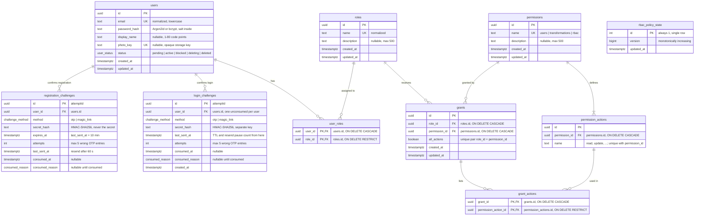

# ER diagram: first version

The tables known so far: users, the two email-confirmation challenge tables, and the 7 RBAC tables.

Sources: `task.md` (sections 2 and 3), theory `1.0`, `1.2`, `1.4`, `1.5`.

Later stages add more tables; they are not drawn yet:
`email_change_challenges`, `storage_cleanup_jobs` (stage 8), `deletion_challenges`, `deletion_jobs` (stage 9),
and the transformation history (stages 14 and 15).

## Reading the diagram

- `||--o{` means "one to zero or more": a user can have no challenges or many (old ones stay as consumed history).
- `||--|{` means "one to one or more": every permission has at least one action (`POST /admin/rbac/permissions` requires 1 to 64 actions).
- `grant_actions` and `user_roles` are **junction tables** for many-to-many links. Their primary key is the pair of foreign keys.
- `rbac_policy_state` has no relationships. It is a single-row version counter: any RBAC change increments `version`, and every app instance reloads its policy snapshot when it sees a newer one.
- `consumed_reason` values: `confirmed`, `replaced`, `attempts_exhausted`, `user_inactive`.

## Open points

- **`registration_challenges.expires_at`.** Theory `1.0` allows either storing it or computing it as `last_sent_at + 10 minutes`. Storing it is a deliberate denormalization (the table drops from BCNF to 2NF). Pick one and be ready to justify it.
- **`users.id` type.** `task.md` uses UUIDs for the RBAC tables, and `user_roles.user_id` is a UUID, so `users.id` is drawn as a UUID too.
