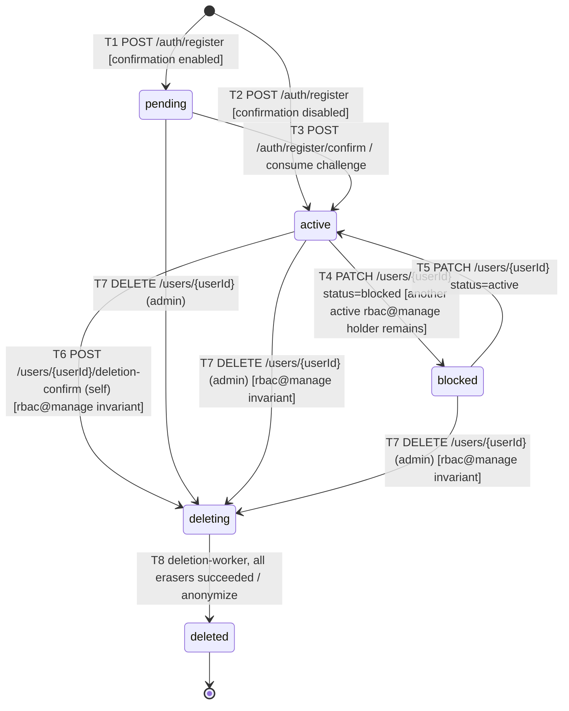

# User status: state diagram

The lifecycle of `users.status` (`pending`, `active`, `blocked`, `deleting`, `deleted`).
Every arrow is labeled with the endpoint or job that performs it, written as `event [guard] / action`.

Sources: `task.md` (sections 2 and 4), theory `0.2`, `1.0`, `1.5`, `1.6`.

## Transitions

| # | From → To | Caused by | Permission | Guard | Side effects in the same transaction |
| --- | --- | --- | --- | --- | --- |
| T1 | — → `pending` | `POST /auth/register` | public | `REGISTRATION_EMAIL_CONFIRMATION_ENABLED = true` | create a `registration_challenges` row; send the email; **202** |
| T2 | — → `active` | `POST /auth/register` | public | `REGISTRATION_EMAIL_CONFIRMATION_ENABLED = false` | assign the `user` role; **201** |
| T3 | `pending` → `active` | `POST /auth/register/confirm` | public | the challenge is valid, not expired, not consumed | consume the challenge with `confirmed` |
| T4 | `active` → `blocked` | `PATCH /users/{userId}` with `status: "blocked"` | `users@update_any` | at least one **other active** user with `rbac@manage` remains, checked under the shared RBAC lock | consume open login and email-change challenges with `user_inactive` |
| T5 | `blocked` → `active` | `PATCH /users/{userId}` with `status: "active"` | `users@update_any` | — | — |
| T6 | `active` → `deleting` | `POST /users/{userId}/deletion-confirm` (self, after `POST /users/{userId}/deletion-challenge`) | `users@delete`, path matches `sub` | valid deletion challenge; if the user holds `rbac@manage`, another active holder remains | create the `deletion_jobs` row (`jobId` = `Idempotency-Key`); delete `user_roles`; bump `rbac_policy_state.version`; consume the user's challenges; expire the cookies; **202** |
| T7 | `pending` / `active` / `blocked` → `deleting` | `DELETE /users/{userId}` (admin, someone else's id only) | `users@delete` + `users@delete_any` | for `active` / `blocked`: if the target holds `rbac@manage`, another active holder remains | create the `deletion_jobs` row (`jobId` = `Idempotency-Key`); delete `user_roles`; bump `rbac_policy_state.version`; consume the target's challenges; **202** |
| T8 | `deleting` → `deleted` | `deletion-worker`, final transaction | — (background job) | all erasers (avatar, personal data, data purge) succeeded | tombstone email, clear `display_name`, `photo_key`, `password_hash`, delete challenges, mark the job `succeeded` |

## Transitions that must never happen

Any transition that is not on the diagram is rejected. The main cases:

| Request | Current status | Result |
| --- | --- | --- |
| `PATCH /users/{userId}` with `status` = `pending`, `deleting` or `deleted` | any | rejected: PATCH can only set `active` or `blocked`. The theory doesn't name the code (most likely **400** validation), so **confirm with the mentor** |
| `PATCH /users/{userId}` (any field) | `pending`, `deleting`, `deleted` | **409** |
| `PUT /users/{userId}/photo` | `pending`, `deleting`, `deleted` | **409** |
| `PATCH /users/{userId}` with `status: "blocked"` that would leave 0 active `rbac@manage` holders | `active` | **409**, nothing changes |
| `DELETE /users/{userId}` with your own id | `active` | **403** `self_confirmation_required`: self-deletion goes through the email-confirmed flow (T6) |
| `POST /users/{userId}/deletion-challenge` | user already has a deletion job | **409**, no email is sent |
| Any authenticated request by the user | anything except `active` | **401** `invalid_session` |

## Notes

- **No-op.** `PATCH` with the status the user already has is a successful no-op and does not change `updated_at`.
- **Failed deletion job.** If the worker exhausts its retries, the job becomes `failed`, but the user **stays** `deleting`. It never goes back to `active`. A repeated `DELETE /users/{userId}` re-queues the same job; it does not create a new one.
- **Repeated delete.** `DELETE /users/{userId}` on a user who already has a job returns **202** with the existing `jobId` and status instead of creating a new transition (idempotency).
- **`deleted` is final.** The row is kept for referential integrity (a tombstone with an anonymized email), but no operation moves it to another status.
