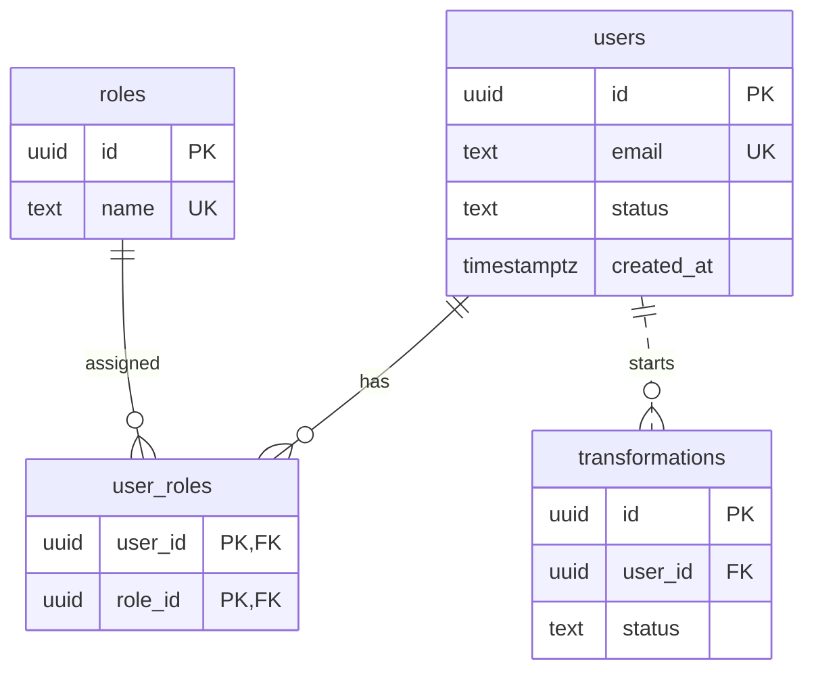

# Databases

## Contents

- [Types of Databases](#types-of-databases)
- [The Relational Model](#the-relational-model)
- [Keys, Constraints, and Relationships](#keys-constraints-and-relationships)
- [SQL](#sql)
- [Normal Forms](#normal-forms)
- [Transactions and ACID](#transactions-and-acid)
- [Indexes](#indexes)
- [Working with the Database from an Application](#working-with-the-database-from-an-application)
- [Common Mistakes](#common-mistakes)
- [Useful Links](#useful-links)
- [Theory Questions](#theory-questions)

## Types of Databases

A database is an organized set of data. A DBMS is a program that stores the data, executes queries, checks constraints, and shares access between clients. PostgreSQL is a DBMS, and `myapp` inside it is a database.

| Type | Examples | When it fits |
| --- | --- | --- |
| Relational: tables, schema, key-based relationships, SQL | PostgreSQL, MySQL, SQLite | related business data with transactions: users, roles, operation history |
| Document: JSON-like documents | MongoDB | an object that is read as a whole, without complex relationships |
| Key-value | Redis, Memcached | cache, rate limit counters, data with a TTL |
| Search | Elasticsearch | full-text search. The source of truth remains in the primary DB |
| Graph | Neo4j | relationships many levels deep: recommendations, routes |

OLTP — many short operations on individual rows (login, order). OLAP — rare heavy aggregates over large volumes. PostgreSQL is designed for OLTP.

A relational DB is the default choice for business data. Other types are added for a task that a relational one handles poorly. In PostgreSQL, some of these tasks are covered by extensions: `jsonb`, full-text search, PostGIS, pgvector.

## The Relational Model

Data is stored in tables. A row describes one object, a column describes one property of a fixed type. The order of rows is undefined: without `ORDER BY`, the DBMS is free to return them in any order.

| Data | PostgreSQL type | Why |
| --- | --- | --- |
| identifier | `uuid` or `bigint GENERATED ALWAYS AS IDENTITY` | a `uuid` can be created before insertion and does not reveal the number of records |
| string | `text` | `varchar(n)` is just as fast and only limits the length |
| money | `numeric(12, 2)` | `real` and `double precision` produce rounding errors |
| point in time | `timestamptz` | stored in UTC. `timestamp` without a zone does not know the time zone |
| document | `jsonb` | for data without a fixed structure. Fields used for filters and relationships are separate columns |

`NULL` means "the value is unknown". A comparison with `NULL` yields `NULL`, so the check is written as `IS NULL`, not `= NULL`.

## Keys, Constraints, and Relationships

- **A primary key** (`PRIMARY KEY`) uniquely identifies a row, is unique, and is never `NULL`.
- **A natural key** has meaning outside the system (`email`), but may change. Therefore a surrogate `id` is made the primary key, and a `UNIQUE` constraint is created for `email`.
- **A composite key** consists of several columns, for example `(user_id, role_id)`.
- **A foreign key** (`FOREIGN KEY`) references a primary or unique key of another table. The DBMS will not save a reference to a non-existent row.

Constraints are checked by the DBMS itself on every write, so they cannot be bypassed either by parallel requests or by another client.

| Constraint | What it guarantees |
| --- | --- |
| `NOT NULL` | the value is required |
| `UNIQUE` | the value is not repeated. Without it, a `SELECT` before an `INSERT` does not protect against a race |
| `CHECK` | the value satisfies a condition, for example `status IN ('active', 'blocked')` |
| `FOREIGN KEY` | the reference points to an existing row |

When the parent is deleted: `RESTRICT` forbids deletion while references exist; `CASCADE` deletes the dependent rows; `SET NULL` nulls out the reference. Cascade fits parts that do not exist without the parent (an email confirmation attempt). Restrict fits independent entities (a role that cannot be deleted while it is assigned).

| Relationship | How it is implemented | Example |
| --- | --- | --- |
| one-to-one | a foreign key with `UNIQUE` | `user_settings.user_id` |
| one-to-many | a foreign key on the "many" side | `transformations.user_id` |
| many-to-many | a junction table with two foreign keys | `user_roles(user_id, role_id)` |



The line ends show cardinality: `||` exactly one, `|o` zero or one, `}o` zero or many. A solid line (`--`) means the foreign key is part of the child table's primary key. A dashed line (`..`) means the child table has its own `id`.

## SQL

| Group | Commands | Purpose |
| --- | --- | --- |
| DDL | `CREATE`, `ALTER`, `DROP` | structure: tables, indexes, constraints |
| DML | `SELECT`, `INSERT`, `UPDATE`, `DELETE` | data |
| TCL | `BEGIN`, `COMMIT`, `ROLLBACK` | transactions |

```sql
CREATE TABLE users (
  id         uuid PRIMARY KEY DEFAULT gen_random_uuid(),
  email      text NOT NULL UNIQUE,
  status     text NOT NULL CHECK (status IN ('pending', 'active', 'blocked', 'deleting', 'deleted')),
  created_at timestamptz NOT NULL DEFAULT now()
);

CREATE TABLE user_roles (
  user_id uuid REFERENCES users (id) ON DELETE CASCADE,
  role_id uuid REFERENCES roles (id) ON DELETE RESTRICT,
  PRIMARY KEY (user_id, role_id)
);

SELECT r.name, count(*) AS users_count
FROM roles r
JOIN user_roles ur ON ur.role_id = r.id
JOIN users u ON u.id = ur.user_id
WHERE u.status = 'active'
GROUP BY r.name
HAVING count(*) >= 2
ORDER BY users_count DESC;
```

Logical order of execution: `FROM` / `JOIN` → `WHERE` → `GROUP BY` → `HAVING` → `SELECT` → `ORDER BY` → `LIMIT`. That is why `WHERE` does not see aggregates, while `HAVING` filters groups that have already been formed.

| JOIN | Result |
| --- | --- |
| `INNER JOIN` | only rows that have a match in both tables |
| `LEFT JOIN` | all rows of the left table; without a match, the right table's columns are `NULL` |
| `FULL JOIN` | all rows of both tables |

Users without roles are found like this: `LEFT JOIN user_roles` and `WHERE user_roles.user_id IS NULL`.

## Normal Forms

Normalization removes duplication that causes anomalies. In the table `user_roles_flat(user_id, role_name, email)` with the key `(user_id, role_name)`, the email is repeated in every row of the user:

- **update** — when the email changes, all rows must be fixed; a missed one will keep the old address;
- **insert** — a user without roles cannot be saved, because `role_name` is part of the key;
- **delete** — removing the last role also deletes the email.

A functional dependency `A → B` means that the value of `A` uniquely determines `B`, for example `user_id → email`. Each subsequent form includes the requirements of the previous one.

| Form | Requirement | Violation | Fix |
| --- | --- | --- | --- |
| 1NF | one value per cell | `users.roles = 'admin,editor'` | a separate row for each pair in `user_roles` |
| 2NF | a non-key column depends on the entire composite key | `email` depends only on `user_id` | `email` is stored in `users` |
| 3NF | a non-key column does not depend on another non-key column | `transformations(id, user_id, user_email)`: `id → user_id → user_email` | the email is read from `users` via a `JOIN` |
| BCNF | the left side of any dependency is a key | see the example below | split along the violating dependency |
| 4NF | independent lists are not mixed in one table | `user_facts(user_id, role_id, phone)` | `user_roles` and `user_phones` |

**BCNF.** The table `mentoring(student, topic, mentor)`: a student has one mentor per topic, and each mentor teaches one topic (`mentor → topic`). The keys are `(student, topic)` and `(student, mentor)`. 3NF holds because all columns are key columns, but `mentor` determines `topic` without being a key. When a mentor's topic changes, the rows of all of their students will have to be edited. Splitting into `mentor_topics(mentor, topic)` and `student_mentors(student, mentor)` removes the anomaly.

In practice, a schema is brought to 3NF or BCNF. If all keys of a table consist of a single column, 3NF already implies the higher forms as well.

Denormalization is deliberate duplication for the sake of read speed, for example a user counter on a role. Each copy needs a synchronization mechanism. The price in an order line is not denormalization but a historical fact that must not change along with the product's price.

## Transactions and ACID

A transaction combines several operations: either all of them are applied, or none.

```sql
BEGIN;
DELETE FROM user_roles WHERE user_id = $1;
INSERT INTO user_roles (user_id, role_id) VALUES ($1, $2), ($1, $3);
COMMIT;
```

If any command fails with an error, the roles will remain as they were.

| Property | Meaning |
| --- | --- |
| Atomicity | applied entirely or not at all |
| Consistency | after the transaction, all schema constraints are satisfied |
| Isolation | parallel transactions affect each other only within the limits of the isolation level |
| Durability | committed data survives a server failure |

PostgreSQL defaults to Read Committed: re-reading the same row may return a different value. Repeatable Read and Serializable work with a snapshot of the data; on a conflict, a transaction may receive serialization error `40001` and must be retried.

Lost update: two transactions read `attempts = 3` and both write `4`, so one attempt is lost. It is prevented with an atomic `UPDATE ... SET attempts = attempts + 1` or `SELECT ... FOR UPDATE`.

## Indexes

An index finds rows without a full scan of the table. Reads become faster; inserts and updates become slower.

`PRIMARY KEY` and `UNIQUE` create an index automatically. A foreign key does not, so for `transformations.user_id` it is added manually.

B-tree is the default type: `=`, `<`, `>`, `ORDER BY`. A composite index works left to right: `(user_id, created_at)` speeds up a filter by `user_id` and sorting by date within a user, but barely helps a query by `created_at` alone.

```sql
CREATE INDEX transformations_user_created_idx
  ON transformations (user_id, created_at DESC, id DESC);

CREATE UNIQUE INDEX deletion_challenges_one_open_idx
  ON deletion_challenges (user_id)
  WHERE consumed_at IS NULL;
```

The second index, with a condition, expresses the rule "no more than one unconsumed attempt per user". `EXPLAIN ANALYZE` shows the plan: `Seq Scan` is a full scan, `Index Scan` uses an index. An index is not used if the column is wrapped in a function or the pattern starts with `%`.

## Working with the Database from an Application

**ORM** (Prisma, TypeORM, EF Core, SQLAlchemy) maps tables to classes and builds parameterized queries. During development, the generated SQL is inspected in the query log.

**Migrations** are schema change files in the repository. A record of applied migrations is stored in the database, so all environments arrive at the same schema. Automatic synchronization of models with the database (`synchronize` in TypeORM) is not enabled in production: it can drop a column together with its data.

**N+1** — one query for a list plus one more query for each element. Related data is loaded in a single query: `JOIN`, `WHERE user_id = ANY($1)`, `include` in Prisma, `relations` in TypeORM, `Include` in EF Core, `selectinload` in SQLAlchemy.

**Connection pool.** A new connection to PostgreSQL is expensive. A pool keeps several open connections and hands them out to queries. The sum of the pool sizes of all application instances must not exceed the server's `max_connections`.

**SQL injections.** Values are passed as parameters and never inserted into the query text.

```javascript
await client.query(`SELECT id FROM users WHERE email = '${email}'`); // vulnerable
await client.query('SELECT id FROM users WHERE email = $1', [email]); // safe
```

In .NET a parameter is denoted as `@email`, in Python as `%s`. An ORM parameterizes queries itself; raw SQL inside an ORM again requires parameters.

`SELECT *` reads unnecessary fields and may return `password_hash` to the client. Columns are listed explicitly.

## Common Mistakes

| What you see | Cause and fix |
| --- | --- |
| Roles are stored as the string `'admin,editor'` | 1NF is violated; a junction table is needed |
| Two users with the same email | uniqueness was checked only by a `SELECT` before the `INSERT`. A `UNIQUE` constraint is needed, and the conflict is turned into **409** |
| The list slows down as the table grows | there is no index for the filter and sorting |
| A `JOIN` on a foreign key is slow | PostgreSQL does not index a foreign key automatically |
| `0.1 + 0.2` yields `0.30000000000000004` | money is stored in `double precision`; `numeric` is needed |
| The time shifted by several hours | `timestamp` without a zone was used; `timestamptz` is needed |
| `password_hash` ended up in an API response | `SELECT *` or the entire ORM entity |
| A page of 20 items takes 21 queries | N+1 |
| The attempt counter misses an incorrect entry | lost update; an atomic `UPDATE` is needed |
| The schema on the server differs from the local one | changes were made manually rather than through migrations |

## Useful Links

### General

- [PostgreSQL — Tutorial](https://www.postgresql.org/docs/current/tutorial.html) — SQL by example: tables, queries, `JOIN`, transactions.
- [PostgreSQL — Constraints](https://www.postgresql.org/docs/current/ddl-constraints.html) — keys, `UNIQUE`, `CHECK`, and actions on delete.
- [PostgreSQL — Transaction Isolation](https://www.postgresql.org/docs/current/transaction-iso.html) — isolation levels.
- [PostgreSQL — Indexes](https://www.postgresql.org/docs/current/indexes.html) — index types, composite and partial indexes.
- [Use The Index, Luke](https://use-the-index-luke.com/) — indexes and query plans for developers.
- [Wikipedia — Database normalization](https://en.wikipedia.org/wiki/Database_normalization) — definitions of normal forms.
- [OWASP — SQL Injection Prevention](https://cheatsheetseries.owasp.org/cheatsheets/SQL_Injection_Prevention_Cheat_Sheet.html) — parameterized queries.
- [Mermaid — Entity Relationship Diagrams](https://mermaid.js.org/syntax/entityRelationshipDiagram.html) — ER diagram syntax.

### By Language

#### Node.js

- [Prisma — Relational data modeling](https://www.prisma.io/docs/orm/data-modeling/relational-databases) — one-to-one, one-to-many, and many-to-many relationships.
- [Prisma — How migrations work](https://www.prisma.io/docs/orm/migrations/how-migrations-work) — schema migrations.
- [TypeORM — How migrations work?](https://typeorm.io/docs/migrations/why/) — migrations and why `synchronize` is unsafe in production.
- [node-postgres — Queries](https://node-postgres.com/features/queries) — parameterized queries in `pg`.

#### .NET

- [EF Core — Relationships](https://learn.microsoft.com/en-us/ef/core/modeling/relationships) — relationships and foreign keys.
- [EF Core — Migrations](https://learn.microsoft.com/en-us/ef/core/managing-schemas/migrations/) — schema migrations.
- [Npgsql — Basic usage](https://www.npgsql.org/doc/basic-usage.html) — connecting to PostgreSQL and query parameters.

#### Python

- [SQLAlchemy — ORM Quick Start](https://docs.sqlalchemy.org/en/20/orm/quickstart.html) — models, relationships, and queries.
- [Alembic — Tutorial](https://alembic.sqlalchemy.org/en/latest/tutorial.html) — schema migrations.
- [psycopg — Passing parameters](https://www.psycopg.org/psycopg3/docs/basic/params.html) — query parameters.

## Theory Questions

1. Why are users, roles, and operation history stored in a relational database, while a key-value store is suitable for rate limit counters?
2. What anomalies occur in the table `user_roles_flat(user_id, role_name, email)`, and which normal form does it violate?
3. How does 3NF differ from BCNF, and what does a table that is in 3NF but not in BCNF look like?
4. Why does a check via `SELECT` before `INSERT` not protect against two users with the same email?
5. How do you avoid losing an incorrect code entry attempt with two parallel requests?
6. Why does the index `(user_id, created_at)` speed up the history of a single user, but not a search by date alone?
7. How do you detect the N+1 problem, and how do you load related data in a single query?
