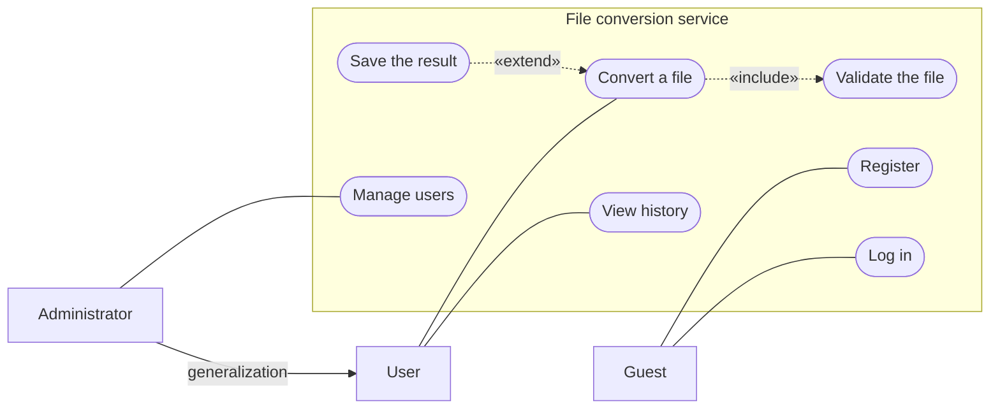
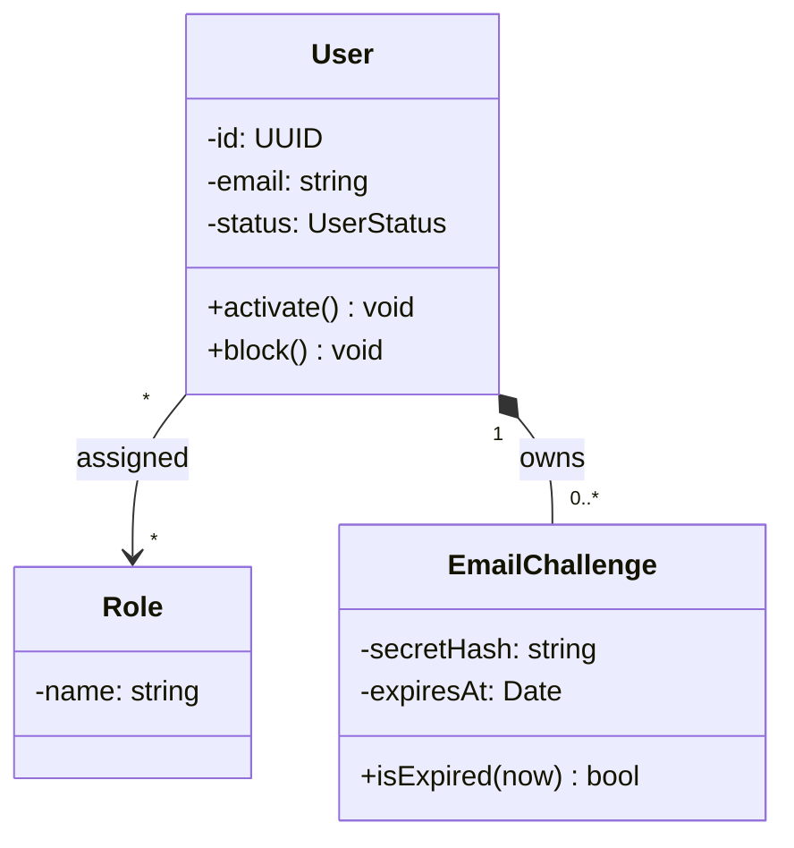
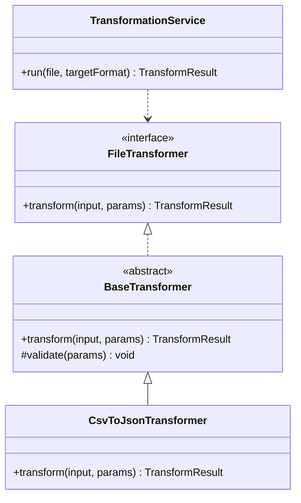
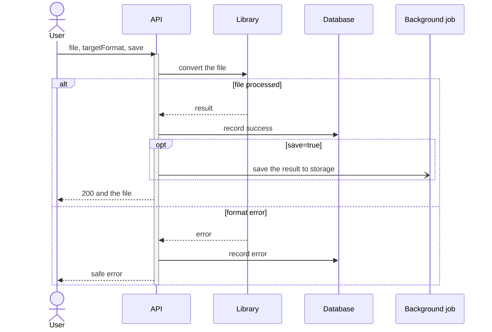
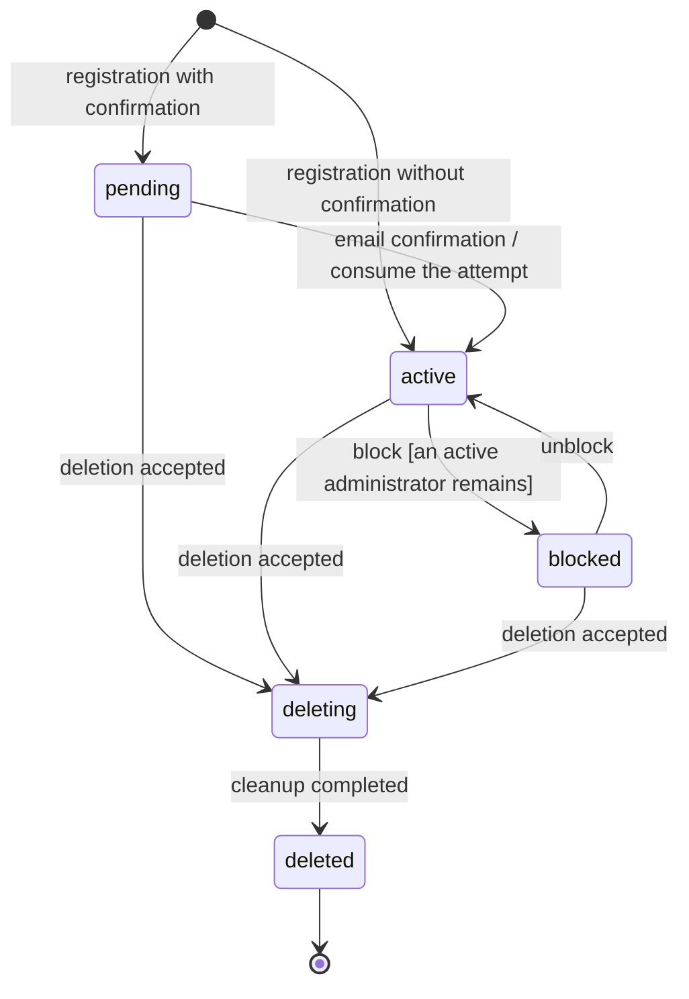
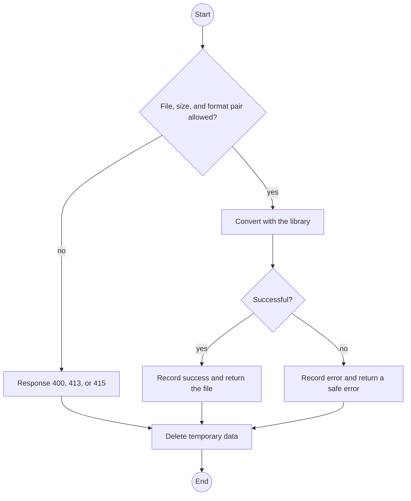
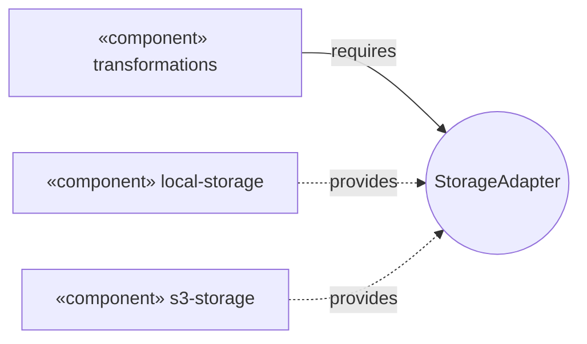
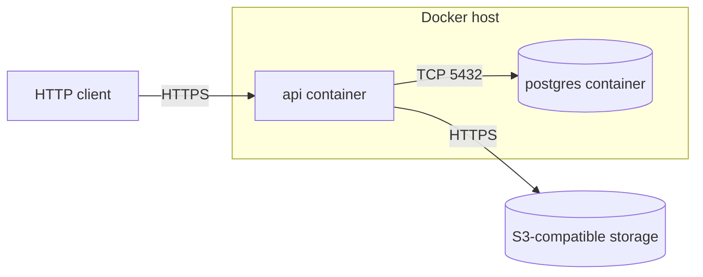

# UML Diagrams

## Contents

- [What UML Is](#what-uml-is)
- [Which Diagram to Choose](#which-diagram-to-choose)
- [General Notation](#general-notation)
- [Use Case Diagram](#use-case-diagram)
- [Class Diagram](#class-diagram)
- [Sequence Diagram](#sequence-diagram)
- [State Diagram](#state-diagram)
- [Activity Diagram](#activity-diagram)
- [Component and Deployment Diagrams](#component-and-deployment-diagrams)
- [Diagrams as Code](#diagrams-as-code)
- [Common Mistakes](#common-mistakes)
- [Useful Links](#useful-links)
- [Theory Questions](#theory-questions)

## What UML Is

UML (Unified Modeling Language) is a graphical language for describing the structure and behavior of a system. The current version is UML 2.5.1. Each diagram shows one aspect: what parts the system consists of, how the parts interact, or how the state of an object changes.

In the backend, UML is used as a sketch: to agree on a scenario, data, and module boundaries, and then to document the decision. Full formal models with code generation are rare.

| Structural | Behavioral |
| --- | --- |
| **class** | **use case** |
| **component** | **activity** |
| **deployment** | **state** |
| package, object | **sequence** |

The diagrams most often needed in the backend are in bold. A table schema is an ER diagram; it is not part of UML; its notation is covered in `0.1 Databases.md`.

## Which Diagram to Choose

| Question | Diagram | Mermaid |
| --- | --- | --- |
| Who uses the system and what goals do they achieve? | use case | no, approximated with `flowchart` |
| What classes and interfaces does a module consist of? | class | `classDiagram` |
| How does a request travel between the client, API, database, and external services? | sequence | `sequenceDiagram` |
| What statuses does an entity have and which transitions are allowed? | state | `stateDiagram-v2` |
| What steps and branches does a process have? | activity | approximated with `flowchart` |
| What parts does the system consist of and through which interfaces are they connected? | component | approximated with `flowchart` |
| On which servers and in which containers is everything running? | deployment | approximated with `flowchart` |

## General Notation

- **A stereotype** in guillemets specifies the kind of element: `«interface»`, `«include»`. In Mermaid it is written as `<<interface>>`.
- **Multiplicity:** `1` — exactly one, `0..1` — zero or one, `*` — any number, `1..*` — at least one.
- **Visibility:** `+` public, `-` private, `#` protected, `~` package.

## Use Case Diagram

Shows who interacts with the system and what goals they achieve, without implementation details.

| Element | Depiction | Meaning |
| --- | --- | --- |
| Actor | stick figure | an external role: a person or another system |
| Use case | oval | the actor's goal, phrased with a verb: "Convert a file" |
| System boundary | a rectangle around the ovals | what is part of the system |
| `«include»` | dashed line from the base use case to the included one | the included use case is always executed |
| `«extend»` | dashed line from the extension to the base one | the extension is executed only under a condition |
| Generalization | solid line with a hollow triangle at the general element | an administrator can do everything a user can |

Mermaid does not support this diagram, so the actor is drawn as a rectangle and the use case as a rounded shape:

Conversion always includes file validation. Saving to storage extends it only when `save=true`.

## Class Diagram

Shows classes and interfaces, their fields, methods, and relationships. A class is drawn as a rectangle with three sections: name, attributes, operations. Attribute: `visibility name: type`. Operation: `visibility name(parameters): type`.

| Relationship | Meaning | Depiction |
| --- | --- | --- |
| Association | objects are linked long-term | solid line |
| Aggregation | a whole and its parts; the parts exist separately | hollow diamond at the whole |
| Composition | the parts do not exist without the whole | filled diamond at the whole |
| Generalization | inheritance, "is a" | hollow triangle at the parent |
| Realization | a class implements an interface | dashed line, hollow triangle at the interface |
| Dependency | temporary usage | dashed arrow |

In Mermaid: `-->` association, `o--` aggregation, `*--` composition, `<|--` generalization, `<|..` realization, `..>` dependency.

Email confirmation attempts do not exist without a user — this is composition. A role lives separately from the user — association.

The structure of the transformers from `2.0 General Requirements for File Transformation.md`:

In TypeScript, generalization is written with `extends` and realization with `implements`. In C#, both relationships use a colon. In Python, a class inherits an abstract base class from the `abc` module.

## Sequence Diagram

Shows the exchange of messages over time. Time flows from top to bottom; each participant has a vertical lifeline.

| Element | Depiction | Mermaid |
| --- | --- | --- |
| Synchronous message | solid line, filled arrowhead, the sender waits | `A->>B: text` |
| Reply | dashed line | `B-->>A: text` |
| Asynchronous message | open arrowhead, the sender does not wait | `A-)B: text` |
| Fragment | frame: `alt` branching, `opt` optional part, `loop` loop | `alt condition` … `else` … `end` |

The API synchronously waits for the library and the history record. Saving is handed off to a background job asynchronously, so the response to the user does not wait for the storage.

## State Diagram

Shows which states an object can be in and which events move it from one state to another. A transition is labeled as `event [guard] / action`.

The user lifecycle according to `1.0`, `1.5`, and `1.6`:

The server does not perform a transition that is not on the diagram (from `deleted` to `active`). In the user update contract, such a request receives **409**.

## Activity Diagram

Shows the order of a process's actions: branches, merges, and parallel branches. Unlike a sequence diagram, what matters here are the steps, not the participants and messages.

A decision is drawn as a diamond, parallel branches as a thick bar (fork / join), and swimlanes show who performs an action. Mermaid does not support this diagram; the closest substitute is `flowchart`.

## Component and Deployment Diagrams

A component diagram shows the major parts of the system and the interfaces between them. A component provides an interface ("lollipop") or requires one ("socket"). A component can be replaced by any other implementation of the same interface.

The transformation module depends only on the storage interface, so the local disk and S3 are plugged in without changing its code.

A deployment diagram shows nodes (servers, containers), the artifacts placed on them, and communication channels.

## Diagrams as Code

Text-based diagrams are stored in the repository next to the code: changes are visible in reviews and in the Git history.

| Tool | Features |
| --- | --- |
| Mermaid | `mermaid` blocks are rendered in GitHub, Notion, and Obsidian. Supports sequence, class, state, ER, and `flowchart`. Does not support use case, component, deployment, and activity diagrams in UML notation |
| PlantUML | the full set of UML diagrams; rendering requires a server or an IDE plugin |
| draw.io | manual drawing; the `.drawio` file can be stored in the repository |

## Common Mistakes

| Mistake | The right way |
| --- | --- |
| The inheritance triangle is at the child | the triangle is always at the parent or interface |
| Composition and aggregation are chosen at random | the part is deleted together with the whole — composition; it lives separately — aggregation |
| A reply is drawn with a solid line | a reply is a dashed line; an asynchronous message has an open arrowhead |
| All scenarios and classes of the system on one diagram | one diagram answers one question |
| Use case: "Click a button" | a use case is the actor's goal: "Convert a file" |
| The `«include»` arrow goes from the included use case | `«include»` goes from the base to the included one; `«extend»` goes from the extension to the base one |
| The code allows a transition that is not on the state diagram | the checks in the code match the diagram |

## Useful Links

- [OMG — UML 2.5.1](https://www.omg.org/spec/UML/2.5.1/) — the official specification.
- [uml-diagrams.org](https://www.uml-diagrams.org/) — a reference on diagram types and notation.
- [Martin Fowler — UML Distilled](https://martinfowler.com/books/uml.html) — practical use of UML.
- [Mermaid — Sequence diagrams](https://mermaid.js.org/syntax/sequenceDiagram.html) — participants, messages, fragments.
- [Mermaid — Class diagrams](https://mermaid.js.org/syntax/classDiagram.html) — classes, relationships, multiplicity.
- [Mermaid — State diagrams](https://mermaid.js.org/syntax/stateDiagram.html) — states and transitions.
- [Mermaid — Flowcharts](https://mermaid.js.org/syntax/flowchart.html) — shapes for diagrams that Mermaid does not have.
- [Mermaid Live Editor](https://mermaid.live/) — checking a diagram in the browser.
- [PlantUML](https://plantuml.com/) — all types of UML diagrams in a text format.

## Theory Questions

1. How do structural diagrams differ from behavioral ones? Give two examples of each type.
2. How do you tell aggregation from composition, and which of them describes the relationship between a user and email confirmation attempts?
3. How does a synchronous message differ from an asynchronous one, and why is saving the result to storage asynchronous on the diagram?
4. How does the user state diagram help determine which API requests should end with **409**?
5. How does `«include»` differ from `«extend»`, and in which direction do their arrows point?
6. When is a process described with an activity diagram, and when with a sequence diagram?
7. Why is a database schema usually drawn as an ER diagram rather than a class diagram?
