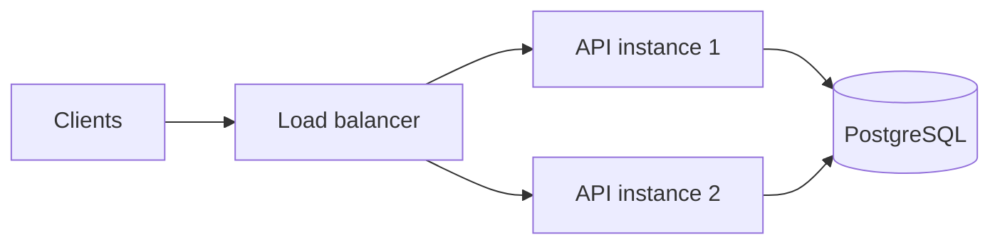
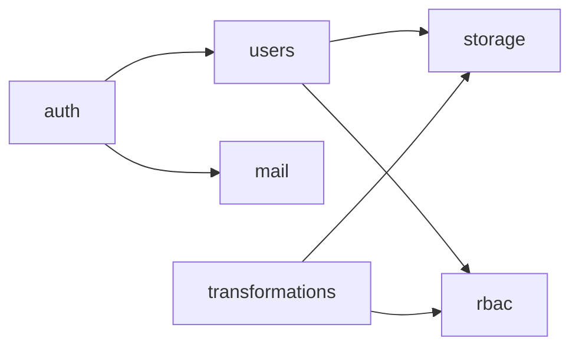
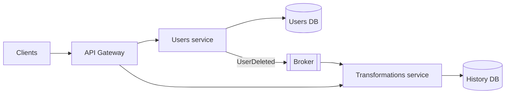
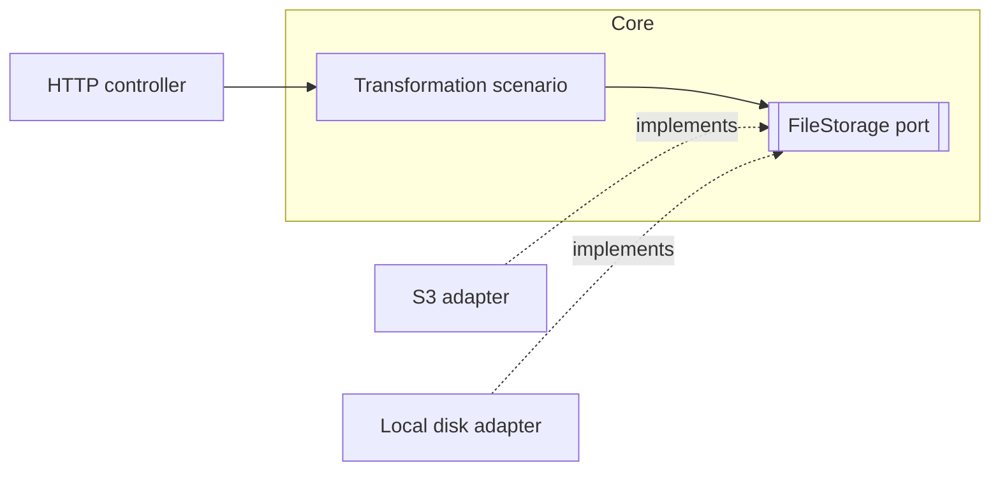

# Back End Architectures

## Contents

- [Two Levels of Architecture](#two-levels-of-architecture)
- [Monolith](#monolith)
- [Modular Monolith](#modular-monolith)
- [Microservices](#microservices)
- [SOA](#soa)
- [Serverless](#serverless)
- [Events, CQRS](#events-cqrs)
- [Architecture Inside the Application](#architecture-inside-the-application)
- [Comparison](#comparison)
- [How to Choose](#how-to-choose)
- [Common Mistakes](#common-mistakes)
- [Useful Links](#useful-links)
- [Theory Questions](#theory-questions)

## Two Levels of Architecture

The system level determines how many independently deployable parts the system consists of: monolith, microservices, SOA, serverless. The application level determines how the code inside one such part is organized: modules, layers, ports and adapters.

The course project is a monolith. The code is split into modules by business function (`auth`, `users`, `rbac`, `transformations`, `storage`), and each module is split into layers.

## Monolith

The entire application is built into a single artifact and runs as a single process with a single database. Modules call each other with ordinary function calls, without a network.

| Pros | Cons |
| --- | --- |
| one repository, one build, one deployment | any change requires rebuilding the entire application |
| calls between modules are fast and do not get lost | without explicit boundaries, the code grows together |
| one transaction covers data of any modules | an error in one module stops the entire process |
| easy to run locally | a heavily loaded part cannot be scaled separately |

A monolith scales horizontally as a whole: several identical instances run behind a load balancer. This works only if an instance does not keep state in process memory or on the local disk. In the course, this problem is solved by JWTs without server-side sessions and by object storage instead of the local disk in production.

Suitable for MVPs, small teams, and most projects at the start.

## Modular Monolith

One process and one deployment, but the code is divided into modules by business function:

- a module exposes only its public API to others. In NestJS, these are the providers from `exports`;
- a module owns its tables; other modules get data only through its API;
- dependencies point in one direction and do not form cycles;
- shared code without business logic (configuration, logging) is extracted separately.

An arrow means "calls the public API". Mutual calls between `users` and `rbac` indicate poor boundaries: the shared part is extracted into a separate module, or the call is replaced with an event.

As the load or the team grows, a module is extracted into a separate service: the in-process call is replaced with a network call, while table ownership is already separated.

## Microservices

The system consists of small services. Each is responsible for one business function, is deployed independently, and owns its own database (database per service). Communication happens over HTTP, gRPC, or through a message broker. Clients go to an API Gateway: routing, token verification, rate limiting.

After a user is deleted, the users service publishes `UserDeleted`. The transformations service receives the event and deletes its history. They do not share a transaction.

| Pros | Cons |
| --- | --- |
| services scale and are released independently | a network call is slower and may fail |
| the failure of one service does not necessarily stop the others | data becomes consistent with a delay |
| each team has its own release cycle | orchestration, tracing, and monitoring are needed |
| each service can use its own stack | debugging is harder than in a single process |

- **Saga** — an operation made of local transactions of different services. A failed step is undone by a compensating action: if a booking fails, the charged payment is refunded.
- **Distributed monolith** — services that can only be released together or that work with a shared database. It combines the downsides of both approaches.
- **Conway's Law.** The structure of a system mirrors the communication structure of the organization. Microservices pay off when several independent teams work on the system.

Suitable for large systems and for parts with very different loads.

## SOA

Service-oriented architecture is the predecessor of microservices. The services are large (customers, invoices, warehouse) and are reused by different applications. They are connected by an enterprise service bus (ESB): routing, format transformation, and often business logic as well. Communication usually happens over SOAP.

The main difference from microservices is where the integration logic lives. In SOA it lives in the bus, which becomes a bottleneck. Microservices follow the principle of "smart endpoints, dumb pipes": the logic is in the services, and the broker only delivers messages.

New projects almost never choose SOA. Suitable for integrating legacy enterprise systems.

## Serverless

Code is packaged as functions that the cloud runs in response to events: an HTTP request, a file upload, a message in a queue, a schedule. Servers and scaling are handled by the provider (AWS Lambda, Azure Functions, Yandex Cloud Functions). Payment is for the number of invocations and execution time. The model is called FaaS.

| Pros | Cons |
| --- | --- |
| no servers that need to be configured | cold start after idle time |
| scaling without configuration | a time limit; for AWS Lambda it is 15 minutes |
| with rare invocations, cheaper than a constantly running server | under constant high load, usually more expensive |
| fast release of an individual function | vendor lock-in; local debugging is harder |

A function does not keep state between invocations. Hundreds of parallel instances exhaust PostgreSQL's `max_connections` if each one opens its own connection, so a pool (PgBouncer, Amazon RDS Proxy) is placed between the functions and the database.

Suitable for webhooks, processing uploaded files, scheduled jobs, and rare load spikes.

## Events, CQRS

A component publishes an event ("user deleted"), and subscribers react independently. The sender does not know the recipients and does not wait for the result. The approach is used both inside a monolith (background jobs) and between services.

Brokers usually deliver a message at least once, so the handler must be idempotent: a repetition does not change the result. This is covered in more detail in `0.4 Idempotency.md`. If data is written to the database and then an event is sent, a failure between the steps will lose the event. A transactional outbox writes the event to a table in the same transaction as the data; a separate process delivers it to the broker. The user deletion job from `1.6` is stored in the database for the same reason.

**CQRS** separates the write and read models. Commands change state and check rules; queries only read data in a convenient form. In the simple variant, both models work with the same database. A separate read store is needed when the load or the shape of the data differ significantly. For ordinary CRUD, CQRS only adds code. It is a module pattern, not a deployment approach: it is also applied inside a monolith.

## Architecture Inside the Application

### Layers

| Layer | Responsible for | Example in NestJS |
| --- | --- | --- |
| Presentation | HTTP: routes, DTOs, validation, statuses | `UsersController` |
| Business logic | scenarios, rules, transactions | `UsersService` |
| Data access | SQL or ORM | TypeORM repository, Prisma Client |

Dependencies point only downward. A controller does not access the database directly. A service knows nothing about HTTP: it does not choose the response status and does not read cookies. Therefore the same service is called from a controller, a background job, or a test. In ASP.NET Core and FastAPI, the layers are the same.

### Ports and Adapters

Hexagonal architecture develops the same idea. At the center is the core with the scenarios. The core declares interfaces (ports) for storage, mail, and the database; the infrastructure implements them with adapters. The core imports neither the storage SDK nor the ORM.

The concrete adapter is supplied by the dependency injection mechanism: providers in NestJS, `IServiceCollection` in ASP.NET Core, `Depends` in FastAPI. This is how the file storage and format transformers are plugged in in the course.

For simple CRUD, a full hexagonal structure is overkill. A practical compromise is layers inside modules and interfaces only at the boundaries with external systems.

## Comparison

| Style | Deployment | Data | Complexity | Suitable for |
| --- | --- | --- | --- | --- |
| Monolith | one application | one database | low | MVPs, small teams |
| Modular monolith | one application, isolated modules | one database, tables assigned to modules | low | most new projects |
| Microservices | many services | each has its own database | high | large systems, several teams |
| SOA | large services and a bus | often shared databases | high | integration of legacy systems |
| Serverless | individual functions | external database and storage | medium | event-driven and uneven load |

## How to Choose

1. Start with a modular monolith: it is developed quickly and does not close off the path to services.
2. Extract a module into a separate service only for a specific reason: its load grows independently, a separate team works on it, it needs its own release cycle.
3. Serverless — for episodic tasks around the main system: webhooks, file processing, schedules.
4. CQRS — selectively, where reads and writes diverge significantly.

## Common Mistakes

| What you see | Cause and fix |
| --- | --- |
| Business logic cannot be tested without an HTTP request | the logic is in the controller; it is moved to a service |
| A module executes SQL against another module's tables | data is obtained through the module's public API |
| Modules import each other in a cycle | poor boundaries; the shared part is extracted, or the call is replaced with an event |
| Microservices can only be released together | distributed monolith: a shared database or tightly coupled contracts |
| The failure of one service stops the chain | there are no timeouts; some calls should be replaced with events |
| The second API instance responds differently from the first | state is kept in process memory; it is moved to the database or a cache |
| Redelivery of an event performed the action twice | the handler is not idempotent |
| Serverless functions exhausted the database connections | each function opens its own connection; a pool is needed |

## Useful Links

### General

- [Martin Fowler — Microservices](https://martinfowler.com/articles/microservices.html) — definition and characteristics of microservices.
- [Martin Fowler — MonolithFirst](https://martinfowler.com/bliki/MonolithFirst.html) — why a project starts with a monolith.
- [Martin Fowler — Serverless Architectures](https://martinfowler.com/articles/serverless.html) — how serverless works and its trade-offs.
- [Martin Fowler — CQRS](https://martinfowler.com/bliki/CQRS.html) — when separating the models is justified.
- [microservices.io — Patterns](https://microservices.io/patterns/) — Saga, Database per service, API Gateway, Transactional outbox.
- [Alistair Cockburn — Hexagonal Architecture](https://alistair.cockburn.us/hexagonal-architecture) — ports and adapters.
- [The Twelve-Factor App](https://12factor.net/) — a stateless application that can run in several instances.

### By Language

#### Node.js

- [NestJS — Modules](https://docs.nestjs.com/modules) — module boundaries, `imports` and `exports`.
- [NestJS — Custom providers](https://docs.nestjs.com/fundamentals/custom-providers) — substituting an interface implementation via DI.
- [NestJS — Microservices](https://docs.nestjs.com/microservices/basics) — transports for communication between services.

#### .NET

- [Microsoft — Common web application architectures](https://learn.microsoft.com/en-us/dotnet/architecture/modern-web-apps-azure/common-web-application-architectures) — monolith, layers, and clean architecture in ASP.NET Core.
- [.NET — Dependency injection](https://learn.microsoft.com/en-us/dotnet/core/extensions/dependency-injection/overview) — registering interface implementations.

#### Python

- [FastAPI — Bigger Applications](https://fastapi.tiangolo.com/tutorial/bigger-applications/) — splitting an application into modules with `APIRouter`.
- [FastAPI — Dependencies](https://fastapi.tiangolo.com/tutorial/dependencies/) — dependency injection.
- [Cosmic Python](https://www.cosmicpython.com/) — repository, unit of work, and events in Python.

## Theory Questions

1. Why can a monolith be scaled horizontally, and what prevents running a second instance of the application?
2. How does a modular monolith differ from an ordinary one, and which rules keep the modules from growing together?
3. Why does each microservice have its own database, and how do you keep the data of several services consistent without a shared transaction?
4. What happens if the broker redelivers an event and the handler is not idempotent?
5. For which tasks is serverless cheaper than a constantly running server, and for which is it more expensive?
6. How does CQRS differ from splitting into microservices, and does it require a separate read database?
7. Why, in hexagonal architecture, does the storage interface belong to the core, while the S3 implementation belongs to an adapter?
