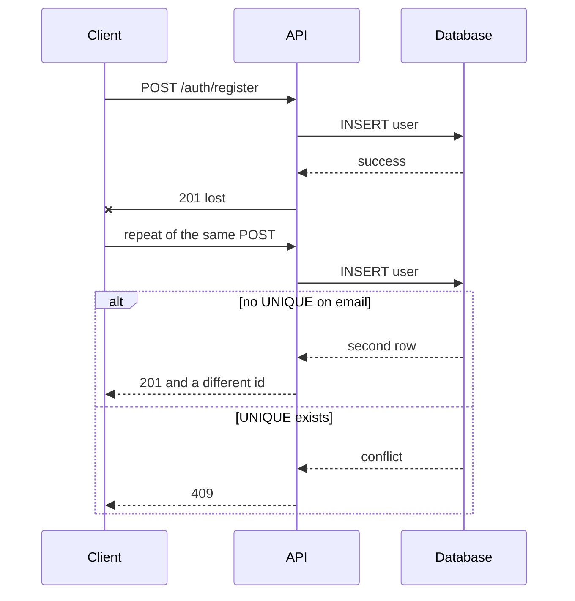
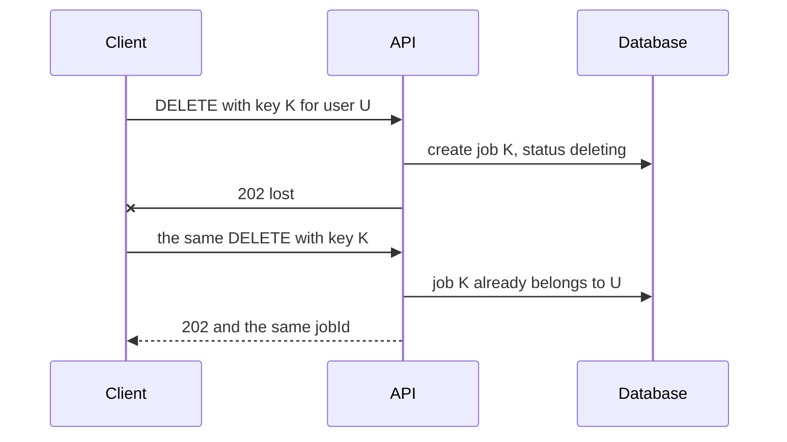

# Idempotency

## Contents

- [What Idempotency Is](#what-idempotency-is)
- [Safe and Idempotent HTTP Methods](#safe-and-idempotent-http-methods)
- [Examples](#examples)
- [Why Requests Are Repeated](#why-requests-are-repeated)
- [How to Make an Operation Idempotent](#how-to-make-an-operation-idempotent)
- [Idempotency Key](#idempotency-key)
- [Background Job Retries](#background-job-retries)
- [How It Shows Up in the System](#how-it-shows-up-in-the-system)
- [Common Mistakes](#common-mistakes)
- [Useful Links](#useful-links)
- [Theory Questions](#theory-questions)

## What Idempotency Is

An operation is idempotent if repeating it does not change the result of the first successful execution. One call and three identical calls leave the server in the same state. The client can send the request again after a connection drop without creating a second entity, sending a second email, or starting a second deletion process.

In mathematics, this property is written as `f(f(x)) = f(x)`. The absolute value of a number is idempotent: the absolute value of −3, taken again, still gives 3. The assignment `name = 'Anna'` is too: a repetition leaves the same value. The increment `attempts = attempts + 1` is not idempotent: each call increases the counter.

Idempotency concerns **the client's intent to change the server's state**, not the bytes of the response. The log, the rate limit counter, and the `updated_at` field may change with every request. RFC 9110 allows this: what counts is the effect on the resource, not side observations.

Getting the same HTTP status on a repeat is a separate, stronger property. The first `DELETE` often returns **204**, the second **404**, because the resource no longer exists. The state is the same: the object does not exist. A contract that **replays the stored response** in full is needed where the client must receive the same `jobId` or the same body, not just the same final effect.

A unique constraint in the database protects the invariant "no more than one row", but by itself it does not make an HTTP operation idempotent. A repeated registration with an already-taken email returns **409**, whereas the first success returned **201**. The state "one user per address" is preserved, but a client that did not receive the first response will not learn the `id` of the created record from the repeated request.

## Safe and Idempotent HTTP Methods

RFC 9110 distinguishes two properties of a method.

| Property | Meaning | Methods in the specification |
| --- | --- | --- |
| Safe | the client does not intend to change state | `GET`, `HEAD`, `OPTIONS`, `TRACE` |
| Idempotent | several identical requests have the same effect as one | the safe ones, plus `PUT` and `DELETE` |
| Neither by default | a repetition accumulates the effect | `POST`, `PATCH` |

A safe method is always idempotent. The reverse is not true: `PUT` and `DELETE` change data, but a repetition does not amplify the change. `PUT /admin/rbac/roles/{roleId}` with the same body leaves the role in the same state. `POST /admin/rbac/roles` with the same `name` tries to create another role.

The specification describes **the semantics of a method**; it does not force the server. Nothing prevents you from attaching a deletion to a `GET` or making `POST /auth/logout` idempotent. Clients and intermediaries rely on the declared semantics, so safe methods do not perform writes, and an idempotent contract is declared explicitly if it differs from the `POST` default.

`PATCH` is not idempotent in the general case: a JSON Patch with `add` to an array appends an element on every call. Replacing a field with an absolute value (`displayName: "Anna"`) has the same effect as a `PUT` of that field. In `1.5`, the profile's text fields are updated with such an absolute PATCH; uploading a new photo generates a new object key and is therefore not a repetition.

An automatic retry is appropriate only for an idempotent method or for a `POST` with an idempotency key. A blind retry of `POST /api/convert` creates a second history record.

## Examples

**Assigning a name.** The client sends the same value twice.

| Call | Before | After |
| --- | --- | --- |
| 1. `displayName = "Anna"` | `"Ivan"` | `"Anna"` |
| 2. the same request | `"Anna"` | `"Anna"` |

The state after one and two calls is the same. The operation is idempotent.

**Creating a transformation.** The client sends the same CSV to `POST /api/convert` twice.

| Call | History |
| --- | --- |
| 1 | row `t1`, status `success` |
| 2 | rows `t1` and `t2` |

A second operation has appeared. This is not a failure: each transformation is a separate fact that the user sees in the history from `2.3`. `POST` was chosen precisely because a repetition must create a new attempt rather than return the previous file.

**Deleting an object in storage.** The background cleanup from `2.4` calls `delete` by key. At the S3-compatible boundary, re-deleting an already missing object succeeds. If absence is treated as an error, a failure after the object has actually been deleted puts the worker in a loop: each retry gets "not found" and does not mark the job as done.

**Reading a list.** `GET /admin/users` with the same parameters does not create users and does not move the cursor. Data may change between two calls — for example, a new registration may appear — because the safety of a method does not freeze the database. The stable cursor pagination from `1.7` adds a stronger traversal promise: repeating a page with the same cursor does not duplicate items because of an identical `createdAt` and does not insert rows created after `snapshotAt` into the middle.

**Logout.** `POST /auth/logout` clears the current client's cookies and responds with **204** regardless of whether there were any cookies. A second call after the first leaves the browser without a session and again returns **204**. From this client's point of view, the operation is idempotent. A copied refresh JWT on another device is not revoked by logout: this is a limitation of the stateless scheme from `1.2`, not a violation of the current request's idempotency.

## Why Requests Are Repeated

A client repeats a request not only when a button is clicked twice. The network, the load balancer, and the message broker make repetition the norm.

A typical lost response:



The first request has already created the user, but the client did not see it. Without a unique constraint, the repetition creates a second one. With the constraint, the invariant "one email — one row" survives, but the client receives an error instead of the original **201** and `id`.

Other sources of repetition:

- the user clicks "Submit" again while the first request is still running;
- the HTTP client or proxy repeats the request after a timeout;
- the load balancer closes the connection when API instances are switched;
- the broker delivers a message "at least once";
- after a lease expires, the worker runs the same deletion job again.

Where a repetition is dangerous, it is either prohibited by the contract (the transformation `POST`) or made safe (a deletion key, `UNIQUE`, "a missing object = success").

## How to Make an Operation Idempotent

Several techniques cover different cases. They can be combined.

**Method semantics.** Replacing a resource entirely — `PUT`. Deletion — `DELETE`. Reading — `GET`. Creating a new fact — `POST`. In `1.1`, a user's list of roles is replaced via `PUT /admin/rbac/users/{userId}/roles`: two identical `roleIds` arrays leave the same links. Creating a role remains a `POST`, because the identifier is issued by the server.

**Natural key.** A repetition is recognized by the meaning of the operation, not by a random header. For the deletion from `1.6`, there is no more than one deletion job per user: a second `DELETE` of the same target returns the existing `jobId`, even if the client sent a different key.

**Unique constraint.** `UNIQUE` on `users.email`, on the pair `(role_id, permission_id)`, and a partial unique index "one unconsumed attempt" turn a race between two parallel `INSERT`s into a database conflict. The handler translates it into **409**, not into an unhandled error. This protects the invariant; a safe retry after a timeout usually also requires a stored response.

**"Already done" as success.** An idempotent eraser and storage cleanup do not require the object to exist at the time of the call. Deleting a missing file, clearing an already empty field, and repeating the finalization when `job.status = succeeded` all complete successfully.

**Conditional write.** `UPDATE ... WHERE status = 'queued'` or `INSERT ... ON CONFLICT DO NOTHING` make a state transition atomic. A second worker does not take the same job while the first one holds the lease.

```sql
INSERT INTO deletion_jobs (id, user_id, status)
VALUES ($1, $2, 'queued')
ON CONFLICT (user_id) DO NOTHING;
```

If the row already exists, the repetition does not create a second process. The client is given the `id` that was found.

## Idempotency Key

When there is no natural key, or the client must know the identifier **before** the response, the client sends its own key. Stripe stores the status and body of the first request with a given `Idempotency-Key` and, on a repeat, returns the stored result without executing the operation again. The key is generated by the client: it needs enough randomness to rule out collisions; email and other PII are not used in the key.

In `1.6`, the client creates 16 random bytes and sends 32 lowercase hex characters as `Idempotency-Key`. The server takes this value as the `jobId`, so the status endpoint's address is known even if the **202** was lost. Retry rules:



- the same key and the same target — the previous job, **202**, without a second process and without re-checking the challenge;
- a different key, but the user already has a job — the existing `jobId`, because there is one natural key per target;
- the same key for a different target — **409**, so that one operation does not acquire two meanings.

The key is compared together with the parameters of the intent. Otherwise a repeat with a different body would silently perform someone else's operation disguised as a retry. A failed validation before work begins does not "burn" the key: the client can fix the request and use it again. Once a side effect has started, a repeat must return the original outcome.

`GET` and `DELETE` are already idempotent in the RFC sense, so they usually do not need a separate key. The exception is the deletion-accepting `DELETE`: it is a long process with **202**, and the client needs a stable `jobId` after the response is lost.

## Background Job Retries

Brokers and queues almost always deliver a message at least once. A handler that creates an object or consumes a resource on every call will perform the action twice. Therefore, a background step is made idempotent, and progress is stored in the database.

In `1.6`, the worker atomically takes a lease on the job, calls all registered erasers, and then the finalization. While the lease is alive, a second worker does not start the same job. After a process crash, the lease expires, and the job can be taken again. The repetition is safe because:

- a missing storage object is considered already deleted;
- a repeated eraser call after success again returns `succeeded`;
- `eraseUserData` with empty user data returns `succeeded`;
- the final transaction, given the pair `job.status = succeeded` and `user.status = deleted`, completes with an internal success.

The same technique is needed for the retention cleanup from `2.4`: first the object is deleted, then the history fields are cleared. If the process crashed between the steps, the retry calls `delete` again and finishes the record.

If a row is written to the database and then a message is sent to the broker, a failure between the steps will lose the event. A transactional outbox puts the event into a table in the same transaction as the data. A separate process delivers it to the broker and must also tolerate redelivery: the event key is unique, and the handler is idempotent.

## How It Shows Up in the System

Idempotency in the course is not a separate module but a property of specific operations. Some are intentionally idempotent, others intentionally are not.

`Registration (1.0).` `POST /auth/register` creates a user and is therefore not an idempotent method. `UNIQUE` on the normalized email prevents two requests from creating two rows, including for `pending`. A lost **201** turns into **409** on a repeat: the account exists, but the client does not get the original `id`. This is acceptable for registration, because subsequent login and email confirmation work by address, not by the lost identifier.

`Authentication (1.2).` Login, confirm, and refresh are `POST`s with a new effect: an email, a consumed attempt, a new pair of cookies. They cannot be blindly repeated as "the same login". Logout, on the contrary, always clears the current client's cookies and responds with **204**: a repeat is safe and expected.

`RBAC (1.1).` `PUT` of a role, permission, grant, and a user's `roleIds` list replaces the resource entirely. A repeat with the same body leaves the policy unchanged; the policy version may increase if the write was actually performed. A `POST` creating a role or grant returns **409** on a uniqueness conflict: a second "role — permission" link does not appear. This protects the invariant; it does not return the first **201**.

`Profile update (1.5).` A repeated PATCH with the same `displayName` leaves the same name. A repeated photo upload creates a new object with a new random key: the file bytes are the same, the operation is not. The partial unique index for a single open email attempt prevents a second request after an SMTP failure from creating a parallel challenge.

`Deletion (1.6).` The central example in the system. Acceptance is idempotent at two levels: the client's `Idempotency-Key` matches the `jobId`, and there is no more than one job per user. The **202** response can be lost and requested again. The worker, erasers, and finalization are idempotent: otherwise a repeat after an already deleted file would halt the cleanup. An administrative repeat of `DELETE` when the job is `failed` does not create a new job and does not change the tombstone: it puts the same process back into the queue.

`Lists (1.7, 2.3).` `GET` does not create entities: identical parameters do not produce side records. A cursor that includes `id` in its key additionally removes page duplicates that look like "a repeat returned something different". This is a property of reading and pagination, not a write idempotency key.

`File transformation (2.0–2.2).` `POST /api/convert` and `POST /api/images/convert` are intentionally not idempotent. Each call is a new attempt with its own `success` or `error` history row. An idempotent `PUT` here would be a contract mistake: the user would not see repeated failed attempts and could not distinguish two transformations of the same file.

`Storage (2.4).` A download via `GET` returns the same object as long as it exists and its retention has not expired. The background write with `save=true` must survive a job retry without a second object with a different key: the key is linked to the history row in advance. Cleanup and the user eraser treat the absence of an object as success; otherwise the deletion from `1.6` will not converge.

**Architecture.** Multiple API instances behind a load balancer do not keep "already done" in process memory: the key, job, and lease live in PostgreSQL. Otherwise a repeat would land on another instance and be executed again.

| Operation | Idempotent? | Ensured by |
| --- | --- | --- |
| `PUT` role / `roleIds` | yes, full replacement | `PUT` semantics |
| `POST` registration, grant, convert | no, as an HTTP method | `UNIQUE` only protects the invariant |
| `POST /auth/logout` | yes, for the current client | always **204** and clearing cookies |
| Deletion-accepting `DELETE` | yes | key + one job per user |
| Deletion worker and erasers | yes | "already gone" = success, lease |
| `GET` of a list, history, file | yes, as a method | no writes; the cursor stabilizes traversal |
| Retention cleanup | yes | repeated `delete` of the object |

## Common Mistakes

| What you see | Where to look |
| --- | --- |
| Two users with the same email after a "registration retry" | there is no `UNIQUE`; uniqueness was checked only by a `SELECT` before the `INSERT` |
| A repeated deletion confirm created a second job | there is no unique job per `user_id`, or the key is not used as the `jobId` |
| A deletion key from request A was applied to user B | a repeat with a different intent was not rejected with **409** |
| The worker endlessly retries deleting a file | the absence of the object is treated as an error rather than success |
| Two history rows for one convert "retry" | expected `POST` behavior; it is a mistake if convert was made idempotent and the attempt was hidden |
| An automatic HTTP retry after a login timeout created a second email | retry is enabled for a non-idempotent `POST` without a key |
| A second API instance executed the background job again | "already done" was stored in process memory rather than in the database |
| An identical `createdAt` duplicated a user across two pages | the cursor lacks `id`; this is confused with `GET` idempotency |
| A repeated photo PATCH left the old object in the bucket | the new key was written, the old one was not deleted; the upload itself is not idempotent |
| Logout returned **401** the second time | the contract requires **204** without checking the session |

## Useful Links

### General

- [RFC 9110 — Idempotent Methods](https://www.rfc-editor.org/rfc/rfc9110.html#name-idempotent-methods) — the definition of an idempotent method and why a client may repeat a request after a connection drop.
- [RFC 9110 — Safe Methods](https://www.rfc-editor.org/rfc/rfc9110.html#name-safe-methods) — the difference between a method's safety and idempotency.
- [MDN — Idempotent](https://developer.mozilla.org/en-US/docs/Glossary/Idempotent) — short examples of `GET`, `POST`, and `DELETE`, including different statuses with the same effect.
- [Stripe — Idempotent requests](https://docs.stripe.com/api/idempotent_requests) — the `Idempotency-Key` header, storing the first response, and the prohibition on changing parameters on a repeat.
- [IETF — Idempotency-Key header](https://datatracker.ietf.org/doc/draft-ietf-httpapi-idempotency-key-header/) — a draft standard header for non-idempotent methods.
- [Microsoft — Retry pattern](https://learn.microsoft.com/en-us/azure/architecture/patterns/retry) — when an automatic retry is acceptable and why it is dangerous for non-idempotent calls.
- [Amazon S3 — DeleteObject](https://docs.aws.amazon.com/AmazonS3/latest/API/API_DeleteObject.html) — re-deleting a missing object.
- [PostgreSQL — INSERT ... ON CONFLICT](https://www.postgresql.org/docs/current/sql-insert.html#SQL-ON-CONFLICT) — an atomic "insert or do nothing" by a unique key.

### By Language

#### Node.js

**Node.js, NestJS.** On Express or Fastify, the idempotency contract stays the same: it is defined by unique constraints, the key, and the route semantics, not by a framework decorator.

- [Prisma — Constraints and indexes](https://www.prisma.io/docs/orm/prisma-schema/data-model/indexes) — `UNIQUE` and conflict handling on creation.
- [node-postgres — Queries](https://node-postgres.com/features/queries) — a parameterized `INSERT ... ON CONFLICT`.
- [NestJS — Exception filters](https://docs.nestjs.com/exception-filters) — turning a uniqueness conflict into **409**.

#### .NET

**.NET, ASP.NET Core.** You can use either Minimal API or controllers; the retry rules do not depend on this.

- [EF Core — Indexes](https://learn.microsoft.com/en-us/ef/core/modeling/indexes) — unique indexes as a guarantee of a natural key.
- [ASP.NET Core — Handle errors](https://learn.microsoft.com/en-us/aspnet/core/web-api/handle-errors) — a uniqueness conflict as **409**, not as an unhandled exception.
- [Polly — Resilience strategies](https://www.pollydocs.org/strategies/retry.html) — retrying an HTTP call only for idempotent operations.

#### Python

**Python, FastAPI.** For Django or Flask: the same `UNIQUE`, key, and "absence = success".

- [SQLAlchemy — IntegrityError](https://docs.sqlalchemy.org/en/20/core/exceptions.html#sqlalchemy.exc.IntegrityError) — a unique constraint conflict.
- [psycopg — Passing parameters](https://www.psycopg.org/psycopg3/docs/basic/params.html) — a safe `ON CONFLICT` with parameters.
- [Celery — Tasks](https://docs.celeryq.dev/en/stable/userguide/tasks.html) — retryable background tasks and the requirement for handler idempotency.

## Theory Questions

1. How does a method's idempotency differ from its safety, and why can a repeated `GET` return different data?
2. Why is a second `DELETE` allowed to respond with **404** while remaining idempotent?
3. Why does `UNIQUE` on email not make registration idempotent for a client that lost the first **201**?
4. Why does user deletion need both an `Idempotency-Key` and a unique job per `user_id`?
5. Why can file transformation not be made an idempotent `PUT`, and what would the history lose?
6. What happens if a deletion eraser treats the absence of an object in storage as an error?
7. Why is an automatic retry appropriate for a role `PUT` and dangerous for a login `POST` without an additional key?
