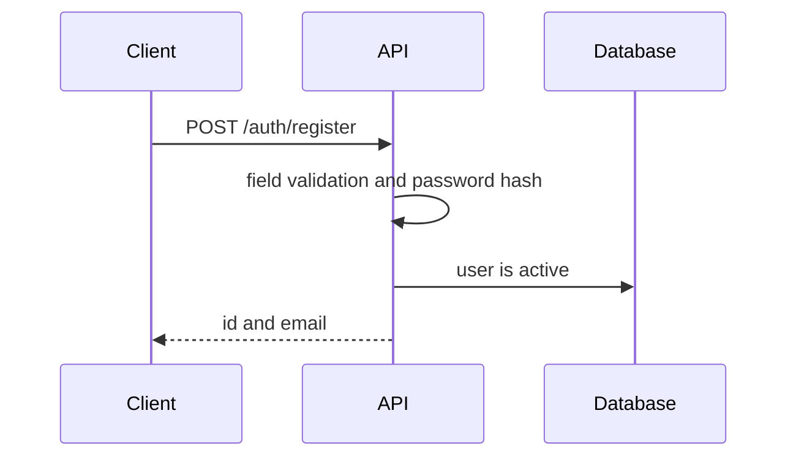
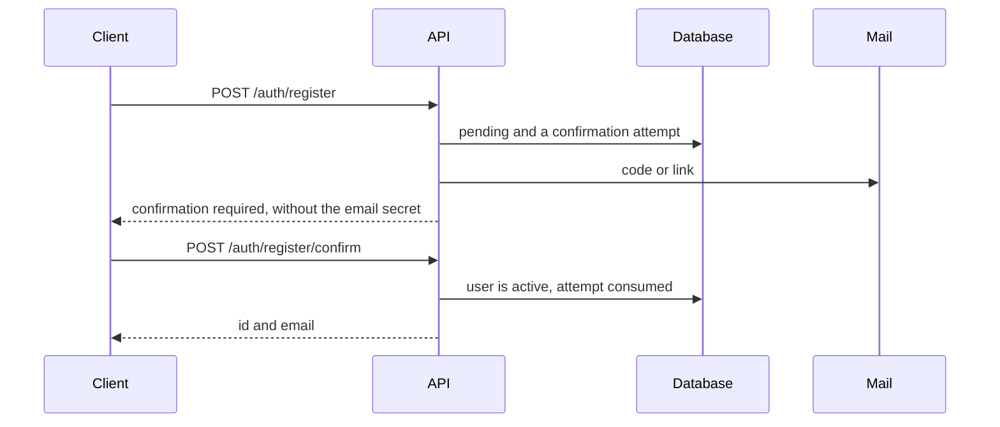

# Registration

## Contents

- [Theory](#theory)
  - [Situation](#situation)
  - [Model](#model)
  - [Concepts and Their Connection to the Backend](#concepts-and-their-connection-to-the-backend)
  - [Areas of Responsibility](#areas-of-responsibility)
  - [Example](#example)
  - [Common Failures](#common-failures)
  - [Useful Links](#useful-links)
  - [Theory Questions](#theory-questions)
- [Practical Assignment](#practical-assignment)
  - [1.1 General](#11-general)
  - [1.2 Scenarios](#12-scenarios-user-stories)
  - [1.3 Contract](#13-contract)
  - [1.4 Errors and Constraints](#14-errors-and-constraints)
  - [1.5 Audit](#15-auditlogs)
  - [1.6 Non-Functional Requirements](#16-non-functional-requirements)

# Theory

## Situation

A guest submits an email and a password. From there, one of several outcomes is possible: the account becomes active immediately, the server waits for a code or for a click on a link from an email, the fields fail validation, the email is already taken, the email was not sent, or a request rate limit or attempt limit is triggered.

A separate frontend is not needed; all requests can be sent from an HTTP client.

## Model

Registration involves the guest, the API, the database, and, if the flag is enabled, the mail server. Whether to send an email, and by which method, is decided by the server. If the client chose this, confirmation could be bypassed with the same request.

Without confirmation, the server validates the fields, computes the password hash, and creates an active user.



When confirmation is enabled, a user in the `pending` state and one unconsumed attempt are created. By this point the email is already considered taken, so a second registration request for it will receive the same error as a repeated registration of an active account. A different storage scheme is acceptable only if the API responses stay the same, including the email being taken before activation.



Instead of the code or token itself, the attempt stores an HMAC-SHA256 of it with a key from the configuration. For a six-digit code, the attempt is first found by its identifier and only then is the HMAC compared, since brute-forcing hashes of a short code across the whole table is too easy. The link token is 32 random bytes, and the attempt is found by the HMAC of this token: brute force is impossible here. The identifier is not part of the token; the `attemptId.secret` format belongs to login, not to registration. The secret is compared in constant time; ordinary string comparison is not suitable for this. The HMAC key, at the same time, does not replace the password salt.

An account is activated via the link with a POST request. Mail scanners and previews open URLs on their own with the GET method and would use up the one-time token before a human opens the email.

A possible set of fields (the schema may be different):

| `users` | Description |
| --- | --- |
| `id` | user identifier |
| `email` | normalized email: without leading/trailing whitespace, lowercase, with a unique index |
| `password_hash` | slow password hash; the salt is part of the string, there is no separate field for it |
| `status` | `pending` or `active` |
| `created_at` | creation time |
| `updated_at` | update time |

| `registration_challenges` | Description |
| --- | --- |
| `id` | attempt identifier: it is returned by the registration response, and `confirm` uses it to find the attempt for a code |
| `user_id` | reference to `users.id` |
| `method` | method: `otp` or `magic_link` |
| `secret_hash` | HMAC-SHA256 of the code or token with a key from the configuration; the secret itself is not stored |
| `expires_at` | end of the TTL: 10 minutes after the email is sent; a resend restarts the countdown |
| `attempts` | number of incorrect code entries: after the fifth, the attempt is consumed; a resend resets the counter |
| `last_sent_at` | time the last email was sent: the next one no earlier than 60 seconds later |
| `consumed_at` | the moment the attempt was consumed: successful confirmation or the fifth incorrect code entry |

### Normal Form

The `users` table is in Boyce–Codd normal form (BCNF). `registration_challenges` would also satisfy BCNF, but because of the computed field `expires_at` it formally remains in second normal form (2NF).

Each subsequent form includes the requirements of the previous one:

- **1NF:** each cell contains one value, without lists or sets. `password_hash` stores the algorithm, cost, salt, and the hash itself in a single string, but database queries do not access these parts separately. The whole string is parsed by the library's verification function, so for the database it is a single value.
- **2NF:** a non-key field depends on the entire key, without partial dependencies. All keys in the schema are simple, i.e., consist of a single field: `id` and `email` in `users`, `id` in `registration_challenges`. A simple key has no parts, so 2NF holds automatically.
- **3NF and BCNF:** non-key fields depend only on the key and are not determined by each other. For tables with simple keys, these two forms coincide. An attempt references the user through `user_id`, while the user's `email` and `status` are stored only in `users`.
- **4NF and 5NF:** independent lists of facts are not mixed in one table, for example the roles and phone numbers of the same user. A table in 3NF with simple keys satisfies this requirement automatically (the Date–Fagin theorem), so `users` is also in 5NF.

The exception is the `expires_at` field. Its value is always equal to `last_sent_at` plus 10 minutes, i.e., one non-key field is determined by another. This creates a transitive dependency on the key through `last_sent_at`, which 3NF does not allow.

Such a dependency creates a risk of an update anomaly. If, on a resend, `last_sent_at` is updated but `expires_at` is not, the TTL countdown will not restart, even though the contract requires it. Therefore both fields are updated in a single `UPDATE`.

The dependency disappears if `expires_at` is not stored but computed during the check as `last_sent_at` plus 10 minutes. In that case the attempt table, like `users`, will be in BCNF and 5NF. Storing both fields is also acceptable. This is a deliberate denormalization, but the attempt's validity period is read from the record without computation.

## Concepts and Their Connection to the Backend

### Password

The database stores the result of a one-way function. At login, the server passes the entered password through the same function and compares the results.

For a new application, Argon2id is preferred. If native Argon2 does not build in the environment, it is replaced with bcrypt with a cost of at least 12. The cost parameter determines how expensive it is to compute one hash at registration and at login. Both algorithms create a separate salt for each password and embed it in the resulting string. Therefore two hashes of the same password differ, yet verification through the library still succeeds.

MD5, SHA-1, SHA-256 without a salt and without a large number of iterations, CRC32, as well as homemade functions with a shared secret for all users, are not suitable for passwords. If the database leaks, such passwords are brute-forced too cheaply. bcrypt has its own limitation as well: bytes after the 72nd are silently discarded, and different passwords with a common prefix start to match. Therefore an overly long password is rejected by validation even before hashing.

### Email

Emails are sent over SMTP. IMAP and POP3 are not needed by this API, since the server does not need to read a mailbox.

After that, the email travels this path:

1. The application hands it over to an SMTP server.
2. The SMTP server finds the mail server of the recipient's domain.
3. The recipient's server places the email into the inbox or into spam, taking into account, among other things, the sender's SPF and DKIM.

On a test stand, steps 2 and 3 are replaced by a local mail catcher, for example Mailpit. The email is visible in its interface, but this says nothing about delivery to a production domain. The language library performs only step 1. A Gmail or Yandex mailbox password is not needed for local work, and accessing a production mailbox from an application often requires a separate app password.

If SMTP did not accept the email, the attempt and the `pending` record are kept, and the client receives **503**. A repeated registration in this case will return the email-taken error, so the email is requested via a resend.

### What Happens at Login

After registration with an active status, the user is not yet logged in. Later, the authentication module will issue two JWTs in cookies: an access token for 15 minutes and a refresh token for 30 days. This is a separate contract; no tokens are signed at registration.

A JWT consists of three parts separated by dots: a header, a payload, and a signature. The first two are base64url-encoded, and anyone who gets hold of the token can read them. The signature lets the server detect tampering but does not hide the contents, so the password, its hash, and the signing secret are not placed in the payload. The short lifetime of the access token limits the time during which a stolen token can be used, and the refresh token is needed so as not to ask for the password every 15 minutes.

### Summary

| Concept | Meaning in registration | What the implementation relies on |
| --- | --- | --- |
| Guest | a call without a session | the operation is public; the role will appear in RBAC |
| Password hash | a one-way result with its own salt | Argon2id or bcrypt, verification by a library function |
| `pending` | the email is already taken, it is too early to allow login | the same user at a different stage, or a separate application with the same uniqueness |
| OTP | 6 digits, 10 minutes, 5 attempts | lookup by attempt id, only the HMAC in the database |
| Magic link | a one-time token of the same attempt | activation via POST |
| SMTP | delivering the secret to the mailbox owner | the SMTP client of the chosen language and a local mail catcher |
| JWT | a pass for an already logged-in user | the authentication and authorization modules, not the registration response |

## Areas of Responsibility

| Client | Server |
| --- | --- |
| Sends the email and password | Validates the format, password policy, and uniqueness |
| On an active status, proceeds to login | Creates an active record and does not create a session |
| On the confirmation flag, shows code entry or waiting for the email | Creates `pending`, an attempt, and an email |
| Sends the code or token for confirmation | Consumes the attempt and activates the record |
| Shows a field error or a waiting state based on the response status | Distinguishes incorrect input, expiration, a taken email, and the rate limit |
| Keeps the password only until the form is submitted | Stores the password hash and the HMAC of the email secret |

A request from a browser on a different origin first goes through a CORS preflight check. While an HTTP utility serves as the client, configuring the list of trusted origins can be postponed until a page appears. If the browser shows a network error while the API log marks the registration as successful, it means the record was created, but the browser was not given the permitting header.

## Example

In the example, the password `secret12` is hashed with the bcrypt library. The program prints the hash string and checks that the hash does not match the password, that a repeated hash of the same password differs from the first one, and that verification through the library succeeds for the original password and fails for a different one.

### Node.js

**Node.js, bcrypt library.** A cost of 12 is the minimum acceptable value for bcrypt. The preferred Argon2id for Node.js is available in the `argon2` package.

```sh
npm install bcrypt
node hash-demo.js
```

```javascript
const { hash, compare } = require('bcrypt');

async function main() {
  const password = 'secret12';
  const stored = await hash(password, 12);
  const again = await hash(password, 12);

  console.log(stored);
  console.log(stored === password);
  console.log(stored === again);
  console.log(await compare(password, stored));
  console.log(await compare('secret13', stored));
}

main();
```

### .NET

**.NET, BCrypt.Net-Next package.** `workFactor: 12` is the minimum acceptable value for bcrypt. Argon2id for .NET is available in the `Isopoh.Cryptography.Argon2` package. `PasswordHasher` from ASP.NET Core Identity, based on PBKDF2, is also suitable, but its iteration count needs to be checked against the current OWASP recommendation.

```sh
dotnet new console -o HashDemo
cd HashDemo
dotnet add package BCrypt.Net-Next
dotnet run
```

```csharp
using BCrypt.Net;

var password = "secret12";
var stored = BCrypt.Net.BCrypt.HashPassword(password, workFactor: 12);
var again = BCrypt.Net.BCrypt.HashPassword(password, workFactor: 12);

Console.WriteLine(stored);
Console.WriteLine(stored == password);
Console.WriteLine(stored == again);
Console.WriteLine(BCrypt.Net.BCrypt.Verify(password, stored));
Console.WriteLine(BCrypt.Net.BCrypt.Verify("secret13", stored));
```

### Python

**Python, bcrypt package.** `rounds=12` is the minimum acceptable value for bcrypt. The preferred Argon2id for Python is available in the `argon2-cffi` package.

```sh
pip install bcrypt
python hash_demo.py
```

```python
import bcrypt

password = "secret12".encode()
stored = bcrypt.hashpw(password, bcrypt.gensalt(rounds=12))
again = bcrypt.hashpw(password, bcrypt.gensalt(rounds=12))

print(stored.decode())
print(stored == password)
print(stored == again)
print(bcrypt.checkpw(password, stored))
print(bcrypt.checkpw("secret13".encode(), stored))
```

---

A bcrypt hash string starts with `$2` and does not contain the password itself. The second call returns a different string because the salt is generated anew. The library's verification function checks the password against a specific stored string.

## Common Failures

| What you see | Where to look |
| --- | --- |
| The password appears in the response or in the log | the entire user row ended up in the response; the request body or the email secret ended up in the log |
| The password in the database matches the entered one | the original field was saved |
| Identical passwords produce the same string | the hash has no salt of its own |
| Two long, different passwords later match | the algorithm truncated the secret. With bcrypt this happens after 72 bytes |
| `User@Example.com` created a second user | the email was written to the index without lowercasing |
| A parallel registration of the same email produces an unhandled error | there is no unique index, or the index conflict was not turned into a response from 1.4 |
| The code is both in the mail catcher and in the registration response | the email secret was returned to the client; the confirmation no longer proves anything |
| The link turns out to be already used right away | a GET consumed the token; a preview or scanner managed to open it |
| The correct code still works after five errors | the attempt is not consumed on the fifth incorrect entry |
| There is nowhere to open the email locally | SMTP points to a production mailbox. A test stand needs a local mail catcher, for example Mailpit |
| A repeated registration after a mail failure | `pending` has already taken the email. The client should have received **503**, and a new email is requested via a resend |

## Useful Links

### General

- [MDN — HTTP response status codes](https://developer.mozilla.org/en-US/docs/Web/HTTP/Reference/Status) — the statuses returned by registration.
- [MDN — CORS](https://developer.mozilla.org/en-US/docs/Web/HTTP/Guides/CORS) — why the browser may show a failure when the record has already been created.
- [OWASP — Password Storage Cheat Sheet](https://cheatsheetseries.owasp.org/cheatsheets/Password_Storage_Cheat_Sheet.html) — Argon2id, bcrypt, and why a fast hash is not suitable.
- [OWASP — Forgot Password Cheat Sheet](https://cheatsheetseries.owasp.org/cheatsheets/Forgot_Password_Cheat_Sheet.html) — one-time PINs and links: expiration, brute force, delivery via a separate channel.
- [jwt.io — Introduction](https://www.jwt.io/introduction) — how a JWT is structured. No tokens are issued at registration.
- [Mailpit](https://mailpit.axllent.org/) — a local SMTP server with an interface for viewing emails on a test stand.
- [PostgreSQL — Unique indexes](https://www.postgresql.org/docs/current/indexes-unique.html) — unique indexes, if PostgreSQL is used.
- [Bruno](https://www.usebruno.com/) or [Postman](https://www.postman.com/) — sending the same requests that a form will send later.

### By Language

#### Node.js

**Node.js, NestJS.** On Express or Fastify, the registration contract stays the same.

- [NestJS — First steps](https://docs.nestjs.com/first-steps) — creating and running an application.
- [NestJS — Modules](https://docs.nestjs.com/modules) — extracting registration into a separate module.
- [NestJS — Validation](https://docs.nestjs.com/techniques/validation) — request body validation.
- [NestJS — Configuration](https://docs.nestjs.com/techniques/configuration) — the confirmation flag and SMTP settings from environment variables.
- [argon2](https://www.npmjs.com/package/argon2) — Argon2id for Node.js.
- [bcrypt](https://www.npmjs.com/package/bcrypt) — hashing and comparison, cost of at least 12.
- [Node.js — crypto](https://nodejs.org/api/crypto.html) — HMAC and `timingSafeEqual` for the email secret.
- [Nodemailer](https://nodemailer.com/) — sending emails over SMTP.
- [NestJS — OpenAPI](https://docs.nestjs.com/openapi/introduction) — describing operations.
- [Prisma Migrate](https://www.prisma.io/docs/orm/prisma-migrate) or [TypeORM — How migrations work](https://typeorm.io/docs/migrations/why) — schema migrations instead of automatic synchronization at startup.

#### .NET

**.NET, ASP.NET Core.** You can use either Minimal API or controllers; the registration contract does not depend on this.

- [ASP.NET Core — Minimal API](https://learn.microsoft.com/en-us/aspnet/core/tutorials/min-web-api) — creating an HTTP API.
- [Model validation](https://learn.microsoft.com/en-us/aspnet/core/mvc/models/validation) — request body validation.
- [Configuration](https://learn.microsoft.com/en-us/aspnet/core/fundamentals/configuration/) — the confirmation flag and SMTP settings from environment variables.
- [Isopoh.Cryptography.Argon2](https://github.com/mheyman/Isopoh.Cryptography.Argon2) — Argon2id for .NET.
- [BCrypt.Net-Next](https://github.com/BcryptNet/bcrypt.net) — hashing and `Verify`, work factor of at least 12.
- [CryptographicOperations.FixedTimeEquals](https://learn.microsoft.com/en-us/dotnet/api/system.security.cryptography.cryptographicoperations.fixedtimeequals) — constant-time comparison of the email secret.
- [MailKit](https://github.com/jstedfast/MailKit) — sending emails over SMTP.
- [Swashbuckle](https://learn.microsoft.com/en-us/aspnet/core/tutorials/getting-started-with-swashbuckle) — describing operations in OpenAPI.
- [EF Core — Migrations](https://learn.microsoft.com/en-us/ef/core/managing-schemas/migrations/) — schema migrations instead of updating the database at startup.

#### Python

**Python, FastAPI.** For Django or Flask the contract does not change; the same hashing and SMTP libraries are suitable.

- [FastAPI — First steps](https://fastapi.tiangolo.com/tutorial/first-steps/) — creating and running an application, and the interactive API schema.
- [Pydantic — Validators](https://docs.pydantic.dev/latest/concepts/validators/) — request body validation.
- [FastAPI — Settings](https://fastapi.tiangolo.com/advanced/settings/) — the confirmation flag and SMTP settings from environment variables.
- [argon2-cffi](https://argon2-cffi.readthedocs.io/en/stable/) — Argon2id for Python.
- [bcrypt](https://github.com/pyca/bcrypt) — hashing and `checkpw`, rounds of at least 12.
- [hmac](https://docs.python.org/3/library/hmac.html) — HMAC and `compare_digest` for the email secret.
- [smtplib](https://docs.python.org/3/library/smtplib.html) — sending emails over SMTP with the standard library.
- [Alembic](https://alembic.sqlalchemy.org/en/latest/tutorial.html) — schema migrations instead of creating tables at startup.

## Theory Questions

1. Why is a slow hash with its own salt better than a fast SHA-256 for a password, and what does the server compare at login?
2. Why is the six-digit code stored as an HMAC, and why is the attempt looked up by its identifier rather than by the code's hash?
3. Why does clicking the link in the email not activate the account?
4. Which part of email delivery does the application perform, and what determines whether the email lands in the inbox or in spam?
5. What does a network error in the browser mean if the API log already shows a successful registration?
6. Why is `registration_challenges` formally only in 2NF, and what update anomaly does such a schema allow?

# Practical Assignment

User registration functionality. A guest creates an account using an email and a password. If confirmation is disabled, the account is active immediately; if it is enabled, the account waits for a code from an email or a click on a link. The confirmation method is chosen by the server. The password is stored only as a slow hash; repeated registration with the same email is forbidden.

## 1) Registration

### 1.1 General

**Purpose:** create a user account using an email and a password.

**Users/roles:** guest (unauthenticated user).

**Dependencies/related settings:** email confirmation for registration is enabled by a separate flag of the "registration" scenario. Until a settings module exists, the flag is set in the application configuration. Login confirmation is controlled by the authentication module's own flag and does not affect registration.

The session is created by the authentication module; registration itself does not issue tokens. The `user` role is assigned by RBAC in the same transaction in which the user becomes `active`. Until the RBAC module is connected, registration does not create a role: already active users will receive it on the first load of an empty RBAC configuration.

### 1.2 Scenarios (user stories)

1. **Registration without confirmation:** the user enters an email and password, and the account immediately becomes active and usable for login. Login itself is not performed.
2. **Registration with confirmation:** the user enters an email and password, and then confirms the email with a code (OTP) or via a link (magic link). Which of the two methods is used is determined by a server setting.

### 1.3 Contract

#### 1.3.1 Registration Request

| `POST /auth/register` | Checks/validation |
| --- | --- |
| `email: string` | Required, valid format. Before comparison and storage, leading/trailing whitespace is trimmed and letters are converted to lowercase. `user+tag@example.com` is a separate address. Repeated registration with an already existing `email` is forbidden. This also applies to an account that is still awaiting confirmation. |
| `password: string` | Required. Leading/trailing whitespace in the password is preserved. Password policy: at least 8 characters, at least one letter of any alphabet and one digit. An overly long password is rejected by validation: the algorithm must not silently cut off the tail. |

**Logic/steps:**

1. Accept `email`, `password`.
2. Validate the input data.
3. Compute a slow password hash with a separate salt for each password. The password cannot be recovered from the hash. The salt is part of the resulting string, so a separate field for it is not needed.
4. If registration confirmation is disabled — create the user in the active state and, if the RBAC module is connected, assign the `user` role in the same transaction.
5. If registration confirmation is enabled — create the user in the `pending` state without a role, save a confirmation attempt, and send an email using the chosen method:
- a code (OTP), or
  - a link (magic link).

The flag affects only new registrations. If it was disabled after registration, an already created `pending` record does not become active by itself. It is still completed by confirmation or a resend.

If the email was not sent, the `pending` record and the attempt are kept. A repeated `register` for this email will return the email-taken error, and the email can be delivered again only via a resend.

Email uniqueness is enforced by a constraint in the database. A conflict on this constraint is returned as the ordinary repeated-registration error and must not lead to an unhandled server failure.

**Responses:**

- **Confirmation disabled:** **201 Created**, `id`, normalized `email`, `status: active`. The password, hash, and tokens are not included in the response.
- **Confirmation enabled:** **202 Accepted**, `confirmationRequired: true`, `method` (`otp` or `magic_link`), `attemptId`, `expiresInSeconds: 600`, `resendAfterSeconds: 60`. The code and the link token are sent only in the email and are absent from the response.

#### 1.3.2 Registration Confirmation via Email

**General rule:** a new user goes through confirmation only if the flag of the "registration" scenario was enabled at the moment of registration. An already issued attempt can be confirmed or resent regardless of whether the flag is currently enabled.

| `POST /auth/register/confirm` | Parameters |
| --- | --- |
| Code (OTP): `attempt identifier` + `code` | Length: 6 digits. TTL: 10 minutes. Entry attempt limit: 5. The fifth attempt can still be successful. The fifth incorrect entry is an incorrect code, and the attempt is consumed after it. The next request, even with the correct code, is rejected as an exhausted limit. |
| Link (magic link): `token` | 32 random bytes. The attempt is found by the HMAC of the token; the identifier is not part of it. TTL: 10 minutes. The token is single-use. The account is activated by a `POST` with the token. Opening the link by itself does not change the status. |

| `POST /auth/register/resend` | Parameters |
| --- | --- |
| `email` | No more than once every 60 seconds. For a code, the new email replaces the previous code, restarts the TTL, and resets the attempt counter. The old code no longer works. For a link, the new email replaces the previous link, restarts the TTL, and consumes the old token. |

**Logic/steps:**

1. Find the attempt and check that it has not yet been consumed. If the attempt is not found or has already been consumed, the response is the same as for an incorrect code.
2. Reject an expired attempt without incrementing the entry counter.
3. Compare the secret. The code and token are stored in the database in a form from which they cannot be recovered. If the code does not match, the attempt counter is incremented.
4. On success, move the user to the active state, assign the `user` role if the RBAC module is connected and the role has not yet been assigned, and consume the attempt.

**Responses:**

- **Confirm success:** **200 OK**, `id`, `email`, `status: active`.
- **Resend success:** **202 Accepted**, `confirmationRequired: true`, `method`, `attemptId`, `expiresInSeconds: 600`, `resendAfterSeconds: 60`. The secret is absent from the response.
- **Errors:** see section 1.4.

### 1.4 Errors and Constraints

- **400** — invalid email.
- **400** — the password does not meet the policy.
- **409** — the email is already registered.
- **400** — an incorrect or expired confirmation code or token, as well as an attempt that was not found or has already been consumed.
- **429** — code entry attempts exhausted, a resend earlier than 60 seconds, or too frequent registration.
- **503** — the email was not sent. The `pending` record and the attempt are kept in this case.

Instead of `409`, a neutral response is allowed from which it cannot be determined whether the email is taken. In this case, the resend must return the same response as well. A neutral response does not contain the `id` of the existing account and does not repeat the body of a successful creation, if that body reveals whether the account was created. By default, an explicit `409` is used.

### 1.5 Audit/Logs

Log: registration attempts (success and failure), sending of a code or link, successful and unsuccessful confirmations.

The log must not contain the password, the password hash, the code, the link token, or the entire request body.

### 1.6 Non-Functional Requirements

- Protection against spam and brute force: rate limit on registration and resend. The numeric registration threshold is set in the configuration.
- The password and the email secret cannot be recovered from the database, the API response, or the log.
- The project's general non-functional requirements (input validation, API description, tests) also apply to these operations.
