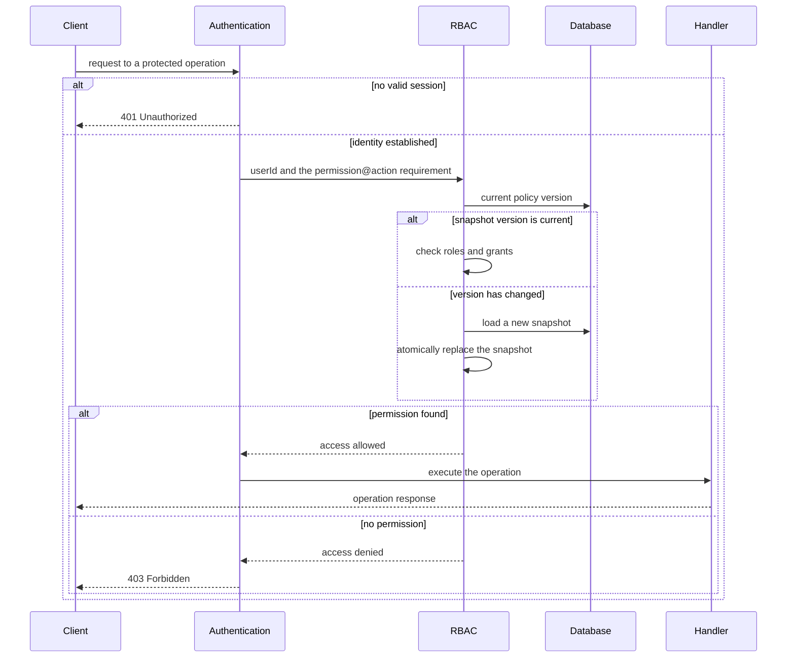
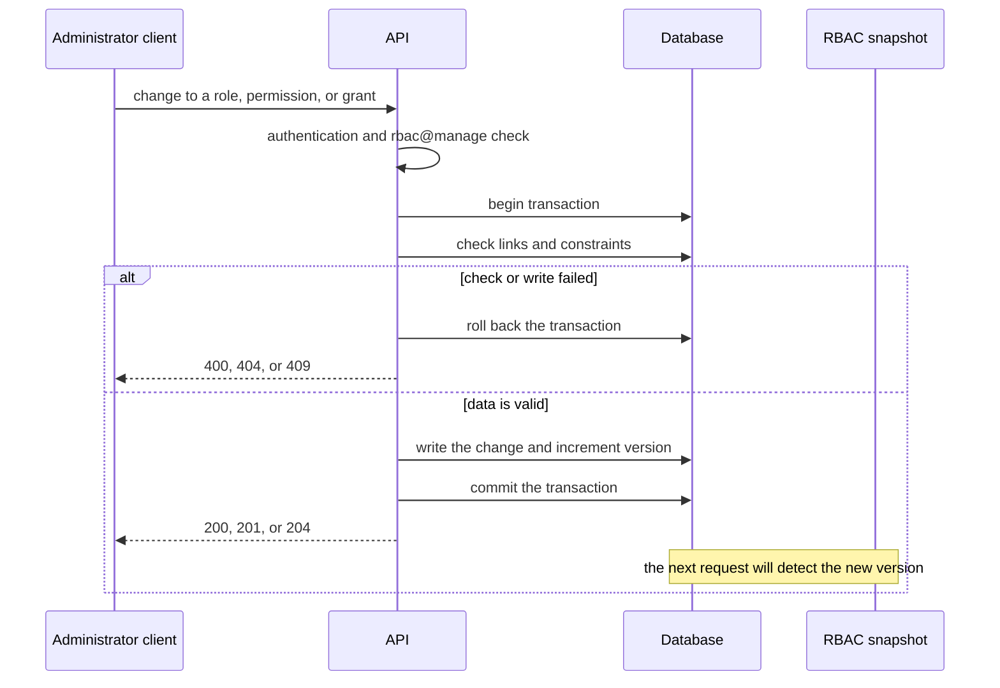
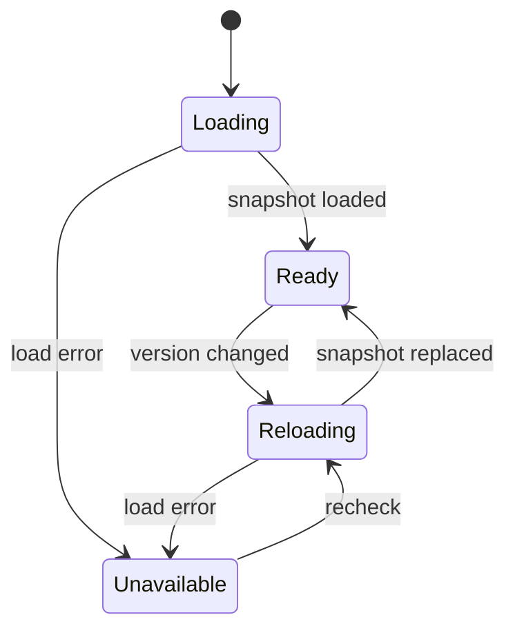

# RBAC

## Contents

- [Theory](#theory)
  - [Situation](#situation)
  - [Model](#model)
  - [Concepts and Their Connection to the Backend](#concepts-and-their-connection-to-the-backend)
  - [Areas of Responsibility](#areas-of-responsibility)
  - [Example](#example)
  - [Common Failures](#common-failures)
  - [Useful Links](#useful-links)
  - [Theory Questions](#theory-questions)
- [Practical Assignment](#practical-assignment)
  - [1.1 General](#11-general)
  - [1.2 Scenarios](#12-scenarios-user-stories)
  - [1.3 Contract](#13-contract)
  - [1.4 Errors and Constraints](#14-errors-and-constraints)
  - [1.5 Audit](#15-auditlogs)
  - [1.6 Non-Functional Requirements](#16-non-functional-requirements)

# Theory

## Situation

An authenticated user calls a protected operation, and the server matches the required permission against the user's roles. From there, one of several outcomes is possible: the handler runs, a request without a valid session receives **401**, a user without the permission gets **403**, and if the current access configuration is unavailable — **503**. Separately, an administrator creates roles and permissions, links them to each other, and assigns roles to users; invalid data, missing entities, conflicts, and dangerous deletions receive **400**, **404**, or **409**.

A separate frontend is not needed; all requests can be sent from an HTTP client.

## Model

Access checking involves the client, authentication, RBAC, the database, and the handler of the protected operation. The client states what it wants to do, but the required `permission` and `action` are set by the handler itself. Otherwise the user could replace the requirement with a weaker one.

Authentication first establishes the user's identity. RBAC receives the verified `userId`, combines the permissions of all roles assigned to the user, and allows the request only on an exact match of permission and action.



The check happens before the target resource is read. Therefore a user without the right receives **403** regardless of whether the requested record exists, and cannot enumerate identifiers by the difference between **403** and **404**.

A policy change is performed in a single transaction. Together with the roles, permissions, or grants, the version number is incremented. After a successful response, any new request will first see this version and, if necessary, reload the snapshot.



The snapshot is replaced entirely, not supplemented piece by piece. If the new version failed to load, the old rules are not used: the protected operation receives **503**, and its handler does not run. The change in the database has already been saved, so the administrative request does not need to be repeated.



A role combines permissions, but by itself does not describe a specific HTTP operation. For example, the own-profile handler requires `users@read`, the user list handler requires `users@list`, and the deletion handler requires `users@delete`. If a user has several roles, a matching grant in at least one of them is enough. The absence of a role, permission, or action always means denial.

A possible set of fields (the schema may be different):

| `roles` | Description |
| --- | --- |
| `id` | role identifier |
| `name` | normalized unique name |
| `description` | optional description |
| `created_at` | creation time |
| `updated_at` | time of last change |

| `permissions` | Description |
| --- | --- |
| `id` | permission identifier |
| `name` | normalized unique resource name, for example `users` |
| `description` | optional description |
| `created_at` | creation time |
| `updated_at` | time of last change |

| `permission_actions` | Description |
| --- | --- |
| `id` | action identifier |
| `permission_id` | reference to `permissions.id` |
| `name` | action, for example `read`, `update`, or `delete`; the pair `permission_id` + `name` is unique |

| `grants` | Description |
| --- | --- |
| `id` | grant identifier |
| `role_id` | reference to `roles.id` |
| `permission_id` | reference to `permissions.id`; the pair `role_id` + `permission_id` is unique |
| `all_actions` | flag for access to all current and future actions of the permission |
| `created_at` | creation time |
| `updated_at` | time of last change |

| `grant_actions` | Description |
| --- | --- |
| `grant_id` | reference to `grants.id` |
| `permission_action_id` | reference to `permission_actions.id`; together with `grant_id` forms the primary key |

| `user_roles` | Description |
| --- | --- |
| `user_id` | reference to an existing user |
| `role_id` | reference to `roles.id`; together with `user_id` forms the primary key |

| `rbac_policy_state` | Description |
| --- | --- |
| `id` | fixed identifier of the single row |
| `version` | monotonically increasing policy version |
| `updated_at` | time of the last policy change |

### Normal Form

All tables in the schema are in Boyce–Codd normal form (BCNF) and do not require deliberate denormalization in the database.

Each subsequent form includes the requirements of the previous one:

- **1NF:** each cell contains one value. Arrays of actions and roles from the API are laid out across rows of `permission_actions`, `grant_actions`, and `user_roles`, rather than stored in a single text or JSON field.
- **2NF:** a non-key field depends on the entire key. The junction tables `grant_actions` and `user_roles` have no non-key fields, and the remaining tables use a simple `id` key.
- **3NF and BCNF:** descriptions and timestamps belong only to their own role, permission, or grant. The role name is not copied into `user_roles`, and the permission and action names are not copied into `grants`, so a name change is made in one place.
- **4NF:** independent multi-valued facts are separated. A user's roles are stored separately from a permission's actions; otherwise combining the two lists would create redundant rows and update anomalies.
- **5NF:** the "user — role", "role — permission", and "grant — action" relationships are reconstructed by joining on foreign keys. There are no additional join dependencies that would require combining these facts into one table.

The in-memory snapshot contains already joined data and therefore looks denormalized, but it is not the source of truth. It can be deleted and rebuilt from the normalized tables. The policy version prevents such a snapshot from being used after the source rows change.

## Concepts and Their Connection to the Backend

### Authentication and Authorization

Authentication answers the question "who sent the request". In this system it verifies the access JWT from the cookie and passes on the `userId`. If the cookie is missing, or the token is corrupted or expired, the server returns **401 Unauthorized** before RBAC is called.

Authorization answers a different question: "can an already known user perform this operation". RBAC makes its decision after authentication. A valid session without the required permission results in **403 Forbidden**; logging in again will not add any rights by itself.

Roles from the request body, query parameters, and unsigned headers are not used. Storing roles only inside the access JWT is also insufficient for a dynamic policy: a removed role would keep working until the token expires. Therefore the JWT confirms identity, while the current roles and grants are taken from an up-to-date snapshot of server-side data.

### Roles, Permissions, and Grants

A role describes a job function, for example `admin`, `support`, or `user`. A permission names a resource, and an action specifies an operation on it. The pair `users@read` means reading users, whereas `users@delete` grants a separate right.

A grant links one role with one permission. A non-empty list of actions opens only the listed operations. An empty list means all actions of the permission, including those added later; in the database this case is marked with `all_actions`, so that the absence of rows is not confused with an incomplete write.

The rights of several roles are combined. A user with the roles `viewer` and `editor` gets the union of their grants, not the intersection. There are no direct "user — permission" grants: every right goes through a role; otherwise a centralized role audit would stop reflecting actual access.

### Default Deny and Least Privilege

In the absence of a matching grant, the result is denial. This applies to a new handler for which someone forgot to specify a rule, to an unknown action, and to a user without roles. Opening an operation when the configuration is incomplete is dangerous: an administrator's mistake turns into access for everyone.

Each handler is assigned the minimum necessary `permission@action` pair. Checking for a single `admin` role by name quickly leads to scattered conditions in the code. Checking permissions keeps the composition of roles changeable: a role can be renamed or redistributed without changing the protected handlers.

The client may hide a button the user will not be able to use, but this is only an interface decision. The final check is performed on the server for every request, since an HTTP request can be sent without the interface.

### Dynamic Policy and Cache

Reading several tables for every request gives an up-to-date result but creates repeated load. An in-memory snapshot speeds up the check, provided the application can tell the current copy from an outdated one.

The policy version changes in the same transaction as the RBAC configuration. Each process compares the snapshot version with the database version before making a decision. On a mismatch, it first builds a new snapshot, checks its integrity, and only then atomically replaces the old one. A partially loaded set of rules never takes part in authorization.

The transaction also protects composite changes. For example, updating a permission changes several actions and increments the version as one unit. If any constraint is violated, both the actions and the version are rolled back, so the other processes do not try to load a state that does not exist.

Caching the final answer "the user is allowed" without tying it to the version is not allowed. After a role is removed, such a result would preserve access longer than the policy in the database.

### The Limits of RBAC

RBAC describes vertical rights well: who can view the list of all users, change settings, or delete records. A single role is not enough for the rule "a user can change only their own profile". Here the decision depends on the relationship between the current `userId` and the resource owner, so after the general permission check an ownership check is needed.

Trying to express every relationship as a separate role leads to a growing number of roles and complex configuration. For rules based on owner, organization, time, or resource state, attribute or relationship checks are added to RBAC. Having `users@update` means the right to enter the update scenario, but does not cancel the `targetUserId` check.

### What Will Happen in Authentication and Protected Operations

The authentication module will later issue access and refresh JWTs in cookies. RBAC does not verify the password, does not create a session, and does not sign tokens. It receives the identity only after the access JWT has been successfully verified.

Protected operations declare the required permission and action on the server. The own profile will require `users@read`, the user list — `users@list`, changes — `users@update`, deletion — `users@delete`. A target belonging to someone else adds the `*_any` action in the handler itself, after the base pair and before looking up the record. Field filtering and the data change itself remain the responsibility of the corresponding modules.

### Summary

| Concept | Meaning in RBAC | What the implementation relies on |
| --- | --- | --- |
| User | the subject of the access check | the verified `userId` from authentication |
| Role | a set of job powers | the `user_roles` link |
| Permission | a protected resource | a unique name in `permissions` |
| Action | an operation on a resource | rows of `permission_actions` |
| Grant | a role's rights to a permission | `grants` and `grant_actions` |
| Default deny | no match means refusal | a server-side check of every request |
| Policy version | an indicator that the snapshot is current | a transaction and `rbac_policy_state` |
| **401** | identity not established | the authentication module |
| **403** | identity known, no right | the RBAC decision |

## Areas of Responsibility

| Client | Server |
| --- | --- |
| Sends the session cookie with the request | Verifies the JWT and obtains the `userId` |
| Requests a business operation | Determines the required `permission` and `action` itself |
| May hide unavailable interface elements | Checks the right independently of the interface |
| Shows login after **401** | Does not call RBAC without an established identity |
| Shows access denied after **403** | Does not reveal the existence of a resource before checking the right |
| Submits RBAC administrative forms | Normalizes data, checks links, and applies a transaction |
| After a successful change, may repeat the business request | Detects the new policy version without a restart |

A request from a browser on a different origin first goes through a CORS check. RBAC does not replace CORS: the first mechanism decides whether the user has the right to the operation, the second whether the browser is allowed to pass the response to a page from a particular origin. A hidden button, CORS, and RBAC solve different problems.

## Example

The program checks access against the `users` catalog. The `user` role gives `read`, `update`, and `delete`. The `admin` role has an empty set of actions — by contract, this means all actions of the permission, including `list` and `delete_any`. Then it prints four decisions: the owner reads the profile, the owner does not get the list of all users, combining roles gives `list`, and the empty set on `admin` opens `delete_any`.

### Node.js

`Node.js 22 or newer, standard Map and Set.` No external packages are needed; in the application, the same function is called by a guard or another server-side interceptor.

```sh
node rbac-demo.js
```

```javascript
const grants = new Map([
  ['user', new Map([['users', new Set(['read', 'update', 'delete'])]])],
  ['admin', new Map([['users', new Set()]])],
]);

function can(roles, permission, action) {
  return roles.some((role) => {
    const roleGrants = grants.get(role);
    if (!roleGrants?.has(permission)) return false;

    const actions = roleGrants.get(permission);
    return actions.size === 0 || actions.has(action);
  });
}

console.log(can(['user'], 'users', 'read'));
console.log(can(['user'], 'users', 'list'));
console.log(can(['user', 'admin'], 'users', 'list'));
console.log(can(['admin'], 'users', 'delete_any'));
```

### .NET

`.NET 8 or newer, standard Dictionary and HashSet.` No additional NuGet package is needed; in ASP.NET Core the check is plugged in via an authorization handler.

```sh
dotnet new console -o RbacDemo
cd RbacDemo
dotnet run
```

```csharp
var grants = new Dictionary<string, Dictionary<string, HashSet<string>>>
{
    ["user"] = new() { ["users"] = new() { "read", "update", "delete" } },
    ["admin"] = new() { ["users"] = new() }
};

bool Can(IEnumerable<string> roles, string permission, string action)
{
    foreach (var role in roles)
    {
        if (grants.TryGetValue(role, out var roleGrants) &&
            roleGrants.TryGetValue(permission, out var actions) &&
            (actions.Count == 0 || actions.Contains(action)))
            return true;
    }

    return false;
}

Console.WriteLine(Can(new[] { "user" }, "users", "read").ToString().ToLowerInvariant());
Console.WriteLine(Can(new[] { "user" }, "users", "list").ToString().ToLowerInvariant());
Console.WriteLine(Can(new[] { "user", "admin" }, "users", "list").ToString().ToLowerInvariant());
Console.WriteLine(Can(new[] { "admin" }, "users", "delete_any").ToString().ToLowerInvariant());
```

### Python

`Python 3.10 or newer, standard dict and set.` No third-party package is needed; in FastAPI the check can be implemented as a dependency.

```sh
python rbac_demo.py
```

```python
grants = {
    "user": {"users": {"read", "update", "delete"}},
    "admin": {"users": set()},
}


def can(roles: list[str], permission: str, action: str) -> bool:
    for role in roles:
        role_grants = grants.get(role, {})
        if permission not in role_grants:
            continue

        actions = role_grants[permission]
        if not actions or action in actions:
            return True
    return False


print(str(can(["user"], "users", "read")).lower())
print(str(can(["user"], "users", "list")).lower())
print(str(can(["user", "admin"], "users", "list")).lower())
print(str(can(["admin"], "users", "delete_any")).lower())
```

---

All three programs print `true`, `false`, `true`, and `true`. The second line is the default deny: no `user` role has `list`. The third shows the combination of roles. The fourth passes thanks to the empty set, which in the contract means all actions of the permission, including those added later.

## Common Failures

| What you see | Where to look |
| --- | --- |
| An unauthenticated request receives **403** | RBAC runs before authentication; identity must be established before checking rights |
| A user with a valid session but no right receives **401** | an RBAC denial is mistakenly mixed up with an invalid session |
| An operation hidden in the interface can be called directly | the handler relies on the client and does not perform a server-side check |
| A new handler is accessible to everyone | the absence of a requirement is treated as permission instead of a default deny |
| A user with two roles does not get the right of the second role | the implementation stopped at the first role or looks for an intersection instead of a union |
| An empty list of actions allows nothing | the representation of `all_actions` differs between the API, the database, and the check function |
| A removed role keeps working until the JWT expires | roles are read only from the token, not from the current policy snapshot |
| After a change, one process allows a request and another denies it | the process caches do not reconcile against the shared policy version |
| During a reload, some rules are already new and some are old | the snapshot is modified in place instead of being fully loaded and atomically replaced |
| On a load failure, the request passes under the old rules | the system keeps using the outdated snapshot instead of returning **503** |
| Deleting a role silently removes it from all users | a cascade is configured for independent links instead of restricting deletion |
| Updating a permission left a grant on a removed action | there is no reference check, or the changes were not performed in a single transaction |
| Two parallel creations produced identical names | uniqueness was checked only by an application query, not by a database constraint |
| An administrator removed the last RBAC management right | there is no check that a holder of `rbac@manage` remains after the change |
| Without the right, an existing `userId` can be distinguished from a made-up one | the resource is looked up before authorization, and the **403** and **404** responses reveal the result |
| A JWT or a full user object ended up in the log | a cookie, a header, or the entire request body is logged instead of event identifiers |

## Useful Links

### General

- [NIST — Role Based Access Control FAQ](https://csrc.nist.gov/projects/role-based-access-control/faqs) — the basic RBAC model: users, roles, permissions, and the relationships between them.
- [OWASP — Authorization Cheat Sheet](https://cheatsheetseries.owasp.org/cheatsheets/Authorization_Cheat_Sheet.html) — default deny, least privilege, and server-side checking of every request.
- [MDN — 401 Unauthorized](https://developer.mozilla.org/en-US/docs/Web/HTTP/Reference/Status/401) — the response when valid authentication credentials are missing.
- [MDN — 403 Forbidden](https://developer.mozilla.org/en-US/docs/Web/HTTP/Reference/Status/403) — the response to an authenticated client without the required permission.
- [PostgreSQL — Constraints](https://www.postgresql.org/docs/current/ddl-constraints.html) — uniqueness, foreign keys, and options for deleting related rows when using PostgreSQL.
- [OpenAPI Specification](https://spec.openapis.org/oas/latest.html) — describing RBAC administrative operations, request bodies, and responses independently of the stack.

### By Language

#### Node.js

**Node.js, NestJS.** On Express or Fastify, the RBAC contract stays the same.

- [NestJS — Authorization](https://docs.nestjs.com/security/authorization) — options for role-based and policy-based checks.
- [NestJS — Guards](https://docs.nestjs.com/guards) — server-side interception of a request before the handler is called.
- [Prisma ORM — Many-to-many relations](https://www.prisma.io/docs/orm/prisma-schema/data-model/relations/many-to-many-relations) — explicit junction tables for roles, permissions, and actions.
- [TypeORM — Transactions](https://typeorm.io/docs/advanced-topics/transactions/) — atomic change of the policy and its version.
- [Prisma ORM — Migrations](https://www.prisma.io/docs/orm/prisma-migrate) — moving the RBAC schema between environments when using Prisma.
- [TypeORM — Migrations](https://typeorm.io/docs/advanced-topics/migrations/) — moving the RBAC schema between environments when using TypeORM.
- [NestJS — OpenAPI](https://docs.nestjs.com/openapi/introduction) — documenting the administrative API and its errors.

#### .NET

**.NET, ASP.NET Core.** You can use either Minimal API or controllers; the RBAC contract does not depend on this.

- [ASP.NET Core — Role-based authorization](https://learn.microsoft.com/en-us/aspnet/core/security/authorization/roles?view=aspnetcore-10.0) — users with several roles and declarative checks.
- [ASP.NET Core — Policy-based authorization](https://learn.microsoft.com/en-us/aspnet/core/security/authorization/policies?view=aspnetcore-10.0) — requirements and handlers for checking `permission@action`.
- [EF Core — Many-to-many relationships](https://learn.microsoft.com/en-us/ef/core/modeling/relationships/many-to-many) — mapping the junction tables of the RBAC schema.
- [EF Core — Transactions](https://learn.microsoft.com/en-us/ef/core/saving/transactions) — consistent writing of the configuration and the policy version.
- [EF Core — Migrations](https://learn.microsoft.com/en-us/ef/core/managing-schemas/migrations/) — versioning the database schema.
- [ASP.NET Core — OpenAPI overview](https://learn.microsoft.com/en-us/aspnet/core/fundamentals/openapi/overview?view=aspnetcore-10.0) — generating a specification of the administrative operations.

#### Python

**Python, FastAPI.** For Django or Flask, the RBAC contract does not change.

- [FastAPI — Dependencies](https://fastapi.tiangolo.com/tutorial/dependencies/) — a shared server-side role and permission check before the handler.
- [FastAPI — OAuth2 scopes](https://fastapi.tiangolo.com/advanced/security/oauth2-scopes/) — declarative security requirements; the actual check against the current policy is performed by a dependency.
- [SQLAlchemy — Many-to-many](https://docs.sqlalchemy.org/en/20/orm/basic_relationships.html#many-to-many) — junction tables and the association object.
- [SQLAlchemy — Transactions](https://docs.sqlalchemy.org/en/20/orm/session_transaction.html) — a single transaction for the configuration and the version.
- [Alembic — Tutorial](https://alembic.sqlalchemy.org/en/latest/tutorial.html) — RBAC schema migrations.
- [FastAPI — First Steps](https://fastapi.tiangolo.com/tutorial/first-steps/) — creating operations and the automatic OpenAPI schema.

## Theory Questions

1. How does authentication differ from authorization, and why does a missing session give **401** while a missing permission gives **403**?
2. How is the result computed for a user with several roles, and how does granting specific actions differ from granting all actions?
3. What happens when there is no matching rule, and why is default deny safer than default allow?
4. Why are the required `permission` and `action` set by the handler on the server, and why can current roles not be taken only from the access JWT?
5. How do the policy version and atomic snapshot replacement keep different processes from continuing to work under outdated rules?
6. Why are actions and roles moved into separate rows, and which 1NF–5NF requirements does such a schema satisfy?
7. Why is `users@update` alone insufficient for the rule "a user changes only their own profile", and what additional check is needed?

# Practical Assignment

Role-based access control functionality in the system. An authenticated user gets access to a protected operation only if at least one of their roles allows the required action. An administrator manages roles, permissions, grants, and user roles through the API. Changes are applied without a restart, and the absence of a rule always means denial.

## 1) RBAC

### 1.1 General

**Purpose:** centrally check and change user rights through roles and permissions.

**Users/roles:**

- an authenticated user — the subject of the access check;
- an RBAC administrator — a user with the `rbac@manage` permission;
- one user may have zero, one, or several roles.

**Dependencies/related settings:**

- the authentication module verifies the access JWT from the cookie and passes on the `userId`;
- the database stores users, roles, permissions, actions, and grants;
- the server keeps a policy snapshot and its version for updating without a restart;
- `RBAC_BOOTSTRAP_ADMIN_USER_ID` specifies an existing user to whom the initial bootstrap assigns the `admin` role.

The initial bootstrap runs once and only for an empty RBAC configuration. It creates the `rbac` permission with the `manage` action and the `users` permission with the actions `read`, `read_any`, `update`, `update_any`, `delete`, `delete_any`, `list`. The `user` role receives `users@read`, `users@update`, and `users@delete`. The `admin` role receives `rbac@manage` and all `users` actions. The user from `RBAC_BOOTSTRAP_ADMIN_USER_ID` receives `admin`. Every already existing user without roles receives `user`. A repeated run does not reassign roles. The bootstrap has no public operation.

From then on, the `user` role is assigned in the same transaction in which registration moves the user to `active`, if this link does not already exist. A `pending` user does not receive the role. The set of rights is chosen by RBAC, not by the registration request. Once at least one administrator exists, further assignments are changed through the API. An operation after which no user would retain `rbac@manage` is forbidden.

The session and JWT are created by the authentication module. RBAC does not issue tokens and does not verify the password.

Each protected operation specifies the `permission` and `action` in the server-side configuration of the handler. The client does not choose these values.

### 1.2 Scenarios (user stories)

1. **Allowed operation:** the user has several roles, and at least one of them contains the required permission and action; the handler runs.
2. **Forbidden operation:** the user is authenticated, but there is no matching grant; the server returns **403** without calling the handler.
3. **Loading at startup:** the application loads roles, actions, and grants from the database and becomes ready to accept protected requests.
4. **Dynamic update:** an administrator changes the policy, the version is incremented, and subsequent requests use the new state without a restart or re-login.
5. **Policy management:** an administrator creates, views, replaces, and deletes roles, permissions, and grants.
6. **Assigning roles to a user:** an administrator replaces a user's list of roles; an empty list removes all roles and leaves protected operations forbidden.
7. **Default role:** the transition to `active` assigns the `user` role if it has not yet been assigned. The own profile, changing it, and confirmed deletion become available without a separate assignment.

### 1.3 Contract

#### 1.3.1 Access Check

| `authorize(userId, permission, action)` | Checks/validation |
| --- | --- |
| `userId: string` | Taken only from the context after the access JWT is verified. A value from the body, query, or an arbitrary header is not accepted |
| `permission: string` | Set by the protected handler, normalized to lowercase, and exists in the policy |
| `action: string` | Set by the protected handler, normalized to lowercase, and valid for the permission |

**Logic/steps:**

1. Authenticate the request. If there is no valid session, return **401** without calling RBAC.
2. Compare the version of the local snapshot with the policy version in the database.
3. If the versions differ, fully load a new snapshot, check the links, and atomically replace the current one.
4. Find all of the user's roles by `userId`.
5. For each role, find the grant with the required permission.
6. Allow access if at least one grant covers all actions or contains the required action.
7. If there is no match, return **403**. The handler and the reading of the target resource are not executed.

Roles from the JWT do not take part in the decision. A change in grants takes effect for the next request without issuing a new token.

**Responses:**

- **Access allowed:** internal result `allowed`; the protected handler runs.
- **Access denied:** **403 Forbidden** with a standard error, without the list of roles, permissions, or information about the existence of the target resource.
- **Current policy unavailable:** **503 Service Unavailable**; the handler does not run and the old snapshot is not used.

RBAC responses contain no JWT, cookies, password, password hash, or internal snapshot contents.

#### 1.3.2 Role Management

| Operation | Input data and rules |
| --- | --- |
| `GET /admin/rbac/roles` | Return the list of roles |
| `POST /admin/rbac/roles` | `name: string`, `description?: string`; create a role |
| `PUT /admin/rbac/roles/{roleId}` | `name: string`, `description?: string`; fully replace the mutable fields |
| `DELETE /admin/rbac/roles/{roleId}` | Delete a role only if it has no permission grants and no assigned users |

`name` is trimmed and converted to lowercase. From 1 to 64 characters matching the pattern `^[a-z][a-z0-9._-]{0,63}$` are allowed. Uniqueness of the normalized name is enforced by a database constraint. `description`, after trimming, contains no more than 500 characters; an empty string is stored as `null`.

The identifier is generated by the server. The role representation contains `id`, `name`, `description`, `createdAt`, `updatedAt`.

**Logic/steps:**

1. Check the session and `rbac@manage`.
2. Validate the path and the request body.
3. Perform the change and the policy version increment in a single transaction.
4. Convert a unique constraint conflict into **409**, not into an unhandled error.

**Responses:**

- **List:** **200 OK**, an array of roles.
- **Creation:** **201 Created**, the created role.
- **Replacement:** **200 OK**, the current role.
- **Deletion:** **204 No Content**, without a body.
- **Errors:** see section 1.4.

Responses contain only the role fields and do not contain user data, JWT, cookies, or other secrets.

#### 1.3.3 Permission Management

| Operation | Input data and rules |
| --- | --- |
| `GET /admin/rbac/permissions` | Return permissions together with their valid actions |
| `POST /admin/rbac/permissions` | `name: string`, `description?: string`, `actions: string[]`; create a permission |
| `PUT /admin/rbac/permissions/{permissionId}` | `name: string`, `description?: string`, `actions: string[]`; fully replace the mutable fields and the set of actions |
| `DELETE /admin/rbac/permissions/{permissionId}` | Delete a permission only if there are no grants to roles |

`name` and each action are normalized and validated by the same rules as a role name. `actions` contains from 1 to 64 unique values after normalization. A repeated action in the array is a **400** error.

Removing an action that is part of a specific role grant returns **409**. For an all-actions grant, removal is allowed: after the change, it covers only the remaining actions. An action added later is automatically included in grants with the all-actions flag and is not included in grants with an explicit list.

The identifier is generated by the server. The permission representation contains `id`, `name`, `description`, the normalized `actions`, `createdAt`, `updatedAt`.

**Logic/steps:**

1. Check the session and `rbac@manage`.
2. Validate the permission and the entire set of actions.
3. Check the references of existing grants.
4. Make sure that the resulting policy leaves at least one user with `rbac@manage`.
5. Write the permission, the actions, and the new policy version in a single transaction.

**Responses:**

- **List:** **200 OK**, an array of permissions with actions.
- **Creation:** **201 Created**, the created permission.
- **Replacement:** **200 OK**, the current permission.
- **Deletion:** **204 No Content**, without a body.
- **Errors:** see section 1.4.

Responses contain no users, tokens, cookies, or application secrets.

#### 1.3.4 Permission Grant Management

| Operation | Input data and rules |
| --- | --- |
| `GET /admin/rbac/grants` | Return role grants |
| `POST /admin/rbac/grants` | `roleId: string`, `permissionId: string`, `actions?: string[]`; create a grant |
| `PUT /admin/rbac/grants/{grantId}` | `roleId: string`, `permissionId: string`, `actions?: string[]`; fully replace a grant |
| `DELETE /admin/rbac/grants/{grantId}` | Delete a grant |

The role and the permission must exist. Only one grant is allowed per `roleId` + `permissionId` pair. A missing or empty `actions` means all current and future actions of this permission. A non-empty array contains only unique actions from `permission_actions`.

The API explicitly returns `allActions: true` and `actions: []` for an all-actions grant. For a restricted grant, `allActions: false` and a normalized non-empty `actions` are returned.

The identifier is generated by the server. The grant representation contains `id`, `roleId`, `permissionId`, `allActions`, `actions`, `createdAt`, `updatedAt`.

**Logic/steps:**

1. Check the session and `rbac@manage`.
2. Check that the role, the permission, and the listed actions exist.
3. Check the uniqueness of the role and permission pair.
4. Write the grant, the selected actions, and the new policy version in a single transaction.
5. Before committing, make sure that at least one user with `rbac@manage` remains in the resulting policy.

**Responses:**

- **List:** **200 OK**, an array of grants.
- **Creation:** **201 Created**, the created grant.
- **Replacement:** **200 OK**, the current grant.
- **Deletion:** **204 No Content**, without a body.
- **Errors:** see section 1.4.

Responses contain no JWT, cookies, or user data, apart from identifiers directly related to the operation.

#### 1.3.5 Assigning Roles to a User

| Operation | Input data and rules |
| --- | --- |
| `GET /admin/rbac/users/{userId}/roles` | Return the role identifiers of an existing user |
| `PUT /admin/rbac/users/{userId}/roles` | `roleIds: string[]`; fully replace the user's list of roles |

All `roleIds` must exist and must not repeat. An empty array is allowed and removes all roles. Deleting an unused role is a separate operation from section 1.3.2.

**Logic/steps:**

1. Check the session and `rbac@manage`.
2. Check that the user and all roles exist.
3. Replace the `user_roles` links and increment the policy version in a single transaction.
4. Reject the change if, after it, no user retains `rbac@manage`.

**Responses:**

- **Read:** **200 OK**, `userId` and `roleIds`.
- **Replacement:** **200 OK**, `userId` and the current value of `roleIds`.
- **Errors:** see section 1.4.

The response contains no email, password, hash, JWT, cookies, or user profile fields.

#### 1.3.6 Policy Consistency

**General rule:** the configuration in the database is the source of truth, and the snapshot is used only for reading.

**Logic/steps:**

1. At startup, load the policy and its `version`. Until the load succeeds, the readiness check does not pass.
2. Perform each administrative change together with `version + 1` in a single transaction.
3. Before each access check, compare the snapshot version with the database version.
4. On a mismatch, build a new snapshot separately and replace the old one only after a fully successful load.
5. If the change transaction was rolled back, keep the previous data and version.
6. If the change was committed but the new snapshot temporarily failed to load, keep the change in the database and return **503** to protected operations until a successful reload. Repeating the administrative request is not required.

A request that was running at the same time as the change was committed may complete under the old or the new version. Every request started after the successful response of the administrative operation uses the new version.

Directly modifying the RBAC tables bypassing the service is not supported unless it increments `rbac_policy_state.version` in the same transaction.

### 1.4 Errors and Constraints

- **400 Bad Request** — an invalid identifier, name, description, or body; an empty set of permission actions; a repeated value in an array; an action does not belong to the permission.
- **401 Unauthorized** — the access JWT is missing, invalid, or expired. This response is produced by the authentication module before RBAC.
- **403 Forbidden** — the user is authenticated but does not have the required permission and action.
- **404 Not Found** — the role, permission, grant, or user from the administrative operation was not found.
- **409 Conflict** — the role or permission name is already taken; the role and permission pair is already granted; the entity being deleted is in use; the action being removed is part of a specific grant; the change would leave the system without a user with `rbac@manage`.
- **503 Service Unavailable** — the database or the current policy snapshot is unavailable. The protected handler does not run.

On a protected business operation, the right is checked before looking up the target resource. A user without the right receives **403**, not **404**, even if the resource identifier does not exist. On administrative operations, **404** is returned only after a successful `rbac@manage` check.

### 1.5 Audit/Logs

Log:

- creation, replacement, and deletion of roles, permissions, and grants;
- replacement of a user's roles;
- rejected administrative operations with a result of **400**, **403**, **404**, **409**, or **503**;
- denials of ordinary access checks with `actorUserId`, `permission`, `action`, and the operation identifier;
- policy version changes, successful snapshot reloads, and reload errors.

For an administrative event, `actorUserId`, the kind of operation, the entity type and identifier, the policy version, and the result are recorded. The values of `description`, the full request body, and the full snapshot are not logged.

The log must not contain JWT, cookies, the password, the password hash, application secrets, or the entire request headers.

### 1.6 Non-Functional Requirements

- The access check is applied centrally; public operations are marked explicitly. An error or incomplete configuration leads to denial or **503**, but never to granting access.
- Changes to related tables and the policy version are atomic. Indexes cover user roles, grants, and unique names.
- Automated tests cover allow and deny, combining roles, all and individual actions, transaction rollback, snapshot unavailability, and assignment of the `user` role on the transition to `active`.
- The project's general non-functional requirements — CORS, OpenAPI, structured logs, health checks, and test coverage of at least 80% — also apply to these operations.
