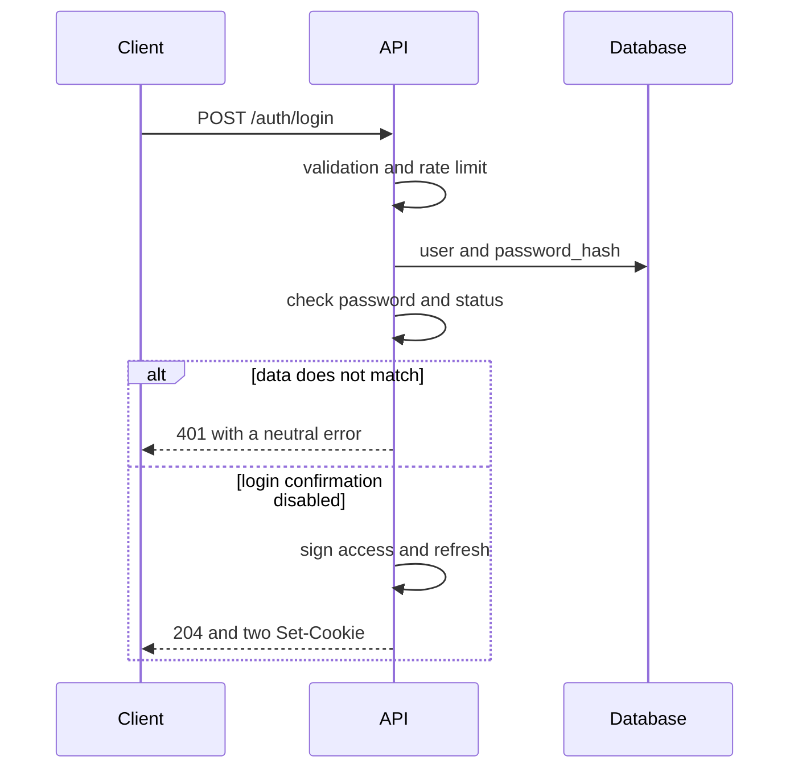
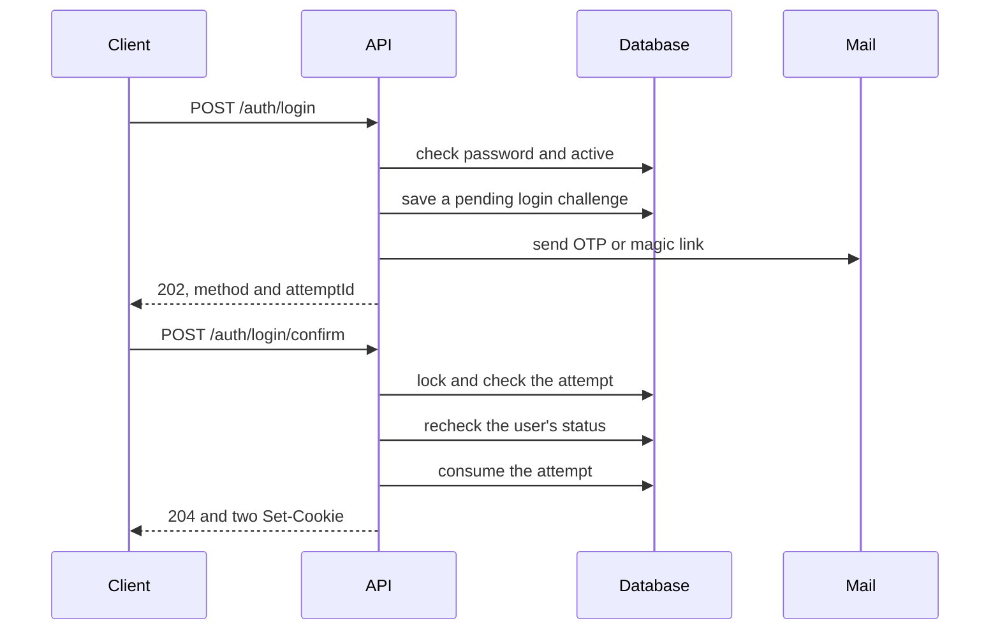
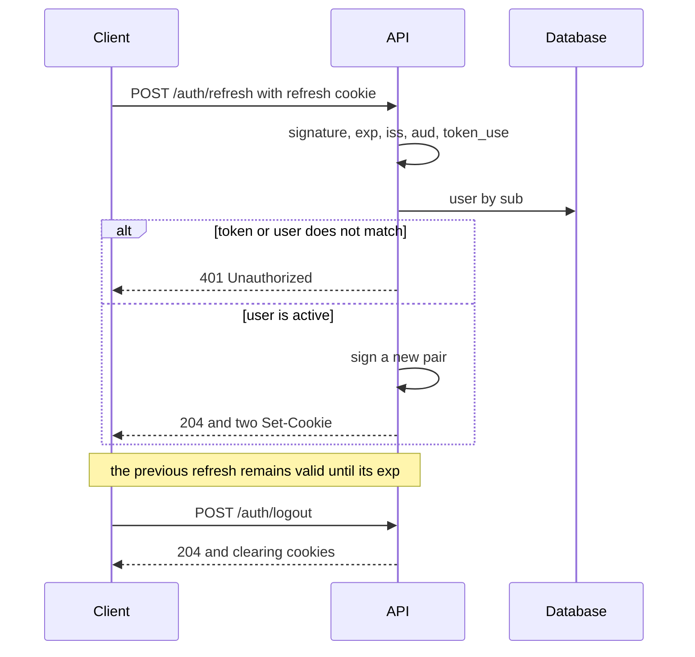

# Authentication

## Contents

- [Theory](#theory)
  - [Situation](#situation)
  - [Model](#model)
  - [Concepts and Their Connection to the Backend](#concepts-and-their-connection-to-the-backend)
  - [Areas of Responsibility](#areas-of-responsibility)
  - [Example](#example)
  - [Common Failures](#common-failures)
  - [Useful Links](#useful-links)
  - [Theory Questions](#theory-questions)
- [Practical Assignment](#practical-assignment)
  - [1.1 General](#11-general)
  - [1.2 Scenarios](#12-scenarios-user-stories)
  - [1.3 Contract](#13-contract)
  - [1.4 Errors and Constraints](#14-errors-and-constraints)
  - [1.5 Audit](#15-auditlogs)
  - [1.6 Non-Functional Requirements](#16-non-functional-requirements)

# Theory

## Situation

A guest sends an email and password over HTTPS. From there, one of several outcomes is possible: the server immediately sets the access and refresh cookies, first requires a code or link from an email, returns a neutral refusal without revealing whether the account exists, rejects an invalid format, limits the rate of attempts, or reports that the database, token signing, or mail is unavailable.

A user with a refresh cookie can obtain a new pair of tokens, and logout clears the cookies. A separate frontend is not needed; all requests can be sent from an HTTP client that supports cookies.

## Model

A direct login involves the client, the API, and the database. The client provides the email and password, but the server itself checks the hash, the user's status, and the confirmation setting. Only a user in the `active` state can receive tokens.



If login confirmation is enabled, a correct password does not yet create a session. The server checks the user's previous unfinished attempt: within 60 seconds a new email is forbidden, and after the pause the previous attempt is replaced by a new one. The client does not choose between OTP and magic link.



For OTP, the attempt is found by `attemptId`, after which the HMAC of the entered code is compared with the stored value in constant time. A magic link contains the attempt identifier and a random secret; the server likewise first finds the record and then compares the HMAC of the secret. The link passes the token in the URL fragment, which the browser does not send to the web server or in `Referer`; the client page reads the fragment and sends the token in the body of a POST. Therefore the access log and a mail scanner with a plain GET neither receive nor use up the secret.

Refresh works without a password, but not without a server-side check of the user. The signature and claims confirm the token's origin, and reading the user by `sub` confirms that the account still exists and has the `active` status.



The server does not store the refresh JWT, a `jti`, a list of allowed or revoked tokens, or a session record. Therefore rotation issues a new pair but does not make the previous refresh single-use. If an old token is stolen, its reuse cannot be distinguished from an ordinary refresh. Logout deletes cookies only in the browser that sent the request and does not revoke a copied token.

Access and refresh are signed with different HMAC keys using the HS256 algorithm. Both tokens contain `sub`, `iss`, `aud`, `iat`, `exp`, and `token_use`; the `token_use` field equals `access` or `refresh`. The verifying code pins the allowed algorithm and the expected token type, so a refresh cannot be used in place of an access token even if it is mistakenly sent in the wrong cookie.

Roles are not placed in the JWT and are not considered during verification. The token establishes identity, and RBAC obtains the current roles and grants from server-side data. Removing a role takes effect without waiting for the 15 minutes of the access token to run out.

Authentication adds only a login attempts table. There is no refresh session table.

| `login_challenges` | Description |
| --- | --- |
| `id` | attempt identifier; used as `attemptId` and is part of the magic link token |
| `user_id` | reference to the user; a partial unique index allows one unconsumed attempt per user |
| `method` | the method chosen by the server: `otp` or `magic_link` |
| `secret_hash` | HMAC-SHA256 of the code or random secret with a separate application key |
| `last_sent_at` | time of the last secret generation; the 10-minute TTL and the 60-second resend pause are counted from it |
| `attempts` | number of incorrect OTP entries; after the fifth, the attempt is consumed |
| `consumed_at` | time of successful confirmation, attempt replacement, entry exhaustion, or user status change |
| `consumed_reason` | `confirmed`, `replaced`, `attempts_exhausted`, or `user_inactive`; equals `null` until consumed |
| `created_at` | time the attempt was created |

### Normal Form

`login_challenges` is in Boyce–Codd normal form (BCNF). The table does not store a computed `expires_at`: the validity period is determined as `last_sent_at` plus a fixed 10 minutes, so there is no anomaly of simultaneously updating two timestamps.

Each subsequent form includes the requirements of the previous one:

- **1NF:** each field contains one value. The code, token, and sending history are not packed into an array; a resend replaces `secret_hash` and `last_sent_at`.
- **2NF:** the primary key consists of a single `id`, so there are no partial dependencies on part of the key.
- **3NF and BCNF:** `user_id`, `method`, the hash, the counter, and the timestamps describe only one attempt. The email, password, and status are not copied from `users` but read via the foreign key.
- **4NF:** a single row has no independent lists of secrets or deliveries. Each attempt is represented by a separate row.
- **5NF:** the attempt and the user are reconstructed by an ordinary join on `user_id`; there are no additional join dependencies.

The partial unique index on `user_id` for rows with `consumed_at IS NULL` expresses a business rule but does not create denormalization. A new attempt first consumes the previous one in the same transaction and then takes the freed unique value.

## Concepts and Their Connection to the Backend

### Password Login and a Neutral Error

The password is sent to the server inside a protected TLS channel. HTTPS does not hide the password from the application itself, so the request body must not be logged, stored in a queue, or included in tracing. The server compares the password with the slow hash from `users.password_hash` using a function of the same library that created the hash at registration.

A response like "email not found" would make it possible to compile a list of users. Therefore a missing email, an incorrect password, and the states `pending`, `blocked`, `deleting`, or `deleted` produce the same status, code, and text. For a missing user, the server performs a check against a pre-prepared dummy hash so that a noticeable time difference does not become a second disclosure channel.

The dummy check does not guarantee absolutely identical timing: the database query, caches, and load still differ. The main protection comes from the neutral response, HTTPS, and rate limiting. Permanently locking an account after several errors is not used, because an attacker could then lock someone else's account.

### JWT and Claims Verification

A JWT consists of a header, a payload, and a signature. The payload is base64url-encoded but not encrypted, so the owner of the cookie or anyone who obtained the token can read it. The password, hash, keys, email, and roles are not included in it.

The signature is verified only with the pre-configured HS256. The server does not accept the algorithm from the token as a setting and does not switch to `none` or another algorithm. Access and refresh use independent keys at least 32 random bytes long and different `token_use` values; this reduces the consequences of one key leaking and rules out mixing up the types.

`sub` contains the user's immutable identifier, `iss` — the expected issuer, `aud` — the expected audience, `iat` — the issuance time, `exp` — the end of the validity period. The allowed clock skew is no more than 30 seconds and does not extend the cookie. After the cryptographic check, the server reads the user by `sub`; a missing record or a status of `pending`, `blocked`, `deleting`, or `deleted` results in **401**.

The JWT keys and the attempt HMAC key are loaded from a protected configuration. If at least one required key is missing, empty, or shorter than 32 bytes, the application does not substitute a default value, does not generate a new key on every start, and does not pass the readiness check.

### Access, Refresh, and Stateless Rotation

The access token is valid for 15 minutes and is sent to protected operations. The refresh token is valid for 30 days and is accepted only by `POST /auth/refresh`. On each successful refresh, both tokens are issued anew, and the new refresh gets a new 30-day period from the moment of rotation.

Such a period forms a sliding session. Since the refresh state is not stored, a stolen token of an active user cannot be forcibly revoked before its `exp`. Moreover, an attacker may manage to exchange it for a new refresh with a new period. Blocking or deleting the user stops the exchange and access, because access and refresh each require reading the current user every time.

Reuse detection requires at least a hash of the current refresh or token family in a server-side session. This is deliberately excluded by the contract. Rotating the signing key would revoke all tokens of that type at once and is therefore unsuitable for logging out a single user.

### Email Challenge

Login confirmation is a second step after a correct password, not a replacement for the password. A server setting enables the step and selects one method for new attempts: a six-digit OTP or a magic link with a random 32-byte secret.

Both methods are valid for 10 minutes. OTP allows five entries: the fifth can still be successful, and a fifth incorrect answer returns a code error and simultaneously consumes the attempt. A resend is allowed no earlier than 60 seconds, replaces the previous secret, restarts the TTL, and resets the OTP counter.

HMAC makes the value in the database unrecoverable without a separate application key. Plain SHA-256 is not suitable for a six-digit OTP: all one million variants can be brute-forced in advance. The HMAC comparison is performed in constant time.

### Cookies, CORS, and CSRF

The default policy assumes a single origin for the page and the API. Cookies have `HttpOnly`, `Secure`, `SameSite=Strict`, contain no `Domain`, and therefore remain host-only. The access cookie is available on the path `/`, and the refresh cookie only on `/auth/refresh`. JavaScript does not read the tokens and does not move them into local storage.

A different origin does not always mean a different site. For example, `app.example.com` and `api.example.com` differ in origin but are usually considered same-site. For a trusted frontend origin, the server lists the exact address in CORS and enables credentials, and the client uses `credentials: "include"`. The value `Access-Control-Allow-Origin: *` together with credentials is not allowed.

Any cross-origin deployment, including same-site, requires an exact `Origin` header and the custom header `X-CSRF-Protection: 1` for state-changing requests. The custom header triggers a CORS preflight, which the server allows only for a trusted origin. Otherwise a neighboring compromised subdomain of the same site could send cookies despite `SameSite=Strict`. An unknown origin or a missing header is rejected with **403**.

If the frontend is also located on a different site, the cookies are additionally switched to `SameSite=None; Secure`; the rules for checking `Origin` and the CSRF header stay the same. GET does not perform login, refresh, logout, or other state changes.

XSS and CSRF are different. `HttpOnly` prevents reading the token through JavaScript, but malicious code on a trusted page can still send requests on behalf of the user. Therefore output escaping, a Content Security Policy, and the absence of secrets in accessible JavaScript are needed.

### Protocols Without Sending the Password

SRP and OPAQUE belong to PAKE: the client proves knowledge of the password through a special cryptographic exchange, and the server stores a verifier. They cannot be added only to the login endpoint, since registration, the server-side data format, the client, and the recovery protocol all change. PAKE also does not replace TLS.

WebAuthn uses a key pair and a server challenge; the private key stays in the authenticator. OAuth 2.0 with PKCE solves a different problem: the application obtains the login result from an external provider, and PKCE binds the authorization code to the client. Neither WebAuthn nor OAuth with PKCE is a hidden way of sending the password in the email+password contract.

### What Will Happen During Authorization

Authentication answers the question "who sent the request" and passes on the verified `userId`. Authorization then obtains the current roles from RBAC and decides whether the action is allowed. An invalid or missing session gives **401**, and a valid session without the right gives **403**.

A role from the JWT, the request body, or an arbitrary header does not take part in the decision. Logout also does not change roles or delete the user: it only clears the current client's cookies.

### Summary

| Concept | Meaning in authentication | What the implementation relies on |
| --- | --- | --- |
| Neutral error | does not reveal whether the account exists or its status | one response and a dummy hash check |
| Access JWT | short-lived proof of identity | HS256, `token_use=access`, TTL 15 minutes |
| Refresh JWT | obtaining a new pair without a password | HS256 with a different key, TTL 30 days |
| Stateless refresh | the server stores neither the session nor revocation | checking the token and the current user |
| OTP | a 6-digit second step | HMAC, TTL 10 minutes, no more than 5 entries |
| Magic link | a second step with a random secret | HMAC and activation only via POST |
| HttpOnly cookie | JavaScript does not read the JWT | `Secure`, `SameSite`, and a restricted `Path` |
| RBAC | checking the right after login | current roles on the server, not JWT claims |

## Areas of Responsibility

| Client | Server |
| --- | --- |
| Sends the email and password only over HTTPS | Normalizes the email, checks the hash and status |
| Stores cookies using browser mechanisms | Never returns the JWT in JSON |
| Shows the same login error | Does not reveal whether the account exists or its status |
| On a **202** response, shows the required second step | Chooses OTP or magic link itself |
| Sends the OTP or the link token via POST | Checks the TTL, the number of attempts, and the HMAC |
| Calls refresh after the access token expires | Checks the refresh token and the current user |
| After **401**, offers to log in again | Does not turn a session error into **403** |
| Calls logout and deletes the local interface state | Clears both cookies with the original attributes |

With a different trusted origin, the client enables credentials and the CSRF header for state-changing requests, and the server returns CORS headers only to that origin. With a different site, `SameSite` also changes; CORS alone does not replace authentication checks or CSRF protection.

## Example

The program issues access and refresh tokens for the user `user-42` with the same `iss` and `aud`, but with different keys and `token_use`. It then verifies both tokens and prints five lines in a fixed order: the access type, whether `sub` matches, the impossibility of accepting a refresh as an access token, the access TTL, and the refresh TTL.

### Node.js

**Node.js 22 or newer, jsonwebtoken library.** For HS256, each key contains at least 32 random bytes; in the application, the access and refresh keys differ.

```sh
npm install jsonwebtoken
node jwt-demo.js
```

```javascript
const jwt = require('jsonwebtoken');

const accessKey = 'access-0123456789abcdef-0123456789';
const refreshKey = 'refresh-0123456789abcdef-01234567';
const now = Math.floor(Date.now() / 1000);

function issue(kind, key, ttl) {
  return jwt.sign({
    sub: 'user-42', iss: 'course-api', aud: 'course-web',
    iat: now, exp: now + ttl, token_use: kind,
  }, key, { algorithm: 'HS256' });
}

function read(token, key) {
  return jwt.verify(token, key, {
    algorithms: ['HS256'], issuer: 'course-api', audience: 'course-web',
  });
}

const access = read(issue('access', accessKey, 900), accessKey);
const refresh = read(issue('refresh', refreshKey, 2592000), refreshKey);
console.log(access.token_use);
console.log(access.sub === 'user-42');
console.log(refresh.token_use === 'access');
console.log(access.exp - access.iat);
console.log(refresh.exp - refresh.iat);
```

### .NET

**.NET 8 or newer, System.IdentityModel.Tokens.Jwt package.** For HS256, a separate key of at least 32 bytes is used for each token type; `ClockSkew` is set explicitly in the application.

```sh
dotnet new console -o JwtDemo
cd JwtDemo
dotnet add package System.IdentityModel.Tokens.Jwt
dotnet run
```

```csharp
using System.IdentityModel.Tokens.Jwt;
using System.Security.Claims;
using System.Text;
using Microsoft.IdentityModel.Tokens;

var accessKey = "access-0123456789abcdef-0123456789";
var refreshKey = "refresh-0123456789abcdef-01234567";
var now = DateTimeOffset.UtcNow.ToUnixTimeSeconds();
var handler = new JwtSecurityTokenHandler { MapInboundClaims = false };

string Issue(string kind, string key, long ttl) =>
    handler.WriteToken(new JwtSecurityToken("course-api", "course-web",
        new[] { new Claim("sub", "user-42"), new Claim("token_use", kind),
            new Claim("iat", now.ToString(), ClaimValueTypes.Integer64) },
        expires: DateTimeOffset.FromUnixTimeSeconds(now + ttl).UtcDateTime,
        signingCredentials: new(new SymmetricSecurityKey(Encoding.UTF8.GetBytes(key)),
            SecurityAlgorithms.HmacSha256)));

ClaimsPrincipal Read(string token, string key) => handler.ValidateToken(token,
    new TokenValidationParameters { ValidIssuer = "course-api", ValidAudience = "course-web",
        IssuerSigningKey = new SymmetricSecurityKey(Encoding.UTF8.GetBytes(key)),
        ValidateIssuerSigningKey = true, ValidAlgorithms = new[] { SecurityAlgorithms.HmacSha256 },
        ClockSkew = TimeSpan.Zero },
    out _);

var access = Read(Issue("access", accessKey, 900), accessKey);
var refresh = Read(Issue("refresh", refreshKey, 2592000), refreshKey);
string Claim(ClaimsPrincipal p, string name) => p.FindFirst(name)!.Value;
Console.WriteLine(Claim(access, "token_use"));
Console.WriteLine((Claim(access, "sub") == "user-42").ToString().ToLowerInvariant());
Console.WriteLine((Claim(refresh, "token_use") == "access").ToString().ToLowerInvariant());
Console.WriteLine(long.Parse(Claim(access, "exp")) - long.Parse(Claim(access, "iat")));
Console.WriteLine(long.Parse(Claim(refresh, "exp")) - long.Parse(Claim(refresh, "iat")));
```

### Python

**Python 3.10 or newer, PyJWT library.** The HS256 key contains at least 32 random bytes; access and refresh are signed with different keys.

```sh
pip install PyJWT
python jwt_demo.py
```

```python
import time
import jwt

access_key = "access-0123456789abcdef-0123456789"
refresh_key = "refresh-0123456789abcdef-01234567"
now = int(time.time())


def issue(kind: str, key: str, ttl: int) -> str:
    claims = {"sub": "user-42", "iss": "course-api", "aud": "course-web",
              "iat": now, "exp": now + ttl, "token_use": kind}
    return jwt.encode(claims, key, algorithm="HS256")


def read(token: str, key: str) -> dict:
    return jwt.decode(token, key, algorithms=["HS256"],
                      issuer="course-api", audience="course-web")


access = read(issue("access", access_key, 900), access_key)
refresh = read(issue("refresh", refresh_key, 2592000), refresh_key)
print(access["token_use"])
print(str(access["sub"] == "user-42").lower())
print(str(refresh["token_use"] == "access").lower())
print(access["exp"] - access["iat"])
print(refresh["exp"] - refresh["iat"])
```

---

All three programs print `access`, `true`, `false`, `900`, and `2592000`. The third line confirms that checking the expected `token_use` must reject a refresh in place of an access token; a single valid signature is not enough for this.

## Common Failures

| What you see | Where to look |
| --- | --- |
| The response differs for an unknown email | a missing user bypassed the neutral error or the dummy hash check |
| A `pending` user receives tokens | the current `users.status` is not checked before issuance |
| A blocked user keeps refreshing | the user is not read by `sub` after the JWT check |
| A refresh token works as an access token | `token_use` is not checked, or a single shared verifier is used without an expected type |
| After a role is removed, the right lives on for 15 minutes | roles are read from the JWT instead of current RBAC data |
| The JWT can be read in JavaScript | the cookie was created without `HttpOnly`, or the token was returned in JSON |
| The cookie does not arrive over HTTPS | the host, `Path`, `SameSite`, or credentials/CORS settings do not match |
| A cross-site cookie does not arrive | `SameSite=None; Secure` is not set for a trusted cross-site frontend |
| A foreign origin, including a neighboring same-site subdomain, can call refresh | the `Origin` and CSRF header check is enabled only for cross-site, or is missing |
| The OTP is visible in the database | the original code or a fast unkeyed hash was stored instead of an HMAC |
| A correct OTP passes after five errors | the fifth incorrect entry did not consume the attempt |
| An old email works after a resend | `secret_hash` and `last_sent_at` were not replaced |
| The link is used up when the email is opened | GET changes state instead of showing a page followed by a POST |
| A stolen refresh works after logout | this is a limitation of the stateless scheme; clearing the cookie does not revoke a copy |
| An old refresh works after rotation | the server does not store a token family, so reuse detection is impossible |
| After a restart, all JWTs unexpectedly stopped working | the key is generated at startup instead of being loaded from a protected configuration |
| The application starts with a test key | a missing secret is replaced with a default value instead of failing readiness |
| After a mail failure, the new code is unknown and the old one is already invalid | the secret was replaced before SMTP; a retry is possible via resend after 60 seconds |
| The log contains a password or JWT | the request body, `Cookie`, `Set-Cookie`, or an exception with the original data is logged |

## Useful Links

### General

- [OWASP — Authentication Cheat Sheet](https://cheatsheetseries.owasp.org/cheatsheets/Authentication_Cheat_Sheet.html) — neutral errors, brute-force protection, and re-verification of identity.
- [OWASP — Password Storage Cheat Sheet](https://cheatsheetseries.owasp.org/cheatsheets/Password_Storage_Cheat_Sheet.html) — verifying the password with the same slow algorithm that was used at registration.
- [OWASP — JSON Web Token Cheat Sheet](https://cheatsheetseries.owasp.org/cheatsheets/JSON_Web_Token_for_Java_Cheat_Sheet.html) — JWT threats, expiration, and the limitations of stateless revocation; the mechanisms are not specific to Java.
- [RFC 7519 — JSON Web Token](https://www.rfc-editor.org/rfc/rfc7519) — the JWT format and the registered claims `sub`, `aud`, `exp`, and `iat`.
- [RFC 8725 — JWT Best Current Practices](https://www.rfc-editor.org/rfc/rfc8725) — pinning the algorithm, checking issuer/audience, and separating token types.
- [MDN — Set-Cookie](https://developer.mozilla.org/en-US/docs/Web/HTTP/Reference/Headers/Set-Cookie) — the `HttpOnly`, `Secure`, `SameSite`, `Path`, and `Domain` attributes.
- [MDN — CORS](https://developer.mozilla.org/en-US/docs/Web/HTTP/Guides/CORS) — credentials, an exact allowed origin, and browser preflight requests.
- [OWASP — Cross-Site Request Forgery Prevention Cheat Sheet](https://cheatsheetseries.owasp.org/cheatsheets/Cross-Site_Request_Forgery_Prevention_Cheat_Sheet.html) — protecting cookie authentication with SameSite, Origin, and custom headers.
- [OWASP — Forgot Password Cheat Sheet](https://cheatsheetseries.owasp.org/cheatsheets/Forgot_Password_Cheat_Sheet.html) — rules for short OTPs and one-time links, applicable to the email challenge.
- [W3C — Web Authentication](https://www.w3.org/TR/webauthn-3/) — a challenge and a key pair as an alternative to password login.
- [RFC 9807 — OPAQUE](https://www.rfc-editor.org/rfc/rfc9807) — a standardized PAKE that requires a separate registration and login protocol.

### By Language

#### Node.js

**Node.js, NestJS.** On Express or Fastify, the authentication contract stays the same.

- [NestJS — Authentication](https://docs.nestjs.com/security/authentication) — attaching identity verification to routes.
- [NestJS — Cookies](https://docs.nestjs.com/techniques/cookies) — reading and setting cookies through the HTTP adapter.
- [jsonwebtoken](https://www.npmjs.com/package/jsonwebtoken) — signing and verifying HS256 JWTs from the example.
- [Node.js — crypto](https://nodejs.org/api/crypto.html) — HMAC, random bytes, and constant-time secret comparison.
- [NestJS — Configuration](https://docs.nestjs.com/techniques/configuration) — required keys, issuer, audience, cookie, and SMTP without default values.
- [NestJS — CORS](https://docs.nestjs.com/security/cors) — an exact list of trusted frontend origins and credentials.
- [NestJS — OpenAPI](https://docs.nestjs.com/openapi/introduction) — describing login, confirm, refresh, logout, and the error branches.
- [Prisma Migrate](https://www.prisma.io/docs/orm/prisma-migrate) or [TypeORM — Migrations](https://typeorm.io/docs/advanced-topics/migrations/) — creating `login_challenges` with a migration.

#### .NET

**.NET, ASP.NET Core.** Minimal API and controllers use the same authentication contract.

- [ASP.NET Core — JWT bearer authentication](https://learn.microsoft.com/en-us/aspnet/core/security/authentication/configure-jwt-bearer-authentication) — verifying the JWT signature, issuer, audience, and expiration.
- [CookieOptions](https://learn.microsoft.com/en-us/dotnet/api/microsoft.aspnetcore.http.cookieoptions) — setting `HttpOnly`, `Secure`, `SameSite`, `Path`, and the cookie lifetime.
- [System.IdentityModel.Tokens.Jwt](https://www.nuget.org/packages/System.IdentityModel.Tokens.Jwt) — issuing and verifying JWTs from the example.
- [CryptographicOperations.FixedTimeEquals](https://learn.microsoft.com/en-us/dotnet/api/system.security.cryptography.cryptographicoperations.fixedtimeequals) — constant-time comparison of the email challenge HMAC.
- [ASP.NET Core — Configuration](https://learn.microsoft.com/en-us/aspnet/core/fundamentals/configuration/) — loading keys and parameters from a protected environment.
- [ASP.NET Core — CORS](https://learn.microsoft.com/en-us/aspnet/core/security/cors) — allowing credentials only for trusted origins.
- [ASP.NET Core — OpenAPI](https://learn.microsoft.com/en-us/aspnet/core/fundamentals/openapi/overview) — an up-to-date specification of authentication operations.
- [EF Core — Migrations](https://learn.microsoft.com/en-us/ef/core/managing-schemas/migrations/) — moving the attempts table between environments.

#### Python

**Python, FastAPI.** For Django or Flask, the authentication contract does not change.

- [FastAPI — OAuth2 with JWT](https://fastapi.tiangolo.com/tutorial/security/oauth2-jwt/) — creating and verifying JWTs; the delivery method in the contract is replaced with HttpOnly cookies.
- [FastAPI — Response Cookies](https://fastapi.tiangolo.com/advanced/response-cookies/) — setting cookies in the response.
- [PyJWT](https://pyjwt.readthedocs.io/en/stable/) — HS256 and claims verification in the example.
- [Python — hmac](https://docs.python.org/3/library/hmac.html) — HMAC and `compare_digest` for OTP and magic link.
- [FastAPI — Settings](https://fastapi.tiangolo.com/advanced/settings/) — required keys, JWT parameters, cookies, and SMTP.
- [FastAPI — CORS](https://fastapi.tiangolo.com/tutorial/cors/) — exact origins, credentials, and allowed headers.
- [FastAPI — Metadata and Docs URLs](https://fastapi.tiangolo.com/tutorial/metadata/) — configuring the automatically generated OpenAPI documentation.
- [Alembic — Tutorial](https://alembic.sqlalchemy.org/en/latest/tutorial.html) — the `login_challenges` migration.

## Theory Questions

1. Why does an identical response for an unknown email, an incorrect password, and an inactive status reduce the risk of account enumeration, but not cancel the need for rate limiting?
2. Why do access and refresh use different keys and `token_use` if both tokens already have a valid signature?
3. Why does stateless rotation not allow detecting reuse of an old refresh, and what would the scheme have to be extended with for reuse detection?
4. What happens after a user is blocked while their access and refresh tokens are still valid, if each check fetches the user by `sub`?
5. Why is a magic link activated by a POST, while simply opening the link with GET does not change state?
6. How does cross-origin differ from cross-site, and when does a cookie actually require `SameSite=None`?
7. Why does `login_challenges` satisfy BCNF, and what anomaly would a separate `expires_at` field, always equal to `last_sent_at` plus 10 minutes, create?

# Practical Assignment

User authentication functionality. A guest logs in with an email and password and then either immediately receives access and refresh tokens in HttpOnly cookies or first confirms the login via email. The access token is valid for 15 minutes, the refresh token for 30 days. Refresh sessions are not stored on the server, logout clears the cookies, and each token is accepted only for an existing user in the `active` state.

## 1) Authentication

### 1.1 General

**Purpose:** establish the user's identity by email and password, issue a pair of JWTs, and support refresh and logout.

**Users/roles:**

- guest — performs login and the email challenge;
- a user with a refresh cookie — refreshes the token pair;
- any client — can call the idempotent logout.

**Dependencies/related settings:**

- registration creates the user and the slow password hash but does not issue tokens;
- `LOGIN_EMAIL_CONFIRMATION_ENABLED` enables the second step for login only;
- `LOGIN_EMAIL_CONFIRMATION_METHOD` has a single value, `otp` or `magic_link`, chosen by the server;
- `JWT_ACCESS_SECRET` and `JWT_REFRESH_SECRET` contain different random values at least 32 bytes long;
- `LOGIN_CHALLENGE_HMAC_KEY` contains a separate random key at least 32 bytes long;
- `JWT_ISSUER` and `JWT_AUDIENCE` are required and are used identically for issuance and verification;
- SMTP and the trusted frontend address are set in the application configuration;
- default cookie policy: host-only, `HttpOnly`, `Secure`, `SameSite=Strict`, without `Domain`.

Until there is a separate settings API, the login confirmation flag and method are changed in the application configuration. The change applies only to new login requests; an already created attempt keeps its method and can be confirmed or resent.

If any required key is missing, empty, or shorter than 32 bytes, the application exits at startup and does not pass the readiness check. A test value, a random key on every start, and a shared key for access, refresh, and the email challenge are forbidden.

RBAC does not trust roles from the JWT and obtains current grants from server-side data. Authentication passes it only the verified `userId`.

### 1.2 Scenarios (user stories)

1. **Login without confirmation:** a user in the `active` state with the correct email and password receives two cookies.
2. **Login with OTP:** after a correct password, the user receives an `attemptId`, enters a six-digit code, and only then receives the cookies.
3. **Login with magic link:** after a correct password, the user receives an email, opens the page, and confirms the login with a separate POST containing the token.
4. **Resend:** the user waits 60 seconds, after which they receive a new code or link; the previous secret stops working.
5. **Token refresh:** a valid refresh token and a current `active` status give a new pair without entering the password.
6. **Logout:** the server clears both cookies, even if they are missing or already invalid.
7. **Termination of access:** `pending`, `blocked`, `deleting`, `deleted`, and a missing user do not pass login, access, or refresh.

### 1.3 Contract

#### 1.3.1 Login Request

| `POST /auth/login` | Checks/validation |
| --- | --- |
| `email: string` | Required, valid format; leading/trailing whitespace is removed, letters are converted to lowercase |
| `password: string` | Required; leading, trailing, and inner whitespace is preserved, the value is not normalized |

**Logic/steps:**

1. Check the body format and the rate limit before the expensive hash check.
2. Get the user by the normalized email. If the record is missing, verify the password against a pre-prepared dummy hash.
3. Compare the password with `password_hash` using the library function.
4. For a missing user, an incorrect password, and any status other than `active`, return a single neutral **401** error.
5. If login confirmation is disabled, sign the access and refresh tokens, then set both cookies in a single response.
6. If confirmation is enabled, check the user's previous unfinished attempt. Until 60 seconds have passed since its `last_sent_at`, return **429** with the remaining time, without creating an attempt or sending an email.
7. After the pause, in a single transaction, lock the user, then the previous attempt, recheck `active` and the 60-second pause, consume the previous attempt, and create a new one using the method chosen by the server. If the status has changed, return a neutral **401** without an email. Commit the attempt before contacting SMTP.
8. Pass the secret only in the email. No JWT or cookies are issued at this step.

If the attempt transaction is not committed, the email is not sent, the client receives **503** and can retry the login. If SMTP did not accept the email after the commit, the attempt is kept, and the **503** contains `confirmationRequired`, `method`, `attemptId`, and `retryAfterSeconds`, but not the secret. A retry is performed via resend or via a new login after the same 60-second pause; both paths replace the secret and do not bypass the sending limit.

Both JWTs are created before the response is formed. If signing at least one token failed, no `Set-Cookie` headers are sent and **503** is returned. A successful response lost by the client does not create a server-side session: a direct login can be repeated, and an already consumed email challenge starts over with login.

**Responses:**

- **Direct success:** **204 No Content**, `Set-Cookie` for access and refresh, without a body.
- **Second step required:** **202 Accepted**, `confirmationRequired: true`, `method`, `attemptId`, `expiresInSeconds: 600`, `resendAfterSeconds: 60`.
- **Invalid credentials or status:** **401 Unauthorized** with a single code `invalid_credentials`.
- The JSON contains no password, hash, JWT, OTP, link token, keys, roles, or information about whether the account exists.

#### 1.3.2 Confirmation and Resend

| Operation | Input data and rules |
| --- | --- |
| `POST /auth/login/confirm` for OTP | `attemptId: string`, `code: string`; the code contains exactly 6 digits |
| `POST /auth/login/confirm` for magic link | `token: string` in the format `attemptId.secret`; the random `secret` contains 32 bytes before base64url encoding; the email passes the token in the URL fragment |
| `POST /auth/login/resend` | `attemptId: string`; the attempt's method does not change |

**Confirmation logic:**

1. Using the attempt identifier, get the `user_id` without making a decision, then lock the user and the attempt row in exactly this order and re-read their state. An attempt that is not found receives **400**.
2. If `attempts` already equals 5 and `consumed_reason` equals `attempts_exhausted`, return **429**. An attempt that is not found, expired, successfully consumed, replaced, or consumed as `user_inactive` receives a common **400** response.
3. Expiration is determined as `last_sent_at + 10 minutes`; an expired attempt does not increment `attempts`.
4. Check the already locked user by `user_id`. If the user is missing or their status is not `active`, consume the attempt with the reason `user_inactive` and return the same **401 invalid\_credentials** as at login.
5. Compute the HMAC-SHA256 of the submitted secret and compare it with `secret_hash` in constant time.
6. On an incorrect OTP, increment `attempts` in the same transaction. The fifth entry is still checked; the fifth incorrect entry returns **400** and consumes the attempt with the reason `attempts_exhausted`. The next entry returns **429**.
7. On an incorrect magic link, return **400**; the counter does not apply to the link.
8. On a match, sign both JWTs, consume the attempt with the reason `confirmed`, commit the transaction, and set two cookies.

If signing the tokens or committing the transaction failed, no cookies are sent, **503** is returned, and the rolled-back attempt can be confirmed again. If the response is lost after the commit, the attempt remains consumed and the user starts a new login.

**Resend logic:**

1. Using `attemptId`, get the `user_id`, lock the user, then the attempt, and accept only an attempt of an active user. An expired TTL forbids confirmation but not resend; an attempt that is not found, replaced, confirmed, or consumed as `user_inactive` receives **400**, and `attempts_exhausted` receives **429**.
2. If less than 60 seconds have passed since `last_sent_at`, return **429** and the number of remaining seconds.
3. Create a new secret of the same method, replace `secret_hash`, set a new `last_sent_at`, and reset `attempts` in a single transaction.
4. After the commit, send the email. The old code or link no longer works.
5. If SMTP did not accept the new email, return **503**. The new hash remains saved, the old secret is not restored, and the next sending is possible after 60 seconds.

**Responses:**

- **Confirmation:** **204 No Content** and two cookies, without a body.
- **Resend:** **202 Accepted**, `method`, `attemptId`, `expiresInSeconds: 600`, `resendAfterSeconds: 60`.
- **Errors:** see section 1.4.
- Responses contain no JWT, password, hash, OTP, link token, or HMAC.

#### 1.3.3 JWT and Cookies

| Claim | Access | Refresh |
| --- | --- | --- |
| `sub` | user identifier | the same user identifier |
| `iss` | the value of `JWT_ISSUER` | the value of `JWT_ISSUER` |
| `aud` | the value of `JWT_AUDIENCE` | the value of `JWT_AUDIENCE` |
| `iat` | server issuance time | server issuance time |
| `exp` | `iat + 15 minutes` | `iat + 30 days` |
| `token_use` | `access` | `refresh` |

The signing algorithm is HS256 only. Access is signed with `JWT_ACCESS_SECRET`, refresh with `JWT_REFRESH_SECRET`. `jti`, roles, email, password, hash, and personal data are absent from the payload. The full JWT is not stored anywhere on the server.

| Cookie | Default attributes |
| --- | --- |
| `access_token` | `HttpOnly; Secure; SameSite=Strict; Path=/; Max-Age=900`, without `Domain` |
| `refresh_token` | `HttpOnly; Secure; SameSite=Strict; Path=/auth/refresh; Max-Age=2592000`, without `Domain` |

The cookie lifetime matches `exp`. The server does not return tokens in the body, in a header accessible to JavaScript, or in a URL. All operations work only over HTTPS; no exception is provided for an insecure production environment.

By default, the frontend and the API share one origin. For a different trusted origin, CORS lists the exact origin, allows credentials and the `X-CSRF-Protection` header, and the browser sends requests with `credentials: "include"`. All POST requests from a different origin check the exact `Origin` and the `X-CSRF-Protection: 1` header, regardless of whether both origins belong to the same site. If the origin is on a different site, both auth cookies additionally receive `SameSite=None; Secure`. A rejected CSRF check returns **403** with the code `csrf_rejected`.

#### 1.3.4 Token Refresh

| `POST /auth/refresh` | Checks/validation |
| --- | --- |
| Cookie `refresh_token` | Required; the JWT must have HS256, a valid signature, `iss`, `aud`, `iat`, `exp`, a non-empty `sub`, and `token_use=refresh` |

**Logic/steps:**

1. Extract the refresh token only from the cookie; do not accept a value from the body, query, or another header.
2. Check the format, algorithm, signature, and claims with an allowed clock skew of no more than 30 seconds.
3. Get the user by `sub` from the database.
4. If the user is missing or has the status `pending`, `blocked`, `deleting`, or `deleted`, return **401** without issuing cookies.
5. For an `active` user, sign a new access token for 15 minutes and a new refresh token for 30 days from the current moment.
6. Set both cookies in a single response. Do not store the previous refresh token and do not add it to a denylist.

Rotation does not invalidate the used refresh token: any copy of it remains cryptographically valid until its own `exp`. Reuse is not detected, and a specific refresh token is not forcibly revoked.

If the database is unavailable, return **503**, not **401**. If signing the new pair failed, return **503** without `Set-Cookie`; the client's previous cookie remains usable for a retry until its `exp`.

**Responses:**

- **Success:** **204 No Content** and a new pair of cookies.
- **Invalid session:** **401 Unauthorized** with the code `invalid_session`.
- The response contains no JWT, `sub`, user status, roles, or keys.

#### 1.3.5 Logout

| `POST /auth/logout` | Rule |
| --- | --- |
| No body | The operation does not require a valid access or refresh token and always clears the current client's cookies |

The server sends expired `access_token` and `refresh_token` with the same `Path`, `Secure`, `SameSite`, and missing `Domain` that were used when setting them. For a cross-origin configuration the CSRF check applies, and for cross-site `SameSite=None` is additionally preserved.

**Response:** **204 No Content** regardless of whether there are cookies. No body, JWT, or user information.

Logout does not write the refresh token to the database and does not revoke its copy on another device. After clearing, the client deletes the local interface state and goes to the login form.

#### 1.3.6 Access Check

**General rule:** each protected operation first calls the single authentication check.

| Input | Checks/validation |
| --- | --- |
| Cookie `access_token` | HS256, signature, `iss`, `aud`, `iat`, `exp`, non-empty `sub`, `token_use=access` |

**Logic/steps:**

1. Verify the access token with an allowed clock skew of no more than 30 seconds.
2. Get the user by `sub`, selecting only `id` and `status`.
3. Accept only an existing user with the `active` status.
4. Pass on the `userId`, but not role claims.

A missing cookie, an invalid or expired JWT, an unknown user, and the statuses `pending`, `blocked`, `deleting`, `deleted` produce a single **401 invalid\_session** response. Database unavailability produces **503**. On success there is no separate HTTP response: the request proceeds to RBAC and the handler.

### 1.4 Errors and Constraints

- **400 Bad Request** — invalid format of login, confirm, or resend; an incorrect or expired OTP or magic link; the attempt is not found, replaced, already successfully used, or consumed as `user_inactive`.
- **401 Unauthorized** — a neutral refusal for an unknown email, an incorrect password, and a user not in the `active` state; the access or refresh token is missing, invalid, expired, of the wrong type, or refers to a missing or inactive user.
- **403 Forbidden** — a request from an untrusted origin, or the required CSRF check failed; the response code `csrf_rejected` does not substitute for an RBAC decision.
- **429 Too Many Requests** — the login rate limit is exceeded; a new email via login or resend was requested earlier than 60 seconds; the OTP has already exhausted five entries.
- **503 Service Unavailable** — the database, SMTP, or the signing operation is unavailable; the partial failure state is described for the corresponding operation.

The login **401** error has the same code `invalid_credentials`, text, and shape for an unknown email, an incorrect password, `pending`, `blocked`, `deleting`, and `deleted`. The session error has a common code `invalid_session` and does not report which JWT or user check failed.

### 1.5 Audit/Logs

Log:

- successful and unsuccessful login, triggering of both rate limits, and the result of the email challenge;
- creation, resend, successful confirmation, incorrect entry, expiration, and exhaustion of an attempt;
- successful and unsuccessful refresh, logout, and access check refusals;
- unavailability of the database, SMTP, and token signing;
- rejection of an origin or the CSRF check.

For a known user, `userId`, the event type, the challenge method, `attemptId`, the result, the time, and the request identifier are recorded. For an unknown email, an irreversible internal identifier with a separate key is used, so that attacks can be correlated without recording the address. The JWT failure reason is logged as a category `missing`, `malformed`, `signature`, `expired`, `claims`, `token_use`, or `user_inactive`, but a common error is returned to the outside.

The log must not contain the email in plain text, the password, the password hash, the OTP, the magic link token, the HMAC, the JWT, `Cookie`, `Set-Cookie`, keys, the full URL, the full request body, or the full headers.

### 1.6 Non-Functional Requirements

- `POST /auth/login` allows no more than 30 requests per IP per minute and no more than 5 unsuccessful checks per email and IP pair within 15 minutes. Refresh — no more than 30 requests per IP per minute. OTP has 5 attempts; resend has a 60-second pause.
- Indexes cover lookup by normalized email and the single unconsumed attempt per `user_id`. Confirmation is performed transactionally.
- Automated tests cover direct login, both email methods, the fifth attempt, resend, logout, user statuses, and CSRF.
- The project's general non-functional requirements — input validation, CORS, OpenAPI, structured logs, health checks, and test coverage of at least 80% — also apply to these operations.
