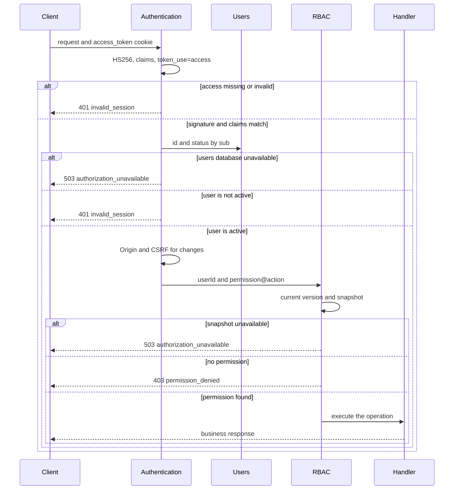
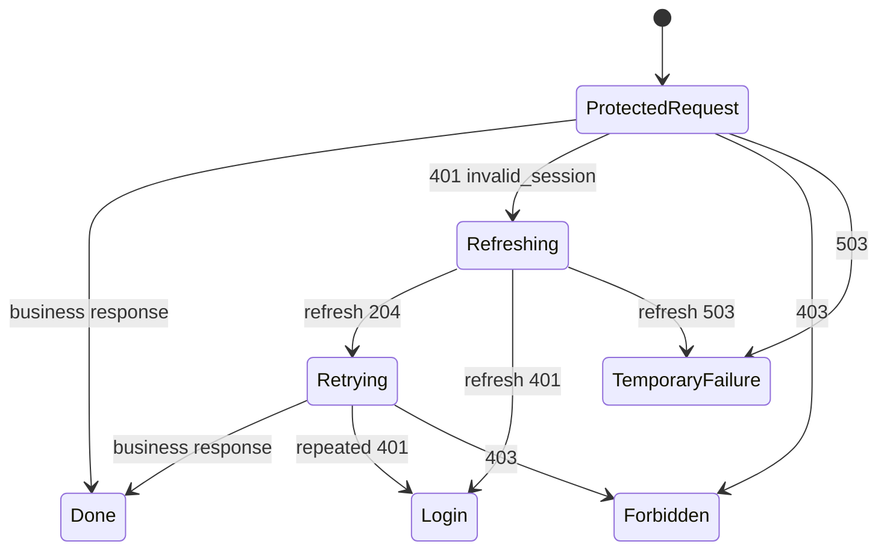
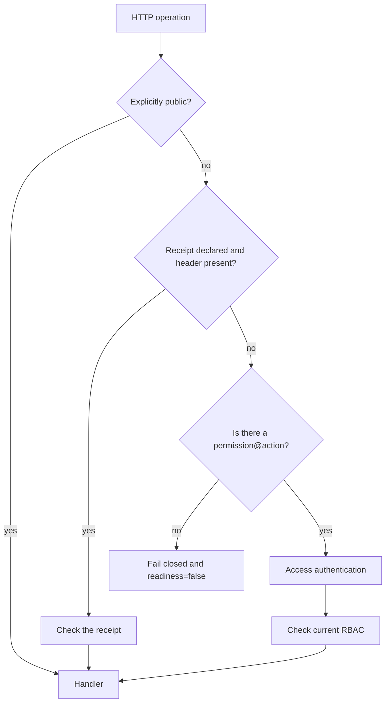

# Authorization

## Contents

- [Theory](#theory)
  - [Situation](#situation)
  - [Model](#model)
  - [Concepts and Their Connection to the Backend](#concepts-and-their-connection-to-the-backend)
  - [Areas of Responsibility](#areas-of-responsibility)
  - [Common Failures](#common-failures)
  - [Useful Links](#useful-links)
  - [Theory Questions](#theory-questions)
- [Practical Assignment](#practical-assignment)
  - [1.1 General](#11-general)
  - [1.2 Scenarios](#12-scenarios-user-stories)
  - [1.3 Contract](#13-contract)
  - [1.4 Errors and Constraints](#14-errors-and-constraints)
  - [1.5 Audit](#15-auditlogs)
  - [1.6 Non-Functional Requirements](#16-non-functional-requirements)

# Theory

## Situation

A user calls a protected operation with an access JWT in a cookie. From there, one of several outcomes is possible: the identity is not established and the server returns **401**; the user is established, but the action is forbidden to them, with a **403** response; the user's current data or RBAC is unavailable and **503** arrives; or the handler runs and returns its own result.

If the access token has expired, the client refreshes the token pair once via refresh and repeats the original request. A **403** response does not trigger a refresh, since a new pair confirms the same identity and does not add any rights.

## Model

A protected request involves the client, access JWT authentication, the users database, RBAC, and the business handler. The order is fixed: first the identity is established, then the right is checked, and only after that is the target resource read and the operation performed.

RBAC receives the `userId` only after the token and the user's status have been fully checked. The required `permission` and `action` are set on the server by the handler. Values from the JWT, body, query, or an arbitrary header cannot weaken the requirement.

An expired access token is not refreshed inside a protected handler. The client receives **401**, calls a separate authentication endpoint, and repeats the original request no more than once.

Several parallel requests may see an expired access token at the same time. The client gathers them around a single refresh: the others wait for its result instead of rotating the refresh token independently. After a successful refresh, each waiting request is retried once.

Each HTTP operation belongs in advance to one of three kinds. A public operation has an explicit marker and does not trigger the access check. A protected operation declares one `permission@action` pair. A receipt-based operation declares a header name; if the header is present, access and RBAC are not triggered, and the handler checks the receipt. A receipt can be combined with one pair: if there is no header — the usual access and RBAC chain. The absence of any declaration is considered a configuration error and does not open the route.

Authorization adds no tables and does not change the existing schema. The user and their status are read from `users`, and the roles, permissions, grants, and policy version from the normalized RBAC tables. The refresh JWT, `jti`, and a server-side session are still not stored.

## Concepts and Their Connection to the Backend

### Authentication Before Authorization

Authentication establishes identity. The access token is extracted only from the HttpOnly cookie `access_token` and is verified with the fixed HS256 and the access key, the expected `iss`, `aud`, `iat`, `exp`, a non-empty `sub`, and `token_use=access`. Then the server fetches the user by `sub` and accepts only the `active` status.

Authorization receives the already verified `userId` and answers a different question: is this user allowed to fulfill the server-side `permission@action` requirement. If the order were swapped, a missing session would start to look like a missing role, and the client would not be able to tell whether a refresh is needed.

A public operation does not try to parse an access cookie that happens to be sent. For example, a corrupted cookie does not prevent logging in again or checking `/health`. The refresh endpoint also does not go through the access guard: it separately verifies the refresh JWT according to the authentication contract.

### Separating 401, 403, and 503

**401 Unauthorized** means the server could not establish a valid identity: the cookie is missing, the JWT is corrupted or expired, the claims do not match, the user was not found or has the status `pending`, `blocked`, `deleting`, or `deleted`. RBAC and the handler are not called after such a response.

**403 Forbidden** means an active user has already been established, but the request is forbidden. The cause is the absence of a current permission, a failed ownership check, or a CSRF rejection for a state-changing operation. Logging in again or refreshing will not fix this result.

**503 Service Unavailable** means the decision cannot be made safely: the users database or the current RBAC snapshot is unavailable, or the route configuration failed validation. A dependency error is not disguised as **401** or **403**; otherwise a temporary failure would look like a change of identity or rights.

### The JWT Establishes Identity, Not Role

The JWT signature proves that the claims were issued by a trusted server and have not been changed. It does not prove that the user is still active, so the user is queried by `sub` every time. Blocking or deletion stops new requests even before the 15 minutes run out.

Roles, permissions, and actions in the JWT are not used. Otherwise a removed role would keep working until `exp`, and a policy change would require issuing a new pair. The access token may contain only the contract's identity claims; unknown claims do not become a source of rights.

A JWT is a bearer credential: anyone who obtains it can act on behalf of the user until it expires and the current status is checked. `HttpOnly` reduces the risk of the token being read through JavaScript, but does not replace HTTPS, XSS protection, and CSRF protection.

### Current RBAC and Default Deny

The handler specifies the minimal pair, for example `reports@read` or `users@delete`. RBAC combines the rights of all of the user's current roles according to the rules of the RBAC module. A matching role name, a hidden button, or a value from the client by themselves allow nothing.

Before making a decision, the process compares the version of the local snapshot with `rbac_policy_state.version`. If the version has changed, a new snapshot is built entirely and atomically replaces the old one. If loading fails, the old rights are not used, and the request receives **503**.

The user's absence from the snapshot, the absence of roles, an unknown permission, an unknown action, and the absence of a matching grant all result in denial. A route without the public marker, without a `permission@action` pair, and without a declared receipt does not become public: the configuration check drops readiness, and the request does not reach the handler.

### The Target Resource and Additional Rules

The general permission check is performed before the target resource is read. A user without `reports@read` receives **403** for both an existing and a made-up `reportId`, so the existence of a record is not revealed by enumeration.

The additional `*_any` action does not replace the route's base pair. The handler checks it after the base right and before looking up the target. The declaration still contains one pair: the profile declares `users@read`, and `users@read_any` is checked for someone else's identifier.

After a successful RBAC check, the handler may load the resource. A missing record then gives **404**. The rule "you can change only your own record" requires comparing the `userId` with the owner; a mismatch gives **403**, even if the general permission `profile@update` is present.

Authorization is checked at the beginning of the request. If the access token expired or the user was blocked after a successful check, the running handler is not interrupted; all subsequent requests will see the new state. A long-running operation itself determines whether a recheck is needed before a critical commit.

### Refresh on the Client

The client reacts only to a **401** with the code `invalid_session` from a protected operation. A single shared promise, task, or coroutine performs `POST /auth/refresh`, and the other requests wait. A **204** success allows a single retry with the new cookies.

A **401** response from refresh means the end of the client session: the local user state is cleared and the login is shown. On **503** the state is not wiped, since the token may still be valid; the client shows a temporary failure and allows the action to be repeated later without an infinite loop.

A **403** response does not trigger a refresh. An automatic refresh after every **403** creates unnecessary load and does not change roles. A repeated **401** after a successful refresh also ends the cycle and sends the user to login.

### Cookies, CORS, and CSRF

Authorization uses the authentication policy without changes: by default the frontend and API share one origin, `access_token` is a host-only cookie with `HttpOnly; Secure; SameSite=Strict; Path=/`, and the refresh cookie is available only on `/auth/refresh`. JavaScript sends cookies using browser mechanisms and does not read the JWT.

For a different trusted origin, CORS lists the exact address and allows credentials, and the client sets `credentials: "include"`. Any state-changing operation from a different origin checks the exact `Origin` and requires `X-CSRF-Protection: 1`, even if the frontend and API remain same-site: `SameSite=Strict` does not protect against a compromised neighboring subdomain. If the origin is also cross-site, the cookies additionally receive `SameSite=None; Secure`.

CORS controls whether a browser page can read the response and send a credentialed request. RBAC controls the right of an already established user. Neither CORS nor hiding an interface element replaces server-side authorization.

### Summary

| Concept | Meaning in authorization | What the implementation relies on |
| --- | --- | --- |
| Authentication | establishes an active user | the access JWT and reading `users` by `sub` |
| Authorization | decides whether the action is allowed | the current RBAC snapshot |
| **401** | identity not established | refusal before RBAC |
| **403** | identity established, request forbidden | RBAC, ownership, or CSRF |
| **503** | a safe decision is temporarily impossible | fail closed without the old snapshot |
| Public | an operation without the access guard | an explicit server-side marker |
| Receipt | access without a session via a secret receipt | a declared header; without it — the route's pair |
| `permission@action` | the handler's minimal requirement | the route's server-side configuration |
| Single-flight refresh | one refresh for parallel **401**s | request coordination on the client |

## Areas of Responsibility

| Client | Server |
| --- | --- |
| Sends cookies with `credentials: "include"` for a different origin | Extracts the access token only from `access_token` |
| After **401**, performs one refresh and one retry | Returns **401** before RBAC and the handler |
| After **403**, shows the refusal without a refresh | Returns **403** only after the identity is established |
| On **503**, offers to retry later | Does not use an unavailable or outdated policy |
| May hide unavailable actions | Checks every operation independently of the interface |
| Does not pass a role or the required right | Takes `permission@action` from the handler |
| Retries only a request rejected by the guard | Does not run business logic until the checks are complete |
| For a cross-origin change, sends the CSRF header | Checks `Origin`, CSRF, and current RBAC |

Refresh, JWT issuance, and clearing cookies belong to authentication. Authorization does not sign tokens, does not store sessions, and does not change roles.

## Common Failures

| What you see | Where to look |
| --- | --- |
| A request without a cookie receives **403** | RBAC is called before authentication, or its error is converted into a rights denial |
| A user without the right receives **401** | an RBAC refusal mistakenly triggers a refresh and mixes up two types of decision |
| A blocked user gets through to RBAC | the current `users.status` is not read after the JWT signature check |
| A removed role works until the access `exp` | roles and permissions are taken from JWT claims |
| The client can pass a weaker right | `permission` or `action` are read from the request rather than from the handler |
| A new route is open without configuration | the absence of public and `permission@action` is treated as permission |
| The public login breaks because of an old cookie | the access guard runs for an operation with an explicit public marker |
| Any dependency error gives **401** | unavailability of the database or snapshot is hidden behind a session error instead of **503** |
| On an update failure, the old rights are used | RBAC keeps working on an outdated snapshot instead of failing closed |
| A **403** reveals whether a record exists | the resource is read before the general permission check |
| A hidden button can be invoked via an HTTP request | the interface is treated as the source of the decision instead of the server-side guard |
| One expired access token triggers several refreshes | the client has no single-flight coordination of parallel **401**s |
| A refresh loop starts after **403** | the client does not distinguish `invalid_session` from `permission_denied` |
| A request is endlessly retried after refresh | there is no limit of one retry |
| A cross-origin change, including same-site, passes without a CSRF check | the protection is mistakenly enabled only together with `SameSite=None`, without an exact `Origin` and the custom header |
| CORS allows `*` together with cookies | the credentialed origin is configured as a wildcard instead of an exact list |
| JWTs or cookies are visible in the log | the entire request headers are logged |
| The handler changes data before the RBAC decision | the guard is attached after the business logic or only inside some of the handlers |

## Useful Links

### General

- [OWASP — Authorization Cheat Sheet](https://cheatsheetseries.owasp.org/cheatsheets/Authorization_Cheat_Sheet.html) — default deny, least privilege, and checking every request.
- [OWASP — REST Security Cheat Sheet](https://cheatsheetseries.owasp.org/cheatsheets/REST_Security_Cheat_Sheet.html) — server-side access token verification and distinguishing HTTP statuses.
- [NIST — Role Based Access Control FAQ](https://csrc.nist.gov/projects/role-based-access-control/faqs) — the RBAC model of users, roles, permissions, and sessions.
- [RFC 9110 — HTTP Semantics](https://www.rfc-editor.org/rfc/rfc9110) — the normative meaning of **401**, **403**, **404**, and **503**.
- [RFC 8725 — JWT Best Current Practices](https://www.rfc-editor.org/rfc/rfc8725) — pinning the algorithm and mutually exclusive validation rules for different JWT types.
- [MDN — 401 Unauthorized](https://developer.mozilla.org/en-US/docs/Web/HTTP/Reference/Status/401) — the response when a valid identity is not established.
- [MDN — 403 Forbidden](https://developer.mozilla.org/en-US/docs/Web/HTTP/Reference/Status/403) — the response to an established user whose request is forbidden.
- [MDN — CORS](https://developer.mozilla.org/en-US/docs/Web/HTTP/Guides/CORS) — credentialed requests, an exact origin, and preflight.
- [OWASP — Cross-Site Request Forgery Prevention Cheat Sheet](https://cheatsheetseries.owasp.org/cheatsheets/Cross-Site_Request_Forgery_Prevention_Cheat_Sheet.html) — `SameSite`, `Origin` checking, and a custom header for cookie authentication.
- [OpenAPI Specification — Security Scheme Object](https://spec.openapis.org/oas/latest.html#security-scheme-object) — describing cookie authentication and the requirements of protected operations.

### By Language

#### Node.js

**Node.js, NestJS.** On Express or Fastify, the order access → user → RBAC → handler stays the same.

- [NestJS — Guards](https://docs.nestjs.com/guards) — a centralized check before the handler is called.
- [NestJS — Authentication](https://docs.nestjs.com/security/authentication) — establishing identity via JWT.
- [NestJS — Authorization](https://docs.nestjs.com/security/authorization) — role- and claims-based guards; by contract, current rights are loaded from RBAC.
- [NestJS — Custom decorators](https://docs.nestjs.com/custom-decorators) — server-side public and `permission@action` markers.
- [NestJS — CORS](https://docs.nestjs.com/security/cors) — exact trusted origins and credentials.
- [NestJS — OpenAPI security](https://docs.nestjs.com/openapi/security) — describing the cookie security scheme and protected operations.

#### .NET

**.NET, ASP.NET Core.** Minimal API and controllers use the same middleware chain and policy-based authorization.

- [ASP.NET Core — Overview of authorization](https://learn.microsoft.com/en-us/aspnet/core/security/authorization/introduction) — separating authentication and authorization.
- [ASP.NET Core — Policy-based authorization](https://learn.microsoft.com/en-us/aspnet/core/security/authorization/policies) — requirements and handlers for `permission@action`.
- [ASP.NET Core — JWT bearer authentication](https://learn.microsoft.com/en-us/aspnet/core/security/authentication/configure-jwt-bearer-authentication) — verifying the JWT before the authorization middleware.
- [ASP.NET Core — CORS](https://learn.microsoft.com/en-us/aspnet/core/security/cors) — middleware order, exact origins, and credentials.
- [ASP.NET Core — OpenAPI](https://learn.microsoft.com/en-us/aspnet/core/fundamentals/openapi/overview) — describing the security scheme and the responses of protected operations.

#### Python

**Python, FastAPI.** For Django or Flask, the same dependency order and the same statuses are kept.

- [FastAPI — Dependencies](https://fastapi.tiangolo.com/tutorial/dependencies/) — sequential execution of shared authentication and the rights check.
- [FastAPI — Security](https://fastapi.tiangolo.com/tutorial/security/) — building the user context before the handler.
- [FastAPI — OAuth2 scopes](https://fastapi.tiangolo.com/advanced/security/oauth2-scopes/) — declaring requirements; by contract, the current decision is made by server-side RBAC.
- [FastAPI — CORS](https://fastapi.tiangolo.com/tutorial/cors/) — credentials and an explicit list of origins.
- [FastAPI — Metadata and Docs URLs](https://fastapi.tiangolo.com/tutorial/metadata/) — up-to-date OpenAPI documentation of operations and errors.

## Theory Questions

1. Why must an invalid access token end with **401** before RBAC, while the absence of a permission for an active user ends with **403**?
2. Why, after verifying the JWT signature, does every request fetch the user by `sub` and check their current status?
3. Why are roles from the access JWT unsuitable for a policy that must apply immediately after a role is removed?
4. What happens if the policy version has changed but the new RBAC snapshot could not be loaded, and why can the old snapshot not continue to be used?
5. Why is the target resource read after the general permission check, and in what case does **404** appear after it?
6. How does single-flight refresh prevent a rotation race with several simultaneous **401** responses?
7. How do CORS and CSRF differ from RBAC, and why does none of these mechanisms replace the others?

# Practical Assignment

Functionality for authorizing user requests in the system. Each protected operation first checks the access JWT and the user's current status, then applies RBAC, and only after that runs the handler. A missing session returns **401**, a missing right for an established user — **403**, and unavailability of the data needed for a safe decision — **503**.

## 1) Authorization

### 1.1 General

**Purpose:** centrally admit to protected operations only active users with a current permission.

**Users/roles:**

- guest — calls only explicitly public operations;
- an authenticated user — passes the access check and RBAC;
- an RBAC administrator — passes the same chain with the `rbac@manage` permission.

**Dependencies/related settings:**

- authentication issues an access JWT for 15 minutes in the HttpOnly cookie `access_token`;
- the access token is verified according to the authentication contract: HS256, the access key, `iss`, `aud`, `iat`, `exp`, `sub`, `token_use=access`;
- the users database is the source of the current `status`;
- RBAC provides a current snapshot of roles, permissions, actions, grants, and the `version`;
- each HTTP operation has a public marker, one `permission@action` pair, a declared receipt, or a receipt together with one pair;
- the cookie and CORS policy matches authentication: same-origin, host-only, `Secure`, `SameSite=Strict` by default.

JWT issuance and refresh, the email challenge, and logout are performed by authentication. Authorization does not sign tokens, does not set cookies, does not verify the password, and does not store the refresh token, `jti`, or a server-side session.

Roles and permissions from the JWT, body, query, and arbitrary headers are ignored. RBAC uses only current server-side data in accordance with the role management contract.

### 1.2 Scenarios (user stories)

1. **Allowed request:** the access token is valid, the user is `active`, and one of the current roles contains the required action; the handler runs.
2. **No session:** the access token is missing, corrupted, expired, or has invalid claims; the server returns **401** without calling RBAC.
3. **User is no longer active:** the JWT is valid, but the user is missing, `pending`, `blocked`, `deleting`, or `deleted`; the server returns **401**.
4. **No right:** the identity is established, but there is no matching grant; the server returns **403** without reading the target resource.
5. **Policy unavailable:** the current snapshot cannot be obtained; the server returns **503** and does not use the old rights.
6. **Access token expired:** the client performs one refresh and, after success, repeats the request once.
7. **Public operation:** an explicit public marker skips access and RBAC; a stray invalid cookie does not change its contract.
8. **Ownership check:** after the general RBAC check, the handler loads the resource and allows the action only to its owner.

### 1.3 Contract

#### 1.3.1 Protected Operation

| Input | Source and rule |
| --- | --- |
| Cookie `access_token` | The only source of the access JWT; a value from `Authorization`, the body, query, or another header is not accepted |
| `permission` | The normalized permission name from the handler's server-side configuration |
| `action` | The normalized action of the same handler |
| HTTP method and path | Used to select the operation's metadata, but do not determine the right from client data |

**Logic/steps:**

1. Find the server-side declaration of the operation. If it is explicitly public, proceed to the handler without parsing access and RBAC.
2. For a protected operation, extract `access_token` from the cookie and check HS256, the signature, `iss`, `aud`, `iat`, `exp`, a non-empty `sub`, and `token_use=access`.
3. On any access error, return **401 invalid\_session**. Do not call RBAC, read the resource, or call the handler.
4. Get only `id` and `status` from `users` by `sub`. Accept only an existing user with the `active` status; return the other cases as **401 invalid\_session**.
5. For a state-changing operation from a different origin, check the allowed `Origin` and the required CSRF header regardless of the site boundary. Once the identity is established, a refusal receives **403 csrf\_rejected**.
6. Pass to RBAC only the `userId`, `permission`, and `action` from the handler.
7. Compare the snapshot version with the policy version. On a mismatch, fully load and atomically install a new snapshot.
8. If the current snapshot is unavailable, return **503 authorization\_unavailable** without using the old one.
9. If none of the current roles allows the action, return **403 permission\_denied**.
10. Only after RBAC allows it, read the target resource, perform ownership checks, and run the business logic.

The access token is checked as of the start of the request. Expiration of `exp` during an already admitted handler does not interrupt it. Blocking the user or changing the policy, committed after the corresponding check, takes effect for subsequent requests; a long-running critical operation, if necessary, repeats the check before committing according to its own contract.

If the users database is unavailable, return **503**, not **401**. If the user check passed but RBAC is unavailable, also return **503**. In both outcomes the handler does not run and there are no partial business changes.

**Responses:**

- **Access allowed:** the status and body are determined by the business handler.
- **Identity not established:** **401 Unauthorized**, code `invalid_session`.
- **Request forbidden:** **403 Forbidden**, code `permission_denied`, `ownership_denied`, or `csrf_rejected`.
- **Decision unavailable:** **503 Service Unavailable**, code `authorization_unavailable`.
- The authorization response contains no JWT, cookies, `sub`, user status, user roles, required permission, internal version, or snapshot contents.

#### 1.3.2 Operation Declaration

| Kind of operation | Required server-side declaration |
| --- | --- |
| Public | `public=true`; access and RBAC are not triggered |
| Protected | exactly one `permission@action` pair; `public` is absent |
| Receipt-based | a header name; when it is present, access and RBAC are not triggered. One `permission@action` pair may be declared alongside it for calls without the header |

The registration, login, email confirm/resend, refresh, logout, and minimal liveness check operations are marked public. Each of them applies its own checks, rate limit, and statuses. Readiness may be accessible only to internal infrastructure. The deletion status is not public: the `Deletion-Receipt` header opens the owner branch, and without it the `users@delete` pair applies.

All other operations are protected by default. At startup, the application checks the declaration, and the requirement names are checked against the RBAC format. `public=true` together with a pair or a receipt, as well as the absence of any declaration, drops readiness; if a request still reaches the process, it receives **503 authorization\_unavailable**, and the handler does not run. A receipt together with one pair is allowed. If the declared header is present, the receipt check is performed. If it is absent, a pair is required, and the request goes through the usual chain.

A `permission` or `action` unknown to the current policy is not a client error and results in **403 permission\_denied**. Adding a grant in RBAC starts allowing subsequent requests without changing the handler and without a new JWT.

The client does not pass the kind of operation, `permission`, or `action`. OpenAPI marks cookie security only on protected operations, but the documentation is not the source of the decision: the server-side metadata is checked independently.

#### 1.3.3 Refresh and Request Retry on the Client

**General rule:** refresh is triggered only after a **401 invalid\_session** from a protected operation.

**Logic/steps:**

1. On the first **401 invalid\_session**, suspend the other requests that received the same error.
2. If a refresh is already running, join its result; do not send a second `POST /auth/refresh`.
3. On a **204** from refresh, retry each suspended request once with the new cookies.
4. If the retry again returned **401**, do not refresh the tokens any more, clear the local user state, and show the login.
5. On a **401** from refresh, perform the same clearing and go to login.
6. On a **503** from refresh, do not clear the user state and do not create a loop; show a temporary error and allow a manual retry later.
7. A **403** or **503** response from the original protected operation does not trigger a refresh.

A retry is acceptable because the **401** was produced by the guard before the handler, and the original business operation did not begin. A lost network response without a confirmed **401** is not retried automatically. A streaming or otherwise non-replayable body requires a new user action.

The client does not read the JWT and does not compute `exp`: the HttpOnly cookie is inaccessible to JavaScript, and the server's response is the source of the decision. With a different origin, the original request, the refresh, and the retry use `credentials: "include"`.

#### 1.3.4 Resource and Ownership

**General rule:** the general `permission@action` check precedes the lookup of the target resource.

**Logic/steps:**

1. After RBAC, get the resource by its identifier.
2. If the resource is missing, return **404 Not Found**.
3. If the operation has an additional rule based on owner, organization, or state, check it against the established `userId` and the resource data.
4. On a mismatch, return **403 ownership\_denied**.
5. Only after both checks, perform the read or the change.

A user without the general permission receives **403 permission\_denied** regardless of whether the identifier exists. A user with the general permission may receive **404**, since they have already been admitted to searching for this type of resource.

The transaction and the state after a partial failure belong to the business operation. Authorization guarantees that the handler did not start before admission, but does not replace the transaction of the change itself.

#### 1.3.5 Cookies, CORS, and CSRF

By default, the frontend and API share one origin. `access_token` remains a host-only cookie with `HttpOnly; Secure; SameSite=Strict; Path=/`; authorization does not reset it.

For a different trusted origin, the server returns a specific `Access-Control-Allow-Origin`, `Access-Control-Allow-Credentials: true`, and allows the necessary methods and headers. The wildcard `*` for credentialed requests is forbidden. The client uses `credentials: "include"`.

A protected state-changing operation from a different origin, after a successful access check, accepts only the exact allowed `Origin` and `X-CSRF-Protection: 1`. This rule also applies to a same-site origin. If the frontend is on a different site, authentication additionally sets cookies with `SameSite=None; Secure`. GET and HEAD do not change state.

A CORS preflight does not require the access cookie and responds only for an allowed origin, method, and set of headers. A successful preflight does not mean the business operation is allowed; the actual request still goes through access, the user check, and RBAC.

#### 1.3.6 Partial Failures

- If the access token is valid but reading the user failed, **503** is returned; RBAC and the handler do not run.
- If the user is established but the RBAC version or snapshot is unavailable, **503** is returned; the old snapshot is not used.
- If an audit entry temporarily failed to be sent to an external system, the access decision does not change and the handler is not retried. The error is written to the local structured log and affects monitoring of the log channel's readiness.
- If the business handler started and ended with an error, its status is preserved. Authorization does not turn a business failure into **401** or **403** and does not retry the operation.
- If the required JWT keys are missing or the initial RBAC snapshot was not loaded, the application does not pass readiness and does not accept protected requests.

### 1.4 Errors and Constraints

- **400 Bad Request** — the business input failed validation after successful authorization; this is not a result of access or RBAC.
- **401 Unauthorized** — `access_token` is missing, corrupted, expired, signed with the wrong key, or has invalid claims or type; the user by `sub` is missing or not `active`.
- **403 Forbidden** — the active user does not have the required permission, does not pass ownership, or did not meet the CSRF condition of a state-changing operation.
- **404 Not Found** — the resource was not found after a successful RBAC check.
- **429 Too Many Requests** — the rate limit of a protected business operation was triggered; refresh is not triggered automatically.
- **503 Service Unavailable** — the users database, the current RBAC snapshot, or a valid route configuration is unavailable.

**401** never means a missing role, and **403** is never used for a missing, expired, or invalid session. Dependency unavailability is not presented as a change of rights and always receives **503**.

The general right is checked before the resource is read. Therefore, without the right the response is always **403**, and **404** is possible only after admission to the resource lookup.

### 1.5 Audit/Logs

Log:

- **401** with the category `missing`, `malformed`, `signature`, `expired`, `claims`, `token_use`, or `user_inactive`;
- **403** with the category `permission_denied`, `ownership_denied`, or `csrf_rejected`;
- **503** with the dependency category `users`, `rbac_version`, `rbac_snapshot`, or `route_configuration`;
- successful admission to critical operations;
- an operation without a valid declaration detected at startup;
- single-flight refresh and its outcome on the client side, without the cookie contents.

For an RBAC decision, the log contains `requestId`, `actorUserId`, the operation name, the server-side `permission` and `action`, the policy version, and the result. The target resource identifier is added only after admission to reading it. The full list of roles and permissions is not recorded.

The log must not contain JWT, `Cookie`, `Set-Cookie`, keys, the password, the hash, the email challenge, the full request body, the full headers, or sensitive resource data.

### 1.6 Non-Functional Requirements

- The single chain access → current user → CSRF for changes → RBAC → resource → handler is applied to all protected operations. Public routes are marked explicitly.
- An error or incomplete configuration leads to **401**, **403**, or **503**, but never allows the request.
- Automated tests cover the check order, all causes of **401**, the **403** refusal, **503** unavailability, user blocking, a role change without a new JWT, and ownership.
- The project's general non-functional requirements — input validation, CORS, OpenAPI, structured logs, health checks, and test coverage of at least 80% — also apply to these operations.
