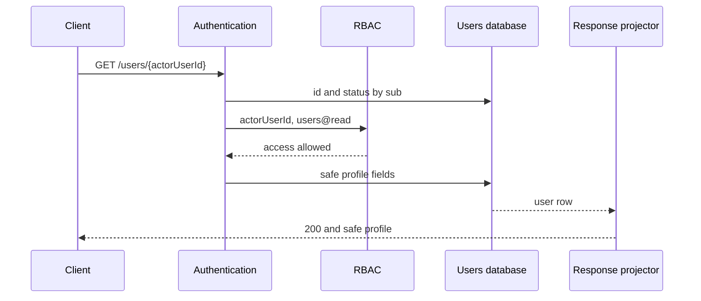
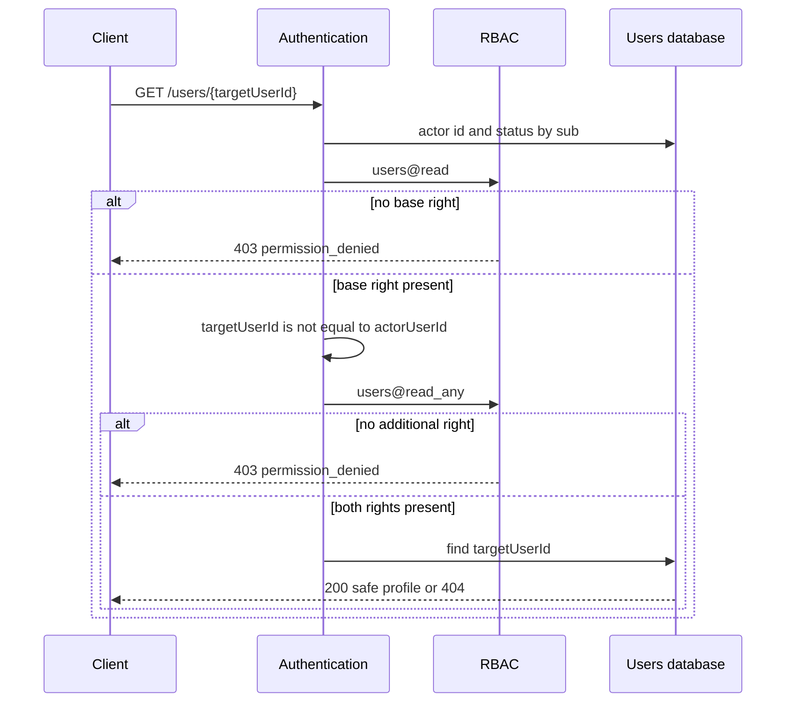
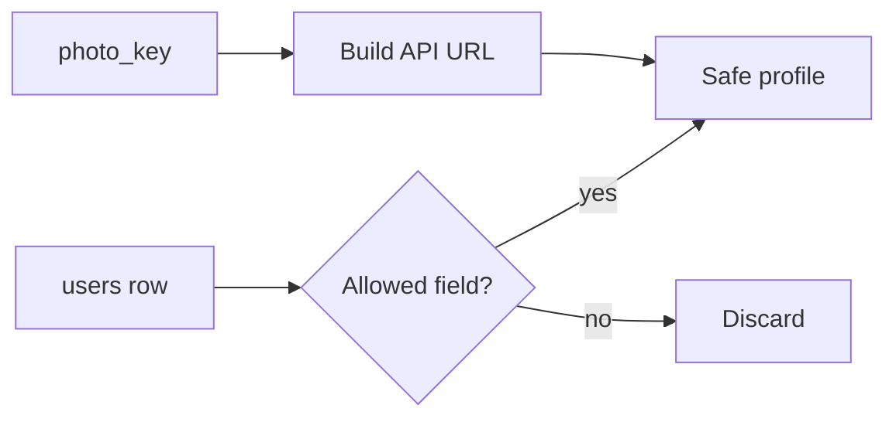

# Viewing User Data

## Contents

- [Theory](#theory)
  - [Situation](#situation)
  - [Model](#model)
  - [Concepts and Their Connection to the Backend](#concepts-and-their-connection-to-the-backend)
  - [Areas of Responsibility](#areas-of-responsibility)
  - [Common Failures](#common-failures)
  - [Useful Links](#useful-links)
  - [Theory Questions](#theory-questions)
- [Practical Assignment](#practical-assignment)
  - [1.1 General](#11-general)
  - [1.2 Scenarios](#12-scenarios-user-stories)
  - [1.3 Contract](#13-contract)
  - [1.4 Errors and Constraints](#14-errors-and-constraints)
  - [1.5 Audit](#15-auditlogs)
  - [1.6 Non-Functional Requirements](#16-non-functional-requirements)

# Theory

## Situation

An active user requests their own or someone else's profile with an access JWT in a cookie. From there, one of several outcomes is possible: the server returns a safe representation of the profile, rejects an invalid session with **401**, forbids access with **403**, reports a missing record or photo with **404**, limits the request rate with **429**, or returns **503** when the current user data, RBAC, or file storage is unavailable.

A separate frontend is not needed; all requests can be sent from an HTTP client that supports cookies.

## Model

Reading a profile involves the client, authentication, RBAC, the users database, and the response projector. The server first establishes an active user, then checks the base permission, and only after that decides whether the target record may be looked up. The client does not choose the permission and does not determine the composition of the response.

For one's own profile, `users@read` is enough. `targetUserId` can be compared with the verified `actorUserId` without reading the target record.

For someone else's profile, after the base `users@read`, the additional `users@read_any` is required. Both checks complete before the target is looked up, so a user without the right receives **403** for both an existing and a made-up identifier.

The response projector uses a fixed allowlist. Even if the database query mistakenly fetched more columns, only `id`, `email`, `displayName`, `photoUrl`, `status`, `createdAt`, and `updatedAt` go out.

The photo is stored behind a separate boundary. The database holds an opaque `photo_key`, and `photoUrl` points to a protected API operation. The local path, bucket name, object key, signed URL, and storage credentials do not end up in the profile. The photo operation repeats the profile checks, obtains the object through the storage abstraction, and returns the normalized image.

The `users` table is extended with profile fields. Column names inside the database may differ, but the constraints and the public representation are preserved.

| `users` | Description |
| --- | --- |
| `id` | immutable user identifier and primary key |
| `email` | normalized email with a unique index; leading/trailing whitespace removed, letters converted to lowercase |
| `password_hash` | slow password hash; never included in the profile |
| `display_name` | `null` or a name after trimming leading/trailing Unicode whitespace and NFC normalization, from 1 to 80 code points |
| `photo_key` | `null` or an opaque unique key of the normalized object in storage |
| `status` | `pending`, `active`, `blocked`, `deleting`, or `deleted`; the constraint is checked by the database |
| `created_at` | UTC creation time assigned by the database; does not change after creation |
| `updated_at` | server time of the last change in UTC |

### Normal Form

The `users` table is in Boyce–Codd normal form (BCNF) and, given the stated dependencies, in fifth normal form (5NF).

Each subsequent form includes the requirements of the previous one:

- **1NF:** each field contains one value. The name, email, and photo key are not mixed into JSON or a list; several photos and profile history are not stored in one cell.
- **2NF:** the primary key `id` is simple, so there is no partial dependency on part of the key. The unique `email` serves as an alternate key.
- **3NF and BCNF:** `display_name`, `photo_key`, `status`, and the timestamps describe the user identified by the key. The public `photoUrl` is not stored, since it is computed from `photo_key` and the API configuration; this rules out a transitive dependency and a mismatch between two addresses of the same object.
- **4NF:** independent lists of roles, challenges, and files are not placed in `users`; they belong to separate tables or external storage.
- **5NF:** the user row does not need to be decomposed into several relations in order to reconstruct the same profile information. Links to roles and challenges are reconstructed via foreign keys and do not create an additional join dependency within `users`.

`photo_key` is an internal reference, not a copy of a public URL. If the API base address changes, all `photoUrl` values are built anew without a mass update of rows. The unique index prevents two profiles from accidentally referencing the same managed object.

## Concepts and Their Connection to the Backend

### Safe Representation and Default-Deny

The database entity and the HTTP representation solve different problems. The `users` row is needed for login, status, and relationships, so it contains fields the client does not need. The safe profile is built by an explicit projector with an allowlist, not by serializing the ORM entity.

A denylist is unreliable: a new internal field may accidentally appear in the response after a migration. An allowlist preserves the existing contract until a field is deliberately added to the projector. `password_hash`, challenge secrets, JWTs, `photo_key`, roles, internal versions, and internal flags are given out neither to the owner nor to the administrator.

The email is returned in full and in normalized form. Masking is not applied, since the owner knows their own address, and viewing someone else's profile already requires a separate `users@read_any`. Hiding part of the string would not replace access control and would make unambiguous identification of the account harder.

### IDOR, the Owner's Right, and `*_any`

IDOR occurs when replacing an identifier in the URL gives access to someone else's object. A match between `targetUserId` and the verified `actorUserId` allows only the owner branch, and only after `users@read`. The identifier from the JWT, not a client parameter, determines the current user.

For someone else's record, `users@read_any` is required. The role name `admin` or `support` is not checked in the handler: the current decision is made by RBAC based on grants from server-side data. A user may have the appropriate permission through any role, and renaming a role does not change the operation's contract.

The base right and the additional right are checked before the target is queried. After both checks, a missing user becomes an ordinary **404**. This order prevents a client without `users@read_any` from finding out which identifiers exist.

### The Protected Operation Chain

The access JWT is read from the HttpOnly cookie according to the authentication rules: fixed HS256, valid `iss`, `aud`, `iat`, `exp`, a non-empty `sub`, and `token_use=access`. The signature establishes the token's origin, but the server still reads the current `id` and `status`.

Only `active` passes further. `pending`, `blocked`, `deleting`, `deleted`, and a missing user receive the same **401 invalid\_session**. The `deleting` and `deleted` states were added for asynchronous deletion: the first immediately stops access after the request is accepted, the second denotes completed anonymization. Stateless access and refresh tokens are not physically revoked, but the mandatory status check blocks their use.

After authentication, RBAC reconciles the current policy version. Unavailability of the users database or the current snapshot returns **503**, not a false **401** or **403**. The target profile and photo are read only after this chain completes.

### Name Validation

`displayName` allows `null` if the name is not set. A non-empty value is trimmed at the edges taking Unicode whitespace into account and normalized to NFC. After normalization, from 1 to 80 code points remain; control characters in the ranges U+0000–U+001F and U+007F–U+009F are forbidden.

Inner spaces, case, diacritics, and characters of different scripts are preserved. The name is not checked with a "Latin letters only" expression, since that would exclude real names. When output, the string remains data: XSS protection is performed by contextual escaping on the client, not by removing ordinary punctuation on the server.

### The Photo and the Storage Boundary

The profile does not accept an arbitrary external URL. Otherwise a user could insert a tracking address, an unsafe scheme, or a resource whose lifecycle the system does not control. Uploading a photo belongs to profile editing, where the server checks the content, removes metadata, and saves a normalized object.

Reading accesses the storage interface by `photo_key`. For production, an S3-compatible object storage suitable for multiple API instances is used by default. The local file system is acceptable only in a single-process development environment and implements the same interface. The public contract does not change with the chosen backend.

`photoUrl` has the form `https://api.example.test/users/{id}/photo` and is not a direct bucket address. The operation again checks the owner or `users@read_any`, so knowing the URL does not open the object. For `deleting` and `deleted`, the projector returns `photoUrl: null`, and the image operation returns **404** without contacting storage: the deletion worker may already have cleared the object while the internal key is still needed for idempotent completion. The image response contains no original file name, EXIF, or internal storage headers.

### What Will Change with Editing and Deletion

Profile editing will manage `display_name`, email, and photo, with separate rules for the owner and the administrator. Reading itself writes nothing and does not accept profile fields from the client.

Deletion will add an administrative transition from `pending`, `active`, or `blocked` to `deleting`, and for Self, a transition from `active` to `deleting` after confirmation. After cleanup, the state will become `deleted`. The user row will be kept for referential integrity, but the email will become a technical unique address, and the name and photo will be cleared. Viewing a deleted record with sufficient rights still uses the same safe profile shape and does not reveal the former PII.

### Summary

| Concept | Meaning in profile viewing | What the implementation relies on |
| --- | --- | --- |
| Safe profile | a fixed set of seven public fields | an allowlist response projector |
| Self | viewing one's own `userId` | `users@read` and comparing identifiers |
| Any | viewing someone else's `userId` | the additional `users@read_any` |
| IDOR | substituting the identifier in the path | a server-side owner check before looking up the target |
| Current status | only `active` is admitted to the operation | reading `users` after the JWT check |
| `deleting` | deletion accepted and access already stopped | a status check on every access and refresh |
| `deleted` | PII anonymized | a retained technical row without the former PII |
| `photoUrl` | a protected API address | the internal `photo_key` and the storage interface |

## Areas of Responsibility

| Client | Server |
| --- | --- |
| Sends the cookie using browser mechanisms | Checks the access JWT and the current status |
| Passes the target `userId` | Takes `actorUserId` only from the verified `sub` |
| Does not pass a role name or a right | Checks `users@read` and, if necessary, `users@read_any` |
| Shows the safe profile fields | Builds the response from a fixed allowlist |
| Handles `null` for the name and photo | Returns the same canonical profile shape |
| Loads `photoUrl` as a protected resource | Does not reveal the key, path, or storage credentials |
| After **401**, runs one refresh according to the authorization rules | Does not call RBAC or the handler for an invalid session |
| After **403**, shows the refusal without a refresh | Does not look up the target before checking the necessary rights |

With a different trusted origin, the client sends cookies with `credentials: "include"`, and the server allows credentials only for the exact origin. Reading a profile does not change state and does not require the CSRF header, but it still goes through authentication and RBAC.

## Common Failures

| What you see | Where to look |
| --- | --- |
| One's own profile receives **403** | the base grant `users@read` is missing, or the owner is mistakenly checked by role |
| Someone else's profile opens with `users@read` alone | the additional `users@read_any` check was not performed |
| Without `users@read_any`, an existing id gives **403** and a made-up one **404** | the target record is looked up before the additional right |
| A blocked user reads a profile | the current `status` is not checked after the JWT signature |
| A removed role works until the access token expires | permissions are read from the JWT instead of the current RBAC snapshot |
| `passwordHash` or `photoKey` appeared in the JSON | the database entity is serialized instead of going through the allowlist projector |
| After a migration, a new internal field ended up in the response | filtering is built on a denylist |
| `photoUrl` leads directly to a private bucket | the API boundary is violated and a key or a signed storage address was given out |
| Profile access can be bypassed via the photo URL | the image operation does not repeat `users@read` and `users@read_any` |
| One user is shown with two variants of the email | reading or writing bypassed normalization and the unique index |
| A name consisting only of spaces was saved as non-empty | the length was checked before trimming Unicode whitespace |
| Identical-looking names compare as different bytes | NFC normalization was not performed before saving |
| An unavailable database gives **401** | a dependency error is mixed up with an invalid session instead of **503** |
| Email, JWT, or the object key are visible in the log | the response body, cookies, or the entire user row are logged |

## Useful Links

### General

- [OWASP API Security — Broken Object Level Authorization](https://owasp.org/API-Security/editions/2023/en/0xa1-broken-object-level-authorization/) — explains IDOR/BOLA and the mandatory access check for every object identifier.
- [OWASP API Security — Broken Object Property Level Authorization](https://owasp.org/API-Security/editions/2023/en/0xa3-broken-object-property-level-authorization/) — shows the risk of exposing internal fields when serializing the full entity.
- [OWASP — Authorization Cheat Sheet](https://cheatsheetseries.owasp.org/cheatsheets/Authorization_Cheat_Sheet.html) — justifies default deny, least privilege, and server-side checking of every request.
- [RFC 9110 — HTTP Semantics](https://www.rfc-editor.org/rfc/rfc9110) — defines the meaning of the **401**, **403**, **404**, **429**, and **503** responses.
- [Unicode Standard Annex #15 — Unicode Normalization Forms](https://unicode.org/reports/tr15/) — specifies the NFC normalization used for `displayName`.
- [PostgreSQL — Constraints](https://www.postgresql.org/docs/current/ddl-constraints.html) — describes unique constraints and value checks when using PostgreSQL.
- [Amazon S3 — Object keys](https://docs.aws.amazon.com/AmazonS3/latest/userguide/object-keys.html) — explains internal object keys, which must not become profile fields.
- [MinIO AIStor — Documentation](https://min.io/docs/minio/linux/index.html) — confirms the native S3 API for a portable boundary of self-hosted object storage.
- [OpenAPI Specification — Security Scheme Object](https://spec.openapis.org/oas/latest.html#security-scheme-object) — needed to describe cookie authentication of protected operations.

### By Language

#### Node.js

**Node.js, NestJS.** On Express or Fastify, the order access → current user → RBAC → projector stays the same.

- [NestJS — Guards](https://docs.nestjs.com/guards) — attaching authentication and permission checks before the handler.
- [NestJS — Serialization](https://docs.nestjs.com/techniques/serialization) — separate response models and excluding internal fields from JSON.
- [NestJS — Streaming files](https://docs.nestjs.com/techniques/streaming-files) — returning the photo through a protected API operation.
- [AWS SDK for JavaScript — S3 examples](https://docs.aws.amazon.com/sdk-for-javascript/v3/developer-guide/javascript_s3_code_examples.html) — reading an object through an S3-compatible boundary.
- [NestJS — OpenAPI](https://docs.nestjs.com/openapi/introduction) — describing the safe profile, cookie security, and the operation's responses.
- [Prisma Migrate](https://www.prisma.io/docs/orm/prisma-migrate) or [TypeORM — Migrations](https://typeorm.io/docs/advanced-topics/migrations/) — adding profile columns and constraints with a migration.

#### .NET

**.NET, ASP.NET Core.** Minimal API and controllers use the same profile contract.

- [ASP.NET Core — Policy-based authorization](https://learn.microsoft.com/en-us/aspnet/core/security/authorization/policies) — the `users@read` and `users@read_any` requirements.
- [System.Text.Json — Customize properties](https://learn.microsoft.com/en-us/dotnet/standard/serialization/system-text-json/customize-properties) — an explicit response model instead of serializing the database entity.
- [ASP.NET Core — File results](https://learn.microsoft.com/en-us/aspnet/core/web-api/action-return-types) — returning a typed file from a protected operation.
- [AWS SDK for .NET — S3](https://docs.aws.amazon.com/sdk-for-net/v3/developer-guide/csharp_s3_code_examples.html) — accessing S3-compatible storage through the client.
- [ASP.NET Core — OpenAPI](https://learn.microsoft.com/en-us/aspnet/core/fundamentals/openapi/overview) — documenting the profile shape and the authorization responses.
- [EF Core — Migrations](https://learn.microsoft.com/en-us/ef/core/managing-schemas/migrations/) — moving `users` changes between environments.

#### Python

**Python, FastAPI.** For Django or Flask, the same allowlist and order of checks are kept.

- [FastAPI — Dependencies](https://fastapi.tiangolo.com/tutorial/dependencies/) — sequential authentication and permission checks.
- [FastAPI — Response Model](https://fastapi.tiangolo.com/tutorial/response-model/) — filtering the response by the declared safe model.
- [FastAPI — Custom Response](https://fastapi.tiangolo.com/advanced/custom-response/) — a streaming or file response for the photo.
- [Boto3 — S3](https://boto3.amazonaws.com/v1/documentation/api/latest/guide/s3-examples.html) — reading objects from S3-compatible storage.
- [FastAPI — Metadata and Docs URLs](https://fastapi.tiangolo.com/tutorial/metadata/) — publishing an up-to-date OpenAPI schema.
- [Alembic — Tutorial](https://alembic.sqlalchemy.org/en/latest/tutorial.html) — migrating profile columns and indexes.

## Theory Questions

1. Why is an allowlist of fields safer than a denylist when the `users` table expands over time?
2. Why check `users@read_any` before looking up someone else's user, and how does this order protect against IDOR?
3. Why is a valid access JWT signature insufficient without reading the current `status`?
4. How does `photoUrl` differ from `photo_key`, and why must a direct private bucket address not be included in the profile?
5. Why is NFC useful for `displayName`, but does not replace contextual escaping on output?
6. How do the `deleting` and `deleted` states stop stateless access and refresh tokens from working without physically revoking them?
7. Why does not storing `photoUrl` help the `users` table stay in BCNF?

# Practical Assignment

Functionality for viewing user data in the system. An active user with `users@read` receives their own safe profile. For someone else's profile, `users@read_any` is additionally required; both checks are performed before the target record is looked up. The response is always limited to seven canonical fields, and the photo is available only through a protected API boundary.

## 1) Viewing User Data

### 1.1 General

**Purpose:** return the user's canonical profile and their normalized photo without internal or secret data.

**Users/roles:**

- an active user with `users@read` — views their own profile;
- an active user with `users@read` and `users@read_any` — views someone else's profile;
- the role name does not take part in the decision; rights are taken from current RBAC.

**Unified catalog of permissions for working with users:**

| Permission | Purpose |
| --- | --- |
| `users@read` | reading one's own profile |
| `users@read_any` | additional access to someone else's profile |
| `users@update` | changing one's own profile |
| `users@update_any` | additional access to changing another user and to a direct email change by an administrator |
| `users@delete` | confirmed deletion of one's own account |
| `users@delete_any` | additional access to deleting another user by an administrator |
| `users@list` | viewing the administrative user list |

The `user` role receives `users@read`, `users@update`, and `users@delete` on the transition to `active`. The `*_any` and `list` actions are not included in it.

**Dependencies/related settings:**

- authentication verifies the access JWT from the cookie and accepts only an existing user with the `active` status;
- authorization applies the chain access → current user → current RBAC → target resource → handler;
- RBAC stores the actions `read`, `read_any`, `update`, `update_any`, `delete`, `delete_any`, and `list` of the `users` permission;
- `PUBLIC_API_BASE_URL` specifies the HTTPS address from which `photoUrl` is built;
- the photo storage implements read-by-opaque-key and delete operations; the key and storage credentials are not given to the client;
- production uses S3-compatible object storage; the local file system is allowed only for a single application instance in a development environment.

The canonical profile contains exactly `id`, the normalized `email`, `displayName`, `photoUrl`, `status`, `createdAt`, `updatedAt`. The email in an allowed response is not masked. For `deleting` and `deleted`, the `photoUrl` field equals `null`, even if the internal key is still being cleaned up. `password_hash`, challenge secrets, JWTs, roles, `photo_key`, internal versions, and internal fields are absent.

Allowed user statuses: `pending`, `active`, `blocked`, `deleting`, `deleted`. Only `active` passes authentication. `deleting` means that asynchronous deletion has been accepted and the tokens have already stopped working; `deleted` means that cleanup and anonymization are complete.

Changing the name and photo is done by the profile editing functionality. Deleting objects and anonymization are done by the deletion functionality. Viewing does not change the user row, the photo object, JWTs, or the RBAC configuration.

### 1.2 Scenarios (user stories)

1. **Own profile:** an active user with `users@read` requests their own `userId` and receives the safe profile.
2. **Someone else's profile:** an active user with `users@read` and `users@read_any` requests someone else's `userId` and receives the same set of fields.
3. **No base right:** the request ends with **403** before comparing with an existing record and before looking up the target.
4. **No additional right:** someone else's `userId` receives **403** before looking up the target, even if such a user does not exist.
5. **Target missing:** a user with both required rights receives **404** after an allowed lookup.
6. **Photo set:** the client accesses `photoUrl`, goes through the same checks again, and receives the normalized image.
7. **No photo:** an allowed image request receives **404** without revealing the internal key.

### 1.3 Contract

#### 1.3.1 Getting a User Profile

| `GET /users/{userId}` | Checks/validation |
| --- | --- |
| `userId: string` | From 1 to 128 ASCII characters; letters, digits, `_`, and `-` are allowed; the value is compared with the verified `actorUserId` without transformation |
| Cookie `access_token` | Fully checked according to the authentication contract; only an `active` user is accepted |

**Logic/steps:**

1. Check the format of `userId`.
2. Verify the access JWT, get the user by `sub`, and accept only `active`. On refusal, return **401** before RBAC.
3. Check the current `users@read`. If it is absent, return **403** without looking up the target user.
4. Compare `userId` with `actorUserId`.
5. If the identifiers differ, check the current `users@read_any`. If it is absent, return **403** without looking up the target.
6. After all necessary rights, select by `userId` only `id`, `email`, `display_name`, `photo_key`, `status`, `created_at`, `updated_at`.
7. If the row is missing, return **404**.
8. Build the safe profile. If `photo_key = null` or the status is `deleting` or `deleted`, return `photoUrl: null`; otherwise build a protected API URL without the key itself.

**Responses:**

- **Success:** **200 OK** and `id`, `email`, `displayName`, `photoUrl`, `status`, `createdAt`, `updatedAt`.
- `displayName` equals `null` if the name is not set; `photoUrl` equals `null` if there is no photo or the status equals `deleting` or `deleted`.
- `email` is returned in full, already normalized and without masking.
- The response contains no password, `password_hash`, challenge, HMAC, JWT, cookies, roles, permissions, `photo_key`, local path, bucket address, or internal fields.

#### 1.3.2 Getting the Profile Photo

| `GET /users/{userId}/photo` | Checks/validation |
| --- | --- |
| `userId: string` | The same format and comparison as for getting the profile |
| Cookie `access_token` | The same active-user check chain |

**Logic/steps:**

1. Perform the authentication, `users@read`, owner comparison, and, if necessary, `users@read_any` steps before looking up the target.
2. Get only the `id`, `status`, and `photo_key` of the target user.
3. If the user or photo is missing, or the status equals `deleting` or `deleted`, return **404** without contacting storage.
4. Read the object through the storage interface by the internal key.
5. Return the bytes of the normalized WebP with `Content-Type: image/webp`, `X-Content-Type-Options: nosniff`, and `Cache-Control: private, max-age=300`.

If the row contains a key but the object is missing, the operation returns **503**, since this is a consistency violation, not a "photo not set" state. The event is sent to monitoring. The key, path, bucket name, original file name, and storage authorization headers do not end up in the response.

#### 1.3.3 Canonical Representation

| Field | Rule |
| --- | --- |
| `id: string` | immutable identifier |
| `email: string` | full normalized email; without leading/trailing whitespace, lowercase |
| `displayName: string \| null` | NFC, from 1 to 80 code points after trimming; without control characters |
| `photoUrl: string \| null` | HTTPS URL of a protected API operation; `null` if there is no photo or the status equals `deleting` or `deleted` |
| `status: string` | one of `pending`, `active`, `blocked`, `deleting`, `deleted` |
| `createdAt: string` | UTC date-time in RFC 3339 format |
| `updatedAt: string` | UTC date-time in RFC 3339 format |

The same shape is used for one's own, someone else's, and the administrative representation of a user. Fields are not added based on the role name. A user with a status other than `active` cannot act as the caller, but a target with any of the five statuses is visible to a holder of the necessary rights.

`displayName` is validated on write: `null` clears the name; a string is trimmed at the edges, normalized to NFC, and must then contain from 1 to 80 code points and not contain U+0000–U+001F or U+007F–U+009F. Viewing returns the stored value without re-correction.

#### 1.3.4 The Photo Storage Boundary

The application stores only an opaque object key in `users.photo_key`. The public `photoUrl` is computed from `PUBLIC_API_BASE_URL`, `userId`, and a fixed path; a client URL, local path, or bucket address is not written to the database.

The storage interface provides the operations `read(key)` and `delete(key)` with the unambiguous results `found`, `not_found`, and `unavailable`. Viewing uses only `read`. The implementation can be replaced without changing the HTTP contract and the profile schema.

The photo object is a normalized WebP without animation or metadata. Upload validation, conversion, atomic replacement of `photo_key`, and cleanup of the old object are defined by profile editing.

### 1.4 Errors and Constraints

- **400 Bad Request** — `userId` does not match the format.
- **401 Unauthorized** — the access token is missing, invalid, expired, has invalid claims, or refers to a missing user or a user not in the `active` state.
- **403 Forbidden** — the active user does not have `users@read`; for someone else's identifier, `users@read_any` is missing.
- **404 Not Found** — the target user was not found after all necessary checks; the photo is not set or unavailable for the `deleting` or `deleted` status.
- **429 Too Many Requests** — the established limit for reading the profile or photo is exceeded.
- **503 Service Unavailable** — the users database, the current RBAC snapshot, or storage is unavailable; the row and the photo object are inconsistent.

The base right is checked before the resource is looked up. For someone else's identifier, the additional `users@read_any` is also checked before the lookup. Therefore **404** is received only by a user already admitted to reading a target of this type.

### 1.5 Audit/Logs

Log:

- successful reading of someone else's profile and photo;
- a `users@read` or `users@read_any` refusal;
- **404** after an allowed lookup;
- triggering of the rate limit;
- unavailability of the database, RBAC, and storage;
- inconsistency between `photo_key` and the object.

The event contains `requestId`, `actorUserId`, the kind of operation, a `self` or `foreign` flag, `targetUserId` after admission to the lookup, the result, and the duration. For a refusal before the lookup, the operation path and the right category are recorded without checking whether the target exists.

The log must not contain the email, `displayName`, `photoUrl`, photo bytes, `photo_key`, the password, `password_hash`, challenges, JWT, `Cookie`, `Set-Cookie`, roles, the full profile, the full response body, or the entire request headers.

### 1.6 Non-Functional Requirements

- One's own profile and photo allow no more than 120 requests per user per minute; someone else's — no more than 60. The next request receives **429**.
- The database query selects only the safe profile fields, and the photo query selects `id`, `status`, and `photo_key`. Storage is read as a stream.
- Automated tests cover Self/someone else's profile, both permissions, the order of rights before the lookup, all five statuses, and the protected photo.
- The project's general non-functional requirements — input validation, CORS, OpenAPI, structured logs, health checks, and test coverage of at least 80% — also apply to these operations.
