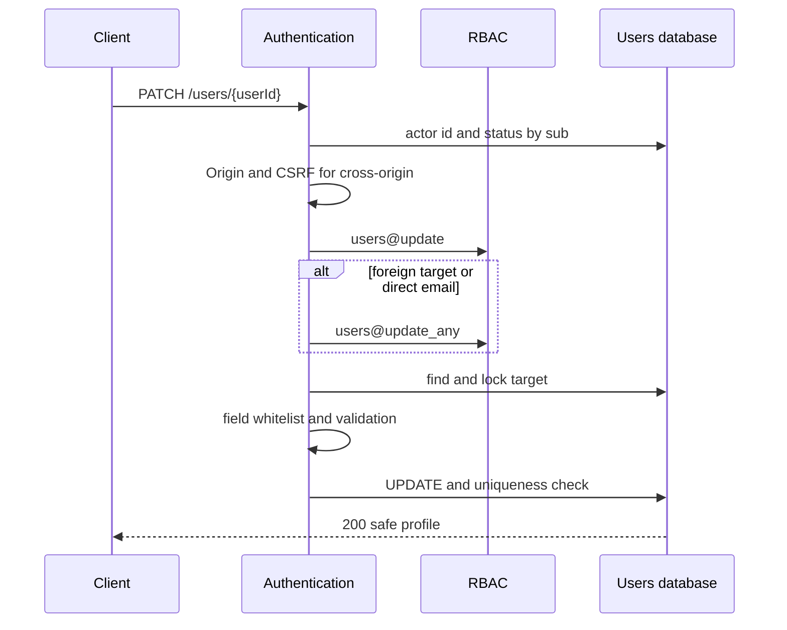
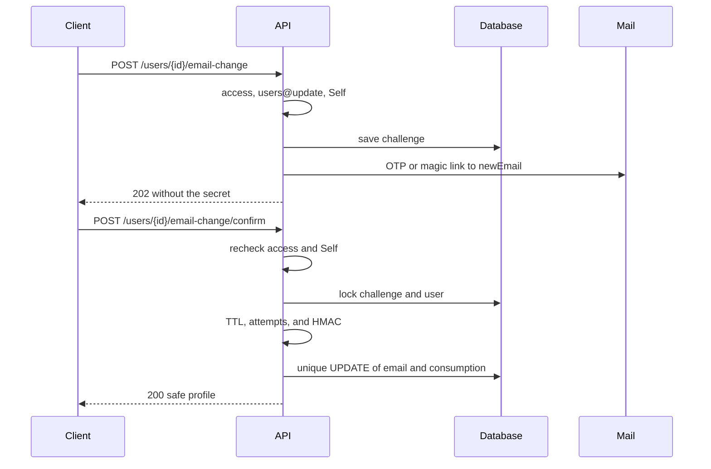
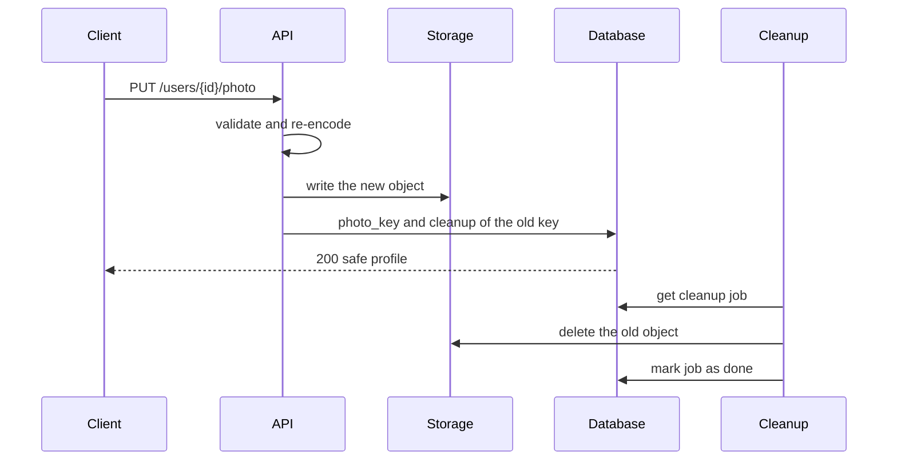
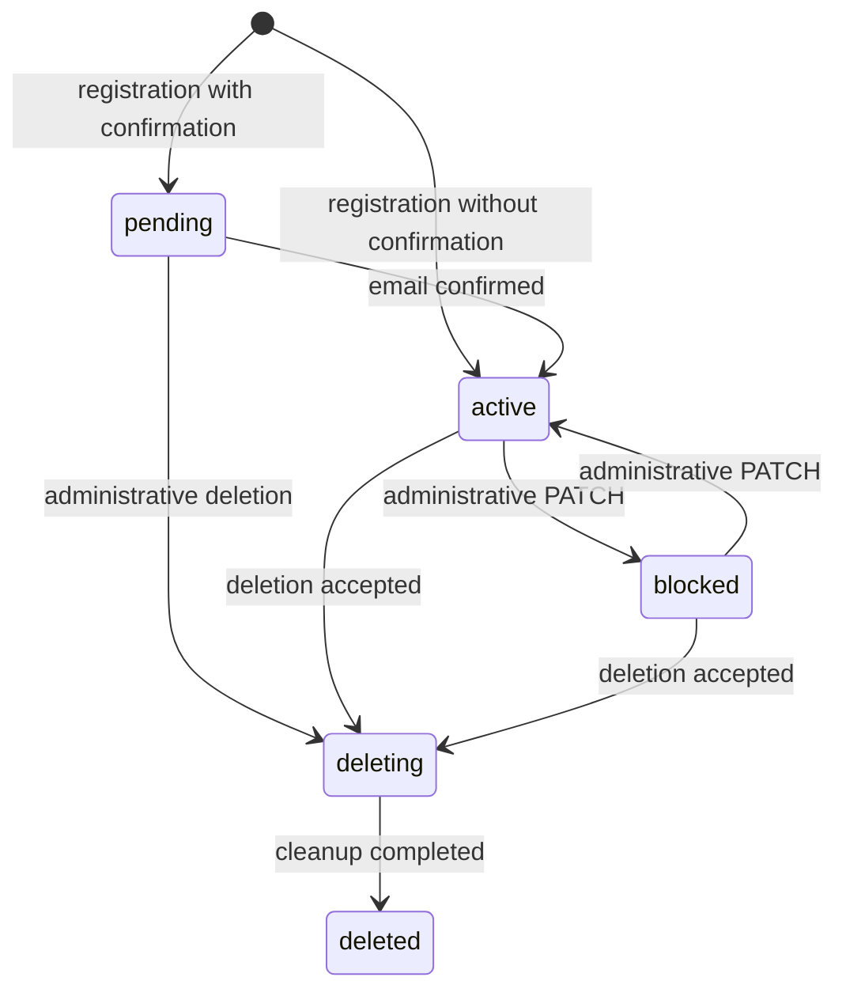

# Changing User Data

## Contents

- [Theory](#theory)
  - [Situation](#situation)
  - [Model](#model)
  - [Concepts and Their Connection to the Backend](#concepts-and-their-connection-to-the-backend)
  - [Areas of Responsibility](#areas-of-responsibility)
  - [Common Failures](#common-failures)
  - [Useful Links](#useful-links)
  - [Theory Questions](#theory-questions)
- [Practical Assignment](#practical-assignment)
  - [1.1 General](#11-general)
  - [1.2 Scenarios](#12-scenarios-user-stories)
  - [1.3 Contract](#13-contract)
  - [1.4 Errors and Constraints](#14-errors-and-constraints)
  - [1.5 Audit](#15-auditlogs)
  - [1.6 Non-Functional Requirements](#16-non-functional-requirements)

# Theory

## Situation

An active user changes their display name or photo, and confirms their email via a message. A holder of an administrative right can change someone else's profile and email directly. From there, one of several outcomes is possible: the profile is updated atomically, an email challenge is created, the photo is replaced, fields are rejected with **400**, the session is rejected with **401**, the right or field is forbidden with **403**, the target is not found with **404**, the state or email conflicts with a **409** response, the file is too large with **413**, the file type is not supported with **415**, a **429** is triggered, or a dependency is unavailable and **503** is returned.

A separate frontend is not needed; all requests can be sent from an HTTP client that supports cookies and `multipart/form-data`.

## Model

An ordinary PATCH involves the client, authentication, RBAC, and the users database. The base `users@update` is checked before looking up the target. If `targetUserId` differs from the verified `actorUserId`, the additional `users@update_any` is also checked before the lookup. A direct email change always requires `users@update_any`, even when the administrator changes their own address.

Self does not pass the email in the general PATCH. First the server creates a challenge for the new normalized address and sends an OTP or magic link, as chosen by the server. Confirmation requires both a valid challenge and a valid session of the same user.

A uniqueness check before sending the email improves the response but is not the final protection against a race. Another request may take the address after the check. The unique index on `users.email` remains the source of truth, so a conflict on the final `UPDATE` is turned into **409**, and the challenge is consumed with the reason `email_conflict`.

The photo goes through decoding and normalization before the reference in the profile is changed. The new object is first written under a new opaque key. Then a transaction changes `photo_key` and creates a cleanup job for the old object. This does not leave the profile without its previous photo if the upload of the new object failed.

The user status forms a separate lifecycle. The administrator's PATCH manages only the transitions between `active` and `blocked`. `pending` is completed by registration, while `deleting` and `deleted` belong to the deletion process and are not set via PATCH.

Two tables are added for the email change and reliable object cleanup. The `users` table keeps the profile schema from viewing user data.

| `users` | Description |
| --- | --- |
| `id` | immutable primary key |
| `email` | normalized email with a unique index |
| `password_hash` | slow password hash; not included in the profile |
| `display_name` | `null` or an NFC string of 1 to 80 code points |
| `photo_key` | `null` or a unique opaque object key |
| `status` | `pending`, `active`, `blocked`, `deleting`, or `deleted` |
| `created_at` | UTC creation time assigned by the database and immutable after insertion |
| `updated_at` | time of the last change in UTC |

| `email_change_challenges` | Description |
| --- | --- |
| `id` | challenge identifier |
| `user_id` | reference to `users.id`; a partial unique index allows one unconsumed challenge per user |
| `new_email` | the normalized address that will be written after confirmation |
| `method` | `otp` or `magic_link`, chosen by the server at creation |
| `secret_hash` | HMAC-SHA256 of the OTP or random secret; the original value is not stored |
| `last_sent_at` | time of the last sending; the 10-minute TTL and the 60-second pause are counted from it |
| `attempts` | number of incorrect OTPs; the fifth incorrect entry consumes the challenge |
| `consumed_at` | `null` until consumed |
| `consumed_reason` | `confirmed`, `replaced`, `attempts_exhausted`, `email_conflict`, `admin_override`, or `user_inactive` |
| `created_at` | time the challenge was created |

| `storage_cleanup_jobs` | Description |
| --- | --- |
| `id` | cleanup job identifier |
| `object_key` | internal object key; one key occurs no more than once |
| `reason` | `photo_replaced`, `photo_cleared`, or `orphan_upload` |
| `status` | `queued`, `succeeded`, or `failed` |
| `attempts` | number of handler runs |
| `next_attempt_at` | time of the next allowed run; at creation it equals the current time |
| `last_error_code` | category of the last failure, without URL, access keys, or response body |
| `created_at` | time the job was created |
| `updated_at` | time of the last change to the job |

### Normal Form

`users`, `email_change_challenges`, and `storage_cleanup_jobs` are in BCNF and, given the stated dependencies, in 5NF.

Each subsequent form includes the requirements of the previous one:

- **1NF:** the email, secret hash, object key, and reason are represented as separate atomic values. The sending history and the list of old photos are not packed into arrays in a single row; a resend replaces the current secret, and each object to be deleted gets a separate cleanup job.
- **2NF:** `users`, `email_change_challenges`, and `storage_cleanup_jobs` have simple primary keys `id`, so there is no partial dependency on a composite key.
- **3NF and BCNF:** the challenge stores `user_id` but does not copy the user's current name, status, or old email. The TTL is computed as `last_sent_at + 10 minutes`, so a separate dependent `expires_at` does not create an update anomaly. A cleanup job describes one object and does not copy `users.photo_key`.
- **4NF:** independent challenges and cleanup objects are moved into different rows and tables. Combining them with the user would produce a product of two independent lists.
- **5NF:** the user's links to challenges and cleanup jobs are reconstructed by keys without an additional join dependency. The decomposition does not lose facts and does not create spurious combinations.

`next_attempt_at` is not computed solely from `attempts`: the time of the last failure affects it. Therefore it is stored scheduler state, not a transitive copy of another field. The partial unique index for an unconsumed challenge defines a constraint but does not change the normal form.

## Concepts and Their Connection to the Backend

### PATCH and a Field Allowlist

PATCH changes only the fields listed by the client. An empty body and an unknown field are rejected entirely: silently ignoring a typo would produce a false successful response. The fields `id`, `photoUrl`, `createdAt`, `updatedAt`, `passwordHash`, roles, and internal keys are never accessible through the profile PATCH.

Self changes only `displayName`. The photo has separate operations, since file transfer and partial storage failures differ from JSON. Self's email goes through a challenge. An administrator with `users@update_any` can pass `displayName`, `email`, and `status`, but cannot set `pending`, `deleting`, or `deleted` via PATCH.

The transaction locks the target row and updates only the submitted columns. Parallel changes to different fields are preserved, and two changes to the same field are applied in the order the transactions commit; the last committed value becomes current. The unique index resolves the email race regardless of the preliminary check.

### Normalizing Profile Fields

The email is trimmed at the edges and converted to lowercase. Tags of the form `user+tag@example.com` are not removed, and dots and domains are not rewritten according to the rules of a particular provider. Therefore two different normalized values are considered different addresses, and one value is protected by the unique index.

`displayName: null` clears the name. A string is trimmed taking Unicode whitespace into account, normalized to NFC, and after that must contain from 1 to 80 code points. Control characters U+0000–U+001F and U+007F–U+009F are forbidden. Inner spaces, case, and script are preserved.

Identical-looking strings may have different binary representations because of precomposed and combining characters. NFC brings canonically equivalent sequences to a single form, but does not perform transliteration and does not protect output from XSS.

### Email Challenge and a Valid Session

The OTP contains exactly six digits. The magic link contains the challenge identifier and 32 random bytes before base64url encoding. Both methods are valid for 10 minutes, and the server chooses one method from the configuration and stores it in the challenge.

The secret is stored as an HMAC-SHA256 with a separate application key at least 32 random bytes long. Plain SHA-256 is not suitable for a short OTP, since a million variants can be brute-forced in advance. The HMAC comparison is performed in constant time.

The OTP allows five entries. The fifth entry can still be successful; a fifth incorrect answer returns **400** and simultaneously consumes the challenge, and the next request receives **429**. The magic link is single-use, but the entry counter does not apply to it. A resend is allowed after 60 seconds, replaces the secret, restarts the TTL, and resets `attempts`.

The challenge proves access to the new mailbox but does not establish the user's identity. Confirm again checks the access JWT, the current `active` status, `users@update`, and that `userId` matches `sub`. There is no self-sufficient confirmation without a session. The email places the magic token in the URL fragment, which is not sent to the server or in `Referer`; the client page reads the fragment and passes the token in the body of a POST. Opening the link with GET only shows the page.

### Email Uniqueness and Races

At initiation, the server reports **409** if the new email is already in `users`. Challenges of different users started at the same time may pass this preliminary check, so the email is not considered a reservation of the address.

Confirm locks the challenge and the user, checks the secret, and then tries to change `users.email`. The unique index picks a single winner. On a conflict, a savepoint undoes only the failed `UPDATE`, after which the challenge is marked `email_conflict` and the transaction is committed with a **409** response. A repeated confirm does not create an endless series of conflicts.

A direct administrative PATCH is subject to the same unique index. It consumes the target user's unconsumed email challenge with the reason `admin_override`, so that a previously sent email does not cancel a later administrative decision.

The JWT contains `sub` but not the email, so a successful address change does not require issuing a new pair. The access and refresh tokens continue to identify the same user. If deletion or blocking started at the same time, rechecking the row before committing does not allow changing an already inactive account.

### Validating and Normalizing the Photo

The upload accepts one JPEG, PNG, or WebP of no more than 5 MiB. The HTTP `Content-Type`, the signature, and the result of full decoding must agree. SVG, GIF, AVIF, animated images, multiple files, and extra multipart fields are rejected.

The decoded image size is from 64×64 to 4096×4096 pixels. The server applies the EXIF orientation, scales the image down preserving the aspect ratio to fit a 1024×1024 frame, removes EXIF, ICC, comments, and other metadata, forbids animation, and encodes a single WebP. The resulting object does not exceed 2 MiB; if the limit cannot be met, the request receives **400**.

The file name extension and the declared MIME do not prove the content. Full decoding detects a corrupted file, and re-encoding removes the original container and metadata. The original name is not used as a path or key. The new key contains at least 128 random bits and is generated by the server.

### Partial Storage and Mail Failures

The challenge is committed before the email is sent. If the transaction did not complete, the email is not sent and the client receives **503**. If SMTP rejected the email after the commit, the challenge remains valid, and the **503** response contains its identifier and the time until resend, but not the OTP or token.

The new photo object is written before the database is changed. If writing the object failed, the profile remains as before. If the object was written but the profile transaction was rolled back, the API tries to delete the new object; an unreachable object is picked up by a periodic search for unconfirmed keys older than one hour.

After a successful transaction, the profile already points to the new object or `null`. An error deleting the previous object does not roll back the profile: `storage_cleanup_jobs` retries the deletion up to five times with a one-minute pause. The object deletion operation is also considered successful when storage responds with `not_found`, so a retry is safe and a separate lease is not needed.

### Status and Stateless JWT

The administrator's PATCH only moves `active` to `blocked` and `blocked` to `active`. Repeating the same value is a successful no-op and does not change `updatedAt`. `pending` is activated only by registration confirmation, and `deleting` and `deleted` are set by deletion.

After the transition to `blocked`, subsequent access and refresh requests receive **401**, since authentication reads the status every time. Signed stateless JWTs are not physically deleted. If the user is reactivated before the old refresh token's `exp`, a copy of the token will again be able to pass verification; full revocation would require server-side sessions, which the current authentication does not store.

The `active` → `blocked` transition cannot leave the system without an active holder of `rbac@manage`. Once user statuses exist, this invariant, in all policy-change operations, counts as a management holder only a user in the `active` state. The check is performed in the same transaction under a shared lock on the policy state, so blocking, deletion, and grant changes cannot disable the last administrators in parallel. A violation returns **409**, and the status and challenge do not change.

### What Will Happen on Deletion

Deletion will first move the user to `deleting`, so editing will stop immediately. For Self, the initial state is `active`, while an administrator can accept deletion of a target in `pending`, `active`, or `blocked`. Then an asynchronous process will delete the photo, clear email challenges and PII, and then set `deleted`.

Profile operations do not start deletion and do not set these two statuses. Cleanup of an old photo relates only to replacing the object and does not anonymize the user's other data.

### Summary

| Concept | Meaning in profile changes | What the implementation relies on |
| --- | --- | --- |
| PATCH whitelist | only known fields are changed | separate Self and Admin sets |
| NFC | a single canonical form of the name | Unicode normalization before the length check |
| Email challenge | Self confirms the new mailbox | a valid session, HMAC, TTL, and attempts |
| Email uniqueness | one address belongs to one row | a unique index and conflict handling |
| `users@update_any` | someone else's profile and direct email | an additional check of current RBAC |
| Photo normalization | one safe format | decoding, limits, and re-encoding |
| Storage boundary | the profile does not store an external URL | an opaque `photo_key` and a cleanup job |
| `blocked` | new requests are not authenticated | reading the current status for access and refresh |

## Areas of Responsibility

| Client | Server |
| --- | --- |
| Sends only the fields being changed | Rejects unknown and forbidden fields entirely |
| For Self, does not put the email in the PATCH | Requires a challenge for a self email change |
| Keeps the `challengeId` but does not receive the secret from the API | Sends the OTP or magic link only to the new email |
| Confirms the email with a valid cookie | Rechecks active, the right, and the owner |
| Uploads one acceptable file | Checks the bytes, decodes, and re-encodes the image |
| Does not build `photoUrl` | Generates the API URL from the internal `photo_key` |
| After **409**, re-reads the profile | Turns a unique index conflict into an ordinary response |
| After **503**, follows the rules of the specific operation | Keeps an unambiguous state for a safe retry |

When the frontend is hosted on a different origin, all state-changing requests after the access check require the exact allowed `Origin` and `X-CSRF-Protection: 1`, even if both origins belong to the same site. For a cross-site deployment, cookies additionally receive `SameSite=None; Secure`. CORS and CSRF do not replace `users@update` or `users@update_any`.

## Common Failures

| What you see | Where to look |
| --- | --- |
| Self changes the email with an ordinary PATCH | the field is not separated from the owner's allowed set |
| Admin changes the email without `users@update_any` | a direct email is mistakenly allowed by the base `users@update` alone |
| A foreign non-existent target gives **404** without `users@update_any` | the resource is found before the additional right |
| An unknown field receives **200** but does not change | PATCH silently ignores typos instead of **400** |
| Two users get the same email | uniqueness was checked by an application query without a unique index |
| Confirm sometimes fails with an unhandled database error | the unique email race is not converted into **409** |
| An old email changes the address after an admin PATCH | the administrative change did not consume the challenge |
| A magic link changes the email with an ordinary GET | a mail scanner can perform the change without an explicit POST |
| The link works without a valid session | the challenge is mistakenly treated as standalone authentication |
| The fifth incorrect OTP does not consume the challenge | the counter and `consumed_reason` are updated non-atomically |
| After a resend, the old secret still works | `secret_hash` and `last_sent_at` were not replaced in a single transaction |
| SMTP returned an error, and a repeated call creates a second active attempt | the partial unique index and the partial failure contract are not respected |
| The last two administrators became `blocked` at the same time | the transitions are not serialized by a shared lock on the `rbac@manage` invariant |
| SVG passes as a photo | only the extension or the client MIME is checked |
| A small file exhausts memory during decoding | there is no limit on decoded dimensions and no full safe decoding |
| EXIF GPS coordinates remained in the photo | the original container was served without re-encoding and metadata removal |
| The number of old objects grows after replacements | the cleanup job was not created in the transaction with the new `photo_key` |
| The profile rolls back when deleting the old object fails | external cleanup is mistakenly included in the critical response after the commit |
| A blocked user keeps refreshing | authentication does not read the current status by `sub` |
| The log contains the new email, OTP, or file bytes | the request body, multipart, or the email secret is logged |

## Useful Links

### General

- [RFC 5789 — PATCH Method for HTTP](https://www.rfc-editor.org/rfc/rfc5789) — defines partial modification of a resource and the requirements for handling PATCH.
- [OWASP — Input Validation Cheat Sheet](https://cheatsheetseries.owasp.org/cheatsheets/Input_Validation_Cheat_Sheet.html) — explains allowlists and syntactic and semantic field validation.
- [OWASP — File Upload Cheat Sheet](https://cheatsheetseries.owasp.org/cheatsheets/File_Upload_Cheat_Sheet.html) — justifies checking size and signature, decoding, new names, and separate storage.
- [OWASP — Forgot Password Cheat Sheet](https://cheatsheetseries.owasp.org/cheatsheets/Forgot_Password_Cheat_Sheet.html) — rules for one-time codes and links, applicable to confirming a new email.
- [Unicode Standard Annex #15 — Unicode Normalization Forms](https://unicode.org/reports/tr15/) — the normative description of NFC for `displayName`.
- [PostgreSQL — Unique indexes](https://www.postgresql.org/docs/current/indexes-unique.html) — the final protection of email uniqueness under parallel requests.
- [PostgreSQL — Partial indexes](https://www.postgresql.org/docs/current/indexes-partial.html) — limiting to one unconsumed attempt via a conditional unique index.
- [Amazon S3 — Consistency model](https://docs.aws.amazon.com/AmazonS3/latest/userguide/Welcome.html#ConsistencyModel) — properties of reading and deleting objects beyond the database boundary.
- [OpenAPI Specification — File Upload](https://spec.openapis.org/oas/latest.html#considerations-for-file-uploads) — describing `multipart/form-data` and binary fields independently of the server stack.

### By Language

#### Node.js

**Node.js, NestJS.** On Express or Fastify, the rules for fields, challenges, and storage stay the same.

- [NestJS — Validation](https://docs.nestjs.com/techniques/validation) — whitelisting JSON fields and DTO validation.
- [NestJS — File upload](https://docs.nestjs.com/techniques/file-upload) — accepting one multipart file and limits before the handler.
- [`Node.js — crypto`](https://nodejs.org/api/crypto.html) — random bytes, HMAC, and constant-time secret comparison.
- [Sharp](https://sharp.pixelplumbing.com/) — decoding, resizing, removing metadata, and encoding WebP.
- [Prisma — Transactions](https://www.prisma.io/docs/orm/prisma-client/queries/transactions) or [TypeORM — Transactions](https://typeorm.io/docs/advanced-topics/transactions/) — atomic change of the user and the challenge.
- [NestJS — OpenAPI](https://docs.nestjs.com/openapi/introduction) — documenting PATCH, the email challenge, and multipart.
- [Prisma Migrate](https://www.prisma.io/docs/orm/prisma-migrate) or [TypeORM — Migrations](https://typeorm.io/docs/advanced-topics/migrations/) — creating challenges, cleanup jobs, and indexes.

#### .NET

**.NET, ASP.NET Core.** Minimal API and controllers use the same normalization and access rules.

- [ASP.NET Core — Model validation](https://learn.microsoft.com/en-us/aspnet/core/mvc/models/validation) — validating JSON models and field errors.
- [ASP.NET Core — Upload files](https://learn.microsoft.com/en-us/aspnet/core/mvc/models/file-uploads) — multipart, streaming upload, and size limits.
- [.NET — Unicode normalization](https://learn.microsoft.com/en-us/dotnet/api/system.string.normalize) — NFC for `displayName`.
- [.NET — HMACSHA256](https://learn.microsoft.com/en-us/dotnet/api/system.security.cryptography.hmacsha256) — an unrecoverable representation of the OTP and magic link.
- [ImageSharp](https://docs.sixlabors.com/) — decoding, resizing, and re-encoding the image.
- [EF Core — Transactions](https://learn.microsoft.com/en-us/ef/core/saving/transactions) — locking and atomically updating related rows.
- [EF Core — Migrations](https://learn.microsoft.com/en-us/ef/core/managing-schemas/migrations/) — moving tables and unique indexes.
- [ASP.NET Core — OpenAPI](https://learn.microsoft.com/en-us/aspnet/core/fundamentals/openapi/overview) — describing bodies, files, and response variants.

#### Python

**Python, FastAPI.** For Django or Flask the contract does not change, and the processing libraries can be replaced.

- [FastAPI — Body Updates](https://fastapi.tiangolo.com/tutorial/body-updates/) — partial update without overwriting absent fields.
- [FastAPI — Request Files](https://fastapi.tiangolo.com/tutorial/request-files/) — accepting `multipart/form-data` and a streaming file.
- [`Python — unicodedata`](https://docs.python.org/3/library/unicodedata.html) — NFC for `displayName`.
- [`Python — hmac`](https://docs.python.org/3/library/hmac.html) — HMAC and `compare_digest` for the challenge.
- [Pillow](https://pillow.readthedocs.io/en/stable/) — decoding, checking dimensions, and encoding WebP.
- [SQLAlchemy — Transactions](https://docs.sqlalchemy.org/en/20/orm/session_transaction.html) — the transaction for changing the email and consuming the challenge.
- [Alembic — Tutorial](https://alembic.sqlalchemy.org/en/latest/tutorial.html) — migrations for challenges, cleanup jobs, and indexes.
- [FastAPI — Metadata and Docs URLs](https://fastapi.tiangolo.com/tutorial/metadata/) — publishing an up-to-date OpenAPI schema.

## Theory Questions

1. Why should PATCH reject an unknown field entirely rather than silently removing it from the body?
2. Why does confirming an email change require both the challenge and a valid session of the same user?
3. Why does a preliminary email check not remove the need for a unique index on the final `UPDATE`?
4. What happens if SMTP did not accept the email after the challenge was committed, and why can the previous state not be silently rolled back?
5. Why is checking the extension and `Content-Type` insufficient for a photo, and why should the image be re-encoded?
6. How does a cleanup job keep the profile consistent if deleting the old object temporarily failed?
7. Why does the absence of `expires_at` help `email_change_challenges` satisfy BCNF?

# Practical Assignment

Functionality for changing user data in the system. Self changes the display name and photo, and confirms a new email with an OTP or magic link while holding a valid session. An administrator with the additional `users@update_any` changes someone else's profile and email via the general PATCH. Unique indexes, transactions, and cleanup jobs determine the outcome of parallel requests and partial failures.

## 1) Changing User Data

### 1.1 General

**Purpose:** safely change the allowed profile fields, the confirmed email, and the managed photo.

**Users/roles:**

- an active user with `users@update` — changes their own `displayName` and photo, initiates and confirms their own email change;
- an active user with `users@update` and `users@update_any` — changes someone else's profile;
- a direct email change via PATCH always requires `users@update_any`, regardless of whether `actorUserId` and `targetUserId` match;
- the role name does not replace the permission check.

**Unified catalog of permissions for working with users:**

| Permission | Purpose |
| --- | --- |
| `users@read` | reading one's own profile |
| `users@read_any` | additional access to someone else's profile |
| `users@update` | changing one's own profile |
| `users@update_any` | additional access to changing another user and to a direct email change by an administrator |
| `users@delete` | confirmed deletion of one's own account |
| `users@delete_any` | additional access to deleting another user by an administrator |
| `users@list` | viewing the administrative user list |

**Dependencies/related settings:**

- the access JWT and cookies fully follow authentication: the access token is valid for 15 minutes, is in an HttpOnly cookie, and the server accepts only a current `active` user;
- the protected chain follows authorization: access → user → CSRF for cross-origin changes → current RBAC → target → change;
- the shared access-management invariant counts as an `rbac@manage` holder only an `active` user and serializes grant changes, blocking, and deletion;
- `EMAIL_CHANGE_METHOD` has a single server-side value, `otp` or `magic_link`;
- `EMAIL_CHANGE_HMAC_KEY` contains a separate random value at least 32 bytes long;
- SMTP and the trusted frontend origin are set by the application configuration;
- the photo storage implements writing and deleting by opaque keys; production uses S3-compatible storage by default, and a local implementation is allowed only for a single application instance in development;
- a background handler executes `storage_cleanup_jobs`: up to 5 attempts with a 1-minute pause; `not_found` counts as success.

If the required HMAC key is missing, empty, or shorter than 32 bytes, the application does not pass readiness. The JWT key, the registration key, the login challenge key, and the email change key are not combined.

The canonical profile contains exactly `id`, the normalized `email`, `displayName`, `photoUrl`, `status`, `createdAt`, `updatedAt`. The email is not masked; for `deleting` and `deleted`, the shared projector returns `photoUrl: null`, although editing operations do not succeed for these states. Responses contain no `password_hash`, challenge secrets, HMAC, JWT, cookies, `photo_key`, roles, or internal fields.

Allowed statuses are `pending`, `active`, `blocked`, `deleting`, `deleted`; only `active` authenticates. `deleting` and `deleted` were added for asynchronous deletion and are not set by editing operations.

### 1.2 Scenarios (user stories)

1. **Self changes the name:** the user sends only `displayName` and receives the updated safe profile.
2. **Self changes the photo:** the user uploads one acceptable file, the server normalizes it and atomically switches the profile to the new object.
3. **Self clears the photo:** the reference is removed immediately, and the object is reliably cleaned up by a background job.
4. **Self changes the email:** the server sends an OTP or magic link to the new address, and a confirm with the same active session atomically changes the email.
5. **Admin changes someone else's profile:** after `users@update` and `users@update_any`, the general PATCH accepts `displayName`, a direct `email`, and an allowed `status`.
6. **Admin changes the email directly:** a PATCH with `users@update_any` does not create an email and consumes the target's previous self challenge.
7. **Parallel email:** the single `UPDATE` that passed the unique index succeeds; the loser receives **409**.
8. **Partial failure:** the state of the user, the challenge, and the objects remains unambiguous, and the response states which request can safely continue.

### 1.3 Contract

#### 1.3.1 Updating Profile Fields

| `PATCH /users/{userId}` | Checks/validation |
| --- | --- |
| `userId: string` | From 1 to 128 ASCII characters; letters, digits, `_`, and `-` are allowed |
| `displayName: string \| null` | Allowed for Self and Admin; `null` clears it; a string is normalized and validated by the name rules |
| `email: string` | Allowed only with `users@update_any`; normalized as at registration |
| `status: string` | Allowed only with `users@update_any`; the resulting value is only `active` or `blocked` |

The body contains from one to three unique fields from the table. An empty body, a repeated key in the JSON, an unknown field, and the fields `id`, `photoUrl`, `createdAt`, `updatedAt`, `password`, `passwordHash`, roles, or internal keys give **400**. `email: null` and `status: null` are not allowed.

`displayName`, after trimming Unicode whitespace and NFC, contains from 1 to 80 code points and does not contain U+0000–U+001F or U+007F–U+009F. A string that is empty after trimming receives **400**; only `null` is used for clearing.

The email, after removing leading/trailing whitespace and converting letters to lowercase, must have a valid format and not exceed 254 characters. `+tag` tags are preserved. An address that matches the current one after normalization is considered a successful no-op.

**Logic/steps:**

1. Check the format of the path and the JSON before accessing the database.
2. Check access, the current `active` status, and, for a request from a different origin, the exact `Origin` with `X-CSRF-Protection: 1`, including for a same-site deployment.
3. Check the current `users@update` before looking up the target.
4. If `userId` differs from `actorUserId`, check `users@update_any` before looking up the target.
5. If the body contains `email` or `status`, check `users@update_any`, even for one's own target.
6. If `status = blocked` is requested, first acquire the shared lock on the policy state. Then find and lock the user row. A missing row receives **404**.
7. Allow the change only for a target in the `active` or `blocked` state. For `pending`, `deleting`, and `deleted`, return **409**.
8. Validate and normalize all values before writing.
9. Before the `active` → `blocked` transition, under the shared lock on the RBAC invariant, make sure that at least one other active user with `rbac@manage` remains after the transition. Otherwise return **409** without changes.
10. Change only the submitted fields with a single `UPDATE`. Convert a conflict on the unique `users.email` into **409**.
11. On a direct email change, consume the target's unconsumed `email_change_challenges` with the reason `admin_override` in the same transaction.
12. On the transition to `blocked`, consume unconsumed login and email-change challenges with the reason `user_inactive`. Subsequent access and refresh stop working because of the status check.
13. If all normalized values already match, return the current profile without changing `updatedAt`; otherwise set a new server-side `updatedAt`.

**Responses:**

- **Success:** **200 OK** and the canonical safe profile.
- **Errors:** see section 1.4.
- The response contains no password, hash, challenge, JWT, cookies, roles, `photo_key`, previous values, or internal fields.

#### 1.3.2 Initiating and Resending an Email Change

| Operation | Input data and rules |
| --- | --- |
| `POST /users/{userId}/email-change` | `newEmail: string`; only Self with `users@update` |
| `POST /users/{userId}/email-change/resend` | `challengeId: string`; only Self with `users@update`; the method and address do not change |

`newEmail` is normalized by the same rules as the registration email. The current address and an address already taken by a `users` row receive **409**. The method is chosen by the server from `EMAIL_CHANGE_METHOD`; the client does not pass `method`.

**Initiation logic:**

1. Check access, the current `active` status, CSRF if needed, and `users@update`.
2. Compare `userId` with `actorUserId`. Return a mismatch as **403** before looking up the target record; Admin uses the direct PATCH.
3. Lock the user row, then their unconsumed challenge, in the common lock order; normalize `newEmail` and check the current state.
4. If an unconsumed challenge was created or sent less than 60 seconds ago, return **429** with the remaining time.
5. After the pause, in a single transaction, consume the previous challenge as `replaced` and create a new one with the chosen method, a new HMAC, and `attempts = 0`.
6. Commit the transaction, then send the secret only to `newEmail`.

**Resend logic:**

1. Repeat access, `active`, CSRF, `users@update`, and Self; lock the user, then the challenge by `challengeId` and `user_id`.
2. A challenge that is not found, replaced, already confirmed, or consumed as `user_inactive` receives **400**; `attempts_exhausted` receives **429**; `admin_override` and `email_conflict` receive **409**.
3. If 60 seconds have not passed since `last_sent_at`, return **429** with the remaining time.
4. Create a new secret of the same method, replace `secret_hash`, update `last_sent_at`, and reset `attempts` in a single transaction.
5. After the commit, send the email. The previous OTP or token stops working immediately.

If the transaction is not committed, the email is not sent, the state does not change, and **503** is returned. If SMTP did not accept the email after the commit, the challenge is kept, and the **503** contains `confirmationRequired: true`, `method`, `challengeId`, `retryAfterSeconds`, but not the secret. A retry is performed via resend after the common 60-second pause.

**Responses:**

- **Accepted:** **202 Accepted**, `confirmationRequired: true`, `method`, `challengeId`, `expiresInSeconds: 600`, `resendAfterSeconds: 60`.
- **SMTP unavailable after commit:** **503 Service Unavailable** with the same safe fields and `retryAfterSeconds`.
- The OTP, link token, HMAC, current and new email, JWT, and cookies are absent from the JSON.

#### 1.3.3 Confirming an Email Change

| `POST /users/{userId}/email-change/confirm` | Input data |
| --- | --- |
| OTP | `challengeId: string`, `code: string` of exactly 6 digits |
| Magic link | `token: string` in the format `challengeId.secret`, where the secret contains 32 random bytes before base64url; the email passes the token in the URL fragment |

The body contains exactly one variant. A GET on the link does not change state; the client page extracts the token and sends a POST with a valid cookie.

**Logic/steps:**

1. Check access, the current `active` status, CSRF, `users@update`, and that `userId` matches `actorUserId`.
2. Lock the user, then find and lock the challenge, in the same order as initiation, resend, PATCH, and deletion.
3. Make sure the challenge belongs to the user and has the expected method. A challenge that is not found, replaced, already confirmed, or consumed as `user_inactive` receives **400**; `attempts_exhausted` receives **429**; `admin_override` and `email_conflict` receive **409**.
4. Determine expiration as `last_sent_at + 10 minutes`. An expired challenge receives **400** without incrementing `attempts`.
5. Recheck that the user is still `active`. If the status has changed, consume the challenge as `user_inactive` and return **401 invalid\_session**.
6. Compute the HMAC-SHA256 of the secret and compare it in constant time.
7. For an incorrect OTP, increment `attempts`. The fifth entry is checked; the fifth incorrect one receives **400** and `attempts_exhausted`, and the next request receives **429**. An incorrect magic link receives **400** without a counter.
8. On a match, try to change `users.email` and `updated_at` under the unique index.
9. On a uniqueness conflict, roll back only the `UPDATE` to a savepoint, consume the challenge as `email_conflict`, commit this state, and return **409**.
10. On success, consume the challenge as `confirmed` in the same transaction and return the safe profile.

If the entire transaction was rolled back, the challenge remains usable for a retry and **503** is returned. If the commit went through but the response was lost, the email has already been changed; a retry receives the consumed-challenge error, and reading the profile returns the current value.

**Responses:**

- **Success:** **200 OK** and the canonical safe profile with the new normalized email.
- **Errors:** see section 1.4.
- The response contains no OTP, link token, HMAC, old email, JWT, cookies, or internal fields.

#### 1.3.4 Uploading a Photo

| `PUT /users/{userId}/photo` | Checks/validation |
| --- | --- |
| `file` | exactly one multipart file; JPEG, PNG, or WebP; no more than 5 MiB |
| Other multipart fields | forbidden |

For Self, `users@update` is required; for someone else's `userId`, `users@update_any` is additionally required before looking up the target. The target must have the status `active` or `blocked`; `pending`, `deleting`, and `deleted` receive **409**.

**File rules:**

1. Stop reading after 5 MiB and return **413**.
2. Match the declared MIME, the signature, and the decoding result. An unsupported container receives **415**, corrupted content — **400**.
3. Accept exactly one non-animated frame from 64×64 to 4096×4096 pixels.
4. Apply the EXIF orientation, preserve the aspect ratio, and scale down to fit a 1024×1024 frame without enlarging a small image.
5. Remove all metadata and re-encode a single WebP of no more than 2 MiB. Inability to fit within the limit gives **400**.
6. Generate an opaque key of at least 128 random bits; do not put the original name or `userId` into the key.

**Saving logic:**

1. Run the protected chain and the file validation.
2. Write the normalized object under a new key. Until this succeeds, the database does not change.
3. Lock the user, recheck the allowed status, and begin a transaction.
4. Replace `photo_key`, update `updated_at`, and, if there was an old key, create `storage_cleanup_jobs` with the reason `photo_replaced`.
5. Commit the transaction and return the new safe profile.

If the object upload failed, **503** is returned and the previous profile does not change. If the object was written but the transaction was rolled back, the server tries to delete the new object; a periodic collector deletes any remaining unconfirmed object older than one hour. If the transaction succeeded, a subsequent error deleting the old object does not change the response: the cleanup job retries the deletion up to five times, then moves to `failed`.

**Response:** **200 OK** and the safe profile with a new protected `photoUrl`. The bytes, original name, metadata, object key, path, and storage credentials do not end up in the JSON or the log.

#### 1.3.5 Clearing the Photo

| `DELETE /users/{userId}/photo` | Rule |
| --- | --- |
| No body | Self requires `users@update`; a foreign target additionally requires `users@update_any` |

After the rights check, the server locks the user row. For `pending`, `deleting`, and `deleted`, **409** is returned. If `photo_key` is already `null`, the operation returns **204** without changing `updatedAt`.

If a photo is set, a single transaction sets `photo_key = null`, updates `updated_at`, and creates a cleanup job with the reason `photo_cleared`. After the commit, **204 No Content** is returned. Storage unavailability does not restore the reference: the background cleanup retries the deletion up to five times, and `not_found` counts as success.

The response contains no body, previous `photoUrl`, object key, JWT, cookies, or internal data.

#### 1.3.6 The Canonical Profile and Status Boundaries

Each successful JSON response contains only:

- `id`;
- the full normalized `email`;
- `displayName: string | null`;
- the protected `photoUrl: string | null`;
- `status`;
- `createdAt`;
- `updatedAt`.

Self changes `displayName` via PATCH, the photo via separate operations, and the email via a challenge. Admin with `users@update_any` changes `displayName`, the normalized email, and `active`/`blocked` via PATCH, and the photo via the same file operations.

`pending` is managed by registration. `deleting` is set immediately after deletion is accepted, `deleted` — after anonymization. Editing neither bypasses nor cancels these states.

The shared projector sets `photoUrl: null` for `deleting` and `deleted`, even if the internal `photo_key` is still needed by the deletion worker. Successful editing responses return only `active` or `blocked`.

### 1.4 Errors and Constraints

- **400 Bad Request** — an invalid path, JSON, or multipart; an unknown or repeated field, an empty PATCH, multiple files, or an extra multipart part; an invalid `displayName` or email; an image that is corrupted, animated, too small, too large after decoding, or does not fit within the final limit; an invalid challenge format, an incorrect or expired secret, or a challenge that is not found, replaced, already confirmed, or consumed as `user_inactive`.
- **401 Unauthorized** — the access token is missing, invalid, expired, or refers to a missing or inactive user; the status changed before the critical confirm commit.
- **403 Forbidden** — `users@update` is missing; a foreign target or a direct email is not allowed by `users@update_any`; Self passed `email` or `status` in the PATCH; the cross-origin CSRF check failed.
- **404 Not Found** — the target user was not found after all necessary permissions.
- **409 Conflict** — the email is taken at the preliminary or final check; at email change initiation, the new address matches the current one; the target has `pending`, `deleting`, or `deleted`; the challenge was consumed with the reason `admin_override` or `email_conflict`; blocking would leave the system without an active user with `rbac@manage`. A matching address in an administrative PATCH remains a successful no-op and receives **200**.
- **413 Content Too Large** — the multipart file exceeds 5 MiB.
- **415 Unsupported Media Type** — the container is not JPEG, PNG, or WebP, or the declared MIME does not match a supported format.
- **429 Too Many Requests** — the change rate limit is exceeded; an email was requested earlier than 60 seconds; the OTP has already exhausted five entries.
- **503 Service Unavailable** — the database, current RBAC, SMTP, storage, or the transactional write is unavailable; the partial failure state is described for the operation.

The base right is checked before the user is looked up. For a foreign target, `users@update_any` is also checked before the lookup. Therefore a client without the right receives **403**, and **404** is possible only after admission to the target.

### 1.5 Audit/Logs

Log:

- successful and rejected PATCH with `actorUserId`, `targetUserId`, field names, and the result;
- the `active` ↔ `blocked` transition;
- creation, resend, incorrect entry, expiration, conflict, and successful confirmation of an email challenge;
- upload, replacement, and clearing of a photo without the file contents and the object key;
- creation, retry, and completion of storage cleanup;
- unique index conflicts, rate limits, and dependency unavailability.

The names of changed fields are recorded; their previous and new values are not. For a challenge, `challengeId`, the method, the event, and the result are recorded, but not the destination address. For cleanup, the external object key is replaced in the ordinary log with the internal job identifier; the key itself is available only to the handler with restricted access.

The log must not contain the email, `displayName`, the photo, metadata, the local path, `photo_key`, the password, `password_hash`, the OTP, the magic-link token, the HMAC, the JWT, `Cookie`, `Set-Cookie`, application keys, the full URL, the full request body, multipart, or the full headers.

### 1.6 Non-Functional Requirements

- PATCH and photo operations allow no more than 30 changing requests per user per hour. Email challenge: a 60-second resend pause and no more than 5 emails per user per hour. The next attempt receives **429**.
- Changes to the user row are performed in a transaction; email uniqueness is enforced by the database, and a conflict receives **409**. A partial unique index enforces one unconsumed email challenge per user.
- The cleanup worker processes `queued` jobs whose `next_attempt_at` has arrived, retries a failure up to 5 times with a 1-minute pause, and counts `not_found` as success. A periodic reconciliation deletes unconfirmed objects older than one hour without touching keys from `users.photo_key`.
- Automated tests cover the field whitelist, Self/Admin, the email race, the fifth OTP, photo replacement and clearing, cleanup, and protection of the last active `rbac@manage`.
- The project's general non-functional requirements — input validation, CORS, OpenAPI, structured logs, health checks, and test coverage of at least 80% — also apply to these operations.
