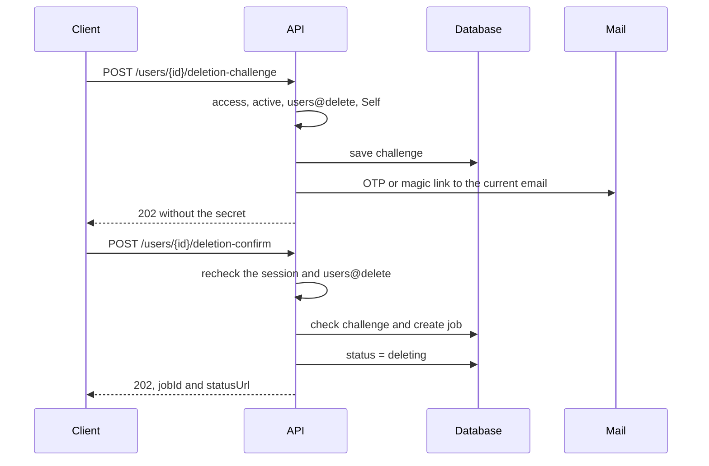
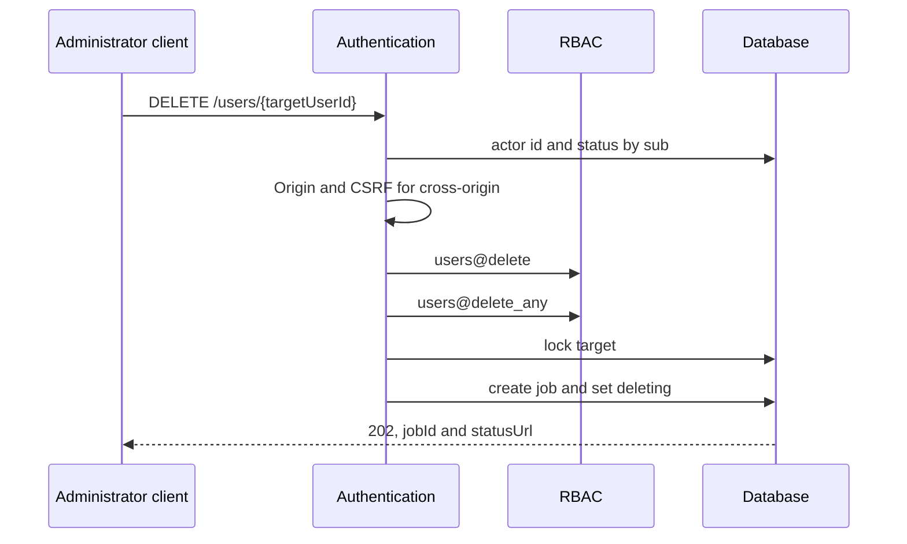
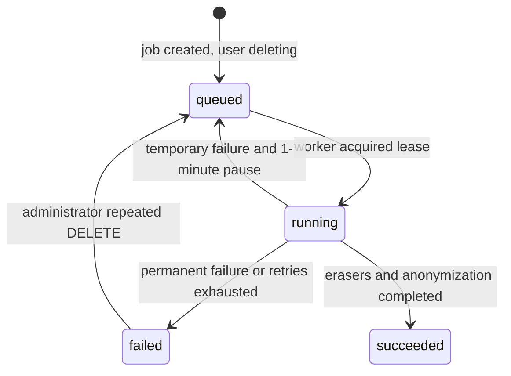
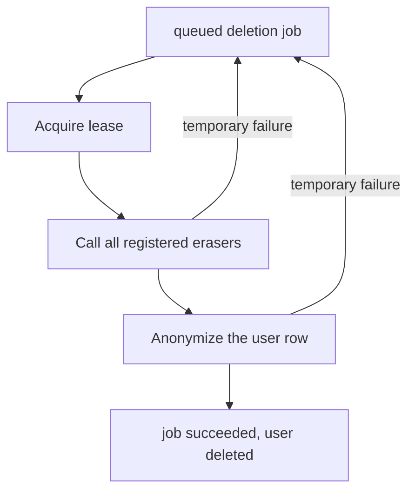

# Deleting a User

## Contents

- [Theory](#theory)
  - [Situation](#situation)
  - [Model](#model)
  - [Concepts and Their Connection to the Backend](#concepts-and-their-connection-to-the-backend)
  - [Areas of Responsibility](#areas-of-responsibility)
  - [Common Failures](#common-failures)
  - [Useful Links](#useful-links)
  - [Theory Questions](#theory-questions)
- [Practical Assignment](#practical-assignment)
  - [1.1 General](#11-general)
  - [1.2 Scenarios](#12-scenarios-user-stories)
  - [1.3 Contract](#13-contract)
  - [1.4 Errors and Constraints](#14-errors-and-constraints)
  - [1.5 Audit](#15-auditlogs)
  - [1.6 Non-Functional Requirements](#16-non-functional-requirements)

# Theory

## Situation

An active user requests deletion of their own account and first confirms their current email. An administrator starts deletion of another user without an email challenge. From there, one of several outcomes is possible: an asynchronous job is accepted with **202**, the minimal job status is returned with **200**, the input data is rejected with **400**, the session is invalid with **401**, the right or a direct self-delete is forbidden with **403**, the target or job is not found with **404**, the operation identifier conflicts with **409**, a **429** is triggered, or a dependency needed before acceptance is unavailable and **503** is returned. A storage or worker failure after **202** is reflected in the job state and does not change the already committed acceptance response.

Deletion chooses anonymization of the user's main row. PII, password data, challenges, roles, and files are cleared, while the technical `id`, timestamps, and a minimal audit without PII are kept for referential integrity and as proof that the process was carried out.

## Model

Self-delete consists of email confirmation and job acceptance. The challenge follows the same rules as registration and login: the server chooses OTP or magic link, stores only the HMAC, and applies a 10-minute TTL, five OTP entries, and a 60-second resend pause. Confirm additionally requires a valid session.

An administrator uses `DELETE /users/{userId}` for another user's target in the `pending`, `active`, or `blocked` state. The base `users@delete` and the additional `users@delete_any` are checked before looking up the target. This endpoint is forbidden for one's own identifier: even an administrator goes through self-confirmation, so that the administrative right does not bypass the protection of their own account.

`status = deleting` is committed in one transaction with the job. From this moment, new access and refresh requests stop working, since authentication accepts only `active`. Stateless JWTs remain cryptographically valid until `exp`, but the mandatory reading of the user by `sub` blocks them even before expiration.

The job is stored in the database, so acceptance does not depend on an external message queue. The worker atomically acquires a lease and calls idempotent erasers, then the finalization. Losing a response after an external deletion leads to calling the same erasers again; the absence of an already deleted object counts as success.

The main row is not deleted. Role assignments are removed already in the acceptance transaction together with the transition to `deleting`, so that the RBAC policy immediately reflects the irreversible termination of access. After external objects are successfully cleaned up, one final transaction replaces the email with a technical unique address `deleted.<32 hex>@example.invalid`, clears `display_name`, `photo_key`, and `password_hash`, deletes challenges, sets `deleted`, and completes the job. The original email is freed only when this transaction commits.

Challenge and job tables are added for the process. `password_hash` in `users` becomes nullable only for `deleted`; a database constraint does not allow `null` for the other statuses.

| `users` | Description |
| --- | --- |
| `id` | retained opaque technical identifier |
| `email` | the current normalized email, or a unique tombstone after anonymization |
| `password_hash` | slow hash before deletion; `null` only when `deleted` |
| `display_name` | profile name; `null` after anonymization |
| `photo_key` | photo key; `null` after anonymization |
| `status` | `pending`, `active`, `blocked`, `deleting`, or `deleted` |
| `created_at` | retained immutable UTC time assigned by the database when the user was created |
| `updated_at` | time of the last transition or anonymization |

| `deletion_challenges` | Description |
| --- | --- |
| `id` | challenge identifier |
| `user_id` | reference to `users.id`; one unconsumed challenge per user |
| `method` | `otp` or `magic_link`, chosen by the server |
| `secret_hash` | HMAC-SHA256; the original OTP or token is not stored |
| `last_sent_at` | start of the 10-minute TTL and the 60-second resend pause |
| `attempts` | number of incorrect OTPs, maximum five |
| `consumed_at` | time of consumption |
| `consumed_reason` | `confirmed`, `replaced`, `attempts_exhausted`, `job_exists`, or `user_inactive` |
| `created_at` | creation time |

| `deletion_jobs` | Description |
| --- | --- |
| `id` | 32 lowercase hex from `Idempotency-Key`; also the opaque `jobId` |
| `user_id` | unique reference to the user's technical row |
| `status` | `queued`, `running`, `succeeded`, or `failed` |
| `tombstone_email` | random unique address for the final anonymization |
| `attempts` | number of worker runs |
| `lease_until` | job ownership deadline; `null` outside execution |
| `next_attempt_at` | the time before which a `queued` job cannot be picked up; on the first run equals the creation time |
| `last_error_code` | machine category without PII or external error text |
| `created_at` | acceptance time |
| `updated_at` | time of the last change |
| `finished_at` | time of success, otherwise `null` |

### Normal Form

The `users`, `deletion_challenges`, and `deletion_jobs` tables are in BCNF and, given the stated dependencies, in 5NF.

Each subsequent form includes the requirements of the previous one:

- **1NF:** the email, status, and result code are atomic. The list of erasers is not stored in the job row: the worker calls the application's current handler registry.
- **2NF:** all three tables have simple keys, so there is no partial dependency.
- **3NF and BCNF:** the challenge does not copy the user's email, and the job does not copy `display_name`, `photo_key`, or the status of the `users` row. The TTL is computed from `last_sent_at`, so there is no dependent `expires_at`.
- **4NF:** independent challenges and jobs are moved out of `users`. Storing them in one row would create two independent multi-valued sets.
- **5NF:** the user, the challenge, and the job are joined by keys without an additional join dependency.

`tombstone_email` is stored in the job until the final transaction, so that a worker retry uses the same value. It is not a copy of PII and not a computed field of the user row. After completion it matches `users.email`, but the two rows describe different facts: the result of a specific job and the user's current technical state. The transfer is performed once in one final transaction, and a completed job is immutable.

`next_attempt_at` depends not only on `attempts` but also on the time of the last failure, so it stores scheduler state, not a transitive copy of the counter.

## Concepts and Their Connection to the Backend

### The Right to Erasure and Retention Boundaries

Article 17 of the GDPR establishes the right to erasure of personal data, but also lists exceptions, such as a legal retention obligation or the defense of legal claims. The product policy must determine the applicable basis and retention period before the technical process is launched.

The technical contract chooses anonymization of the main row. The former email, name, photo, password hash, challenge secrets, and related user information are deleted. The retained random `id` can no longer be linked to a person through PII. The log records the progress of the process without the actor id, target id, email, IP, `jobId`, reason, or data contents.

Accepting a deletion cannot leave the system without an active holder of `rbac@manage`. If the user being deleted is granted this permission, the self and admin branches, under the shared lock on the RBAC invariant, check that another active holder exists before creating the job and moving to `deleting`. A violation returns **409**. The same transaction deletes the target's `user_roles` and increments `rbac_policy_state.version`, so subsequent policy changes no longer count a user in `deleting` as a rights holder. The shared lock is also used for administrative blocking of a user, so parallel operations do not bypass the rule from RBAC.

Anonymization differs from hiding. Encryption with a retained key, base64, an ordinary hash of the email, and moving to an archive all leave the possibility of recovery or brute force. The tombstone is generated randomly and is not derived from the original email.

### Asynchronous Deletion and HTTP 202

Files and data of different modules cannot be reliably deleted in a single relational database transaction. Therefore the API atomically accepts the work, stops access, and returns **202 Accepted**, and the worker completes the cleanup later.

**202** means acceptance, not successful cleanup. The client receives a `jobId` and checks a separate status endpoint. Self, after the transition to `deleting`, presents an opaque `jobId` receipt, since the ordinary session is already invalid. An active Admin requests the status of another user's target with `users@delete` and `users@delete_any`. Both branches return `queued`, `running`, `succeeded`, or `failed`, but do not report which specific object caused a failure.

Storing the job in the database eliminates the dual write between the user row and a broker. The worker selects a `queued` or an expired `running` job, sets a lease, and calls all erasers, then the finalization. A second worker does not take the same job while the lease is alive. After a process crash, the lease expires, and the retry calls all erasers again: they are idempotent, so already cleaned data does not get in the way.

### Idempotency and a jobId Known to the Client

The client creates `Idempotency-Key` as 16 random bytes and sends 32 lowercase hex characters. The server uses this value as the `jobId`, so the client knows the status address even before the request. Losing the response after the transition to `deleting` does not leave the user without a way to learn the result.

Repeating the same key for the same target returns the previous job without a second process. A different key for a user who already has a job also returns the existing `jobId`. Repeating a key for a different target receives **409**, so that one operation does not acquire two meanings.

Idempotency also applies to erasers. Deleting a missing file succeeds, clearing an already empty field changes nothing, and a repeated call after success again returns `succeeded`. If an external call was executed but the response was lost, the retry must lead to the same state. A separate steps table is not needed: progress is not stored per eraser, because every handler can safely be called again.

### Immediate Termination of Access

The acceptance transaction changes `users.status` to `deleting`. The access and refresh checks from authentication, after the token signature, fetch the current row and accept only `active`, so the next request returns **401 invalid\_session**.

The server also sends expired access and refresh cookies to the Self client. This clears the current browser but is not a revocation: a copied stateless JWT physically exists until `exp`. Blocking is ensured only by the status check. An administrative deletion cannot clear cookies on the target's devices, but the same check stops them from working.

A request that already passed authorization at the same time as the deletion was accepted is not interrupted by itself. Critical operations changing the profile, email, and data of other modules recheck the status before committing according to their own contracts.

### Self Confirmation

The email is sent to the user's current normalized email. The OTP contains six digits; the magic link contains `challengeId` and 32 random bytes. The server stores an HMAC-SHA256 with a separate key at least 32 random bytes long and compares it in constant time.

Both methods are valid for 10 minutes. The fifth OTP may succeed; a fifth incorrect entry returns **400** and consumes the challenge, and the next one receives **429**. A resend after 60 seconds replaces the secret, restarts the TTL, and resets the counter.

Email confirmation does not replace the session. Confirm requires an active access token, `users@delete`, and that the path matches `sub`. The email places the magic token in the URL fragment, which is not sent to the server or in `Referer`; the client page reads it and passes the token in the body of a POST. An ordinary GET only opens the page, and creating the job is done by a POST. An administrator deletes another user directly, while their own identifier is always directed to the confirmed self-flow.

### The Module Cleanup Contract

Every module that stores user data or files registers a handler `eraseUserData(userId, deletionJobId)`. The handler contract is mandatory:

1. a repeated call with the same pair is safe and does not restore already deleted data;
2. PII, original and derived files, secrets, and direct links owned by the module are deleted;
3. an acceptable anonymized aggregate does not allow reconstructing the user and does not contain the original identifier;
4. the result has a single value, `succeeded`, `retryable_failure`, or `permanent_failure`, and a safe machine code;
5. the exception, the log, and the result do not contain the values being cleared, storage keys, the full `jobId`, or file contents;
6. `succeeded` is returned even when the data no longer exists.

Part 2, with file transformations, must register such an eraser before accepting the first file. It will delete the original and resulting objects and clear or anonymize the records owned by the module. The contract does not specify the names of future tables, buckets, or fields. While the transformations functionality is not installed and there is no data of this type, the handler is not registered.

The worker calls all registered erasers in turn and only after their success performs the final anonymization transaction. A temporary failure of any eraser or of the finalization returns the job to the queue; a permanent one moves it to `failed` without returning the user to `active`.

### Anonymization and the Unique Email

The final transaction starts only after all erasers have succeeded. It locks the policy state, the user, and the job, makes sure of `deleting`, idempotently deletes the remaining role assignments and challenges, clears PII and the password hash, moves the stored tombstone into `users.email`, sets `deleted`, and completes the job. If the defensive role deletion actually changed rows, the RBAC version is incremented in the same transaction.

The old email stays taken until the cleanup is finished. After the tombstone is committed, the unique index frees the address for a new registration. A parallel registration before the commit receives **409**, and after it creates a new row with no link to the deleted technical `id`.

Immediately after the transition to `deleting`, the canonical profile returns `photoUrl: null`, so as not to send the client to an object the worker may already have deleted. After the final anonymization, `displayName` also becomes `null`. The profile still has the fields `id`, `email`, `displayName`, `photoUrl`, `status`, `createdAt`, `updatedAt`, but an authorized administrator sees only the technical tombstone and `deleted`, not the former PII. `password_hash`, challenge secrets, JWTs, and internal fields are never included in the profile.

### Errors and Process Recovery

If the acceptance transaction was rolled back, the status and challenge do not change, there is no job, and the client receives **503** and repeats the request with the same key. If the commit went through, the status endpoint at the previously known `jobId` shows the accepted state even if the HTTP response was lost.

A temporary failure after acceptance does not turn the already returned **202** into **503**. The worker stores a safe category and `next_attempt_at`, and the status endpoint shows `queued`, `running`, or, after retries are exhausted, `failed`.

A temporary failure is retried up to five times with a one-minute pause. After the fifth failure, the job becomes `failed`, the user remains `deleting`, and the PII is not declared deleted. The administrator repeats `DELETE`, thereby moving the same job to `queued`, resetting `attempts`, and setting `next_attempt_at` to the current time; a new job and a new tombstone are not created.

Successfully deleted external data is not restored if a later eraser fails. The next run calls all handlers again, and those already cleaned up return `succeeded`. The `deleted` status is set only after full success.

### Summary

| Concept | Meaning in deletion | What the implementation relies on |
| --- | --- | --- |
| **202 Accepted** | the process is accepted but not completed | a durable job and a status endpoint |
| `deleting` | access is stopped immediately | a status check on every access and refresh |
| `deleted` | PII and files are cleared | the final anonymization after all erasers |
| Idempotency | a repeat does not create a second process | a `jobId` known to the client and a unique `user_id` |
| Lease | one worker owns the job for a limited time | an atomic claim and a safe retry |
| Eraser | the cleanup boundary of a neighboring module | `eraseUserData(userId, deletionJobId)` |
| Tombstone email | keeps `NOT NULL` and uniqueness without PII | a random address in `example.invalid` |

## Areas of Responsibility

| Client | Server |
| --- | --- |
| Self requests an email to the current address | Chooses OTP or magic link and stores only the HMAC |
| Before confirm, creates a random `Idempotency-Key` | Uses the key as a stable `jobId` |
| Sends confirm with a valid cookie | Rechecks active, `users@delete`, and the owner |
| Admin directly deletes only someone else's `userId` | Requires `users@delete` and `users@delete_any` before the lookup |
| After **202**, stops making ordinary requests | Immediately sets `deleting` |
| Self checks the status with the receipt, Admin — after both rights | Does not reveal PII or internal eraser errors |
| On `failed`, contacts an administrator | Does not automatically return the user to `active` |
| Does not enumerate storages and related entities | Calls all registered idempotent erasers |

When the frontend is hosted on a different origin, initiation, resend, confirm, and the administrative DELETE require the exact allowed `Origin` and `X-CSRF-Protection: 1`, even if both origins belong to the same site. For a cross-site deployment, cookies additionally receive `SameSite=None; Secure`. The Self branch of the status endpoint does not accept the auth cookie and checks the receipt; the Admin branch accepts the access cookie and repeats authentication and RBAC. GET does not change data and does not require the CSRF header.

## Common Failures

| What you see | Where to look |
| --- | --- |
| Self is deleted with a single DELETE without an email | the direct administrative path is not forbidden for one's own `userId` |
| A magic link starts deletion with an ordinary GET | a mail scanner can consume the secret without an explicit action |
| Confirm works after logout or blocking | the challenge mistakenly replaces a valid session |
| After **202**, the access token can still read the profile | `deleting` is set after the response, or the status is not checked |
| A refresh of a `deleting` user issues a new pair | the current row is not read by `sub` after the JWT check |
| Deletion is stuck without a job | the status and the work enqueuing are written separately |
| A lost response left Self without a way to learn the jobId | the identifier is created only by the server after the request, rather than known to the client in advance |
| A repeated confirm created a second process | there is no unique job per user or no idempotency key |
| One key deletes two different targets | a repeated `Idempotency-Key` is not checked against its previous meaning |
| Deletion accepted the last active `rbac@manage` holder | the shared RBAC invariant was not checked before `deleting`, or parallel operations are not serialized |
| Two workers clean up one user at the same time | there is no lease and no atomic job claim |
| A failure after a file deletion breaks the retry | `not_found` is mistakenly treated as a failure |
| The user became `deleted` before transformations were cleaned up | the final status was set before all registered erasers succeeded |
| An eraser error returned the user to `active` | the process violated the irreversible termination of access |
| The old email remains taken after success | the final transaction did not set the random tombstone |
| The tombstone can be computed from the original email | an ordinary hash or encoding is used instead of a random value |
| `password_hash` or `photo_key` remained in `deleted` | the final anonymization constraint does not check all PII fields |
| A new registration received the old account's links | the old technical `id` was reused instead of a new row |
| Self sees someone else's status via a random `jobId` | the receipt is not matched against the `user_id` from the path |
| Admin reads the status without both delete rights | the administrative branch bypassed access and RBAC |
| The status endpoint reveals the email | the receipt contains more than the minimal state |
| The log contains an OTP, JWT, the full `jobId`, or the values being deleted | the request body, cookies, the receipt, or eraser data are logged |

## Useful Links

### General

- [UK GDPR — Article 17](https://www.legislation.gov.uk/eur/2016/679/article/17/adopted/data.html) — the primary text of the right to erasure and the exceptions listed by the law.
- [UK GDPR — Article 5](https://www.legislation.gov.uk/eur/2016/679/article/5/adopted/data.html) — the principles of data minimization and storage limitation for the profile and audit.
- [ICO — Right to erasure](https://ico.org.uk/for-organisations/uk-gdpr-guidance-and-resources/individual-rights/individual-rights/right-to-erasure/) — a practical explanation of the boundaries of a request and verifying its fulfillment.
- [RFC 9110 — 202 Accepted](https://www.rfc-editor.org/rfc/rfc9110#name-202-accepted) — the meaning of the response for an asynchronous operation whose result is not yet complete.
- [OWASP — User Privacy Protection Cheat Sheet](https://cheatsheetseries.owasp.org/cheatsheets/User_Privacy_Protection_Cheat_Sheet.html) — minimization and protection of personal data.
- [OWASP — Logging Cheat Sheet](https://cheatsheetseries.owasp.org/cheatsheets/Logging_Cheat_Sheet.html) — excluding tokens, PII, and secrets from process events.
- [PostgreSQL — Explicit Locking](https://www.postgresql.org/docs/current/explicit-locking.html) — row locks and `SKIP LOCKED` for safely picking up jobs when using PostgreSQL.
- [PostgreSQL — Constraints](https://www.postgresql.org/docs/current/ddl-constraints.html) — uniqueness of the user's job, the tombstone, and checks of the final state.
- [Amazon S3 — DeleteObject](https://docs.aws.amazon.com/AmazonS3/latest/API/API_DeleteObject.html) — the behavior of repeated object deletion at an S3-compatible boundary.
- [OpenAPI Specification — Responses](https://spec.openapis.org/oas/latest.html#responses-object) — describing **202**, the status endpoint, and the error variants.

### By Language

#### Node.js

**Node.js, NestJS.** On Express or Fastify, the durable job and erasers keep the same contract.

- [NestJS — Queues](https://docs.nestjs.com/techniques/queues) — workers, retries, and handling long-running work; the job in the database remains the source of truth.
- [`Node.js — crypto.randomBytes`](https://nodejs.org/api/crypto.html#cryptorandombytessize-callback) — generating the challenge, the idempotency key, and the random tombstone.
- [`Node.js — createHmac`](https://nodejs.org/api/crypto.html#cryptocreatehmacalgorithm-key-options) — the challenge HMAC without storing the original secret.
- [Prisma — Transactions](https://www.prisma.io/docs/orm/prisma-client/queries/transactions) or [TypeORM — Transactions](https://typeorm.io/docs/advanced-topics/transactions/) — atomic job creation, status change, and final anonymization.
- [NestJS — OpenAPI](https://docs.nestjs.com/openapi/introduction) — documenting the challenge, **202**, and the status endpoint.
- [Prisma Migrate](https://www.prisma.io/docs/orm/prisma-migrate) or [TypeORM — Migrations](https://typeorm.io/docs/advanced-topics/migrations/) — creating the deletion tables and constraints.

#### .NET

**.NET, ASP.NET Core.** Minimal API and controllers use a shared hosted worker and a transactional service.

- [.NET — Background tasks with hosted services](https://learn.microsoft.com/en-us/aspnet/core/fundamentals/host/hosted-services) — a long-running worker and graceful process shutdown.
- [.NET — RandomNumberGenerator](https://learn.microsoft.com/en-us/dotnet/api/system.security.cryptography.randomnumbergenerator) — cryptographic bytes for keys and the tombstone.
- [.NET — HMACSHA256](https://learn.microsoft.com/en-us/dotnet/api/system.security.cryptography.hmacsha256) — storing an unrecoverable representation of the OTP and token.
- [EF Core — Transactions](https://learn.microsoft.com/en-us/ef/core/saving/transactions) — atomic acceptance and completion of deletion.
- [EF Core — Concurrency](https://learn.microsoft.com/en-us/ef/core/saving/concurrency) — handling competing workers and user changes.
- [EF Core — Migrations](https://learn.microsoft.com/en-us/ef/core/managing-schemas/migrations/) — moving the jobs and challenge tables.
- [ASP.NET Core — OpenAPI](https://learn.microsoft.com/en-us/aspnet/core/fundamentals/openapi/overview) — describing cookie protection and asynchronous responses.

#### Python

**Python, FastAPI.** For Django or Flask, the durable job, lease, and idempotent eraser are kept.

- [Celery — Tasks](https://docs.celeryq.dev/en/stable/userguide/tasks.html) — retryable background tasks and idempotency requirements.
- [`Python — secrets`](https://docs.python.org/3/library/secrets.html) — cryptographic identifiers, the challenge, and the tombstone.
- [`Python — hmac`](https://docs.python.org/3/library/hmac.html) — HMAC and `compare_digest` for the confirmation secret.
- [SQLAlchemy — Transactions](https://docs.sqlalchemy.org/en/20/orm/session_transaction.html) — atomic status change and job commit.
- [SQLAlchemy — Versioning](https://docs.sqlalchemy.org/en/20/orm/versioning.html) — detecting competing changes when processing rows.
- [Alembic — Tutorial](https://alembic.sqlalchemy.org/en/latest/tutorial.html) — migrations of the deletion tables and constraints.
- [FastAPI — Metadata and Docs URLs](https://fastapi.tiangolo.com/tutorial/metadata/) — publishing an up-to-date OpenAPI.

## Theory Questions

1. Why can **202 Accepted** not mean that the PII has already been deleted, and what role does the status endpoint play?
2. How does `status = deleting` block stateless access and refresh tokens, even though the JWTs themselves are not physically revoked?
3. Why does the client know the `jobId` before sending confirm, and what happens if a successful response is lost?
4. Why must deleting a missing file be considered successful when an eraser is rerun?
5. How does a random tombstone differ from a hash of the original email in terms of recovering PII?
6. What guarantees must the eraser of the future transformations module provide without revealing its schema?
7. Why does the `deletion_jobs` table not store the list of erasers, and how does a rerun rely on the idempotency of the handlers?

# Practical Assignment

User deletion functionality. Self confirms their current email and, with a valid session, starts asynchronous deletion; Admin starts deletion of another user directly. Acceptance immediately sets `deleting` and returns **202** and a `jobId` known to the client, and an idempotent worker clears PII and files, anonymizes the main row, and completes it with the `deleted` status.

## 1) Deleting a User

### 1.1 General

**Purpose:** irreversibly clear a user's personal data with immediate termination of access, an observable status, and a safe retry.

**Users/roles:**

- an active user with `users@delete` — initiates the challenge and confirms deletion of their own account;
- an active user with `users@delete` and `users@delete_any` — directly starts deletion of someone else's account;
- one's own `userId` cannot be deleted via the administrative endpoint, even with `users@delete_any`;
- Self obtains the status after losing the session via an opaque `jobId` receipt;
- an active Admin obtains the status of another user's target only with `users@delete` and `users@delete_any`.

**Unified catalog of permissions for working with users:**

| Permission | Purpose |
| --- | --- |
| `users@read` | reading one's own profile |
| `users@read_any` | additional access to someone else's profile |
| `users@update` | changing one's own profile |
| `users@update_any` | additional access to changing another user and to a direct email change by an administrator |
| `users@delete` | confirmed deletion of one's own account |
| `users@delete_any` | additional access to deleting another user by an administrator |
| `users@list` | viewing the administrative user list |

**Dependencies/related settings:**

- access, refresh, and cookies follow authentication; each token is accepted only for an existing `active` user;
- the protected chain follows authorization and current RBAC;
- the shared access-management invariant counts as an `rbac@manage` holder only an `active` user and serializes grant changes, blocking, and deletion;
- assigning roles to a user rechecks their status under the shared lock and rejects `deleting` or `deleted`;
- `DELETION_CONFIRMATION_METHOD` has a single value, `otp` or `magic_link`, chosen by the server;
- `DELETION_CHALLENGE_HMAC_KEY` contains a separate random value at least 32 bytes long;
- SMTP sends the challenge to Self's current email;
- the worker obtains durable jobs from the database, applies a lease, and calls the registered erasers;
- the profile storage and future modules provide idempotent cleanup;
- `DELETION_WORKER_LEASE_SECONDS` defaults to 300, the maximum number of automatic runs is 5, and the pause between them is 1 minute.

If the key is missing, empty, or shorter than 32 bytes, the application does not pass readiness. The key does not match the JWT, registration, login, or email-change key.

In all user operations, the canonical profile contains `id`, the normalized `email`, `displayName`, `photoUrl`, `status`, `createdAt`, `updatedAt`. The email is not masked. In `deleting`, the `photoUrl` field already equals `null`; after anonymization, the email becomes a random tombstone, `displayName` also equals `null`, and `status` equals `deleted`. `password_hash`, challenge secrets, JWTs, object keys, and internal fields are not given out.

The statuses are agreed as `pending`, `active`, `blocked`, `deleting`, `deleted`; only `active` authenticates. `deleting` was added as an immediate barrier for the duration of asynchronous cleanup, `deleted` — as the completed anonymized state.

### 1.2 Scenarios (user stories)

1. **Self confirms deletion:** the server sends an OTP or magic link to the current email, and a confirm with an active session creates a job.
2. **Admin deletes another user:** a request with both rights creates a job without an email.
3. **Access is stopped:** in the acceptance transaction the user becomes `deleting`, so subsequent access and refresh requests receive **401**.
4. **The client tracks the process:** Self presents the `jobId` created in advance, and Admin passes both delete permissions; the response contains `queued`, `running`, `succeeded`, or `failed`.
5. **Request retry:** the same process and `jobId` are returned without a second deletion and a second tombstone.
6. **Temporary failure:** the worker calls all idempotent erasers again; the user remains `deleting`.
7. **Full success:** files and PII are cleared, the main row is anonymized, the old email is freed, and the status becomes `deleted`.
8. **Permanent failure:** the job becomes `failed`, and the administrator moves the same job back to the queue with a repeated DELETE.

### 1.3 Contract

#### 1.3.1 Initiating and Resending Self-Confirmation

| Operation | Input data and rules |
| --- | --- |
| `POST /users/{userId}/deletion-challenge` | no body; only Self with `users@delete` |
| `POST /users/{userId}/deletion-challenge/resend` | `challengeId: string`; only Self with `users@delete` |

`userId` contains from 1 to 128 ASCII characters from letters, digits, `_`, and `-`. The server chooses the method from `DELETION_CONFIRMATION_METHOD` and sends the email to the current address; the client does not pass `method` or an address.

**Initiation logic:**

1. Check access, the current `active` status, CSRF for a request from a different origin regardless of the site boundary, and `users@delete`.
2. Compare `userId` with `actorUserId`. Return a mismatch as **403** before looking up the target.
3. Lock the user, then their unconsumed deletion challenge and an existing deletion job, in the common order. If a job already exists, return **409** and do not send an email.
4. If an unconsumed challenge was sent less than 60 seconds ago, return **429** with the remaining time.
5. After the pause, consume the previous challenge as `replaced` and create a new one of the chosen method with `attempts = 0` in a single transaction.
6. Commit the challenge, then send the secret to the current normalized email.

**Resend logic:**

1. Repeat access, `active`, CSRF, `users@delete`, and Self; lock the user, then the challenge by `challengeId`.
2. A challenge that is not found, replaced, already confirmed, or consumed as `user_inactive` receives **400**; `attempts_exhausted` receives **429**; `job_exists` receives **409**.
3. If 60 seconds have not passed since `last_sent_at`, return **429**.
4. Create a new secret of the same method, replace the HMAC, update `last_sent_at`, and reset `attempts` in a single transaction.
5. After the commit, send the email; the previous secret no longer works.

If the transaction is not committed, the email is not sent and **503** is returned. If SMTP did not accept the email after the commit, the challenge is kept, and the **503** contains `confirmationRequired`, `method`, `challengeId`, and `retryAfterSeconds`, but not the email or the secret.

**Responses:**

- **Accepted:** **202 Accepted**, `confirmationRequired: true`, `method`, `challengeId`, `expiresInSeconds: 600`, `resendAfterSeconds: 60`.
- The OTP, token, HMAC, email, JWT, cookies, and profile data are absent from the JSON.

#### 1.3.2 Self Confirmation and Deletion Acceptance

| `POST /users/{userId}/deletion-confirm` | Input data |
| --- | --- |
| Header `Idempotency-Key` | exactly 32 lowercase hex characters created by the client from 16 random bytes; the value becomes the `jobId` |
| OTP | `challengeId: string`, `code: string` of exactly 6 digits |
| Magic link | `token: string` in the format `challengeId.secret`; the secret contains 32 random bytes before base64url; the email passes the token in the URL fragment |

The body contains exactly one variant of the secret. A GET on the magic link does not change state.

**Logic/steps:**

1. Check the path, `Idempotency-Key`, and the body shape.
2. Before any new business operation, check for an idempotent repeat: if such a `jobId` already belongs to the same user, return it with **202** without rechecking the challenge; if the key belongs to a different target, return **409**. This branch neither creates nor retries a job.
3. If there is no job with this key, check access, the current `active` status, CSRF, `users@delete`, and that `userId` matches `actorUserId`.
4. Acquire the shared lock on the policy state, then lock the user and the challenge in the established order of transactional locks.
5. Check ownership, method, consumption, and the TTL `last_sent_at + 10 minutes`. A challenge that is not found, replaced, already confirmed, or consumed as `user_inactive` receives **400**; `attempts_exhausted` receives **429**; `job_exists` receives the existing job with **202**.
6. Recheck `active`; for any other status, consume the challenge as `user_inactive` and return **401**.
7. Compare the HMAC in constant time. The fifth OTP is still checked; the fifth incorrect one receives **400** and consumes the challenge, and the next one receives **429**. An incorrect magic link receives **400** without a counter.
8. If the user already has a job with a different key, consume the challenge as `job_exists` and return the existing job with **202**.
9. If the user is granted `rbac@manage`, under the already acquired lock on the RBAC invariant, make sure another active holder remains. Otherwise return **409** without a job and without a status transition.
10. Create `deletion_jobs` with the status `queued`, `attempts = 0`, and `next_attempt_at = now`, and generate one tombstone.
11. Set the user to `deleting`, delete their `user_roles`, increment `rbac_policy_state.version`, update `updated_at`, consume the challenge as `confirmed`, and consume the remaining login, email-change, and deletion challenges in a single transaction.
12. Commit the transaction, send the client expired access and refresh cookies with the original attributes, and return the receipt.

If the transaction was rolled back, the user remains `active`, the challenge is usable for a retry, there is no job, and **503** is returned. After the commit, the `jobId` is already known to the client from the header, so a lost response does not prevent checking the status.

**Response:** **202 Accepted**, `jobId`, `status`, `statusUrl`. `statusUrl` contains only the path `/users/{userId}/deletion-status`, without the receipt in the path or query; Self passes it later only in `Deletion-Receipt`. On the first acceptance, `status = queued`; on a repeat, the current status of the existing job is returned. The response contains no profile, email, challenge secret, JWT, tombstone, or internal fields.

#### 1.3.3 Administrative Deletion Acceptance

| `DELETE /users/{userId}` | Checks/validation |
| --- | --- |
| `userId: string` | From 1 to 128 ASCII characters from letters, digits, `_`, and `-` |
| Header `Idempotency-Key` | 32 lowercase hex characters from 16 random bytes; the value becomes the `jobId` |
| Body | absent |

**Logic/steps:**

1. Check the path and the header.
2. Check access, the current `active` status, CSRF, and the base `users@delete`.
3. If `userId` matches `actorUserId`, return **403 Forbidden** with the code `self_confirmation_required`; one's own account is deleted only via the challenge.
4. Check `users@delete_any` before looking up the target.
5. If the `jobId` already belongs to a different target, return **409**.
6. Acquire the shared lock on the policy state, then find and lock the target user. After both rights, absence receives **404**.
7. After the user, lock the existing job, if any, and return **202** with its `jobId`. For `failed`, move the same job to `queued`, set `next_attempt_at` to the current time, reset `attempts`, and clear the lease and `last_error_code`; do not create a new tombstone.
8. If the target's status is `active` or `blocked` and it is granted `rbac@manage`, under the shared lock on the RBAC invariant, make sure another active holder remains. Otherwise return **409** without changes.
9. If the target's status is `pending`, `active`, or `blocked`, create a job and a tombstone with a `next_attempt_at` that has already arrived, set `deleting`, delete the target's `user_roles`, and increment `rbac_policy_state.version` in a single transaction.
10. If the status is `deleting` or `deleted` but there is no related job, return **503** and a consistency violation event.
11. Consume all of the target's challenges on the first acceptance.

**Response:** **202 Accepted**, `jobId`, the current `status`, `statusUrl` without the receipt in the path or query. No email challenge is created. The response contains no target profile, email, password hash, JWT, tombstone, actor roles, or internal fields.

#### 1.3.4 Deletion Status

| `GET /users/{userId}/deletion-status` | Checks/validation |
| --- | --- |
| Self | The `Deletion-Receipt` header contains a `jobId` of 32 lowercase hex characters; the auth cookie and body are not used |
| Admin | A valid access token, `users@delete` and `users@delete_any`; `userId` must differ from `actorUserId`; no body |

The operation is declared with the `Deletion-Receipt` receipt together with the base pair `users@delete`. If the header is present, the Self branch runs and the cookie is not read, even if it is also sent. If the header is absent, the Admin branch runs: access and `users@delete`, then `users@delete_any` before looking up the target. The operation is not marked public.

The Self branch is available after losing the session, since `deleting` no longer authenticates. The server finds the job by the receipt and checks for an exact match between `job.user_id` and the `userId` from the path. A mismatch and an unknown receipt receive the same **404**. The receipt allows only reading the minimal status and neither starts nor retries the job.

The Admin branch first fully checks access and the current `active` status, then `users@delete` and `users@delete_any` before looking up another user's target. One's own `userId` receives **403** and uses the Self branch. A missing target or job after both rights receives **404**.

**Responses:**

- **Found:** **200 OK**, `jobId`, `status`, `createdAt`, `updatedAt`, `finishedAt`.
- `status` has a single value, `queued`, `running`, `succeeded`, or `failed`; `finishedAt` is set only for `succeeded`.
- **Not found:** **404 Not Found** for an unknown target, job, an invalid receipt, or a mismatch between the receipt and the target after the corresponding checks.
- The response contains no `userId`, actor, email, name, photo, deletion reason, tombstone, external service error, number of attempts, PII, JWT, or internal fields.

The endpoint does not make access decisions for other data and does not allow retrying the job. The rate limit, the randomness of the receipt, and the Admin check protect against mass enumeration; successful and unsuccessful lookups do not reveal user data.

#### 1.3.5 The Worker and the Mandatory Eraser

The worker processes `queued` jobs and `running` jobs with an expired lease:

1. Atomically obtain a job with the status `queued` and `next_attempt_at <= now`, or `running` with an expired lease; set `running`, `lease_until = now + 300 seconds`, clear `next_attempt_at`, and increment `attempts`.
2. Call each registered `eraseUserData(userId, deletionJobId)` in turn.
3. If all erasers returned `succeeded`, perform the final anonymization from section 1.3.6.
4. If any eraser returned `retryable_failure` and `attempts` is less than 5, store the safe code, return the job to `queued`, clear the lease, and write `next_attempt_at = now + 1 minute`.
5. If `attempts` has reached 5 or the result is `permanent_failure`, set the job to `failed` and clear the lease and `next_attempt_at`; the user remains `deleting`.
6. If the final transaction was not committed, treat this as a `retryable_failure` with the same limit and pause; the original **202** does not change.

Every module with user data must register an eraser before accepting such data. The interface accepts only `userId` and `deletionJobId`, idempotently deletes the PII and objects owned by the module, and returns `succeeded`, `retryable_failure`, or `permanent_failure` with a safe code. A repeated call after success again returns `succeeded`.

Part 2, with transformations, must delete the original and resulting files and clear or anonymize its records through this interface. Specific tables, fields, formats, and object locations are not specified here. Without a registered eraser, the transformations module does not pass readiness.

#### 1.3.6 Final Anonymization

After all erasers succeed, the worker performs one transaction:

1. Locks the policy state, the user, then the job. The pair `job.status = succeeded` and `user.status = deleted` immediately gives an internal idempotent success; otherwise `job.status = running` and `user.status = deleting` are required.
2. Rechecks that the profile photo has been deleted or is absent.
3. Physically deletes the user's registration, login, email-change, and deletion challenges.
4. Idempotently deletes the remaining `user_roles`; if rows were actually deleted, increments `rbac_policy_state.version`.
5. Sets `email = tombstone_email`, `display_name = null`, `photo_key = null`, `password_hash = null`, `status = deleted`, and a new `updated_at`.
6. Sets the job to `succeeded`, sets `finished_at`, and clears the lease and `next_attempt_at`.

A database constraint allows `password_hash = null` only when `status = deleted` and requires `display_name = null`, `photo_key = null` in this state. The unique tombstone has the form `deleted.<32 lowercase hex>@example.invalid` and is not derived from the original email.

The old email is freed after this transaction commits. The `users` row and its `id`, `created_at`, `updated_at` are kept, so that foreign keys do not become dangling references. A new registration of the former email creates a new `id` and does not receive the old roles, files, or history.

Repeating the finalization for an already `deleted` and `succeeded` pair returns an internal success without new changes. The status endpoint then returns `succeeded`.

### 1.4 Errors and Constraints

- **400 Bad Request** — an invalid `userId`, `jobId`, `Idempotency-Key`, challenge body, OTP, or magic link; the challenge is not found, expired, replaced, already confirmed, or consumed as `user_inactive`.
- **401 Unauthorized** — the access token is missing, invalid, expired, or refers to a user not in the `active` state; Self lost active before the job was accepted.
- **403 Forbidden** — `users@delete` is missing; an administrative foreign target lacks `users@delete_any`; a direct DELETE or an Admin status check is aimed at one's own user; the CSRF check failed.
- **404 Not Found** — the target user or job was not found after the necessary rights; the Self receipt is unknown or belongs to a different target.
- **409 Conflict** — the `Idempotency-Key` already belongs to a different target; a challenge was initiated or resent after a job had already been created; deletion would leave the system without an active user with `rbac@manage`.
- **429 Too Many Requests** — the rate limit is exceeded; a resend was performed earlier than 60 seconds; the OTP has already exhausted five entries.
- **503 Service Unavailable** — before acceptance or when reading the status, the database or current RBAC is unavailable; SMTP is unavailable when sending the challenge; the mandatory eraser configuration is not ready; `deleting`/`deleted` without a job was detected; the acceptance transaction was not committed. A storage, worker, or final transaction failure after a committed **202** is reflected in the status of the existing job and does not change the acceptance response.

The base right is checked before looking up the target. For an administrative deletion of another user, `users@delete_any` is also checked before the lookup, so a client without the right always receives **403**, and **404** is possible only after admission.

A job with the `failed` status does not mean a rollback. The user remains `deleting`, access and refresh do not work, and automatic restoration of PII or status is forbidden.

### 1.5 Audit/Logs

Log:

- creation, resend, incorrect entry, expiration, and consumption of a deletion challenge;
- self/admin acceptance, an idempotent repeat, and a key conflict;
- the user's transition to `deleting` and the final `deleted`;
- claim, success, retry, and permanent failure of a job;
- an administrative retry of a `failed` job;
- a consistency violation and completion of anonymization.

The event contains the kind of operation, a safe result code, and the time. The log must not contain the `jobId`, `Idempotency-Key`, `Deletion-Receipt`, actorUserId, targetUserId, email, displayName, IP, reason, tombstone, OTP, magic-link token, HMAC, JWT, cookies, storage keys, file contents, the full request body, or the full headers.

### 1.6 Non-Functional Requirements

- Creating a deletion challenge allows no more than 5 emails per user per hour; resend has a 60-second pause. The status endpoint allows 60 requests per IP per minute. The next attempt receives **429**.
- The acceptance transaction atomically creates the job, sets `deleting`, deletes `user_roles`, increments the RBAC version, and consumes challenges. The worker reads jobs from the database and does not depend on an external broker.
- Unique constraints cover `deletion_jobs.id`, one job per `user_id`, the tombstone, and one unconsumed challenge per user. The claim index covers `status, next_attempt_at, lease_until`.
- The worker holds a lease for 5 minutes, retries a temporary failure up to 5 times with a 1-minute pause, and survives a process stop. Each eraser is idempotent; the absence of an object in storage counts as success.
- Readiness does not pass if a module stores user data without an eraser.
- Automated tests cover Self/Admin, both status branches, the prohibition of direct self-delete, protection of the last active `rbac@manage`, loss of the **202**, eraser retries, `failed`, the tombstone, and re-registration of the old email.
- The project's general non-functional requirements — input validation, CORS, OpenAPI, structured logs, health checks, and test coverage of at least 80% — also apply to these operations.
