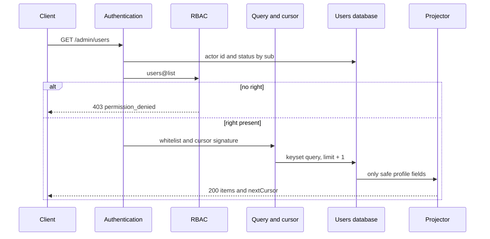
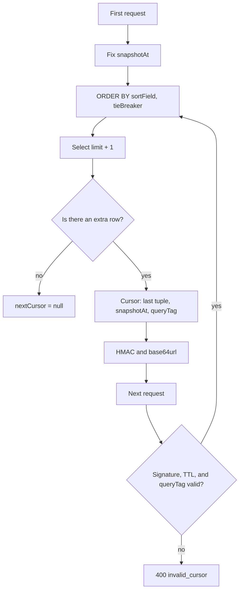

# Viewing the List of All Users

## Contents

- [Theory](#theory)
  - [Situation](#situation)
  - [Model](#model)
  - [Concepts and Their Connection to the Backend](#concepts-and-their-connection-to-the-backend)
  - [Areas of Responsibility](#areas-of-responsibility)
  - [Common Failures](#common-failures)
  - [Useful Links](#useful-links)
  - [Theory Questions](#theory-questions)
- [Practical Assignment](#practical-assignment)
  - [1.1 General](#11-general)
  - [1.2 Scenarios](#12-scenarios-user-stories)
  - [1.3 Contract](#13-contract)
  - [1.4 Errors and Constraints](#14-errors-and-constraints)
  - [1.5 Audit](#15-auditlogs)
  - [1.6 Non-Functional Requirements](#16-non-functional-requirements)

# Theory

## Situation

An active user with an administrative permission requests `GET /admin/users`. From there, one of several outcomes is possible: the server returns a page of canonical profiles and the next cursor, rejects the parameters or cursor with **400**, reports an invalid session with **401**, forbids a request without `users@list` with **403**, limits the rate with **429**, or returns **503** if the database, current RBAC, or the cursor verification key is unavailable.

The list has no separate "extended" user object. Each item contains the same safe profile as a single view: `id`, `email`, `displayName`, `photoUrl`, `status`, `createdAt`, `updatedAt`.

## Model

The request involves the client, authentication, RBAC, the query validator, the users database, and the response projector. The `users@list` check completes before the search is built and the first row is read. The right grants access to the entire administrative set, so `users@read_any` is not invoked for each row.



The first page fixes `snapshotAt` using the database clock before the selection and already applies the strict `created_at < snapshotAt` on it. The `users.created_at` field is assigned by the same database, and neither the client nor the process clock sets it; otherwise clock skew would break the boundary. All pages exclude users exactly on the boundary and after it, so parallel registrations do not appear in the middle of a traversal. Sorting is allowed only by the immutable `createdAt` and `id`; a second immutable component is added to the chosen field, which makes the order total.



The cursor contains the format version, key identifier, sort, direction, `snapshotAt`, the last composite value, and a keyed `queryTag` of the normalized query parameters. The payload does not contain the email, `displayName`, or status. HMAC-SHA256 with a separate key protects the cursor from modification but does not encrypt it, so PII is not placed in it.

Keyset pagination does not use a page number or a large `OFFSET`. For the `desc` direction, the next selection takes tuples smaller than the last one; for `asc`, larger. `limit + 1` is requested: the extra row determines `nextCursor` but is not returned in `items`.

Search and filter may change whether a row belongs to the set between HTTP requests. The contract guarantees an unchanging order, the exclusion of new rows after `snapshotAt`, and no duplicates due to an identical sort value; a historical snapshot of mutable fields is not created. For an administrative traversal with a changing `status`, the client starts a new pass if it needs the current complete set after bulk changes.

The list uses the existing `users` table and adds only indexes. There are no new columns or tables.

| `users` | Role in the list |
| --- | --- |
| `id` | public field, exact-match search, and tie-breaker |
| `email` | public field and prefix search on the normalized string |
| `password_hash` | not selected and not returned |
| `display_name` | public nullable field and prefix search after NFC and `lower` |
| `photo_key` | used only to build the protected `photoUrl` outside the `deleting` and `deleted` statuses; not returned itself |
| `status` | public field and exact filter on five values |
| `created_at` | public field, immutable sort, and snapshot boundary |
| `updated_at` | public field, but not a sort |

| Index | Purpose |
| --- | --- |
| `users_pkey (id)` | primary key, exact search, and sorting by `id` |
| `users_list_created_id_idx (created_at, id)` | default sort and composite cursor |
| `users_list_status_created_id_idx (status, created_at, id)` | status filter with the default sort |
| `users_list_status_id_created_idx (status, id, created_at)` | status filter with sorting by `id` |
| `users_list_email_prefix_idx (email text_pattern_ops)` | normalized literal email prefix without wildcards |
| `users_list_name_prefix_idx (lower(normalize(display_name, NFC)) text_pattern_ops) WHERE display_name IS NOT NULL` | literal name prefix; the query expression matches the index |

### Normal Form

Adding indexes does not change the functional dependencies of the data. `users` remains in BCNF and 5NF.

Each subsequent form includes the requirements of the previous one:

- **1NF:** profile fields contain one value each; the list is not stored in a single JSON cell and is formed by a query from rows.
- **2NF:** the primary key `id` is simple, so there is no partial dependency. `email` remains an alternate unique key.
- **3NF and BCNF:** `display_name`, `photo_key`, `status`, and the timestamps depend on the user key. The public `photoUrl` is computed and does not duplicate the internal key in the table.
- **4NF:** roles, challenges, deletion jobs, and files are behind separate relations or boundaries; independent lists are not multiplied inside `users`.
- **5NF:** links to other entities are reconstructed by keys, and the profile does not require additional decomposition to eliminate spurious combinations.

A functional index stores an internal representation of the value inside the index structure, but does not become a new attribute of the HTTP profile or a source of truth. The query expression exactly matches the index expression, and the Unicode version is pinned by the database version; after it changes, the index is rebuilt by a migration. Changing `display_name` updates the index in the same database transaction, so there is no separate update anomaly.

## Concepts and Their Connection to the Backend

### The List Permission and Least Privilege

`users@list` is a standalone administrative permission. It is checked after a valid access token and the current `active` status, but before parsing the resource-intensive search. The role name `admin` does not take part in the handler; the right can be granted to any role via RBAC.

`users@read` and `users@read_any` belong to `GET /users/{userId}`. The list does not perform a hundred `read_any` checks: an explicit `users@list` already allows returning the page. The absence of the right returns **403** before querying `users`, so the number and composition of records are not revealed.

Authentication and cookies do not change: the access token is extracted only from the HttpOnly cookie, the signature and claims are checked, and then the database confirms `active`. `pending`, `blocked`, `deleting`, `deleted`, and a missing actor receive **401**. Target rows in the list may have any of the five statuses.

### Cursor Pagination and a Total Order

Offset pagination forces the database to skip more and more rows and may shift pages when rows are inserted. Keyset pagination continues after the last sort tuple and uses an index range.

`createdAt` alone is not enough: several users may be created within the same unit of time. The pair `(createdAt, id)` creates a total order. When sorting by `id`, `(id, createdAt)` is used; the second component unifies the cursor format, although the unique `id` already rules out equality.

Both fields are immutable after creation. `snapshotAt` excludes rows created after the first request and is applied identically on every page. The cursor is valid for 15 minutes; after expiration the client starts the traversal over, so that a long-lived receipt does not pin an old set.

### Cursor Integrity

The cursor is base64url-encoded, but that is not protection. The server signs the payload with HMAC-SHA256 using a separate key at least 32 random bytes long and compares the signature in constant time.

`queryTag` equals an HMAC of the canonical `limit`, `searchBy`, normalized `q`, `status`, `sort`, and `order` with the domain prefix `users-list-query`. Changing at least one parameter while keeping the old cursor returns **400 invalid\_cursor**. A separate prefix `users-list-cursor` is used to sign the payload with the same key, so that the two HMAC purposes do not mix. The payload version makes it possible to reject an outdated format after an incompatible change.

The cursor does not contain PII. The value of `q` is first normalized and then enters only the keyed `queryTag`; plain SHA-256 is not used, since a short email or prefix could be checked offline against a dictionary. The signature confirms the cursor's origin but does not grant access: every subsequent request again goes through access and `users@list`.

The payload contains a non-secret `kid`. New cursors are signed with the active key, and all previous keys that signed not-yet-expired cursors are kept for their TTL plus 30 seconds of allowed clock skew. After that, the old key is deleted. An unknown `kid` receives a common **400 invalid\_cursor** rather than triggering a search for another key.

### Search and Filter Whitelist

The query accepts only `cursor`, `limit`, `searchBy`, `q`, `status`, `sort`, and `order`. An unknown or repeated parameter receives **400**. The client does not pass a column name, an SQL fragment, a comparison operator, or an arbitrary direction.

`searchBy=id` performs an exact comparison. `searchBy=email` performs a literal prefix match of at least three characters on the normalized email; `%`, `_`, and other characters get no wildcard meaning. `searchBy=displayName` trims the string and converts it to NFC. Then the database compares a literal prefix via `lower(normalize(display_name, NFC))` and `lower` of the same `q`. This is not full Unicode case folding: `casefold()` exists only in PostgreSQL 18 and is not used here, so `ß` does not turn into `ss`. The length is counted on `q` after trimming and NFC and is at least three code points.

`searchBy` and `q` are present together or both absent. Searching across all fields at once is not performed, since such an OR worsens index predictability and makes the semantics of a short string ambiguous.

The `status` filter accepts exactly one value: `pending`, `active`, `blocked`, `deleting`, or `deleted`. Sorting allows only `createdAt` and `id`, and the direction is `asc` or `desc`. The defaults are `createdAt desc`.

### The Canonical Profile and Email

Each page item contains exactly `id`, the normalized `email`, `displayName`, `photoUrl`, `status`, `createdAt`, `updatedAt`. `lastLoginAt`, roles, block reasons, challenge flags, and deletion data are not added.

The email is returned in full and is not masked. This is a definite decision: `users@list` is a separate privileged access, and an administrative email search requires distinguishing similar accounts. Masking would not replace RBAC and could make two addresses indistinguishable.

PII minimization is achieved not by distorting an allowed field, but by a strict `users@list`, small pages, rate limiting, auditing, and forbidding the export of extra columns. `password_hash`, challenge secrets, JWTs, cookies, `photo_key`, the job tombstone, roles, and internal fields are not selected.

`photoUrl` is built without contacting storage and leads to the protected profile operation. Having `users@list` by itself does not give out the object's bytes: loading the URL applies the photo-reading rules. This keeps the permissions independent and does not create N+1 requests to the file storage when building a page.

### Search, Indexes, and the Query Plan

Parameters are passed into the query as values and are not concatenated with SQL. The sort field and order are selected by the server from two small whitelists. This closes off SQL injection through column names and operators.

The default query uses `users_list_created_id_idx`. The status filter uses one of the indexes with `status` first. The email prefix uses `users_list_email_prefix_idx`, and the name prefix uses `users_list_name_prefix_idx` with the same `lower(normalize(..., NFC))` as the query condition. Searching with one or two code points is forbidden; substring search, fuzzy search, and a simultaneous OR across several fields are absent.

The API requests `limit + 1` rows and does not compute `totalCount`. An exact total size would require a separate, potentially heavy query and would quickly become outdated with registrations and deletions. `nextCursor = null` unambiguously marks the end of the traversal.

### Deletion Statuses in the Administrative List

`deleting` appears immediately after the deletion **202**, so the list shows terminated access even before the file cleanup is finished. In this state `photoUrl` already equals `null`, so as not to reference an object the worker may have deleted. `deleted` means successful anonymization: the email has already been replaced with a random tombstone, and the name and photo have been cleared.

The list does not reveal the progress of the deletion job. A separate status endpoint by `jobId` exists for that. The `status=deleting` filter helps an operator find technical rows, but does not replace job monitoring and does not show failure reasons.

### Summary

| Concept | Meaning in the list | What the implementation relies on |
| --- | --- | --- |
| `users@list` | access to the entire administrative set | a single current RBAC check before the query |
| Safe profile | the same seven fields in every row | an allowlist projector |
| Keyset pagination | continuing after the last tuple | a range query instead of `OFFSET` |
| Tie-breaker | a total order for identical timestamps | the immutable `id` |
| `snapshotAt` | new rows are not included in the current traversal | strict `created_at < snapshotAt` |
| Signed cursor | the client does not change the boundary or parameters | HMAC, TTL, version, and a keyed query tag |
| Whitelist | fixed search, filter, and sort | server-side options without SQL from the client |
| Full email | unambiguous administrative identification | a separate privileged `users@list` |

## Areas of Responsibility

| Client | Server |
| --- | --- |
| Passes only documented query parameters | Rejects unknown and repeated parameters |
| Stores the cursor as an opaque string | Checks the HMAC, TTL, version, `kid`, and query tag |
| Does not change filters between pages | Binds the cursor to the normalized query |
| After `nextCursor: null`, ends the traversal | Requests `limit + 1` and builds the next cursor |
| Does not pass SQL, an arbitrary field name, or an operator | Selects search and sort from a whitelist |
| Protects the list screen as PII | Checks `users@list` on every request |
| Does not expect `totalCount` | Returns only the page and the cursor |
| Requests the photo separately | Does not make N+1 storage calls |

The list request uses GET and does not change state, so the CSRF header is not required. With a different trusted origin, the client sends cookies with `credentials: "include"`, and the server allows credentials only for the exact origin.

## Common Failures

| What you see | Where to look |
| --- | --- |
| A request without a session receives **403** | RBAC runs before authentication |
| A user with `users@read_any` gets the list without `users@list` | a single-item right mistakenly replaces the administrative permission |
| Without `users@list`, the database performs a heavy search | the right is checked after the query is built |
| A page contains `passwordHash` or `photoKey` | the list serializes the entity instead of going through the safe projector |
| The email is sometimes masked, sometimes full | there is no single decision; the contract requires the full normalized address |
| `lastLoginAt` appeared only in the list | the canonical safe profile was extended with an internal field |
| A user repeats across pages with identical timestamps | the cursor does not contain the immutable `id` tie-breaker |
| New registrations appear in the middle of an `asc` traversal | the cursor does not store and apply `snapshotAt` |
| An existing row disappeared beyond `snapshotAt` | `created_at` was assigned by the application clock, while the boundary uses the database clock |
| An old cursor works with a different filter | `queryTag` is missing or not checked |
| The cursor can be changed manually | the payload is encoded but not protected by HMAC |
| The searched email can be guessed from `queryTag` | plain SHA-256 is used instead of a keyed HMAC |
| The cursor reveals the email in the access log | sort or search PII was placed in the payload |
| `%` in `q` returns almost the entire table | the user's prefix was passed as an SQL wildcard |
| `sort=password_hash` is accepted by the server | the column name is taken from the query without a whitelist |
| A short page always ends the traversal | the query does not use `limit + 1` for an accurate `hasMore` |
| A large page number gets slower | `OFFSET` is used instead of a keyset range |
| A storage request is made for every row | `photoUrl` is built by loading the object instead of from row data |
| A deleted profile shows the old email | the list reads an archive or cache from before the final anonymization |
| The log contains `q` or the full cursor | search PII and the entire URL are logged |

## Useful Links

### General

- [PostgreSQL — LIMIT and OFFSET](https://www.postgresql.org/docs/current/queries-limit.html) — explains why a predictable `ORDER BY` is mandatory and the drawbacks of large offsets.
- [PostgreSQL — Row constructor comparison](https://www.postgresql.org/docs/current/functions-comparisons.html#ROW-WISE-COMPARISON) — the composite comparison `(sort_value, id)` for keyset pagination.
- [PostgreSQL — Multicolumn indexes](https://www.postgresql.org/docs/current/indexes-multicolumn.html) — the order of index columns for filtering and sorting.
- [PostgreSQL — String Functions and Operators](https://www.postgresql.org/docs/current/functions-string.html) — `normalize` and `lower` in the name search index expression. The `casefold()` on this page belongs to PostgreSQL 18 and is not used in the index.
- [RFC 2104 — HMAC](https://www.rfc-editor.org/rfc/rfc2104) — the mechanism for checking cursor integrity with a separate secret key.
- [RFC 4648 — Base64url](https://www.rfc-editor.org/rfc/rfc4648#section-5) — URL-safe encoding of the binary cursor without a promise of confidentiality.
- [OWASP — Secrets Management Cheat Sheet](https://cheatsheetseries.owasp.org/cheatsheets/Secrets_Management_Cheat_Sheet.html) — storing and rotating cursor signing keys outside code and logs.
- [Unicode Standard — Default Case Algorithms](https://www.unicode.org/versions/latest/core-spec/chapter-3/#G33992) — full case folding, which the list search deliberately does not use: the index calls the database's `lower`.
- [OWASP API Security — Broken Object Property Level Authorization](https://owasp.org/API-Security/editions/2023/en/0xa3-broken-object-property-level-authorization/) — the risk of exposing extra properties in list items.
- [OWASP — Authorization Cheat Sheet](https://cheatsheetseries.owasp.org/cheatsheets/Authorization_Cheat_Sheet.html) — least privilege and server-side checking of `users@list`.
- [OpenAPI Specification — Parameter Object](https://spec.openapis.org/oas/latest.html#parameter-object) — describing the allowed query parameters, enums, and `limit` bounds.

### By Language

#### Node.js

**Node.js, NestJS.** On Express or Fastify, the whitelist and keyset query keep the same contract.

- [NestJS — Controllers](https://docs.nestjs.com/controllers) — declaring and receiving the operation's query parameters.
- [NestJS — Validation](https://docs.nestjs.com/techniques/validation) — transforming `limit` and rejecting unknown values.
- [`Node.js — crypto.createHmac`](https://nodejs.org/api/crypto.html#cryptocreatehmacalgorithm-key-options) — signing the cursor and building the keyed query tag.
- [Prisma — Pagination](https://www.prisma.io/docs/orm/prisma-client/queries/pagination) — the cursor approach and how it differs from offset pagination.
- [TypeORM — Select Query Builder](https://typeorm.io/docs/query-builder/select-query-builder) — parameterized filters and a composite range predicate.
- [NestJS — OpenAPI types and parameters](https://docs.nestjs.com/openapi/types-and-parameters) — documenting query enums and bounds.
- [Prisma Migrate](https://www.prisma.io/docs/orm/prisma-migrate) or [TypeORM — Indices](https://typeorm.io/docs/advanced-topics/indices/) — creating composite and functional indexes.

#### .NET

**.NET, ASP.NET Core.** Minimal API and controllers use the same parameter whitelist and LINQ query.

- [ASP.NET Core — Model binding](https://learn.microsoft.com/en-us/aspnet/core/mvc/models/model-binding) — typed retrieval of query parameters.
- [EF Core — Efficient pagination](https://learn.microsoft.com/en-us/ef/core/querying/pagination) — keyset pagination and a unique composite order.
- [.NET — HMACSHA256](https://learn.microsoft.com/en-us/dotnet/api/system.security.cryptography.hmacsha256) — the cursor HMAC.
- [.NET — Base64UrlEncoder](https://learn.microsoft.com/en-us/dotnet/api/microsoft.identitymodel.tokens.base64urlencoder) — URL-safe encoding of the payload and signature.
- [EF Core — Indexes](https://learn.microsoft.com/en-us/ef/core/modeling/indexes) — composite indexes for the filter and order.
- [ASP.NET Core — OpenAPI](https://learn.microsoft.com/en-us/aspnet/core/fundamentals/openapi/overview) — describing the security scheme, query, and responses.
- [EF Core — Migrations](https://learn.microsoft.com/en-us/ef/core/managing-schemas/migrations/) — moving new indexes between environments.

#### Python

**Python, FastAPI.** For Django or Flask, the same normalization, cursor, and parameterized query remain.

- [FastAPI — Query Parameters](https://fastapi.tiangolo.com/tutorial/query-params/) — typed query parameters and default values.
- [Pydantic — Validators](https://docs.pydantic.dev/latest/concepts/validators/) — joint validation of `searchBy` and `q`.
- [`Python — hmac`](https://docs.python.org/3/library/hmac.html) — HMAC and `compare_digest` for the cursor.
- [`Python — base64`](https://docs.python.org/3/library/base64.html) — base64url encoding of the payload.
- [SQLAlchemy — SELECT](https://docs.sqlalchemy.org/en/20/tutorial/data_select.html) — a parameterized range query and a composite order.
- [Alembic — Tutorial](https://alembic.sqlalchemy.org/en/latest/tutorial.html) — migrations of composite and functional indexes.
- [FastAPI — Metadata and Docs URLs](https://fastapi.tiangolo.com/tutorial/metadata/) — up-to-date OpenAPI documentation.

## Theory Questions

1. Why is `createdAt` alone insufficient for stable cursor pagination, and why is `id` added?
2. How does keyset pagination differ from `OFFSET` in cost and in behavior with new rows?
3. Why does the cursor simultaneously contain `snapshotAt`, `queryTag`, `kid`, a version, and an HMAC?
4. Why is `users@list` checked once before the query, while `users@read_any` is not applied to each row?
5. Why is the full email acceptable only with a separate privileged permission, and how does masking differ from access control?
6. What happens to the current traversal if the status of an existing user changes between pages?
7. Why does the functional index `lower(normalize(display_name, NFC))` not violate the normal forms of the `users` table?

# Practical Assignment

Functionality for viewing the list of all users in the system. An active user with `users@list` receives pages of canonical safe profiles via `GET /admin/users`. Search, filter, and sort are limited by a whitelist, the page size has a fixed default and maximum, and a signed composite cursor binds the immutable order to the parameters of the first request.

## 1) Viewing the List of All Users

### 1.1 General

**Purpose:** return stable pages of safe profiles to a privileged user, with limited search and filtering.

**Users/roles:**

- an active user with `users@list` — receives the list;
- an active user without `users@list` receives **403**;
- the role name `admin` is not checked; the decision is made by current RBAC;
- the statuses of target users do not restrict their presence in the list.

**Unified catalog of permissions for working with users:**

| Permission | Purpose |
| --- | --- |
| `users@read` | reading one's own profile |
| `users@read_any` | additional access to someone else's profile |
| `users@update` | changing one's own profile |
| `users@update_any` | additional access to changing another user and to a direct email change by an administrator |
| `users@delete` | confirmed deletion of one's own account |
| `users@delete_any` | additional access to deleting another user by an administrator |
| `users@list` | viewing the administrative user list |

**Dependencies/related settings:**

- the access JWT and cookies fully follow authentication; only an existing actor with the `active` status proceeds to RBAC;
- `users@list` is checked against the current policy version before the users query;
- `USER_LIST_CURSOR_ACTIVE_KEY_ID` selects the active `kid`, and `USER_LIST_CURSOR_HMAC_KEYS` contains a key ring of separate random values at least 32 bytes long;
- the default `limit` is 20, the maximum is 100;
- the cursor is valid for 15 minutes with `snapshotAt`;
- `users.created_at` is assigned by the database's UTC clock and does not change after creation;
- `PUBLIC_API_BASE_URL` builds the protected `photoUrl` without reading storage.

If the active `kid` is not found, any cursor key is empty or shorter than 32 bytes, or two `kid`s are duplicated, the application does not pass readiness. The keys do not match the JWT and challenge keys, are not in the code, and are not returned to the client. During rotation, the previous key is kept for at least 15 minutes 30 seconds and then deleted.

The canonical item contains exactly `id`, the normalized `email`, `displayName`, `photoUrl`, `status`, `createdAt`, `updatedAt`. The email is returned in full and is never masked on this endpoint. `password_hash`, challenge secrets, JWTs, cookies, roles, `photo_key`, the deletion job, and internal fields are absent.

The statuses are agreed as `pending`, `active`, `blocked`, `deleting`, `deleted`; only `active` authenticates as an actor. All five values are allowed in items. `deleting` means accepted cleanup and always has `photoUrl: null`; `deleted` means completed anonymization with a tombstone email and an empty name and photo.

### 1.2 Scenarios (user stories)

1. **First page:** a client without a cursor receives up to 20 users in the order `createdAt desc, id desc`.
2. **Next page:** the client passes `nextCursor` and the unchanged parameters, and receives the continuation without duplicates caused by identical creation times.
3. **Limited search:** the client chooses exactly one field, `id`, `email`, or `displayName`; the email and name prefix contains at least three characters.
4. **Status filter:** the client chooses one of the five canonical states.
5. **Allowed sorting:** the client chooses `createdAt` or `id` and the direction `asc` or `desc`.
6. **Invalid cursor:** a modified signature, an expired TTL, or mismatched parameters receive **400**.
7. **No right:** the request receives **403** before searching, sorting, and reading users.
8. **End of traversal:** the last page returns `nextCursor: null`; a separate `totalCount` is not computed.

### 1.3 Contract

#### 1.3.1 Getting the List

| `GET /admin/users` | Rule |
| --- | --- |
| `cursor` | absent on the first page; on subsequent pages contains the opaque string issued by the server |
| `limit` | an integer from 1 to 100; defaults to 20 when absent |
| `searchBy` | absent together with `q`, or one of `id`, `email`, or `displayName` |
| `q` | present only together with `searchBy`; the format depends on the chosen field |
| `status` | if present, one of `pending`, `active`, `blocked`, `deleting`, `deleted` |
| `sort` | `createdAt` or `id`; defaults to `createdAt` when absent |
| `order` | `asc` or `desc`; defaults to `desc` when absent |

Other query parameters and a repeated parameter receive **400**. When a cursor is passed, `limit`, `searchBy`, `q`, `status`, `sort`, and `order` must, after normalization, match the first page.

**Search validation:**

- `searchBy=id` — `q` contains from 1 to 128 ASCII characters from letters, digits, `_`, and `-`; an exact comparison is performed;
- `searchBy=email` — `q`, after trimming and lowercasing, contains from 3 to 254 visible ASCII characters without spaces or control characters; a literal prefix match is performed, and SQL wildcards are not interpreted;
- `searchBy=displayName` — `q`, after trimming and NFC, contains from 3 to 80 code points without U+0000–U+001F and U+007F–U+009F; the database compares a literal prefix via `lower(normalize(display_name, NFC))`;
- an empty `q`, `q` without `searchBy`, and `searchBy` without `q` receive **400**.

**Logic/steps:**

1. Verify the access JWT, get the user by `sub`, and accept only `active`. On refusal, return **401** before RBAC.
2. Check the current `users@list`. If it is absent, return **403** before search validation and the `users` query.
3. Reject unknown, repeated, and invalid query parameters.
4. On the first page, get `snapshotAt` from the database's UTC clock before the selection and normalize the query.
5. On a subsequent page, check the cursor's format, `kid`, HMAC, version, TTL, and `queryTag`.
6. Build only a server-defined variant of the parameterized keyset query and the condition `created_at < snapshotAt`.
7. Select `limit + 1` rows and only `id`, `email`, `display_name`, `photo_key`, `status`, `created_at`, `updated_at`.
8. Pass no more than `limit` rows through the safe projector.
9. If there is an extra row, sign the cursor based on the last returned item; otherwise return `nextCursor: null`.

The database query has a 2-second timeout. A timeout returns **503**, not a partial page. No SQL fragment, arbitrary column name, or operator from the client is substituted into the query.

**Response:**

- **200 OK:** `items: SafeProfile[]`, `nextCursor: string | null`.
- `items` contains from 0 to `limit` elements.
- An empty first or subsequent page is allowed and returns `nextCursor: null`.
- `totalCount`, the page number, and a previous cursor are not returned.

#### 1.3.2 The Composite Cursor

The payload contains:

| Field | Value |
| --- | --- |
| `v` | format version `1` |
| `kid` | identifier of the key that signed the cursor |
| `sort` | `createdAt` or `id` |
| `order` | `asc` or `desc` |
| `snapshotAt` | RFC 3339 UTC from the database clock before the first selection |
| `lastSortValue` | the last value of the chosen immutable field |
| `lastTieBreaker` | `id` when sorting by `createdAt`, `createdAt` when sorting by `id` |
| `queryTag` | HMAC of the canonical query set, including `limit`, with a separate domain prefix |
| `issuedAt` | server UTC time of the first page, unchanged until the end of the traversal |
| `expiresAt` | `issuedAt + 15 minutes`, unchanged until the end of the traversal |

The payload is serialized in canonical order, base64url-encoded, and gets an HMAC-SHA256 using the key selected by `kid` from `USER_LIST_CURSOR_HMAC_KEYS`. The resulting string has the format `payload.signature`. The signature is compared in constant time. The domain prefixes `users-list-query` and `users-list-cursor` are used for `queryTag` and the signature.

Each subsequent page keeps the original `issuedAt` and `expiresAt`, so fast requests do not extend the traversal indefinitely. Invalid base64url, an unknown version or `kid`, an invalid signature, a future `issuedAt`, a mismatched fifteen-minute interval, an expired `expiresAt`, an invalid field value, and a mismatched `queryTag` produce the same **400 invalid\_cursor** without details.

For `createdAt desc`, the next page uses:

```text
(created_at, id) < (:lastCreatedAt, :lastId)
```

For `createdAt asc`, `>` is used. When sorting by `id`, the tuple order changes to `(id, created_at)`. In both cases `ORDER BY` lists the same fields with the same direction.

The cursor does not contain the email, `displayName`, status, roles, JWT, the signing key, or SQL. It does not replace access: every request again goes through authentication and `users@list`.

#### 1.3.3 The Safe List Item

| Field | Rule |
| --- | --- |
| `id: string` | immutable identifier |
| `email: string` | full normalized email, without masking |
| `displayName: string \| null` | the stored NFC string or `null` |
| `photoUrl: string \| null` | a protected HTTPS API URL; `null` without a photo and for `deleting` or `deleted` |
| `status: string` | `pending`, `active`, `blocked`, `deleting`, or `deleted` |
| `createdAt: string` | RFC 3339 UTC |
| `updatedAt: string` | RFC 3339 UTC |

The projector is fixed and does not depend on the role or the search field. For `deleting`, the `photoUrl` field equals `null`; for `deleted`, the email is a random tombstone, and `displayName` and `photoUrl` equal `null`. For the other statuses, the current allowed values are returned.

The email is not masked under any parameter. A user without the right does not receive even a masked list, and a user with `users@list` receives the full field. Items contain no `password_hash`, challenge secrets, JWTs, cookies, `photo_key`, roles, login timestamps, status reasons, deletion job, or internal flags.

Building `photoUrl` does not access the file storage. Obtaining the bytes themselves is done by the separate protected photo viewing operation and may require its own permissions.

#### 1.3.4 Races and Changes Between Pages

`createdAt` and `id` are immutable, so an already returned row does not move relative to the cursor. The strict `snapshotAt` boundary excludes users created at the same moment the boundary was fixed or later, for both sort directions; such rows will be included in a new traversal.

Changing `email`, `displayName`, or `status` does not change the sort position. If a row stopped matching the search or filter before the next page, it is not returned; if it started matching after its position had been passed, it will appear only in a new traversal. The cursor does not promise a historical MVCC snapshot between HTTP requests.

Deletion does not delete the main row: `deleting` and then `deleted` change the filter, but `id` and `createdAt` are kept. A client that needs the final set after a series of changes starts from the first page without a cursor.

### 1.4 Errors and Constraints

- **400 Bad Request** — an unknown or repeated query parameter; `limit` outside 1–100; invalid `searchBy`, `q`, `status`, `sort`, or `order`; the cursor is corrupted, expired, or has an invalid signature, `kid`, version, or query tag.
- **401 Unauthorized** — the access token is missing, invalid, expired, or refers to a missing or inactive actor.
- **403 Forbidden** — the active actor does not have a current `users@list`.
- **429 Too Many Requests** — the list rate limit is exceeded.
- **503 Service Unavailable** — the database, the current RBAC snapshot, or the HMAC operation is unavailable; the database query exceeded 2 seconds; the cursor key is not ready.

**404 Not Found** is not used for the list: a valid request with no matches returns **200** with empty `items`. An error in a single row does not turn the page into a partial response; when a dependency is unavailable, **503** is returned without items.

### 1.5 Audit/Logs

Log:

- a successful request with `actorUserId`, the normalized names of the parameters used, the page size, a `hasNext` flag, and the duration;
- **401**, **403**, **400 invalid\_cursor**, **429**, and **503** by safe category;
- a database timeout and the use of a plan that exceeded the monitoring threshold;
- a readiness failure due to the cursor key or RBAC.

The values of `q`, the cursor, the email, `displayName`, `photoUrl`, the composition of `items`, and the full URL are not logged. For search analytics, only `searchBy`, the presence of `status`, `sort`, `order`, `limit`, and an irreversible short-lived request id are recorded.

The log must not contain row PII, the password, `password_hash`, challenges, JWT, `Cookie`, `Set-Cookie`, the HMAC key, the cursor payload, roles, the full response body, or the full headers.

### 1.6 Non-Functional Requirements

- The endpoint allows no more than 60 requests per actor per minute and 120 requests per IP per minute. The first exceeded limit receives **429**. A `limit` value greater than 100 is rejected, not truncated.
- The database performs a keyset range over a composite index, selects `limit + 1`, and does not compute `totalCount`. Building a page does not access the photo storage.
- The cursor is valid for 15 minutes and is bound to the first page's query. The search is parameterized: the characters `%` and `_` get no wildcard meaning.
- Automated tests cover an empty page, identical `createdAt` values, both sort directions, search and filter, the cursor signature, TTL, a query tag mismatch, and all five statuses in items.
- The project's general non-functional requirements — input validation, CORS, OpenAPI, structured logs, health checks, and test coverage of at least 80% — also apply to this operation.
