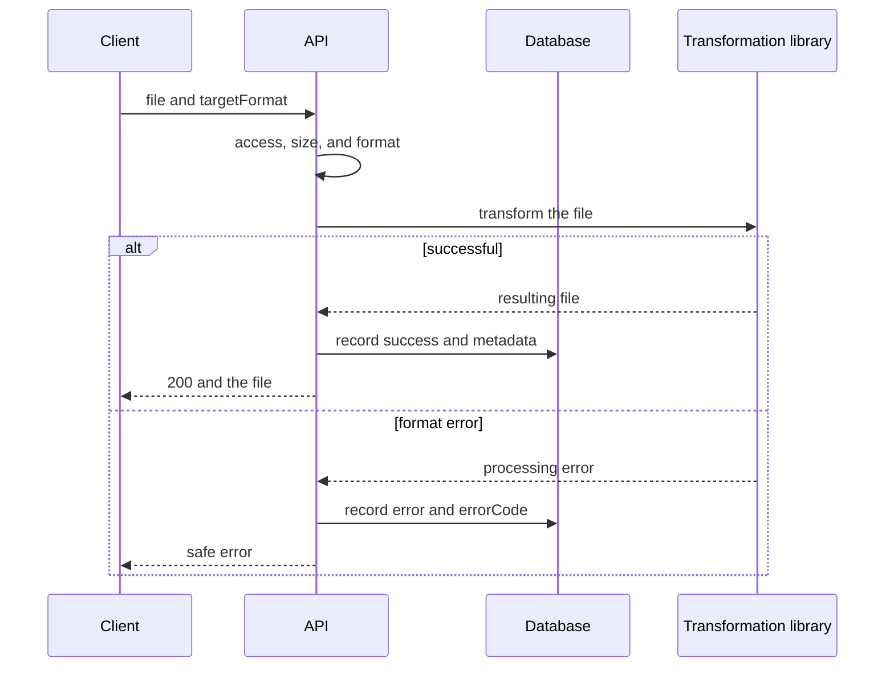
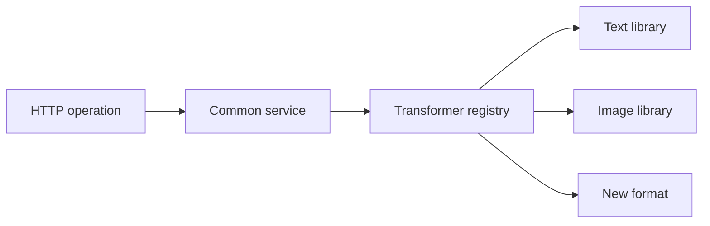

# General Requirements for File Transformation

## Contents

- [Theory](#theory)
  - [Situation](#situation)
  - [Model](#model)
  - [Concepts and Their Connection to the Backend](#concepts-and-their-connection-to-the-backend)
  - [Areas of Responsibility](#areas-of-responsibility)
  - [Common Failures](#common-failures)
  - [Useful Links](#useful-links)
  - [Theory Questions](#theory-questions)
- [Practical Assignment](#practical-assignment)
  - [1.1 General](#11-general)
  - [1.2 Scenarios](#12-scenarios-user-stories)
  - [1.3 Contract](#13-contract)
  - [1.4 Errors and Constraints](#14-errors-and-constraints)
  - [1.5 Audit](#15-auditlogs)
  - [1.6 Non-Functional Requirements](#16-non-functional-requirements)

# Theory

## Situation

An active user sends a file and chooses a target format. The server checks access and the input data, passes the file to a suitable library, returns the result, and saves the operation's metadata in the history.

From there, one of several outcomes is possible: the file is successfully transformed, the input is rejected, the library could not process the content, a limit is exceeded, or a required dependency is temporarily unavailable.

A separate frontend is not needed; requests can be sent from an HTTP client that supports cookies and `multipart/form-data`.

## Model

The HTTP layer contains no format-specific algorithms. It performs the common checks and selects a registered transformer by the source and target formats.

Each transformation type implements one common interface. Inside the implementation is a call to a suitable library: a CSV parser, an XML/YAML serializer, Sharp, ImageSharp, Pillow, or another agreed-upon tool.

The history contains process metadata, but not file contents.

| `transformations` | Description |
| --- | --- |
| `id` | operation identifier |
| `user_id` | owner of the operation |
| `type` | `file` or `image` |
| `source_format` | the detected source format |
| `target_format` | the chosen target format |
| `status` | `success` or `error` |
| `input_size` | input file size in bytes |
| `output_size` | result size on success, otherwise `null` |
| `duration_ms` | processing duration |
| `error_code` | safe error code, otherwise `null` |
| `created_at` | start time in UTC |
| `completed_at` | completion time; set for every recorded attempt |

### Normal Form

The `transformations` table is in BCNF.

- **1NF:** each field contains one value; file bytes and lists of stages are not stored in the row.
- **2NF:** the primary key `id` is simple, so there are no partial dependencies.
- **3NF and BCNF:** formats, sizes, and status describe one operation and depend on its key. The user's email is not copied.
- **4NF:** independent saved files and audit events are not packed into one row.
- **5NF:** the user and the operation are joined by `user_id`; there are no additional join dependencies.

## Concepts and Their Connection to the Backend

### The Transformer Interface

A transformer receives an input stream, parameters, and an output stream. The controller does not care which library does the work. Adding a new format means a new implementation and registering the pair, not changing all the existing branches.

An abstract class is acceptable but not required. An interface and composition are usually enough: the library is plugged in via an adapter, and the common service is responsible for access, history, and errors.

### Libraries, Not Custom Parsers

CSV, YAML, XML, JPEG, PNG, and SVG have many edge cases. A custom parser or codec easily gets quotes, Unicode, entities, color profiles, and corrupted data wrong.

A maintained library of the chosen language is used. The application gives it limits and safe settings, and then translates its errors into the contract's HTTP statuses.

### Streaming Processing

A stream avoids loading an entire large file into a single buffer and supports backpressure. However, some libraries still build a complete model of the document or image, so a size limit remains mandatory.

The result is first fully formed in a temporary area. The client does not receive a partial file if the library ended with an error.

### History and Audit

History is a user-facing feature. It shows the format, status, sizes, and duration. Audit is a technical log of requests and errors.

After an attempt completes, `success` or `error` is saved. If the history could not be written, the API returns **503**, and the temporary result is deleted.

### Temporary and Permanent Storage

Without `save=true`, the result exists only until the response completes. Temporary files are not accessible via a public URL and are deleted on success, error, or timeout.

Permanent storage is plugged in through a separate interface. A local disk is suitable for development with a single instance, while production uses S3-compatible or another agreed-upon storage.

### User Deletion

The transformations module registers a user data deletion handler. It deletes saved files and history records. A repeated call is safe: an already missing object is considered deleted.

### Summary

| Concept | Meaning | Implementation |
| --- | --- | --- |
| Interface | a single call for different transformers | service/adapter |
| Registry | selecting a library by format pair | `source + target` |
| Stream | bounded memory consumption | stream and backpressure |
| History | metadata of every attempt | `transformations` |
| Temporary file | a complete result before the response | a private temporary area |
| Storage adapter | changing the backend without changing the API | local or S3-compatible |

## Areas of Responsibility

| Client | Server |
| --- | --- |
| Sends one file and parameters | Checks access, `transformations@convert`, format, and size |
| Chooses a published direction | Selects the registered library |
| Receives a file or a clear error | Does not reveal the library's stack trace |
| Requests the history separately | Saves the metadata of every attempt |
| Explicitly chooses permanent saving | Deletes the temporary result by default |

## Common Failures

| What you see | Where to look |
| --- | --- |
| A new format required changing the controller | library selection is not moved into a registry |
| A large file exhausted memory | the stream was replaced by reading the entire file without a limit |
| The client received a truncated result | the response started before the transformation completed |
| A successful transformation is missing from the history | the result was returned without the required metadata record |
| The history contains file contents | metadata is mixed with user data |
| Temporary files remain after an error | cleanup is not performed for all branches |
| The library's message is visible in the response | the exception was not converted into a safe code |

## Useful Links

### General

- [OWASP — File Upload Cheat Sheet](https://cheatsheetseries.owasp.org/cheatsheets/File_Upload_Cheat_Sheet.html) — file validation, limits, and safe storage.
- [MDN — MIME types](https://developer.mozilla.org/en-US/docs/Web/HTTP/Guides/MIME_types) — a correct `Content-Type` for the input and the result.
- [Refactoring Guru — Strategy](https://refactoring.guru/design-patterns/strategy) — selecting an independent transformation implementation.
- [PostgreSQL — Transactions](https://www.postgresql.org/docs/current/tutorial-transactions.html) — consistent writing of the history.

### By Language

#### Node.js

**Node.js, NestJS.** On Express or Fastify, the contract does not change.

- [Node.js — Streams](https://nodejs.org/api/stream.html) — streams and backpressure.
- [NestJS — File upload](https://docs.nestjs.com/techniques/file-upload) — accepting a multipart file.
- [NestJS — Providers](https://docs.nestjs.com/providers) — registering transformation services.
- [NestJS — OpenAPI](https://docs.nestjs.com/openapi/introduction) — describing file operations.
- [Prisma Migrate](https://www.prisma.io/docs/orm/prisma-migrate) — migrating the history.

#### .NET

**.NET, ASP.NET Core.** Minimal API and controllers use the same service.

- [.NET — Stream](https://learn.microsoft.com/en-us/dotnet/api/system.io.stream) — streaming input and output.
- [ASP.NET Core — Upload files](https://learn.microsoft.com/en-us/aspnet/core/mvc/models/file-uploads) — accepting files and limits.
- [.NET — Dependency injection](https://learn.microsoft.com/en-us/dotnet/core/extensions/dependency-injection) — registering implementations.
- [ASP.NET Core — OpenAPI](https://learn.microsoft.com/en-us/aspnet/core/fundamentals/openapi/overview) — API documentation.
- [EF Core — Migrations](https://learn.microsoft.com/en-us/ef/core/managing-schemas/migrations/) — moving the schema.

#### Python

**Python, FastAPI.** For Django or Flask, the common contract is kept.

- [`Python — io`](https://docs.python.org/3/library/io.html) — streaming interfaces.
- [FastAPI — Request Files](https://fastapi.tiangolo.com/tutorial/request-files/) — multipart files.
- [FastAPI — Dependencies](https://fastapi.tiangolo.com/tutorial/dependencies/) — wiring services and access.
- [FastAPI — Metadata and Docs URLs](https://fastapi.tiangolo.com/tutorial/metadata/) — OpenAPI.
- [Alembic — Tutorial](https://alembic.sqlalchemy.org/en/latest/tutorial.html) — migrating the history.

## Theory Questions

1. Why is it better to hide the transformation of a specific format behind a common interface?
2. What errors arise when implementing a CSV, XML, or image codec yourself?
3. Why does streaming processing not cancel the input file limit?
4. How does the user-facing history differ from the technical audit?
5. Why is the result formed in full before the HTTP response begins?
6. What happens to temporary data after an error or a timeout?
7. Why does the `transformations` table satisfy BCNF?

# Practical Assignment

Functionality of the common file transformation process in the system. An active user starts a supported transformation. The server calls a library through a common interface, returns a complete result, and saves the operation's safe metadata.

## 1) General Requirements for File Transformation

### 1.1 General

**Purpose:** define a common interface, history, and file lifecycle rules for all transformations.

**Users/roles:** an active user with the `transformations` permission. The role name is not checked.

| Action | Operation |
| --- | --- |
| `convert` | `POST /api/convert`, `POST /api/images/convert`, and both direction lists |
| `history` | one's own history |
| `history_any` | the history of a specified user; checked before looking up the target |
| `download` | downloading one's own result |
| `download_any` | downloading a specified user's result; checked before looking up the target |

On first installation, while the `transformations` permission does not exist, the module creates these actions. The `user` role receives `convert`, `history`, and `download`. The `admin` role, if it exists, receives all actions. A repeated run does not restore removed grants. If there is no `user` role, the module does not pass readiness.

**Dependencies/related settings:**

- the access JWT, cookies, and the authorization chain follow authentication and RBAC;
- the specific pairs and limits are set by the text and image requirements;
- exactly one transformer is registered for each direction;
- the temporary area is not publicly accessible;
- the storage backend is set by the application configuration.

The transformer uses a library of the chosen language. The practical contract does not require writing a parser or codec yourself.

### 1.2 Scenarios (user stories)

1. **Success:** the library transforms the file, the server saves `success`, and the client receives the result.
2. **Error:** the server saves `error` and a safe code, and the temporary data is deleted.
3. **New pair:** a new implementation is registered without changing the contracts of already working pairs.
4. **History:** the user later receives the metadata of text and image operations in a single list.
5. **Saving:** with an explicit flag, the attempt remains `success`, gets a key and `storageStatus=pending`; the HTTP response does not wait for object storage.
6. **User deletion:** the handler deletes the user's saved files and history.

### 1.3 Contract

#### 1.3.1 The Transformer Interface

The transformer receives:

- an input stream;
- validated parameters;
- an output stream.

It returns the actual `contentType`, extension, and size, or a safe error code. It does not verify the JWT, does not form the HTTP response, and does not write the history.

#### 1.3.2 The Common Order

1. Check the access JWT and the current `active` status.
2. For a state-changing request from a different origin, check `Origin` and CSRF.
3. Check this operation's `permission@action` pair. On refusal, return **403** before parsing the file.
4. Check the multipart, size, and parameters of the specific operation.
5. Detect the source format and find the registered pair.
6. Call the library and form the temporary result.
7. On success, record `success`, sizes, and duration, and return the file.
8. On error, record `error` and a safe `errorCode`, and return the status from section 1.4.
9. Delete the temporary data in any outcome.

If writing the history failed, the result is not returned; the temporary data is deleted and **503** is returned.

#### 1.3.3 History

Only the fields of the `transformations` table are written to the history. Contents, parsed data, JWTs, cookies, temporary paths, and library messages are not saved.

#### 1.3.4 Temporary Data and Storage

The original name is not used as a path. The temporary name is generated by the server.

Without saving, the result is deleted after the response. With `save=true`, the server assigns a key and keeps a copy for the background write according to the rules of `2.4`, without delaying delivery of the transformed file.

The user deletion handler first deletes the objects belonging to the user, then the history rows. A missing object or row is considered already deleted.

### 1.4 Errors and Constraints

- **400 Bad Request** — the file or a parameter is missing, the structure is corrupted, or the parameters are invalid.
- **401 Unauthorized** — the session is missing or invalid, or the user is not `active`.
- **403 Forbidden** — the declared `transformations` permission is missing, or the cross-origin CSRF check failed.
- **413 Content Too Large** — the input or result limit is exceeded.
- **415 Unsupported Media Type** — the format or direction is not supported.
- **503 Service Unavailable** — the history database, the temporary area, or a required dependency is unavailable.
- **504 Gateway Timeout** — the library did not finish within the set time.

The library's message and a partial result are not returned to the client.

### 1.5 Audit/Logs

Log: `requestId`, `transformationId`, `userId`, type, formats, sizes, result, a safe `errorCode`, and duration.

The log must not contain the contents, parsed values, the original name, the temporary path, JWT, cookies, the multipart body, or the library's stack trace.

### 1.6 Non-Functional Requirements

- The size limits and timeout of the specific format apply. The result is returned only in full.
- Calling a resource-intensive library does not block accepting other requests: it is moved to a separate thread or pool, but the HTTP response waits for the transformation to finish. A job queue is not used for the transformation itself.
- The history index covers `user_id, created_at, id`.
- Tests cover library selection, success, error, timeout, history, and cleanup of temporary files.
- The project's general non-functional requirements and test coverage of at least 80% apply to all transformations.
