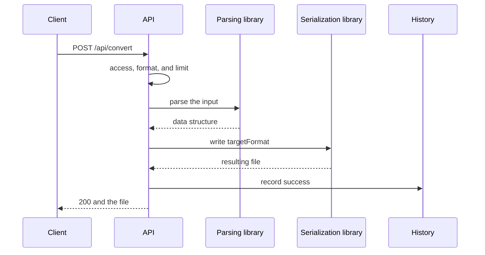
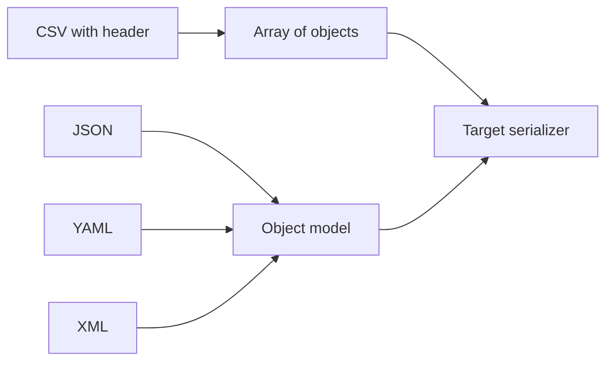

# Text Format Transformation

## Contents

- [Theory](#theory)
  - [Situation](#situation)
  - [Model](#model)
  - [Concepts and Their Connection to the Backend](#concepts-and-their-connection-to-the-backend)
  - [Areas of Responsibility](#areas-of-responsibility)
  - [Example](#example)
  - [Common Failures](#common-failures)
  - [Useful Links](#useful-links)
  - [Theory Questions](#theory-questions)
- [Practical Assignment](#practical-assignment)
  - [1.1 General](#11-general)
  - [1.2 Scenarios](#12-scenarios-user-stories)
  - [1.3 Contract](#13-contract)
  - [1.4 Errors and Constraints](#14-errors-and-constraints)
  - [1.5 Audit](#15-auditlogs)
  - [1.6 Non-Functional Requirements](#16-non-functional-requirements)

# Theory

## Situation

An active user uploads CSV, JSON, XML, or YAML and chooses another text format. The server validates the file, calls a parsing and serialization library, saves the operation's metadata, and returns the transformed file.

From there, one of several outcomes is possible: a successful transformation, a syntax or structural error, an unsupported format, an exceeded limit, a timeout, or a temporary dependency error.

A separate frontend is not needed; requests can be sent from an HTTP client with cookies and `multipart/form-data`.

## Model

Text libraries work with different representations, so the service brings the parsing result to a common data structure. CSV uses a table, while JSON, YAML, and XML use an object model.



For CSV, an array of objects is used: the first row contains the column names, and the rest contain values. This makes CSV → JSON/YAML unambiguous and defines the shape that JSON/YAML must have for the reverse transformation.



The file history uses the `transformations` table from the general requirements. No additional tables are created.

## Concepts and Their Connection to the Backend

### Ready-Made Libraries

A CSV parser can handle quoted fields, line breaks, and escaped quotes. An XML parser checks that the markup is well-formed. A YAML library distinguishes strings, numbers, booleans, and `null`.

These rules should not be implemented by hand. The application is responsible for choosing the library, safe configuration, limits, and translating exceptions into an HTTP response.

### The Source Format

The extension `.csv`, `.json`, `.xml`, `.yaml`, or `.yml` declares the format. The server additionally checks that the corresponding library can fully parse the content.

The client's `Content-Type` serves as an additional check but does not replace parsing. JSON is also valid YAML, so guessing based only on the first characters is unreliable.

### CSV

The first CSV row is required and contains non-empty, unique column names. Each record has the same number of fields. CSV values remain strings; automatically turning `001` into a number is forbidden.

CSV → JSON/YAML returns an array of objects. JSON/YAML → CSV accepts an array of flat objects with the same set of keys. A nested object or array cannot be unambiguously written into a single CSV cell, so it is rejected.

For CSV ↔ XML, the structure `rows → row → field` is used, where the column name is stored in the `name` attribute.

### JSON and YAML

JSON conforms to RFC 8259. Duplicate keys, `NaN`, `Infinity`, and data after the root value are rejected.

YAML is loaded with the library's safe method. Custom tags and the creation of arbitrary objects are disabled. JSON ↔ YAML preserves the data, but not comments or the original formatting.

### XML

XML is processed without DTDs, external entities, or network requests. This protects against XXE.

For XML → JSON/YAML, attributes get the `@` prefix, text gets `#text`, and repeated elements become an array. The reverse transformation uses the same convention. It is pinned down by tests and the API documentation.

### Encoding and Constraints

The input and the result use UTF-8. A BOM is allowed only at the beginning. An invalid encoding receives **400**.

The limit for each input format is set by the configuration; the default value is 10 MiB. The result does not exceed 50 MiB, and the transformation timeout is 30 seconds.

CSV is processed as a stream when the chosen library supports it. For JSON, XML, and YAML, the input limit protects operations that need the full structure in memory.

### History

A successful operation saves the source and target formats, sizes, and duration. An error saves a safe `errorCode`, but not a fragment of the document or the text of the library's exception.

### Summary

| Concept | Meaning | Implementation |
| --- | --- | --- |
| CSV header | names of the result fields | the first row |
| Common model | the link between JSON, YAML, and XML | library structures |
| Safe YAML | forbidding object creation | a safe loader |
| Safe XML | forbidding external entities | parser settings |
| UTF-8 | a single encoding | a validating decoder |

## Areas of Responsibility

| Client | Server |
| --- | --- |
| Sends a file with the correct extension | Validates it with the chosen library |
| Chooses one of the published targets | Checks the direction |
| Does not count on comments being preserved | Preserves the data, not the formatting |
| Receives a file or a safe error | Does not reveal the contents or a stack trace |
| Requests the list of formats | Builds it from the registered pairs |

## Example

The program transforms a CSV with the columns `name`, `age` and a single record into JSON. All three variants print `[{"name":"Anna","age":"30"}]`. The age value remains a string, as it is represented in the CSV.

### Node.js

`Node.js 22 or newer, csv-parse library.` A ready-made CSV parser is used, with the first-row-as-header mode.

```sh
npm install csv-parse
node csv-to-json.js
```

```javascript
const { parse } = require('csv-parse/sync');

const input = 'name,age\nAnna,30\n';
const rows = parse(input, {
  columns: true,
  skip_empty_lines: true,
});

console.log(JSON.stringify(rows));
```

### .NET

**.NET 8 or newer, CsvHelper package.** The library reads CSV using the invariant culture, and the standard JSON serializer forms the result.

```sh
dotnet new console -o CsvToJson
cd CsvToJson
dotnet add package CsvHelper
dotnet run
```

```csharp
using System.Globalization;
using System.Text.Encodings.Web;
using System.Text.Json;
using CsvHelper;

using var reader = new StringReader("name,age\nAnna,30\n");
using var csv = new CsvReader(reader, CultureInfo.InvariantCulture);
var rows = csv.GetRecords<dynamic>()
    .Select(row => ((IDictionary<string, object>)row)
        .ToDictionary(item => item.Key, item => item.Value?.ToString()))
    .ToList();
var options = new JsonSerializerOptions {
    Encoder = JavaScriptEncoder.UnsafeRelaxedJsonEscaping
};

Console.WriteLine(JsonSerializer.Serialize(rows, options));
```

### Python

`Python 3.10 or newer, standard csv and json modules.` No additional package is needed for CSV.

```sh
python csv_to_json.py
```

```python
import csv
import io
import json

source = io.StringIO("name,age\nAnna,30\n")
rows = list(csv.DictReader(source))

print(json.dumps(
    rows,
    ensure_ascii=False,
    separators=(",", ":"),
))
```

---

The libraries parse the CSV, and the application code only sets clear parameters and serializes the resulting structure.

## Common Failures

| What you see | Where to look |
| --- | --- |
| A field with a comma was split in two | the CSV is parsed with `split` rather than a library |
| `001` turned into `1` | automatic CSV type detection is enabled |
| `[object Object]` appeared in the CSV | a nested structure was not rejected |
| YAML created an application object | an unsafe loader is used |
| XML accesses an external URL | DTDs and external entities are not disabled |
| JSON is detected as YAML | the format is guessed without considering the extension |
| The client received part of the result | the response started before serialization completed |
| A fragment of the document is visible in the error | the library's exception was passed to the outside |

## Useful Links

### General

- [RFC 8259 — JSON](https://www.rfc-editor.org/rfc/rfc8259) — JSON syntax and encoding.
- [RFC 4180 — CSV](https://www.rfc-editor.org/rfc/rfc4180) — quoted fields and CSV rows.
- [W3C — XML 1.0](https://www.w3.org/TR/xml/) — the rules for well-formed XML.
- [YAML 1.2.2](https://yaml.org/spec/1.2.2/) — the YAML data model.
- [OWASP — XXE Prevention](https://cheatsheetseries.owasp.org/cheatsheets/XML_External_Entity_Prevention_Cheat_Sheet.html) — safe XML configuration.

### By Language

#### Node.js

**Node.js, NestJS.** On Express or Fastify, the contract does not change.

- [csv-parse](https://csv.js.org/parse/) — CSV from the example.
- [fast-xml-parser](https://github.com/NaturalIntelligence/fast-xml-parser) — XML.
- [yaml](https://eemeli.org/yaml/) — YAML 1.2.
- [NestJS — File upload](https://docs.nestjs.com/techniques/file-upload) — multipart.
- [NestJS — OpenAPI](https://docs.nestjs.com/openapi/introduction) — API documentation.

#### .NET

**.NET, ASP.NET Core.** The contract is the same for Minimal API and controllers.

- [CsvHelper](https://joshclose.github.io/CsvHelper/) — CSV from the example.
- [System.Text.Json](https://learn.microsoft.com/en-us/dotnet/api/system.text.json) — JSON.
- [XmlReaderSettings](https://learn.microsoft.com/en-us/dotnet/api/system.xml.xmlreadersettings) — safe XML.
- [YamlDotNet](https://github.com/aaubry/YamlDotNet) — YAML.
- [ASP.NET Core — Upload files](https://learn.microsoft.com/en-us/aspnet/core/mvc/models/file-uploads) — multipart.

#### Python

**Python, FastAPI.** For Django or Flask, the contract does not change.

- [`Python — csv`](https://docs.python.org/3/library/csv.html) — CSV from the example.
- [`Python — json`](https://docs.python.org/3/library/json.html) — JSON.
- [defusedxml](https://pypi.org/project/defusedxml/) — safe XML.
- [PyYAML](https://pyyaml.org/wiki/PyYAMLDocumentation) — safe YAML.
- [FastAPI — Request Files](https://fastapi.tiangolo.com/tutorial/request-files/) — multipart.

## Theory Questions

1. Why can CSV not be parsed correctly with an ordinary `split` on commas?
2. Why should CSV values be kept as strings without automatic type detection?
3. What constraints are needed when transforming a nested structure into CSV?
4. How does a safe YAML loader differ from an ordinary one?
5. Why must an XML parser not load DTDs and external entities?
6. Why does the extension select the parser, but the content is still validated?
7. What data is saved in the history when the library fails?

# Practical Assignment

Functionality for transforming text files in the system. An active user transforms CSV, JSON, XML, and YAML in any of twelve directions. Ready-made libraries perform parsing and serialization, while the server checks access, limits, errors, and the history.

## 1) Text Format Transformation

### 1.1 General

**Purpose:** transform a text file between CSV, JSON, XML, and YAML.

**Users/roles:** an active user with `transformations@convert`.

**Dependencies/related settings:**

- the common process and history are defined in `2.0`;
- the limit for each input format is set by the configuration, 10 MiB by default;
- the maximum result is 50 MiB;
- the timeout is 30 seconds;
- the encoding is UTF-8; a leading BOM is allowed.

### 1.2 Scenarios (user stories)

1. **CSV → JSON/XML/YAML:** the header and rows become a table of objects.
2. **JSON → CSV/XML/YAML:** the library parses the JSON and checks the shape for the target.
3. **XML → CSV/JSON/YAML:** a safe XML parser forms the structure.
4. **YAML → CSV/JSON/XML:** a safe loader forms the structure.
5. **Direction list:** the client receives four source formats and three targets for each.

### 1.3 Contract

#### 1.3.1 Transforming a File

| `POST /api/convert` | Checks/validation |
| --- | --- |
| `file: binary` | One non-empty `.csv`, `.json`, `.xml`, `.yaml`, or `.yml` |
| `targetFormat: string` | `csv`, `json`, `xml`, or `yaml`; differs from the source |
| `save: string` | Optional `true` or `false`; rules from `2.4` |
| Other fields | forbidden |

All twelve directions between different formats are supported.

**Logic/steps:**

1. Check the access JWT and the `active` status.
2. Check `transformations@convert`. If it is absent, return **403** before parsing the file.
3. Check the multipart, extension, MIME, and limit.
4. Parse the file with the library of the declared format.
5. Check that the structure is suitable for the target.
6. Serialize the result with the target format's library.
7. Record `success` and return the file; on error, record `error`.

**Responses:**

- **200 OK:** a file with the correct `Content-Type` and `Content-Disposition: attachment; filename="converted.<ext>"`.
- **Errors:** see section 1.4.
- The response contains no original content, internal paths, JWT, cookies, or stack trace.

#### 1.3.2 Representation Rules

- CSV has a required header; values remain strings.
- CSV → JSON/YAML creates an array of objects.
- JSON/YAML → CSV accepts an array of flat objects with identical keys.
- CSV ↔ XML uses `rows`, `row`, `field name`.
- JSON ↔ YAML preserves data types, but not comments or formatting.
- XML ↔ JSON/YAML uses the convention `@attribute`, `#text`, an array for repeated elements.

#### 1.3.3 Direction List

| `GET /api/convert/formats` | Checks |
| --- | --- |
| Cookie `access_token` | a valid `active` user |
| RBAC | `transformations@convert` |

**200 OK:**

```json
[
  {"source":"csv","target":["json","xml","yaml"]},
  {"source":"json","target":["csv","xml","yaml"]},
  {"source":"xml","target":["csv","json","yaml"]},
  {"source":"yaml","target":["csv","json","xml"]}
]
```

### 1.4 Errors and Constraints

- **400 Bad Request** — the file is empty, the syntax or encoding is invalid, the parameters are invalid, or the structure is not suitable for the target.
- **401 Unauthorized** — the session is missing or invalid, or the user is not `active`.
- **403 Forbidden** — `transformations@convert` is missing, or the CSRF check of a state-changing request failed.
- **413 Content Too Large** — the input or the result exceeded the limit.
- **415 Unsupported Media Type** — the source/target is not supported, or the content does not match the extension.
- **503 Service Unavailable** — the history or the temporary area is unavailable.
- **504 Gateway Timeout** — processing did not finish within 30 seconds.

### 1.5 Audit/Logs

Log: `userId`, `transformationId`, `sourceFormat`, `targetFormat`, sizes, result, a safe code, and duration.

Do not log the contents, parsed data, the original name, the temporary path, JWT, cookies, or the multipart body.

### 1.6 Non-Functional Requirements

- Use maintained libraries, not custom parsers. XML — without DTDs and external entities; YAML — a safe loader.
- Tests cover the 12 directions, CSV quotes, Unicode, library errors, limits, and timeout.
- The project's general non-functional requirements and test coverage of at least 80% are mandatory.
