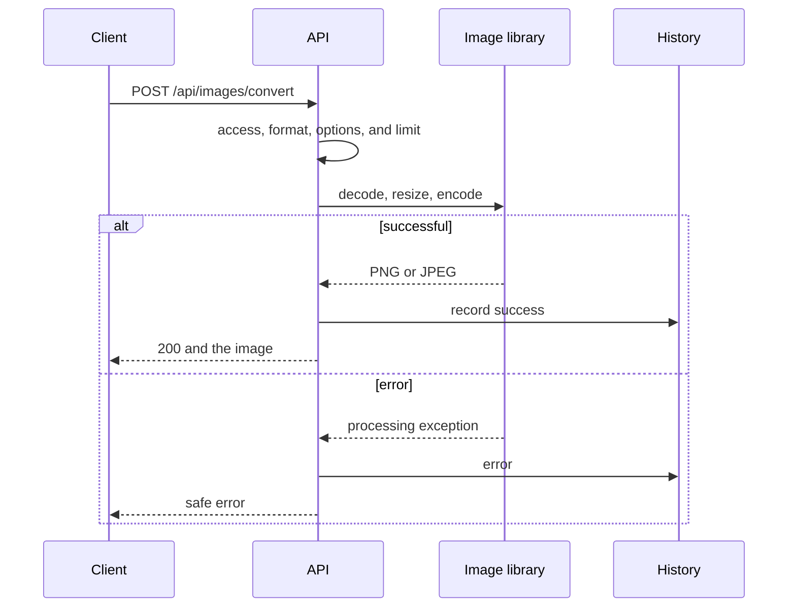
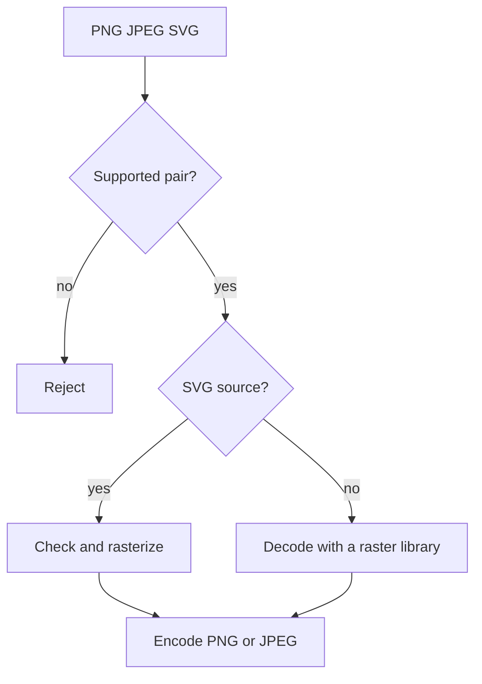

# Image Transformation

## Contents

- [Theory](#theory)
  - [Situation](#situation)
  - [Model](#model)
  - [Concepts and Their Connection to the Backend](#concepts-and-their-connection-to-the-backend)
  - [Areas of Responsibility](#areas-of-responsibility)
  - [Example](#example)
  - [Common Failures](#common-failures)
  - [Useful Links](#useful-links)
  - [Theory Questions](#theory-questions)
- [Practical Assignment](#practical-assignment)
  - [1.1 General](#11-general)
  - [1.2 Scenarios](#12-scenarios-user-stories)
  - [1.3 Contract](#13-contract)
  - [1.4 Errors and Constraints](#14-errors-and-constraints)
  - [1.5 Audit](#15-auditlogs)
  - [1.6 Non-Functional Requirements](#16-non-functional-requirements)

# Theory

## Situation

An active user uploads a PNG, JPEG, or SVG and chooses a supported result. The server validates the file and parameters, calls an image library, saves the operation's metadata, and returns the finished image.

From there, one of several outcomes is possible: the transformation is completed, the direction is not supported, the file is corrupted, the SVG is unsafe, the size or processing time is exceeded, or a required dependency is unavailable.

PNG/JPEG → SVG is not supported: encoding a raster file into an SVG container does not turn pixels into vector objects.

## Model

The API does not process pixels itself. PNG and JPEG are passed to a raster library, and SVG to a rasterization library after a safe XML check.



The direction determines the available parameters.



The `transformations` table from the general requirements gets `type=image`. No additional tables are needed.

## Concepts and Their Connection to the Backend

### Image Libraries

Sharp, ImageSharp, and Pillow can decode PNG/JPEG, take dimensions into account, change the format, and encode the result. For SVG, resvg, Svg.Skia, CairoSVG, or an equivalent is used.

The application does not implement PNG, JPEG, and SVG itself. It gives the library the allowed dimensions, quality, background, and timeout, and then converts exceptions into the contract's errors.

### Raster and Vector

PNG and JPEG store pixels. SVG stores geometric commands. An SVG can be rasterized at a given size, but the reverse transformation requires separate vectorization and is not part of the assignment.

JPEG does not support transparency. For PNG/SVG → JPEG, transparent areas are flattened onto a background, white by default. PNG preserves alpha.

### Format Validation

The extension and `Content-Type` are checked together with the signature and the decoding result. Renaming a corrupted file to `.png` does not make it a PNG.

Before allocating a large buffer, the library must receive limits on width, height, and the number of pixels. This protects against a decompression bomb.

### Safe SVG

SVG is an XML document and may contain scripts, external links, and other active constructs. Before rasterization, DTDs, external entities, `script`, `foreignObject`, event handlers, and external resources are forbidden.

The rasterizer runs without network access. The SVG itself is never returned as a target format, so the client receives only PNG or JPEG.

### Dimensions and Quality

For SVG → raster, `width` and `height` set the final size. If both are absent, the SVG's intrinsic size is used; if there is none — 1024×1024. A single dimension preserves the aspect ratio.

Each side of the result does not exceed 4096 pixels, and the total number of pixels does not exceed 16,777,216. JPEG quality accepts an integer value of 1–100, 85 by default.

### Metadata

The EXIF orientation is applied before encoding the JPEG. The output file is created anew without EXIF, GPS, or the original name.

### History and Storage

The history contains the formats, file sizes, status, duration, and a safe code. Pixels and SVG markup are not saved.

Without `save=true`, the temporary result is deleted after the response. Permanent saving is performed by the storage adapter from `2.4`.

### Summary

| Concept | Meaning | Implementation |
| --- | --- | --- |
| Decode | validating and reading the raster | the image library |
| Rasterize | SVG becomes pixels | an SVG renderer |
| Pixel limit | memory protection | width × height |
| Quality | JPEG setting | the library's encoder |
| Background | replacing JPEG transparency | `#RRGGBB` |
| Re-encode | a new safe file | removing metadata |

## Areas of Responsibility

| Client | Server |
| --- | --- |
| Sends one file and options | Checks the fields and the direction |
| Chooses PNG or JPEG | Calls the suitable library |
| Does not request raster → SVG | Rejects vectorization |
| Sets an allowed size | Checks the sides and pixels |
| Receives the finished file | Removes metadata and temporary data |

## Example

Each program creates an in-memory 2×1 PNG with a semi-transparent red color, transforms it with the library into a JPEG with a white background, and saves `output.jpeg`. Then the program prints `jpeg 2x1`.

### Node.js

**Node.js 22 or newer, Sharp library.** The same package decodes the PNG, flattens alpha onto the background, and encodes the JPEG.

```sh
npm install sharp
node png-to-jpeg.js
```

```javascript
const sharp = require('sharp');

async function main() {
  const png = await sharp({
    create: {
      width: 2, height: 1, channels: 4,
      background: { r: 255, g: 0, b: 0, alpha: 0.5 },
    },
  }).png().toBuffer();

  const info = await sharp(png)
    .flatten({ background: '#ffffff' })
    .jpeg({ quality: 85 })
    .toFile('output.jpeg');

  console.log(`${info.format} ${info.width}x${info.height}`);
}

main();
```

### .NET

**.NET 8 or newer, SixLabors.ImageSharp package.** The library creates a PNG, loads it, and encodes a JPEG.

```sh
dotnet new console -o PngToJpeg
cd PngToJpeg
dotnet add package SixLabors.ImageSharp
dotnet run
```

```csharp
using SixLabors.ImageSharp;
using SixLabors.ImageSharp.Formats.Jpeg;
using SixLabors.ImageSharp.PixelFormats;
using SixLabors.ImageSharp.Processing;

using var source = new Image<Rgba32>(2, 1, new Rgba32(255, 0, 0, 128));
using var png = new MemoryStream();
await source.SaveAsPngAsync(png);
png.Position = 0;

using var image = await Image.LoadAsync<Rgba32>(png);
image.Mutate(context => context.BackgroundColor(Color.White));
await image.SaveAsJpegAsync(
    "output.jpeg",
    new JpegEncoder { Quality = 85 });

Console.WriteLine($"jpeg {image.Width}x{image.Height}");
```

### Python

**Python 3.10 or newer, Pillow library.** A PNG is created in memory, then Pillow flattens alpha and saves a JPEG.

```sh
pip install Pillow
python png_to_jpeg.py
```

```python
import io
from PIL import Image

source = Image.new("RGBA", (2, 1), (255, 0, 0, 128))
png = io.BytesIO()
source.save(png, format="PNG")
png.seek(0)

image = Image.open(png).convert("RGBA")
result = Image.new("RGB", image.size, "white")
result.paste(image, mask=image.getchannel("A"))
result.save("output.jpeg", format="JPEG", quality=85)

print(f"jpeg {result.width}x{result.height}")
```

---

The example performs a real conversion with a library. The application code only passes the settings, and the JPEG format is produced by a ready-made encoder.

## Common Failures

| What you see | Where to look |
| --- | --- |
| PNG → SVG appeared in the list | changing the extension is mistakenly treated as vectorization |
| A small file exhausted memory | there is no pixel limit before decoding |
| An SVG loaded an external URL | the rasterizer has network access, or the check was skipped |
| A JPEG is rotated incorrectly | the EXIF orientation was not applied |
| Transparency became black | no background was set before JPEG |
| `quality` affects PNG | parameters are not restricted by direction |
| GPS coordinates remained in the response | the original file was returned without re-encoding |
| The client received part of a JPEG | the response was opened before the library finished |

## Useful Links

### General

- [OWASP — File Upload Cheat Sheet](https://cheatsheetseries.owasp.org/cheatsheets/File_Upload_Cheat_Sheet.html) — validating content and limits.
- [OWASP — XXE Prevention](https://cheatsheetseries.owasp.org/cheatsheets/XML_External_Entity_Prevention_Cheat_Sheet.html) — safe SVG/XML.
- [W3C — SVG 2](https://www.w3.org/TR/SVG2/) — dimensions and `viewBox`.
- [MDN — Image file type guide](https://developer.mozilla.org/en-US/docs/Web/Media/Guides/Formats/Image_types) — properties of PNG, JPEG, and SVG.

### By Language

#### Node.js

**Node.js, NestJS.** On Express or Fastify, the contract does not change.

- [Sharp](https://sharp.pixelplumbing.com/) — PNG/JPEG from the example.
- [resvg-js](https://github.com/thx/resvg-js) — SVG → raster.
- [NestJS — File upload](https://docs.nestjs.com/techniques/file-upload) — multipart.
- [NestJS — OpenAPI](https://docs.nestjs.com/openapi/introduction) — documenting the operation.

#### .NET

**.NET, ASP.NET Core.** The contract is the same for Minimal API and controllers.

- [ImageSharp](https://docs.sixlabors.com/) — PNG/JPEG from the example.
- [Svg.Skia](https://github.com/wieslawsoltes/Svg.Skia) — SVG → raster.
- [ASP.NET Core — Upload files](https://learn.microsoft.com/en-us/aspnet/core/mvc/models/file-uploads) — multipart.
- [ASP.NET Core — OpenAPI](https://learn.microsoft.com/en-us/aspnet/core/fundamentals/openapi/overview) — documentation.

#### Python

**Python, FastAPI.** For Django or Flask, the contract does not change.

- [Pillow](https://pillow.readthedocs.io/en/stable/) — PNG/JPEG from the example.
- [CairoSVG](https://cairosvg.org/documentation/) — SVG → raster.
- [defusedxml](https://pypi.org/project/defusedxml/) — safe SVG/XML.
- [FastAPI — Request Files](https://fastapi.tiangolo.com/tutorial/request-files/) — multipart.

## Theory Questions

1. Why is PNG/JPEG → SVG not an ordinary format transformation?
2. Why use a library instead of decoding the image yourself?
3. How does a file size limit differ from a pixel count limit?
4. Which SVG features are forbidden before rasterization?
5. Why must transparency be handled explicitly before JPEG?
6. Why apply the EXIF orientation and re-encode the result?
7. What metadata is saved in the history when the library fails?

# Practical Assignment

Functionality for transforming images in the system. An active user transforms PNG to JPEG, JPEG to PNG, and SVG to PNG or JPEG. Ready-made image libraries perform decoding, rasterization, and encoding, while the server sets safe parameters and limits.

## 1) Image Transformation

### 1.1 General

**Purpose:** transform a supported image into PNG or JPEG.

**Users/roles:** an active user with `transformations@convert`.

**Dependencies/related settings:**

- the common process and history are defined in `2.0`;
- the input limit is set separately for PNG, JPEG, and SVG, 10 MiB by default;
- the maximum side of the result is 4096, the maximum is 16,777,216 pixels;
- JPEG quality is 85 by default;
- the background is `#ffffff` by default;
- the timeout is 30 seconds.

### 1.2 Scenarios (user stories)

1. **PNG → JPEG:** the library flattens alpha onto the background and encodes a JPEG.
2. **JPEG → PNG:** the library decodes the JPEG and encodes a PNG.
3. **SVG → PNG:** a safe SVG is rasterized into a PNG.
4. **SVG → JPEG:** the SVG is rasterized and gets a background.
5. **Direction list:** the client receives only four pairs.

PNG/JPEG → SVG and transforming a format into itself are not supported.

### 1.3 Contract

#### 1.3.1 Transforming an Image

| `POST /api/images/convert` | Checks/validation |
| --- | --- |
| `file: binary` | One non-empty PNG, JPEG, or SVG |
| `targetFormat: string` | `png` or `jpeg` |
| `options: string` | An optional JSON object |
| `save: string` | Optional `true` or `false`; rules from `2.4` |
| Other fields | forbidden |

`png→jpeg`, `jpeg→png`, `svg→png`, `svg→jpeg` are supported.

**Logic/steps:**

1. Check the access JWT and the `active` status.
2. Check `transformations@convert`. If it is absent, return **403** before parsing the file.
3. Check the multipart, extension, MIME, and limit.
4. Check the direction and `options`.
5. Pass the file and parameters to the chosen library.
6. Check the final dimensions and form the temporary result.
7. Record `success` and return the file; on error, record `error`.

**Responses:**

- **200 OK:** `image/png` or `image/jpeg`, `Content-Disposition: attachment; filename="converted.<ext>"`, `X-Content-Type-Options: nosniff`.
- **Errors:** see section 1.4.
- The response contains no original name, SVG text, EXIF, internal paths, JWT, or cookies.

#### 1.3.2 Parameters

| Field | Rule |
| --- | --- |
| `quality` | Integer 1–100, only for JPEG, 85 by default |
| `width` | Integer 1–4096, only for SVG |
| `height` | Integer 1–4096, only for SVG |
| `background` | `#RRGGBB`, only for JPEG, `#ffffff` by default |

If no dimensions are passed for an SVG, the intrinsic size is used, and if it is absent — 1024×1024. A single dimension preserves the aspect ratio. Unknown or inapplicable fields give **400**.

#### 1.3.3 SVG Security

The SVG is parsed without DTDs, external entities, or network access. `script`, `foreignObject`, event handlers, and external resources are forbidden.

The result is always PNG or JPEG; the original SVG is never returned directly.

#### 1.3.4 Direction List

| `GET /api/images/convert/formats` | Checks |
| --- | --- |
| Cookie `access_token` | a valid `active` user |
| RBAC | `transformations@convert` |

**200 OK:**

```json
[
  {"source":"png","target":["jpeg"]},
  {"source":"jpeg","target":["png"]},
  {"source":"svg","target":["png","jpeg"]}
]
```

### 1.4 Errors and Constraints

- **400 Bad Request** — the file is corrupted, the options are invalid, the SVG is unsafe, or the dimensions are not allowed.
- **401 Unauthorized** — the session is missing or invalid, or the user is not `active`.
- **403 Forbidden** — `transformations@convert` is missing, or the CSRF check of a state-changing request failed.
- **413 Content Too Large** — the input or the result exceeded the limit.
- **415 Unsupported Media Type** — the format or direction is not supported.
- **503 Service Unavailable** — the history, the temporary area, or the library is unavailable.
- **504 Gateway Timeout** — processing did not finish within 30 seconds.

### 1.5 Audit/Logs

Log: `userId`, `transformationId`, formats, input and result sizes, final dimensions, result, a safe code, and duration.

Do not log bytes, SVG/XML, EXIF, the original name, the temporary path, JWT, cookies, or the multipart body.

### 1.6 Non-Functional Requirements

- Use maintained libraries, not custom codecs. The SVG renderer has no network access. The result is re-encoded without the original metadata.
- Tests cover the four pairs, alpha, EXIF, dimensions, a dangerous SVG, limits, and timeout.
- The project's general non-functional requirements and test coverage of at least 80% are mandatory.
