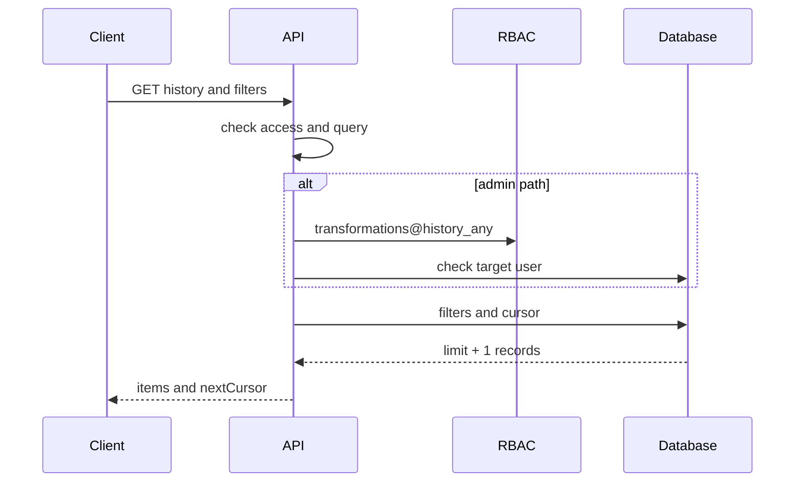
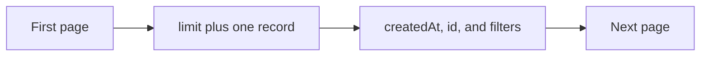

# Viewing User File Transformation History

## Contents

- [Theory](#theory)
  - [Situation](#situation)
  - [Model](#model)
  - [Concepts and Their Connection to the Backend](#concepts-and-their-connection-to-the-backend)
  - [Areas of Responsibility](#areas-of-responsibility)
  - [Common Failures](#common-failures)
  - [Useful Links](#useful-links)
  - [Theory Questions](#theory-questions)
- [Practical Assignment](#practical-assignment)
  - [1.1 General](#11-general)
  - [1.2 Scenarios](#12-scenarios-user-stories)
  - [1.3 Contract](#13-contract)
  - [1.4 Errors and Constraints](#14-errors-and-constraints)
  - [1.5 Audit](#15-auditlogs)
  - [1.6 Non-Functional Requirements](#16-non-functional-requirements)

# Theory

## Situation

An active user requests their own history of text and image transformations. A user with an administrative permission can view the history of a specified user.

From there, one of several outcomes is possible: the server returns a page of metadata, rejects a filter or cursor, forbids someone else's history, reports a missing user, limits the rate, or returns a temporary database error.

File contents, email, and profile fields are not included in the history. A separate frontend is not needed; requests can be sent from an HTTP client with cookies.

## Model

Self gets the `userId` from the verified access JWT. The administrative operation first checks `transformations@history_any`, then looks up the target user.

The history is sorted by `created_at DESC, id DESC`. The cursor contains the last sort pair for the next page.

The API reads the `transformations` table from the general requirements. No additional tables are created.

## Concepts and Their Connection to the Backend

### Cursor Pagination

An offset forces the database to skip more and more rows. A cursor starts the query after the last `created_at, id` pair, so it uses the composite index and does not depend on the page number.

`created_at` may coincide for several operations, so time alone is not enough. `id` makes the order unambiguous.

The cursor encodes the version, the last time, the `id`, and the canonical set of filters together with `limit` via base64url. After decoding, the server checks the shape, types, and that the set matches the current query. A different filter or a different `limit` receives **400**: the traversal starts over. The cursor does not grant rights: the Self filter by `user_id` and RBAC are applied anew on every request.

New operations appear before the pages already viewed. They will not be included in the current continuation and will be visible after requesting a new first page.

### Filters

You can filter by type, source format, target format, result, and period. Values are checked against the published formats.

The period is set in UTC. `createdAtFrom` is inclusive, `createdAtTo` is exclusive. An incorrect order of dates receives **400**. The set of filters is pinned in the first page's cursor and does not change on continuation.

### Self and Admin

The Self endpoint does not accept a `userId`; the owner is always taken from `sub`. This rules out access to someone else's history by substituting the query. The operation declares `transformations@history` and checks it before reading the history.

The Admin endpoint requires `transformations@history_any`. The right is checked before looking up the target, so a client without the right receives **403** regardless of whether the `userId` exists.

### Item Shape

An item contains only the operation's metadata: formats, status, sizes, duration, a safe code, and time. `durationMs` can be stored on completion or computed from the timestamps — the public contract does not change because of this.

Once storage is connected, `storageStatus`, `hasStoredFile`, and `fileExpiresAt` are added. The internal object key is not given out.

### Retention

The history retention period is set by the configuration, 90 days by default. A background cleanup deletes old records in small batches.

If a record has a saved file, the object is first deleted via the storage adapter, then the history record. The user deletion handler uses the same order without waiting for retention.

### Summary

| Concept | Meaning | Implementation |
| --- | --- | --- |
| Cursor | the position of the next page and its filters | `created_at + id + query` |
| Self | only one's own records | `user_id` from `sub` |
| Admin | another user's history | `history_any` |
| Filter | narrowing the list | allowed query fields |
| Retention | a limited history period | background cleanup |

## Areas of Responsibility

| Client | Server |
| --- | --- |
| Passes filters and the cursor | Checks their format |
| For Self, does not pass `userId` | Takes the owner from the access JWT |
| Stores the cursor as an opaque string | Applies a stable sort |
| Shows only metadata | Does not give out contents or PII |
| Starts a new selection without a cursor | Shows new operations on the first page |

## Common Failures

| What you see | Where to look |
| --- | --- |
| Records repeat between pages | the cursor uses only time without `id` |
| Self sees someone else's record | `user_id` is accepted from the query |
| Without the admin right, a user's existence can be checked | the target is looked up before RBAC |
| A large page slows down the API | the limit is not bounded |
| An email appeared in an item | the user profile is joined unnecessarily |
| An error contains a fragment of a file | the library's message ended up in the history |
| Old records are not deleted | the retention job is not running |

## Useful Links

### General

- [PostgreSQL — Multicolumn indexes](https://www.postgresql.org/docs/current/indexes-multicolumn.html) — the index for `user_id, created_at, id`.
- [OWASP — Authorization Cheat Sheet](https://cheatsheetseries.owasp.org/cheatsheets/Authorization_Cheat_Sheet.html) — Self/Admin checks.
- [MDN — URLSearchParams](https://developer.mozilla.org/en-US/docs/Web/API/URLSearchParams) — passing filters from the client.

### By Language

#### Node.js

**Node.js, NestJS.** On Express or Fastify, the pagination contract does not change.

- [Prisma — Pagination](https://www.prisma.io/docs/orm/prisma-client/queries/pagination) — cursor pagination.
- [NestJS — Controllers](https://docs.nestjs.com/controllers) — query parameters.
- [NestJS — OpenAPI](https://docs.nestjs.com/openapi/introduction) — describing filters and the page.

#### .NET

**.NET, ASP.NET Core.** Minimal API and controllers return the same page shape.

- [EF Core — Efficient querying](https://learn.microsoft.com/en-us/ef/core/performance/efficient-querying) — keyset pagination.
- [ASP.NET Core — Model validation](https://learn.microsoft.com/en-us/aspnet/core/mvc/models/validation) — query validation.
- [ASP.NET Core — OpenAPI](https://learn.microsoft.com/en-us/aspnet/core/fundamentals/openapi/overview) — describing the response.

#### Python

**Python, FastAPI.** For Django or Flask, the cursor rules are kept.

- [SQLAlchemy — SELECT](https://docs.sqlalchemy.org/en/20/core/selectable.html) — filters and sorting.
- [FastAPI — Query Parameters](https://fastapi.tiangolo.com/tutorial/query-params/) — query validation.
- [FastAPI — Metadata and Docs URLs](https://fastapi.tiangolo.com/tutorial/metadata/) — OpenAPI.

## Theory Questions

1. Why does the cursor use both `created_at` and `id`?
2. How does cursor pagination differ from offset on large pages?
3. Why does the Self endpoint not accept a `userId`?
4. Why check the administrative right before looking up the user?
5. What data is included in a history item, and what belongs only to the audit?
6. How do new operations behave when continuing an already started pagination?
7. In what order are the saved file and the history record deleted?

# Practical Assignment

Functionality for viewing a user's transformation history in the system. An active user receives pages of their own history, and a holder of an administrative permission receives the history of a specified user. The response contains metadata without file contents or PII.

## 1) Viewing Transformation History

### 1.1 General

**Purpose:** return a page of completed text and image transformations.

**Users/roles:**

- Self with `transformations@history` — one's own history after authentication;
- Admin with `transformations@history_any` — the history of a specified user.

**Dependencies/related settings:**

- the `transformations` table is defined in `2.0`;
- the default page size is 20, the maximum is 100;
- the sort is always `created_at DESC, id DESC`;
- the default retention period is 90 days.

### 1.2 Scenarios (user stories)

1. **Self:** the user receives a page of their own operations.
2. **Continuation:** `nextCursor` opens the next page.
3. **Admin:** after the right is checked, the target's history is returned.
4. **Filters:** type, formats, status, and period narrow the list.
5. **Empty page:** a valid request with no results returns an empty array.

### 1.3 Contract

#### 1.3.1 Query Parameters

| Parameter | Rule |
| --- | --- |
| `cursor: string` | optional position of the next page |
| `limit: integer` | 1–100, 20 by default |
| `type: string` | `file` or `image` |
| `sourceFormat: string` | a supported source format |
| `targetFormat: string` | a supported target format |
| `status: string` | `success` or `error` |
| `createdAtFrom: date-time` | inclusive UTC boundary |
| `createdAtTo: date-time` | exclusive UTC boundary |

All filters are optional. When a cursor is present, `limit` and all filters must match the canonical set inside the cursor. A different set receives **400** and requires a new first page.

#### 1.3.2 Own History

| `GET /api/transformations/history` | Checks |
| --- | --- |
| Cookie `access_token` | a valid `active` user |
| RBAC | `transformations@history` |

**Logic/steps:**

1. Check access and the query.
2. Check `transformations@history`. If it is absent, return **403** before reading the history.
3. Take the `userId` from `sub`.
4. Apply the filters and the after-cursor condition.
5. Select `limit + 1` rows in a fixed order.
6. Return no more than `limit`; if there is a continuation, build `nextCursor` with the same set of filters.

#### 1.3.3 History of a Specified User

| `GET /admin/users/{userId}/transformations/history` | Checks |
| --- | --- |
| Cookie `access_token` | a valid `active` user |
| RBAC | `transformations@history_any` |

The right is checked before looking up the target. After admission, a missing user receives **404**. The other filters and pagination are the same as for Self.

#### 1.3.4 Response Shape

**200 OK:**

- `items: TransformationHistoryItem[]`;
- `nextCursor: string | null`.

`TransformationHistoryItem` contains:

- `id`;
- `type`;
- `sourceFormat`;
- `targetFormat`;
- `status`;
- `inputSize`;
- `outputSize: number | null`;
- `durationMs: number`;
- `errorCode: string | null`;
- `createdAt`;
- `storageStatus: "not_requested" | "pending" | "available" | "error"`;
- `hasStoredFile`;
- `fileExpiresAt: date-time | null`.

Until saving from `2.4` is implemented, all records return `storageStatus=not_requested`, `hasStoredFile=false`, and `fileExpiresAt=null`. The storage fields appear in the schema together with `2.4`.

The response contains no `userId`, email, file name, contents, temporary path, or storage key.

#### 1.3.5 Cursor and Retention

The cursor encodes the version, `createdAt`, `id` of the last record, and the canonical set of `limit`, `type`, `sourceFormat`, `targetFormat`, `status`, `createdAtFrom`, `createdAtTo` via base64url. A missing filter is encoded explicitly. After decoding, the version, time format, identifier, and that the set matches the current query are checked. An invalid cursor and a mismatched set receive **400**.

Cleanup deletes records older than the configured period. If there is a saved object, its deletion is called first; the absence of the object is considered an already completed cleanup.

### 1.4 Errors and Constraints

- **400 Bad Request** — the query, period, or cursor is invalid.
- **401 Unauthorized** — the session is missing or invalid, or the user is not `active`.
- **403 Forbidden** — the own history was called without `transformations@history`, or the admin path was called without `transformations@history_any`.
- **404 Not Found** — the admin path's target user was not found after the right was checked.
- **429 Too Many Requests** — the history reading rate limit is exceeded.
- **503 Service Unavailable** — the database or RBAC is unavailable.

### 1.5 Audit/Logs

Log: `actorUserId`, Self/Admin, `targetUserId` for an allowed admin request, filter categories, limit, the number of items, the result, and the duration.

Do not log the full cursor, file contents, email, file names, storage key, JWT, cookies, or the full response.

### 1.6 Non-Functional Requirements

- Pagination is mandatory; offset is not used. The index covers `user_id, created_at, id`. The query selects only the response fields and `limit + 1`.
- Reading the history allows no more than 60 requests per user per minute; the next one receives **429**.
- Retention deletes records older than the configured period in small batches. If there is an object, its deletion is called first.
- Tests cover Self/Admin, identical `createdAt`, the cursor, filters, an empty page, and retention.
- The project's general non-functional requirements and test coverage of at least 80% are mandatory.
