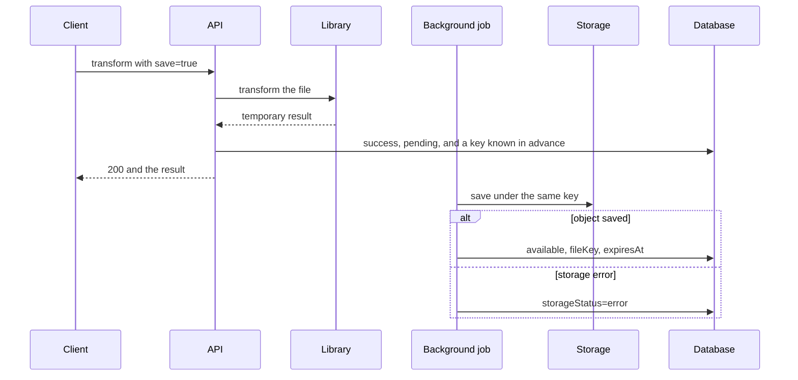
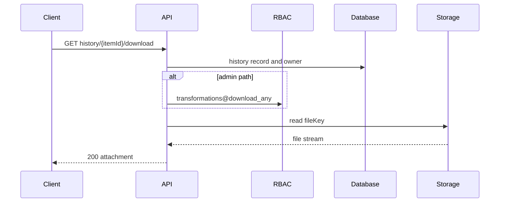

# Saving Transformation Results to Storage

## Contents

- [Theory](#theory)
  - [Situation](#situation)
  - [Model](#model)
  - [Concepts and Their Connection to the Backend](#concepts-and-their-connection-to-the-backend)
  - [Areas of Responsibility](#areas-of-responsibility)
  - [Common Failures](#common-failures)
  - [Useful Links](#useful-links)
  - [Theory Questions](#theory-questions)
- [Practical Assignment](#practical-assignment)
  - [1.1 General](#11-general)
  - [1.2 Scenarios](#12-scenarios-user-stories)
  - [1.3 Contract](#13-contract)
  - [1.4 Errors and Constraints](#14-errors-and-constraints)
  - [1.5 Audit](#15-auditlogs)
  - [1.6 Non-Functional Requirements](#16-non-functional-requirements)

# Theory

## Situation

A user can add `save=true` to a transformation. Then, once the result is ready, the server marks the history as `pending`, immediately returns the transformed file, and writes the object to storage with a background job. Without the flag, the result is only returned to the client and deleted after the response.

The saved file is available for download until the retention period ends. Self downloads only their own result, and Admin downloads the result of a specified user after a separate right is checked.

## Model

The transformation library first creates a finished temporary file. With `save=true`, the server immediately assigns a random key, saves a copy in the internal temporary area, and marks the history as `pending`. The HTTP response does not wait for object storage. The queue is the history rows themselves with the `pending` status.

Downloading goes through the API. The direct storage address is not given to the client.

The `transformations` schema is extended with optional fields:

| Field | Description |
| --- | --- |
| `storage_status` | `not_requested`, `pending`, `available`, or `error` |
| `stored_file_key` | internal random key of the result, otherwise `null` |
| `stored_file_until` | retention deadline, otherwise `null` |
| `storage_error_code` | safe code of the background error, otherwise `null` |

### Normal Form

The table remains in BCNF: the storage fields describe the same operation and depend on its `id`.

- **1NF:** the status, key, deadline, and error code are atomic values.
- **2NF:** the primary key is simple.
- **3NF and BCNF:** the storage key and deadline belong only to one transformation; the bucket address is not copied.
- **4NF:** several versions of a file are not stored in one row; by contract there is one result.
- **5NF:** no additional decomposition is required for a one-to-one relationship.

## Concepts and Their Connection to the Backend

### Storage Adapter

The business logic uses the operations `save`, `read`, and `delete`. The local file system and S3-compatible storage implement the same interface.

A local disk is suitable for development with a single instance. In production, object storage accessible to all API instances is typically used.

### Private Key

The server generates the key from a random value. It contains no email, `userId`, or original name. The bucket and credentials are in the configuration.

Even a random key is not considered a permission. The API always checks the access JWT and the owner of the record.

### Background Saving

`save=true` means the server has accepted a request to save. A successful transformation response does not wait for object storage: the client already receives the file, and the history shows `pending`.

The key is assigned before the response to the client. The background job writes the object under this key, so a retry does not create a second file. After the write, the state becomes `available`, or `error` on a permanent failure. With `available`, downloading becomes possible; with `error`, the user can repeat the transformation. A separate polling endpoint is not needed: the regular history returns the state.

### Partial Failures

If writing the object temporarily failed, the row remains `pending`, and the next attempt writes the same key. The status of the transformation itself remains `success`: the transformed file has already been delivered to the client.

If the object was written but the history update failed, the retry writes the same key again and brings the row to `available`.

If the temporary copy could not be saved, the transformation response still remains **200**, and the history immediately gets `storage_status=error`.

### Downloading and IDOR

A Self request selects the history by both `itemId` and the current `userId`. Someone else's id and a non-existent id give the same **404**.

The Admin endpoint requires `transformations@download_any` before looking up the target user. Knowing the URL or `itemId` does not bypass the check.

### Retention

The period is set by the configuration, 90 days by default. A background job first deletes the object, then clears the storage fields of the history record. The history row itself is deleted by the retention from `2.3`.

A missing object is considered already deleted. This makes it safe to retry cleanup after a failure.

### Summary

| Concept | Meaning | Implementation |
| --- | --- | --- |
| `save` | the user's explicit choice | multipart boolean |
| `pending` | the file is still being saved | the history row as a queue |
| Storage adapter | changing the backend | `save/read/delete` |
| Private key | an internal reference | a random value |
| Ownership | protection against IDOR | item + current user |
| Retention | the result's lifetime | `stored_file_until` |

## Areas of Responsibility

| Client | Server |
| --- | --- |
| Passes `save=true` explicitly | Does not save the result by default |
| Downloads through the API | Does not give out a direct storage URL |
| Uses the history item | Checks the owner and the admin right |
| On **404**, removes the download button | Deletes expired objects |
| Shows `pending`, `available`, or `error` | Updates the state of the background write |

## Common Failures

| What you see | Where to look |
| --- | --- |
| `save=false` created an object | the default value is handled incorrectly |
| `pending` never completes | the background job did not process the queue |
| The file key is visible in the response | the internal history model is serialized directly |
| Someone else's item can be downloaded | the record is looked up without restricting by owner |
| The file is available after retention | download does not check the deadline |
| The history was deleted, but the object remained | cleanup deletes the database record before storage |
| A storage failure turned the transformation into an error | the transformation status and the saving status are mixed up |
| Unavailable storage breaks `save=false` | the adapter is called without the flag |

## Useful Links

### General

- [OWASP — File Upload Cheat Sheet](https://cheatsheetseries.owasp.org/cheatsheets/File_Upload_Cheat_Sheet.html) — private storage and safe names.
- [OWASP — Authorization Cheat Sheet](https://cheatsheetseries.owasp.org/cheatsheets/Authorization_Cheat_Sheet.html) — checking the owner.
- [Amazon S3 — Object keys](https://docs.aws.amazon.com/AmazonS3/latest/userguide/object-keys.html) — internal object keys.
- [Amazon S3 — Data consistency](https://docs.aws.amazon.com/AmazonS3/latest/userguide/Welcome.html#ConsistencyModel) — the behavior of storage operations.

### By Language

#### Node.js

**Node.js, NestJS.** On Express or Fastify, the storage contract does not change.

- [AWS SDK for JavaScript — S3 examples](https://docs.aws.amazon.com/sdk-for-javascript/v3/developer-guide/javascript_s3_code_examples.html) — writing, reading, and deleting.
- [NestJS — Streaming files](https://docs.nestjs.com/techniques/streaming-files) — streaming download.
- [NestJS — Task scheduling](https://docs.nestjs.com/techniques/task-scheduling) — retention cleanup.
- [NestJS — OpenAPI](https://docs.nestjs.com/openapi/introduction) — documenting `save` and download.

#### .NET

**.NET, ASP.NET Core.** The contract is the same for Minimal API and controllers.

- [AWS SDK for .NET — S3](https://docs.aws.amazon.com/sdk-for-net/v3/developer-guide/csharp_s3_code_examples.html) — operations with objects.
- [ASP.NET Core — Action return types](https://learn.microsoft.com/en-us/aspnet/core/web-api/action-return-types) — a file response.
- [.NET — Worker services](https://learn.microsoft.com/en-us/dotnet/core/extensions/workers) — background cleanup.
- [ASP.NET Core — OpenAPI](https://learn.microsoft.com/en-us/aspnet/core/fundamentals/openapi/overview) — API documentation.

#### Python

**Python, FastAPI.** For Django or Flask, the file lifecycle is kept.

- [Boto3 — S3 examples](https://boto3.amazonaws.com/v1/documentation/api/latest/guide/s3-examples.html) — working with objects.
- [FastAPI — Custom Response](https://fastapi.tiangolo.com/advanced/custom-response/) — streaming download.
- [`Python — asyncio`](https://docs.python.org/3/library/asyncio.html) — the background cleanup task.
- [FastAPI — Metadata and Docs URLs](https://fastapi.tiangolo.com/tutorial/metadata/) — OpenAPI.

## Theory Questions

1. Why must `save=false` not access the permanent storage?
2. Why hide the storage key even when it is a random value?
3. Why does `save=true` return the result before the background write completes?
4. How does the transformation status differ from `storageStatus`?
5. How does the ownership check protect download from IDOR?
6. Why does cleanup first delete the object, and then the record or reference?
7. Why do the two storage fields not violate BCNF of the `transformations` table?

# Practical Assignment

Functionality for saving transformation results in the system. The user explicitly chooses background saving of the result. The transformed file is returned immediately, and the saving state is shown in the history. The saved object remains private, is downloaded only through the API, and is deleted after retention.

## 1) Saving Transformation Results

### 1.1 General

**Purpose:** save a successful result and provide a protected download.

**Users/roles:**

- Self with `transformations@convert` saves the result and, with `transformations@download`, downloads only their own;
- Admin with `transformations@download_any` downloads the result of a specified user.

**Dependencies/related settings:**

- transformations and history are defined in `2.0`–`2.3`;
- `save` is `false` by default;
- the storage backend is set by the configuration;
- only a successful result, already bounded by the transformation limit, is saved;
- retention is 90 days by default.

### 1.2 Scenarios (user stories)

1. **Without saving:** the result is returned and deleted after the response.
2. **With saving:** the result is returned immediately, the history gets `pending`, and a background job writes the object.
3. **Self download:** the owner receives the saved file.
4. **Admin download:** after the right check, the specified user's file is returned.
5. **Expiration:** the object is deleted, and the download returns **404**.
6. **Storage failure:** the transformation remains successful, and the history gets `storageStatus=error`.

### 1.3 Contract

#### 1.3.1 The Save Flag

| Operations | Additional multipart field |
| --- | --- |
| `POST /api/convert` | `save: string`, optional, `true` or `false` |
| `POST /api/images/convert` | the same |

A missing `save` equals `false`. Other values receive **400**.

`Logic with save=false:`

1. Perform the ordinary transformation.
2. Record `success` without a storage key.
3. Return the result and clean up the temporary file.

`Logic with save=true:`

1. Perform the ordinary transformation.
2. Generate a random `stored_file_key` and save a copy of the result in the internal temporary area under this key.
3. Record `success`, `storage_status=pending`, and the key.
4. Return the file without waiting for object storage.
5. A background job reads the rows with `storage_status=pending`, writes the object under the already known key, and sets `available` with `stored_file_until`.

If the copy for saving could not be created, the file is still returned, and the history gets `storage_status=error`. If storage is temporarily unavailable, the row remains `pending`, and the job will retry the write under the same key. A permanent failure or the disappearance of the temporary copy moves saving to `error`. A repeated write under the same key does not create a second object.

A successful response contains `X-Transformation-Id` and `X-Save-Status: not_requested|pending|error`. The final state is read from the history. A separate jobs table is not needed: the queue is the history rows with the `pending` status.

#### 1.3.2 Own Download

| `GET /api/transformations/history/{itemId}/download` | Checks |
| --- | --- |
| Cookie `access_token` | a valid `active` user |
| RBAC | `transformations@download` before looking up the record |

The absence of `transformations@download` gives **403** before the lookup. After admission, the record is selected by `itemId` and the current `userId`. Someone else's, missing, unsaved, failed, or expired result receives **404**. The `pending` state receives **409 Conflict** with the code `file_not_ready`.

On success, the server reads the object as a stream and returns **200**, the contract's `Content-Type`, `Content-Disposition: attachment; filename="converted.<ext>"`, and `X-Content-Type-Options: nosniff`.

If the history contains a key but storage does not find the object, **503** is returned and an inconsistency event is created.

#### 1.3.3 Administrative Download

| `GET /admin/users/{userId}/transformations/history/{itemId}/download` | Checks |
| --- | --- |
| Cookie `access_token` | a valid `active` user |
| RBAC | `transformations@download_any` |

The right is checked before looking up the user. After admission, a missing user or item receives **404**. The other rules are the same as for Self.

#### 1.3.4 History Extension

The history item gets:

- `storageStatus: "not_requested" | "pending" | "available" | "error"`;
- `hasStoredFile: boolean`;
- `fileExpiresAt: date-time | null`.

`hasStoredFile=true` only when `available`. The storage key, local path, bucket, and internal error code are not included in the response.

#### 1.3.5 Retention and User Deletion

A background job selects expired records in small batches. For a saved result, it first calls `delete(key)`, then clears the storage fields. `not_found` counts as a successful deletion. The user deletion handler performs the same actions immediately for all of the user's records.

### 1.4 Errors and Constraints

- **400 Bad Request** — `save` is not `true` or `false`.
- **401 Unauthorized** — the session is missing or invalid, or the user is not `active`.
- **403 Forbidden** — the own download was called without `transformations@download`, the admin download was called without `transformations@download_any`, or the POST CSRF check failed.
- **404 Not Found** — the user, item, or saved file is unavailable after the right check.
- **409 Conflict** — saving is still in the `pending` state.
- **503 Service Unavailable** — the database is unavailable during the download operation, or the history points to a missing object.

Unavailability of the permanent storage does not affect `save=false` and does not delay a successful response with `save=true`; the error becomes visible in the history.

### 1.5 Audit/Logs

Log: `userId`, `transformationId`, the action `save`, `download`, or `delete`, size, result, and duration.

Do not log the contents, the original name, the storage key, the path, the bucket, credentials, JWT, cookies, or the full storage response.

### 1.6 Non-Functional Requirements

- The storage adapter supports `save`, `read`, `delete`. Files are private and not accessible via a direct public link.
- The background write reads `storage_status=pending` and writes the object under the key saved in advance. Cleanup and the eraser count `not_found` as success.
- The index covers `storage_status` and `stored_file_until`.
- Tests cover `save=false/true`, the `pending/available/error` transitions, a repeated write under the same key, Self/Admin download, IDOR, and expiration.
- The project's general non-functional requirements and test coverage of at least 80% are mandatory.
